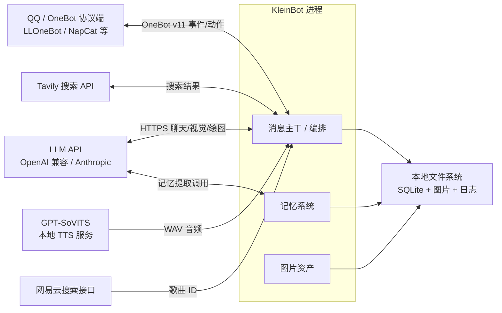
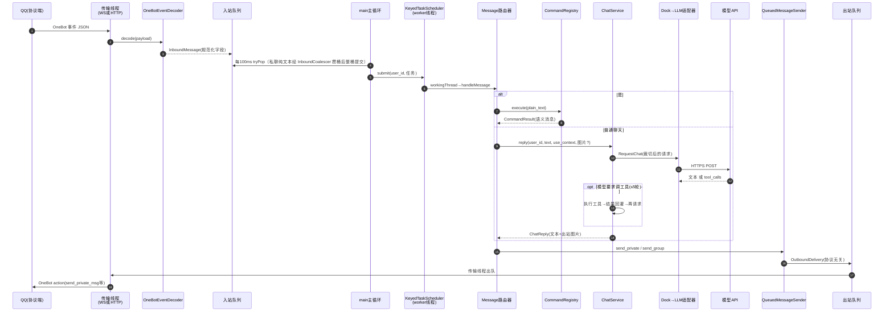

# 卷 01 · 项目全景：KleinBot 是什么、由什么组成

> 源码基准：`src/` 全目录。本章不深入任何函数，仅建立整体认知框架——后续各卷均是对其中某一局部的详细展开。

## 1. 项目定位

KleinBot（下称 Klein）是一个**使用 C++17 开发、部署于自有计算机或服务器的 QQ 聊天机器人**。它自身不登录 QQ，而是通过 OneBot 协议与真正的 QQ 客户端程序（协议端，如 LLOneBot）通信；它收到 QQ 消息后调用大语言模型（LLM）生成回复，模型在回复过程中可以自主调用工具（搜索网页、看图、画图、设提醒等），Klein 负责执行这些工具并把结果回灌给模型，直到模型给出最终回答，再经协议端发回 QQ。

从职责划分看：协议端承担消息的收发，LLM 服务承担推理，KleinBot 本体负责将二者衔接，并管理记忆、权限与资源边界。

## 2. 外部系统依赖（6 类）



| 外部系统 | Klein 怎么用它 | 不工作时会怎样 |
| --- | --- | --- |
| OneBot 协议端 | 唯一的消息出入口。三种连接方式三选一（服务器模式 / 客户端模式 / HTTP） | 收不到也发不出消息；WS 模式会自动重连 |
| LLM API | 聊天、看图（vision）、画图（image）、后台记忆提取，共四类调用 | 该功能失败并给用户返回系统提示，进程不崩 |
| Tavily | `klein_web_search` 工具背后的搜索引擎 | 搜索工具报错文本回灌给模型 |
| GPT-SoVITS | 文本转语音（自部署的 TTS HTTP 服务） | 回退为文本错误提示 |
| 网易云接口 | `#搜歌` 命令查歌 | 返回"未搜索到歌曲" |
| 本地文件系统 | SQLite（一个库存对话/记忆/提醒/图片元数据）、图片目录、日志目录、人格文件、模型注册表 | 数据库打不开时逐模块降级为纯内存模式（各 Store 方法变 no-op） |

**Klein 不承担的职责**：QQ 登录与风控（协议端职责）、外部服务的可用性保证、密钥的生成与轮换。

## 3. 源码目录地图（32 个模块 + 入口）

生产目录外另有 `tmp/affect_mvp`（本地实验，未入库）：2026-09-20 新增的独立 Python 情感策略实验，运行合成数据、训练／反馈闭环及 Fake 执行。它不进入以下 C++ 模块计数、CMake、发布包或机器人运行依赖。仓库根 `scripts/affect_eval/export.py`（2026-11-01，R0.4）是 affect 三表的只读导出/指标脚本，标准库实现、不进构建，仅其回归测试注册进 CTest（卷21 §3.3）。

```
src/
├── main.cpp                  ★ 组合根：装配一切、启动线程、主循环（详见卷03）
│
│ —— 入站链路（消息怎么进来）——
├── Network/                  三种传输实现 + WS 会话 + 鉴权/签名 + curl 取消（卷05）
├── Protocol/OneBot/          OneBot JSON ↔ 内部消息结构 的编解码器（卷05）
├── MessageQueue/             入站/出站两个线程安全队列（卷06）
│
│ —— 调度与路由（消息怎么被分发）——
├── utils/KeyedTaskScheduler  按用户分片的线程池：同人串行、异人并行（卷07）
├── utils/Live.h              活值模板：互斥量保护的不可变配置快照，使用方只读、每次操作取一次（ADR-023，卷04/22）
├── Message/                  Message 路由器：命令 or 聊天；含 Person 会话结构（卷07、12）
│
│ —— 业务三层：Command → Action ← Tool（卷08、09）
├── Command/                  13 个显式 #命令 适配器 + 注册表
├── Action/                   可复用业务动作（提醒三件套、搜索、抓网页、管理控制…）
├── Tool/                     模型可调用工具（ActionTool 适配 + 图片工具 + 时间 + 召回 + 群聊离场 leave_topic + 用语音说 send_voice）
│
│ —— 编排与模型（回复怎么生成）——
├── ChatService/              Agent 循环核心：一次 reply() 的全部逻辑（卷10）
├── Application/              编排层的纯函数小件：入站连发合并（InboundCoalescer）、图片路由、召回/摘要注入、滚动摘要合并（ContextDigest）、工具循环与规则组装、决策点小件（ToolPolicyFilter/ReplyConstraints/AtReplySituation/ShadowDecision）、会话轮定案 EngagementTurn（L3 护栏：只认工具调用里的话）（卷10/23）
├── Affect/                   决策层：BehaviorPlan、SituationCard、DecisionPolicy（Baseline/Judge）、决策/执行/反馈记录与 DecisionStore（R1 影子/生效，默认 baseline）、模块配置 AffectOptions、在场账本 GroupPresence（发言份额与退场，ADR-024）、事实卡 FactsCard（现场事实 + 部署者 `source/facts.md`，经历层 E0，ADR-026）
├── ModelApiCaller/           Dock（模型路由）+ OpenAI/Anthropic 适配器 + TTS + SD（卷11）
├── ModelRegistry/            ModelsName.json 的加载与查找（卷11）
├── Port/                     全部跨层 DTO：ChatRequest/ChatResponse/InboundMessage/…（卷06）
│
│ —— 状态与存储（记住的东西放哪）——
├── UserSession/              每用户会话状态 + 上下文裁切算法（卷12）
├── Persistence/              ConversationStore / ReminderStore（SQLite 适配器，卷13）
├── Memory/                   长期记忆：批处理、提取、n-gram 召回、结构化事实（卷14）
├── Perception/               观察通道：白名单群计数 + 话题热度（T7）+ 话题会话 EngagementService（意志层 v2：激活/轮次/2h 保留）
│                             + 群聊瞥视 GlanceService/GlanceOptions（R1.1：群图异步瞥视成一行描述写回群缓冲，卷23）
│                             + 群聊材料行格式 GroupLineFormat（一行的唯一格式化点，画出回复的是谁的哪句，ADR-026，卷23）
├── Reminder/                 提醒调度 + 时间工具函数（卷15）
├── Asset/                    图片资产库（卷16）
│
│ —— 附加能力 ——
├── WebSearch/                Tavily Provider（卷17）
├── WebFetch/                 HTML 正文提取器（卷17）
├── WebUI/                    Web 配置面板（cpp-httplib 后端 + panel.html 前端，卷04）
├── Push/                     推送门：外部投递 HTTP 入口 + 校验/润色/投递接缝（契约草案；2026-10-25 起运行时搁置，technical-design §16.4）
├── Bootstrap/                Schema 配置 → 运行时设置 的映射 + 配置快照 + 规则表 + 活值集合 + 唯一的重载入口（卷04，ADR-023）
├── Configuration/            配置加载/校验/写回/首次引导（卷04）
│
│ —— 支撑 ——
├── Log/                      异步文件日志单例（卷18）
├── ComputerStatus/           本机 IP 查询（管理员命令用，卷18）
├── Version/                  --version 输出（卷18）
├── JsonParse/                遗留的 JSON 递归查找工具（卷18）
├── submodules/CloudMusicID/  网易云搜歌（卷18）
└── Library/(仓库根)          vendored 依赖：nlohmann/json、最小 Boost.Asio/Beast、httplib
```

## 4. 消息处理主流程（总览）

下图是全项目的主干，后续各卷均是对其中某一段的展开：



以下三项关键设计贯穿全项目，后续各卷均会涉及：

1. **协议只存在于边缘**。队列里流动的永远是协议无关的内部结构（`InboundMessage` / `OutboundDelivery`），OneBot JSON 的编解码发生在传输层最外圈。换协议（如将来的 Milky）只改边缘，不动核心。
2. **同一用户串行、不同用户并行**。消息按 `user_id` 分片进 `KeyedTaskScheduler`，保证同一人的消息有序处理，不同人互不阻塞。
3. **写库和记忆都在后台**。聊天回复路径上只做"写穿 SQLite 对话表"这一件事；记忆提取、提醒触发都是独立线程异步做。

## 5. 运行时的线程全景

| 线程 | 数量 | 启动方 | 职责 | 停止方式 |
| --- | --- | --- | --- | --- |
| 主线程 | 1 | OS | 轮询入站队列、提交任务、监测信号 | 信号 → `running=false` |
| 消息 worker | 初始=CPU核数(或配置)，最大4倍 | `KeyedTaskScheduler` 构造 | 执行每条消息的完整处理 | `shutdown()` 拒新任务、等存量完成 |
| 传输线程 | 1（三选一） | `main` | 收事件/发动作；HTTP 模式内部再开 1 个 API sender 子线程 | `running=false` + socket/curl 取消 |
| 定时线程 | 1 | `main` | 每 3 秒：08:00 早安 + 到期提醒渲染送达 | `running=false` |
| 记忆 worker | 0 或 1 | `MemoryService` 构造（enabled 且库可用） | 批次/空闲阈值到了就提取记忆 | `MemoryService::shutdown()` |
| 瞥视 worker | 0 或 1 | `GlanceService::start()`（glance.enabled 且视觉模型就绪且观察通道开启） | 群图异步瞥视：预算/去重后调视觉模型，一行描述写回群缓冲（R1.1） | `GlanceService::shutdown()` 丢弃 pending |
| 面板线程 | 0 或 1 | `main`（webui.enabled） | cpp-httplib 服务器 | 看门狗观察到 running=false 后 `stop()` |
| 推送门线程 | 0（2026-10-25 起固定为 0） | 当前离线：`main.cpp` 接线 `#if 0`；恢复后为 `main`（push.enabled） | cpp-httplib 服务器：外部投递入口（模块保留） | 当前无；恢复后看门狗观察到 running=false 后 `stop()` |
| 日志线程 | 1 | `Log` 单例首次使用 | 消费日志队列写文件 | `Log::shutdown()` 排空队列 |

退出顺序（严格）：`running=false` → 消息执行器 → 瞥视服务 → 记忆服务 → 定时线程 → 传输线程 → 面板线程 → 推送门线程（2026-10-25 起搁置，实际跳过）→ 日志。第二次 Ctrl+C 直接 `_Exit` 强杀。

## 6. 三类"记忆"概念的严格区分

这是初学者最容易混淆的概念，全项目反复依赖此区分：

| | 存在哪 | 活多久 | 谁写 | 谁读 |
| --- | --- | --- | --- | --- |
| **上下文窗口** | 内存（`Person.user_chatHistory`），发模型前裁切 | 受 `message_survival_seconds`（默认 1 小时）和 32K/16K token 水位限制（被移出的部分压成内存滚动摘要）；`#重置对话` 立即清空 | `ChatService.reply()` 写穿 | 每次构建请求时 |
| **原始历史** | SQLite `conversations` 表 | 直到 `#重置上下文`；`#重置对话` 只前移"上下文起点"、行保留 | 同上（write-through 同一笔） | 召回检索、记忆证据回取 |
| **长期记忆** | SQLite `memories` + 结构化事实三表 | 同上；可被模型提取更新/软删除 | 后台 `MemoryService` 异步 | `recall_conversation` 工具 + 自动召回 |

概括而言：**上下文是"模型本次请求可见的内容"，原始历史是"完整的持久化事实记录"，长期记忆是"事实记录的结构化摘要"。**

## 7. 模块依赖方向红线

项目通过自动化测试（`tests/architecture_dependency_test.py`）强制约束依赖方向，开发前必须了解：

- **配置读取只允许出现在** `main`（组合根）和 `src/Configuration/` + `src/Bootstrap/`。业务模块只接收自己的 Options 结构体，看不到 JSON。
- **`src/Bootstrap/` 只允许** `src/main.cpp`、`Bootstrap/` 自身与面板 `WebUI/` 包含（2026-11-15 起机检，ADR-023）：规则表、活值集合、重载入口都不给业务模块看；业务模块要实时配置时只持 `const Live<T> &`（`utils/Live.h`）。
- **SQL 只允许出现在** `Persistence/`、`Memory/MemoryStore`、`Asset/`、`Reminder`、`Perception/PerceptionStore`（各自的 Store）。
- **OneBot/CQ 概念只允许出现在** `Network/`、`Protocol/`。业务层发的是 `TextMessage`/`ImageMessage` 等语义消息。
- **供应商 HTTP 协议只允许出现在** `ModelApiCaller/` 的各 Standard 适配器内。业务层只认 `ChatRequest/ChatResponse`。
- 依赖注入靠构造函数引用；"拥有者持值、使用者持引用"；调用期数据（user_id 等）放 `ToolContext/CommandContext`，不伪装成构造依赖。

## 8. 本章文件清单

| 文件 | 角色 |
| --- | --- |
| `src/main.cpp` | 组合根与线程编排（[卷03](03-启动与生命周期.md) 逐行展开） |
| `CMakeLists.txt`、`cmake/*`、`CMakePresets.json` | 构建（[卷02](02-构建体系与依赖.md)） |
| `AGENTS.md` | 仓库协作规范（本套文档遵守它） |
| `README.md` / `README.en-US.md` | 用户文档 |
| `docs/technical-design.md` | 正式设计文档（概览层） |
| `config.example.json` | 无密钥配置模板（[卷04](04-配置系统.md) 提供全字段参考手册） |

### 8.1 R1 决策层新增文件（2026-11-01，分支 `feat/v2.4.2-r1-judge`，提交 `85a20fc`（R1.a）/ `29da89b`（R1.b）/ `0ddff1e`（R1.c））

| 文件 | 角色 |
| --- | --- |
| `src/Affect/SituationCard.h/.cpp` | 决策输入：只含派生字段，`toJson()` 写进 `state_json`；`plan_summary` 为对话计划预留 |
| `src/Affect/DecisionPolicy.h` | 策略接口 + `Decision{plan, fallbackReason, latencyMs}` 结果 |
| `src/Affect/BaselinePolicy.h/.cpp` | 基线策略（复现既有口径）+ `isBaselinePolicy` |
| `src/Affect/JudgePolicy.h/.cpp` | judge 策略：动作空间、预算、60 秒超时常量、JSON 解析与回退 |
| `src/Application/ToolPolicyFilter.h` | 按计划收窄工具名单的唯一纯函数 |
| `src/Application/ReplyConstraints.h` | 计划 → 表达约束；分寸注记唯一格式化点 |
| `src/Application/AtReplySituation.h` | @ 路径情境卡装配（纯函数） |
| `src/Application/InboundCoalescer.h/.cpp` | R2.2 私聊入站连发合并（纯逻辑，主线程独用；N 进 N 出） |
| `src/Application/ContextDigest.h/.cpp` | 滚动摘要合并 `mergeDigest`（私聊上下文与群会话轮共用，2026-11-08） |
| `src/Application/ShadowDecision.h` | @ 路径影子期记录时序（预分配 decision_id，方案 A） |
| `tests/DecisionPolicyTests.cpp` | SituationCard / Baseline / Judge 合同 |
| `tests/ToolPolicyFilterTests.cpp` | 工具收窄 |
| `tests/AtReplySituationTests.cpp` | @ 情境卡 |
| `tests/ShadowDecisionTests.cpp` | 方案 A 时序 |
| `tests/ReplyConstraintsTests.cpp` | 约束映射、注记格式、注入护栏 |

既有文件的 R1 改动：`DecisionRecord`（`makePolicyDecision`）、`DecisionRecorder`（`newDecisionId`）、`EngagementService`、`Message`、`ChatService`（`toolNames`、`buildOnceWith` 超时、`reply` 约束）、`Port/ChatRequest.h`（`timeout_ms`）、两个模型适配器与 `CurlRequestControl`（超时透传）、`utils/LocalDate`（`currentLocalHour`）、配置链（`affect.policy/enforce/judge_model`）、`main.cpp`、`panel.html`、`scripts/affect_eval/export.py`（孤儿执行行计数）。

### 8.2 会话轮定案护栏新增文件（2026-11-14，提交 `b2c6cee`，已合入 `2.4.2`）

| 文件 | 角色 |
| --- | --- |
| `src/Application/EngagementTurn.h/.cpp` | 会话轮定案的唯一判定点：模型这一轮的输出里哪些算她说出口的话（只认 `group_say`/`leave_topic`，不调工具直接写出的文字按沉默处理；ADR-017 L3 护栏）。`EngagementTurn` 类型由 `EngagementService.h` 迁来，`EngagementService::parseTurn` 删除 |
| `tests/EngagementTurnTests.cpp` | 定案判定（原 `EngagementTests` 里的解析用例迁入并改为新规则） |

既有文件的改动：`EngagementService.h/.cpp`（改调 `parseEngagementTurn`，裸文本记一条只含长度的 WARNING）、`tests/EngagementTests.cpp`（解析用例迁出，新增会话轮用例）、`tests/CMakeLists.txt`（登记新测试文件）。

### 8.3 配置实时生效 L0 新增文件（2026-11-15，分支 `feat/v2.4.2-live-config`，已提交，未合入 `2.4.2`，ADR-023）

| 文件 | 角色 |
| --- | --- |
| `src/utils/Live.h` | 活值模板 `Live<T>`（仅头文件）：互斥量保护一个 `shared_ptr<const T>`；不可拷贝，没有 `->`、解引用与隐式转换，不带回调，`set` 是非 const 成员 |
| `src/Bootstrap/ConfigRules.h/.cpp` | 规则表：每个配置键一行（差异路径、生效方式、`field<成员指针链>`），档位的唯一来源；生效方式只能由 `restart()`、`applies(应用函数)`、过渡期的 `notYet(原档位)` 产生（`notYet` 于 L2.e 删除，现只剩前两个） |
| `src/Bootstrap/LiveSettings.h/.cpp` | 组合根持有的活值集合：chat、models、voice、memory、webSearch、webFetch、dock、glance、message 各一个 `Live<T>`，从启动时的 `RuntimeSettings` 构造 |
| `src/Bootstrap/ConfigReloader.h/.cpp` | 唯一的“重载并应用”入口（`#刷新配置文件` 与面板保存共用，串行化）与反馈文案 `summarizeReload` |
| `tests/LiveTests.cpp` | 活值模板用例 + 接口形态的编译期断言 |
| `tests/ConfigRulesTests.cpp` | 规则表：行数（L0 时为 90 行，含后来删除的 `chat.top_p`；现状见[卷04 §5 规则表与影响等级](04-配置系统.md#规则表与影响等级configrulescpp-全表)）、路径不重复、工厂语义、`field` 比较 |
| `tests/ConfigReloaderTests.cpp` | 重载入口：失败不应用（截断的 JSON；能解析但带 Fatal/Error 诊断的候选，L0.d）、产品表不应用且活值不变、带应用函数的行只调一次、并发串行 |

既有文件的改动：`src/Bootstrap/ConfigDiff.cpp`（`compareConfig` 改为遍历规则表，90 个手写比较删除；对外声明不变）、`src/main.cpp`（构造 `LiveSettings` 与 `ConfigReloader`，刷新回调与面板改用它；`summarizeReload` 移出）、`src/WebUI/ConfigPanelServer.h/.cpp`（注入 `ConfigReloader`，store 改为 const 引用）、`tests/ConfigPanelServerTests.cpp`（夹具注入重载入口，新增用例）、`tests/architecture_dependency_test.py`（新增 Bootstrap 规则）、`tests/CMakeLists.txt`（登记 3 个新测试文件）。

### 8.4 配置实时生效 L1.a（chat 组）改动的文件（2026-11-15，同分支，已提交为 `8b4d174`）

没有新增源文件或测试文件。

| 文件 | 改动 |
| --- | --- |
| `src/Bootstrap/ConfigRules.cpp` | 新增应用函数 `applyChat`；chat 组 6 行改为 `applies(applyChat)` |
| `src/UserSession/UserSessionService.h/.cpp` | 改持 `const Live<ChatOptions> &`，操作开头取快照；新增 `resolveModelName`（用户模型的唯一解析点） |
| `src/ChatService/ChatService.h/.cpp` | 改持 `const Live<ChatOptions> &`；`buildOnceWith` 回退默认模型时取快照 |
| `src/Message/Person.hpp` | `current_model` 改为 `std::optional<std::string>`；删除从未读取的三个超参字段 |
| `src/main.cpp` | 两个服务接 `liveSettings.chat`；网页摘录模型与 `max_message_tokens` 改为使用时现取 |
| `README.md` | 说明哪些配置改了即生效 |
| `tests/StorageIntegrationTests.cpp`、`ContextDigestTests.cpp`、`InboundCoalescerTests.cpp` | 夹具改持活值；新增 USS 与 ChatService 用例 |
| `tests/ConfigReloaderTests.cpp`、`ConfigReloadTests.cpp`、`ConfigRulesTests.cpp`、`ConfigPanelServerTests.cpp` | 新增端到端、chat 档位与 `applies` 行用例，产品规则表用例与面板档位断言同步改 |

### 8.5 配置实时生效 L1.b–L1.f 改动的文件（2026-11-15，同分支，已提交为 `4d34af5`、`dfa616f`、`d58bf35`、`59cdef6`、`9eddf29`）

新增 2 个文件：

| 文件 | 角色 |
| --- | --- |
| `src/Affect/AffectOptions.h` | 决策层模块自有配置 `AffectOptions{enabled, policy, enforce, judgeModel}`（L1.f，由 `Bootstrap/RuntimeSettings.h` 的 `AffectSettings` 迁出并改名） |
| `tests/VoiceTests.cpp` | 语音合成每次取活值快照（L1.c，两个本地假 TTS 服务对比请求地址与参数） |

既有文件的改动：

| 文件 | 改动 |
| --- | --- |
| `src/Bootstrap/LiveSettings.h/.cpp` | models 拆成 `drawingModel`/`visionModel`/`workerModel` 三个 `Live<ModelEndpointOptions>`（L1.b）；新增语音总开关 `globalVoice`（`Live<bool>`，L1.c）与 `affect`（`Live<AffectOptions>`，L1.f） |
| `src/Bootstrap/ConfigRules.cpp` | 新增 12 个应用函数，39 行改为 `applies(...)`；混合结构里没接通的字段保持运行值 |
| `src/Bootstrap/RuntimeSettings.h` | `AffectSettings` 移出，改用 `AffectOptions` |
| `src/ModelApiCaller/ModelEndpointResolver.h` | 新增活值版 `registryEndpoint(const Live<ModelEndpointOptions> &, registry)`（并禁止传临时活值）；按值版只剩 judge 在用（L1.b） |
| `src/ModelApiCaller/Voice/Voice.h/.cpp` | 改持 `const Live<VoiceOptions> &`，每次合成开头取快照（L1.c） |
| `src/Action/VoiceModeAction.h`、`AdminControlAction.h` | 语音总开关改为 `const Live<bool> &`（只读）与 `Live<bool> &`（`#激活语音`/`#冻结语音` 写）（L1.c） |
| `src/Memory/MemoryService.h/.cpp`、`MemoryExtractor.h/.cpp` | 改持 `const Live<MemoryOptions> &`；后台线程每轮开头在队列锁外取快照；提取器的模型名改为每次提取时传入（L1.d） |
| `src/ModelApiCaller/Dock.hpp`、`OpenAIStandard/*`、`AnthropicStandard/*` | `Dock` 与两个适配器改持 `const Live<DockOptions> &`，每次请求开头取一次代理（L1.e） |
| `src/WebSearch/TavilySearchProvider.h/.cpp`、`src/Action/WebSearchAction.h/.cpp`、`WebFetchAction.h/.cpp` | 改持各自的活值，每次搜索/执行开头取快照并往下传（L1.e） |
| `src/Perception/GlanceService.h/.cpp` | 改持 `const Live<GlanceOptions> &`，每张图开头取预算（L1.f） |
| `src/Perception/EngagementService.h/.cpp` | 构造参数新增 `const Live<AffectOptions> &`，删除 `setEnforce` 与成员 `enforce`，每个会话轮开头取一次（L1.f） |
| `src/Message/Message.h/.cpp` | `MessageOptions`、语音总开关、`AffectOptions` 都改持活值（构造参数里的 `bool enforcePlan` 删除），过滤、投递、决策各取一次（L1.c、L1.f） |
| `src/main.cpp` | 各模块接 `liveSettings` 的成员；judge 改用单独的启动值 worker 端点（L2.c 删除，改为每次决策解析）；`workingThread` 只调一次 `messageFilter` |
| `README.md` | “改了即生效”的清单补齐五组 |
| `tests/CMakeLists.txt` 与 17 个既有测试文件 | 登记 `VoiceTests.cpp`；夹具改持活值（见[卷21](21-测试体系.md)） |

### 8.6 配置实时生效 L2.a–L2.e 改动的文件（2026-11-15，同分支，每步一个提交）

新增 1 个文件：`src/Affect/SwitchingPolicy.h`（仅头文件，始终存在的策略外壳：`affect.enabled` 为真且 `policy == "judge"` 时转给 `JudgePolicy`，否则转给 `BaselinePolicy`）。没有新增测试文件。

| 步 | 改动的文件 |
| --- | --- |
| L2.a 工具可用性 | `Tool/Tool.h`、`Tool/ActionTool.h`、`Action/Action.h`（虚函数 `available()`）；`Tool/ToolRegistry.h`（列名与 schema 只给可用的，新增 `registeredNames()`）；`Application/ToolLoop.cpp`（不可用的工具按未开放拒绝）、`ToolGuidance.cpp`；`Action/WebSearchAction.h`、`WebFetchAction.h`；`ChatService.cpp`；`EngagementService.h/.cpp`（每轮按可用性筛 `offeredToolNames`）；`main.cpp`（联网工具始终构造并注册） |
| L2.b 记忆与瞥视开关 | `Memory/MemoryService.h/.cpp`（线程常驻，开关在入队与召回处读）；`Perception/GlanceService.h/.cpp`（开关与视觉就绪在入队时判断，新 seam `setVisionReady`）；`main.cpp`（视觉 seam 无条件设置） |
| L2.c 决策记录与策略 | `Affect/DecisionStore.h/.cpp`（构造不碰库，`open()` 延迟打开、只试一次）、`DecisionRecorder.h/.cpp`（持 `const Live<AffectOptions> &`）、`DecisionPolicy.h`（`resolve`）、`SwitchingPolicy.h`（新）、`JudgePolicy.h/.cpp`（`TargetResolver`）、`BaselinePolicy.cpp`、`DecisionRecord.cpp`、`AffectOptions.h`；`ModelApiCaller/ModelEndpointResolver.h`（`resolveLabeledEndpoint`）；`Message.h/.cpp`、`EngagementService.h/.cpp`（每条消息/每轮 `resolve` 一次）；`Action/RecordFeedbackAction.h`；`main.cpp` |
| L2.d 机器人名字与别名 | `Bootstrap/LiveSettings.h/.cpp`（新增 `Live<BotIdentity> bot`）；`UserSessionService.h/.cpp`、`GroupContextService.h/.cpp`、`EngagementService.h/.cpp` 改持活值；`panel.html`；`main.cpp` |
| L2.e 删除 `chat.top_p` | `Configuration/SchemaConfig.h`、`ConfigLoader.cpp`、`ConfigTemplate.cpp`；`ChatService/ChatOptions.h`；`Bootstrap/RuntimeSettings.cpp`、`ConfigRules.h/.cpp`；`config.example.json`；`panel.html`；`README.md` |
| L2.e 规则表如实 | `Bootstrap/ConfigRules.h/.cpp`（18 行改 `restart()`，删除 `notYet`）、`ConfigReloader.h/.cpp`（删除 `notWired` 与“尚未接通”文案）、`ConfigDiff.h`（注明 `Rebuild` 不再产生） |
| L2.e 面板说明由规则表推出 | `WebUI/ConfigPanelServer.h/.cpp`（`GET /api/config/effects`）、`panel.html`；`README.md` |

各步改动的测试见[卷21](21-测试体系.md)。

### 8.7 在场账本（ADR-024）新增与改动的文件（2026-11-16，分支 `fix/v2.4.2-group-presence`，基于 `2.4.2@f726c91`，未提交）

| 文件 | 角色 |
| --- | --- |
| `src/Affect/GroupPresence.h/.cpp` | 在场账本：发言份额（她主动说的话不超过其他人平均每人的条数，10 分钟窗口）与退场（被请走后 30 分钟）；纯逻辑 |
| `src/Application/SpokenForm.h` | 送达形式：语音合成失败退回文字发原话（ADR-025 起删除，规则移入 `Tool/SendVoiceTool.h`） |
| `src/Tool/LeaveTopicTool.h` | @ 回复路径的 `leave_topic`：只在群聊开放，接到 `EngagementService::leaveTopic` |
| `tests/GroupPresenceTests.cpp` | 账本（含事发节奏回放） |

既有文件的改动：`Perception/EngagementService.h/.cpp`（持每群账本；没人叫她的轮次只在份额允许时提交；会话轮定案处按应答/主动记账；`onSelfActivity` 换成 `onAtAnswered`；新增 `leaveTopic` 与唯一实现 `leaveLocked`；离场动词带 `step_back`）、`Perception/GroupContextService.h/.cpp`（`recordOutbound` 只管入库；新增 `onAtAnswered` 转发）、`Application/EngagementTurn.h/.cpp`（解析 `step_back`）、`Message/Message.cpp`（每轮确有出站时报一次应答；送达经 `chooseSpokenForm`；情境卡工具名按群聊场合取）、`ChatService/ChatService.h/.cpp`（工具表按场合取，`toolNames()` 改为 `toolNamesIn`）、`Tool/Tool.h`（`offeredIn`）、`Tool/ToolContext.h`（`ToolVenue`、`venueOf`）、`Tool/ToolRegistry.h`（`namesIn`）、`Port/ToolNames.h`（`leave_topic` 与 `step_back` 常量）、`main.cpp`（注册并接线离场工具）；测试 `EngagementTests`、`EngagementTurnTests`、`VoiceTests`、`InboundCoalescerTests`（语音失败的期望改为原话）、`tests/CMakeLists.txt`。

### 8.8 语音由她决定（ADR-025）新增、删除与改动的文件（2026-11-16，分支 `feat/v2.4.2-voice-choice`，基于 `2.4.2@df33009`，未提交）

新增 `src/Tool/SendVoiceTool.h`（`send_voice`）。删除 `src/Action/VoiceModeAction.h`、`src/Command/VoiceSwitchCommand.h/.cpp`、`src/Application/SpokenForm.h`。改动：`ModelApiCaller/Voice/Voice.h/.cpp`（失败一律返回空串、检查 HTTP 状态、`reachable()` 探测缓存）、`Port/OutboundMessage.h`（`VoiceMessage.transcript`）、`Port/ToolNames.h`（`send_voice` 取代 `set_voice_mode`）、`Perception/GroupContextService.cpp`（语音入库存原话）、`Application/EngagementTurn.h/.cpp`（`send_voice` 定案为语音发言）、`Perception/EngagementService.cpp`（定案动词与经工具送达）、`Application/ToolGuidance.h/.cpp`（布局第 5 位换成 `send_voice`）、`Message/Message.h/.cpp`（删除语音分支、`textToVoice`、`Voice` 与语音总开关两个构造参数）、`Message/Person.hpp`、`UserSession/UserSessionService.h/.cpp`、`Command/HelpText.h`、`main.cpp`（`Voice` 提前到注册表之前构造，注册 `SendVoiceTool`，会话轮名单加 `send_voice`）、`README.md`、`README.en-US.md`；测试 `VoiceTests`、`EngagementTests`、`EngagementTurnTests`、`ToolGuidanceTests`、`ConfigReloaderTests`、`InboundCoalescerTests`、`CommandAdapterTests`。

### 8.9 经历层 E0：事实卡与回复关系（ADR-026）新增与改动的文件（2026-11-16，分支 `feat/v2.4.2-experience-e0`，基于 `2.4.2@4a39e80`，未提交）

| 文件 | 角色 |
| --- | --- |
| `src/Affect/FactsCard.h/.cpp` | 事实卡：`sceneFactsNote`（现场事实）、`deployerFactsSection`（部署者事实段）、`DeployerFacts`（现读 `source/facts.md`，4096 字节护栏）、`factsCardFor`（两条群聊路径共用的装配点） |
| `src/Perception/GroupLineFormat.h/.cpp` | 群聊材料一行的唯一格式化点：`formatGroupLine`、按 `messageId` 查的 `GroupReplyIndex`、引语 `replyQuoteOf`、时刻 `groupClock` |
| `tests/FactsCardTests.cpp` | 事实卡 |
| `tests/GroupLineFormatTests.cpp` | 行格式与回复关系 |

既有文件的改动：`Perception/EngagementService.h/.cpp`（`setDeployerFacts`；契约以部署者事实段开头、材料之后加现场事实一行；五处行格式改用 `formatGroupLine`，删除 `formatClock`）、`Perception/GroupContextService.h/.cpp`（直灌块与摘要输入改用 `formatGroupLine`，索引按全部缓冲构建，删除 `formatClock` 与“（引用回复）”）、`Message/Message.h/.cpp`（构造参数 `deployerFacts`；群聊 @ 回复的部署者事实段接在收敛契约之后，现场事实并入尾注）、`Affect/JudgePolicy.h/.cpp`（`setFactsSource`；`userPrompt` 两个默认空参数）、`utils/LocalDate.h/.cpp`（公开 `localTimeOf`）、`main.cpp`（`DeployerFacts` 栈对象与三处接线）、`README.md`；测试 `DecisionPolicyTests`、`EngagementTests`、`InboundCoalescerTests`（夹具加 `facts` 参数）、`GroupContextTests`、`tests/CMakeLists.txt`。
