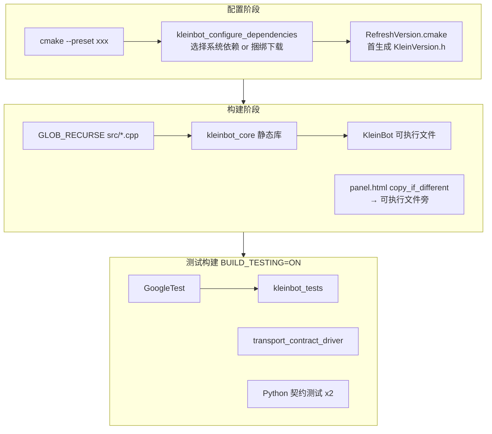

# 卷 02 · 构建体系与依赖：从源码到可执行文件

> 源码基准：`CMakeLists.txt`（184 行）、`cmake/Dependencies.cmake`、`cmake/RefreshVersion.cmake`、`cmake/KleinVersion.h.in`、`CMakePresets.json`、`tests/CMakeLists.txt`。

## 1. 构建全景



## 2. 顶层 CMakeLists.txt 逐段解读

### 2.1 版本与选项（1–24 行）

```cmake
project(KleinBot VERSION 2.4.0 LANGUAGES C CXX)
set(KLEINBOT_VERSION_SUFFIX "_betaVersion" CACHE STRING "版本渠道后缀，正式版置空")
```

- **版本号唯一来源**是 `project()` 里的 `2.4.0`。发布正式版时用 `-DKLEINBOT_VERSION_SUFFIX=""` 或改默认值，**不需要动源码**。
- 最终版本串形如 `v2.4.0_betaVersion`，宏名 `KLEINBOT_VERSION_STRING`。

三个 option：

| option | 默认值 | 含义 |
| --- | --- | --- |
| `DEBUG` | ON | Debug 构建（影响产物名 `KleinBot_debug`、`CMAKE_BUILD_TYPE=Debug`、`LOG_DEBUG` 宏是否生效） |
| `KLEINBOT_USE_BUNDLED_DEPS` | Windows=ON，Linux=OFF | 用下载/捆绑依赖还是系统 `find_package` |
| `KLEINBOT_STATIC_MINGW_RUNTIME` | ON | MinGW 下 `-static -static-libgcc -static-libstdc++`，Windows 产物零外部 DLL |

**MinGW 线程模型检查**（26–42 行）：编译一段 `std::thread` 探针程序，无法通过则直接 `FATAL_ERROR`——因为 KleinBot 大量使用 std::thread，win32 线程模型的 MinGW 会在链接阶段失败。该检查将编译中途才暴露的问题提前至 configure 阶段。

### 2.2 架构归一化（53–83 行）

目的：给版本头和产物命名一个统一的架构名。`CMAKE_SYSTEM_PROCESSOR` 在 MinGW 下常是 `AMD64`，交叉编译时可能为空，所以：

```
归一化规则：amd64/x86_64/x64 → x86_64；i[3-6]86/x86 → i686；
arm64/aarch64 → arm64；arm* → arm；空 → unknown（回退用编译器 -dumpmachine 前缀）
KLEINBOT_COMPILER = "${CMAKE_CXX_COMPILER_ID} ${CMAKE_CXX_COMPILER_VERSION}"（如 "GNU 13.2.0"）
```

### 2.3 源码收集与目标（85–129 行）

- `file(GLOB_RECURSE CORE_SRC CONFIGURE_DEPENDS src/*.cpp)` —— 全量收集后**剔除 `src/main.cpp`**（main 属于可执行文件，不属于库）。
- `CONFIGURE_DEPENDS`：每次构建时 CMake 检查是否有 .cpp 增删，有则自动重新 configure。**新增源文件不需要手动跑 cmake**。
- `include_directories` 里有一批历史遗留目录（`src/ConfigManager`、`src/TimingTast` 等已删除的目录也还列着）——只是加 include 路径，目录不存在也不报错，属于无害残留。
- 库目标：

```
kleinbot_core (STATIC)
  ├─ 接口链接: kleinbot_boost / kleinbot_curl / kleinbot_sqlite（三个 INTERFACE 目标，见 §3）
  ├─ C++17 (target_compile_features cxx_std_17 PUBLIC)
  ├─ 生成头目录: ${BINARY_DIR}/generated （KleinVersion.h 所在）
  └─ Windows 额外: _WIN32_WINNT=0x0A00 + ws2_32/iphlpapi/mswsock

KleinBot (可执行)
  ├─ PRIVATE 链接 kleinbot_core
  └─ OUTPUT_NAME = KleinBot 或 KleinBot_debug
```

### 2.4 版本头生成机制（131–153 行）

`cmake/RefreshVersion.cmake` 被两处调用：configure 时先执行一次（保证头存在），并挂成自定义目标 `kleinbot_refresh_version` 依赖在 `kleinbot_core` 上——**每次构建都重新查 git 短哈希**。

RefreshVersion.cmake 的行为：

1. `git rev-parse --short HEAD` → 7 位短哈希；无 git 环境为 `unknown`。
2. `git diff-index --quiet HEAD --` 失败（工作区有已跟踪文件的未提交修改）→ 追加 `-dirty`。未跟踪文件不算 dirty。
3. `configure_file(KleinVersion.h.in generated/KleinVersion.h @ONLY)`——**内容不变不落盘**，因此哈希没变时不会触发全库重编。

生成头里的宏（`cmake/KleinVersion.h.in`）：

| 宏 | 示例值 | 消费者 |
| --- | --- | --- |
| `KLEINBOT_VERSION_STRING` | `"v2.4.0_betaVersion"` | 启动日志、`#帮助` |
| `KLEINBOT_VERSION` | `"2.4.0"` | — |
| `KLEINBOT_GIT_HASH` | `"c769606"` / `"c769606-dirty"` / `"unknown"` | 启动日志、`#帮助` |
| `KLEINBOT_ARCH` / `KLEINBOT_BUILD_TYPE` / `KLEINBOT_COMPILER` | `x86_64` / `Release` / `GNU 13.2.0` | `--version` |

构建时间用的是 `__DATE__`/`__TIME__` 编译期宏（在 VersionInfo.cpp 里），故意不放进生成头——否则每次构建时间变化会触发该文件重编。

### 2.5 面板页面同步（167–174 行）

`panel.html` 是**运行时资源**（服务器按请求现读工作目录），所以构建时用 `copy_if_different` 同步到可执行文件目录。单独做成 `panel_page_sync` 目标并 `add_dependencies`，是因为 POST_BUILD 只在重链时触发——**纯前端改动不会重链**，独立目标保证增量构建也能同步。tests 侧有对等的 `panel_page_sync_tests` 目标。

### 2.6 测试开关（176–184 行）

`BUILD_TESTING` 开启时找 GoogleTest（`GTest::gtest_main`），找到才 `add_subdirectory(tests)`，否则 WARNING 跳过。

## 3. 依赖策略：`cmake/Dependencies.cmake`

入口函数 `kleleinbot_configure_dependencies()` 创建三个 **INTERFACE 目标**，把"依赖从哪来"完全藏在目标后面——**生产代码不知道也不需要知道依赖是系统的还是捆绑的**（这是仓库规则）。

### 3.1 双轨制

| | Linux（`KLEINBOT_USE_BUNDLED_DEPS=OFF`） | Windows MinGW（`=ON`） |
| --- | --- | --- |
| Boost.Asio/Beast | `find_package(Boost)` → `Boost::headers` | 仓库内 `Library/boost/kleinbot-boost-beast-asio-1.91.0.tar.xz` 解包，`BOOST_ERROR_CODE_HEADER_ONLY` |

两分支共同的 `kleinbot_boost` INTERFACE 定义（`cmake/Dependencies.cmake`）追加了 `BOOST_ASIO_DISABLE_ERROR_LOCATION` + 三个 `BOOST_ASIO_DISABLE_*_SOURCE_LOCATION`：Boost.System/Asio ≥1.86 默认把编译期源位置（含构建机完整路径）附进错误消息（`… [asio.misc:2 at /构建路径/xxx.hpp:90 in function '…']`），对部署排障无用且泄漏构建目录布局，全部禁用后错误消息只剩 `… [asio.misc:2]`（2026-09-19 真机反馈后经 wine 实证）。
| SQLite | `find_package(SQLite3)` → `SQLite::SQLite3` | FetchContent 下载 amalgamation `sqlite-amalgamation-3530300.zip`，编译 `sqlite3.c` 成静态库 |
| curl | `find_package(CURL)` → `CURL::libcurl` | FetchContent 下载 **curl 8.21.0** 源码自建静态库 |
| GoogleTest（测试） | `find_package(GTest QUIET)`，找不到且开了捆绑则下载 v1.17.0 | 同左 |

**哈希校验**（仓库规则"Pin 版本并校验哈希"的落实）：

- Boost 归档：`file(SHA256 ...)` 必须等于 `d19684cd…c6ebf`，否则 FATAL_ERROR。
- SQLite：`URL_HASH SHA3_256=d45c688a…5ab9`。
- curl：`URL_HASH SHA256=aa1b66a…c72e6`。

**捆绑 curl 的裁剪**（Windows 免 OpenSSL 的关键）：`HTTP_ONLY=ON`（去掉 FTP 等协议）、`CURL_USE_SCHANNEL=ON`（用 Windows 系统证书，不需要 CA bundle）、关掉 zlib/brotli/zstd/libidn2/LDAP。注意：这是**完整 curl 源码编译**，不是 vendored 进仓库。

### 3.2 双轨策略的设计依据

Linux 发行版的 Boost/curl/SQLite 与编译器 ABI 一致，使用系统包获取成本最低；Windows 上 MinGW 缺乏统一包管理器，且 **MinGW 与 MSVC 的 ABI 不互通、不能共享编译产物**（仓库规则），因此采用固定版本自行构建。仓库仅 vendor 了三个"单头/头文件库"级依赖：`Library/nlohmann/json.hpp`、最小 Boost 头归档、`Library/httplib/httplib.h`（cpp-httplib v0.53.1）。

## 4. CMakePresets.json（四个 preset）

| preset | 生成器 | binaryDir | DEBUG | BUILD_TESTING | 捆绑依赖 | build jobs |
| --- | --- | --- | --- | --- | --- | --- |
| `linux-debug` | Unix Makefiles | `build/linux-debug` | ON | ON | OFF | 2 |
| `linux-release` | Unix Makefiles | `build/linux-release` | OFF | OFF | OFF | 2 |
| `windows-mingw-debug` | MinGW Makefiles | `build/windows-mingw-debug` | ON | ON | ON | 2 |
| `windows-mingw-release` | MinGW Makefiles | `build/windows-mingw-release` | OFF | OFF | ON | 2 |

testPresets 只有 linux-debug 和 windows-mingw-debug（`outputOnFailure: true`）。

日常命令（与 AGENTS.md 一致）：

```bash
cmake --preset linux-debug && cmake --build --preset linux-debug && ctest --preset linux-debug
cmake --preset linux-release && cmake --build --preset linux-release
cmake --preset windows-mingw-release && cmake --build --preset windows-mingw-release
```

`CMakeUserPresets.json` 是可选本地覆盖，**不得提交**；CMakeLists 里禁止出现开发者机器绝对路径。

## 5. 产物与运行时布局

```
build/<preset>/
├── KleinBot[.exe]           （Debug 版叫 KleinBot_debug）
├── panel.html               （构建时从 src/WebUI/ 同步）
├── generated/KleinVersion.h （编译期产物）
└── （首次运行后还会出现：.config.json、logs/、source/）

运行时（工作目录=可执行文件启动目录）：
.config.json                主配置（点前缀隐藏；首次运行自动生成骨架）
source/
├── ModelsName.json         模型注册表（路径可配）
├── soul.md                 默认人格（路径硬编码）
├── facts.md                可选：部署者写的“关于她自己的事实”（路径硬编码，affect.enabled 时群聊现读，ADR-026）
├── .conversations.db       SQLite：对话+记忆+提醒+图片元数据（多 Store 共享一个文件）
└── image_assets/           图片文件（文件名=asset_id+扩展名）
logs/YYYY-M-DD.log          日志（只记 WARNING 及以上，INFO 仅控制台）
```

`build/.config.json`、数据库、日志、密钥**一律不得提交**（.gitignore 已覆盖 build/）。

## 6. 常见构建问题排查

| 症状 | 原因与处理 |
| --- | --- |
| configure 报 "POSIX thread support" | MinGW 是 win32 线程模型。更换为 MSYS2 UCRT64/MINGW64 的工具链（`gcc`/`g++`/`mingw32-make` 在 PATH） |
| Boost 校验失败 | `Library/boost/` 归档被改动；恢复原归档 |
| 新增 .cpp 未参与编译 | 无需手动重新 configure，`CONFIGURE_DEPENDS` 会自动发现；若构建系统状态异常，重新运行 preset 即可 |
| 修改 panel.html 不生效 | 面板按请求现读工作目录文件，刷新浏览器即可；确认构建同步目标已执行（重链或独立目标） |
| Linux 找不到 Boost/curl/SQLite | 安装对应开发包（如 `libboost-dev libcurl4-openssl-dev libsqlite3-dev`），或临时启用 `-DKLEINBOT_USE_BUNDLED_DEPS=ON` |
| 测试未被构建 | 检查 preset 是否 `BUILD_TESTING=ON` 且 GTest 可用 |

## 7. 本章文件清单

| 文件 | 内容 |
| --- | --- |
| `CMakeLists.txt` | 全部构建逻辑：选项、架构归一、GLOB、目标、版本刷新、面板同步、测试开关 |
| `cmake/Dependencies.cmake` | 三依赖 INTERFACE 目标 + 双轨获取 + 哈希校验 + curl 裁剪 + GTest |
| `cmake/RefreshVersion.cmake` | git 短哈希/dirty 检测 + configure_file 生成版本头 |
| `cmake/KleinVersion.h.in` | 版本宏模板（6 个宏） |
| `CMakePresets.json` | 4 configure + 4 build + 2 test preset |
| `tests/CMakeLists.txt` | 测试目标与 Python 契约测试注册（详见[卷21](21-测试体系.md)） |
