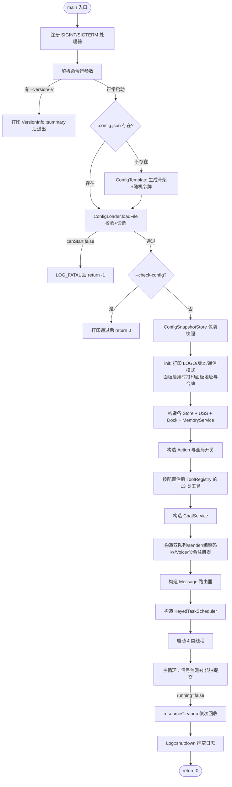

# 卷 03 · 启动与生命周期：main() 逐行、装配、线程与退出

> 源码基准：`src/main.cpp`（510 行）。`main()` 是全项目唯一的"组合根"——所有长生命周期对象在此创建并完成相互装配，其余模块仅持有引用。本章按执行顺序逐步走读。

## 1. 进程启动时序总图



## 2. 信号处理（main.cpp:67–74, 244–245）

```cpp
volatile std::sig_atomic_t receivedSignal = 0;
void signalHandler(int signal) {
    if (receivedSignal != 0) std::_Exit(128 + signal);  // 第二次信号：立即强杀
    receivedSignal = signal;
}
```

- 信号处理器只做一件安全的事：写标志变量（信号处理器里不能加锁/分配内存，`sig_atomic_t` 是唯一安全类型）。
- **第一次** Ctrl+C：走优雅退出流程。
- **清理还没完成时第二次** Ctrl+C：`std::_Exit(128+signal)` 立即终止——放弃未完成的 SQLite 写入和日志刷新，换取"用户明确连续中断时必须马上死"。退出码沿用 Unix 惯例（SIGINT=130、SIGTERM=143）。
- `running` 是 `std::atomic<bool>`，被全部线程共享；主循环发现 `receivedSignal != 0` 后 `running=false`，各线程各自观察到并退出。

## 3. 命令行参数（250–267）

| 参数 | 行为 |
| --- | --- |
| `--version` / `-V` | 打印 `VersionInfo::summary()`（版本、git 哈希、构建时间/类型、编译器、libc、架构）后 `return 0`，不做任何初始化 |
| `--check-config` | 配置加载并校验通过后打印"配置校验通过"并退出（配合 `--config` 用于部署前检查） |
| `--config <path>` | 指定配置文件路径，默认 `.config.json`（相对工作目录，点前缀隐藏） |
| 其他 | `未知参数` 报错 `return -1` |

## 4. 首次引导（270–276）

`ConfigTemplate::createIfMissing(configPath, bootstrapToken)`：文件不存在时生成内嵌骨架（详见[卷04 §7](04-配置系统.md#7-首次引导configtemplate)），打印 "首次运行：已生成默认配置文件 …" 与占位骨架补全提示。**文件已存在（哪怕损坏）一律不覆盖**。

骨架是"能启动但没接线"的合法配置（客户端模式 WS 空监听、占位模型名），用户在面板补全后重启。**Web 面板地址与访问令牌在每次启动时打印**（2026-09-19 项目规则；配置加载后、面板启用且令牌非空时输出，首跑与日常启动同一处打印，找回令牌不必翻配置文件）——面板地址形如 `http://127.0.0.1:55346/`（55346 = KLEIN 九宫格映射：K=5,L=5,E=3,I=4,N=6），令牌为随机 32 位十六进制。

## 5. 配置加载与快照（278–300）

```cpp
ConfigLoader configLoader;
ConfigLoadResult loadResult = configLoader.loadFile(configPath);
logConfigDiagnostics(loadResult.diagnostics);      // Error/Fatal→LOG_ERROR; Warning/FeatureDisabled→LOG_WARNING; Info→LOG_INFO
if (!loadResult.canStart()) { LOG_FATAL(...); return -1; }
```

`canStart()` = 有配置对象 且 诊断里没有任何 Error/Fatal。注意**缺 `bot.id`、默认模型、通信段这类"身份级"问题是 Fatal，直接拒绝启动**；可选功能损坏只是降级。

通过后：

```cpp
ConfigSnapshotStore configStore(configPath, schema);  // 持有 {SchemaConfig, RuntimeSettings} 不可变快照
const auto startupSnapshot = configStore.current();
const RuntimeSettings &settings = startupSnapshot->runtime;  // 之后一切模块 Options 都取自这里
LiveSettings liveSettings(settings);                   // 活值集合（ADR-023），声明在所有服务之前
ConfigReloader configReloader(configStore, liveSettings); // 唯一的“重载并应用”入口
```

`init(schemaVersion)`（217–240）：Windows 下 `chcp 65001`（UTF-8 控制台）；打印 ASCII LOGO（绿色 ANSI）；记两条 INFO：Klein 版本、配置 Schema 版本（两者独立）。随后记当前通信模式名。

## 6. 对象装配顺序（300–434，精确到构造参数）

**装配顺序即依赖顺序，调整顺序前需确认对象间引用关系**（析构按构造的逆序自动进行）：

| # | 对象 | 构造要点 | 后续谁用它 |
| --- | --- | --- | --- |
| 1 | `ModelRegistry models(registryPath)` | 构造即 `reload()` 读 ModelsName.json；文件坏只记日志，对象仍可用（空表） | USS、ChatService、记忆提取、`#模型列表` |
| 2 | `ConversationStore conversationStore(dbPath)` | 打开 SQLite，建 conversations/context_state/user_persona 三表 | USS、MemoryService |
| 2b | `DecisionStore/DecisionRecorder` | 2026-11-15（ADR-023 L2.c）起始终构造：构造不碰数据库，第一次需要记录且 `affect.enabled` 活值为真时才在同一 db 文件打开、建 affect 三表（没启用过就没有这三张表；打开失败只试一次，之后降级为不记录）。关着时完全保持 v2.4.1 行为。同时构造 `BaselinePolicy`、`JudgePolicy` 与策略外壳 `SwitchingPolicy`（每次决策按当前 affect 快照选一个）。事实卡来源 `affect::DeployerFacts deployerFacts("source/facts.md")`（ADR-026）声明在两个策略之前，只存路径、每次用时现读，接到 judge（`setFactsSource`）、话题会话（`setDeployerFacts`）与 Message（构造参数），在它们之后析构 | Message、EngagementService |
| 3 | `ImageAssetStore imageAssetStore(dbPath, imageAssetsDir)` | 同一 db 文件，建 image_assets 表 + 目录 | USS、Message、三个图片工具 |
| 4 | `ReminderStore reminderStore(dbPath)` | 同一 db 文件，建 reminders 表 | ReminderService |
| 5 | `ReminderService reminderService(reminderStore)` | **构造即重建内存队列**：漏触发 ≤24h 补发（late 标记），>24h 一次性删行/重复滚动到下次 | 提醒三 Action + 定时线程 |
| 6 | `UserSessionService userSession(models, conversationStore, bot, chat, "source/soul.md")` | 只存引用；用户 map 惰性创建 | 几乎所有层 |
| 7 | `Dock dock(liveSettings.dock, &running)` | 注册 `"OpenAI"→OpenAIStandard`、`"Anthropic"→AnthropicStandard`（共享代理活值与 running 指针；适配器每次请求开头取一次代理，L1.e） | 一切模型调用方 |
| 8 | `MemoryService memoryService(dbPath, conversationStore, dock, models, liveSettings.memory)` | 库可开就起 worker 线程（L2.b 起与 `memory.enabled` 无关，开关在入队与召回处读）；记忆参数持活值（L1.d） | USS 注入（`setMemoryService`）、图片库注入（`setImageAssetStore`）、ChatService、召回工具 |
| 9 | `userSession.ensureUserExists(managerId)` | 管理员 ≠ 0 时预热（提前建 Person） | — |
| 10 | `TavilySearchProvider`、`WebSearchAction`、`WebFetchAction`（栈对象） | 2026-11-15（L2.a）起始终构造、始终注册，是否对模型开放看各自活值里的 `enabled`（`available()`）；启动日志写“已启用/未启用” | — |
| 11 | `ToolRegistry tools` + 逐个注册 | 见 [§7](#7-工具注册清单319381条件--无条件) | ChatService |
| 12 | `ChatService chatService(dock, userSession, models, tools, memoryService, chat, managerId)` | 保存 `max_tool_rounds=5` | Message、定时线程 |
| 13 | `InboundMessageQueue/OutboundMessageQueue/QueuedMessageSender` | sender 持出站队列引用 | Message、定时线程 |
| 14 | `OneBotEventDecoder/OneBotMessageEncoder` | 无状态，值语义 | 传输线程 |
| 15 | `Voice voice(liveSettings.voice, &running)` | GPT-SoVITS 客户端；每次合成开头取一份 voice 活值（L1.c） | Message |
| 16 | `CommandRegistry commandRegistry(managerId)` + 13 条命令 | 见[卷08](08-命令体系.md) | Message |
| 17 | `Message messageClass(dock, userSession, chatService, messageSender, imageAssetStore, commandRegistry, voice, liveSettings.message, vision, liveSettings.globalVoice, liveSettings.affect, …)` | 群聊开关、语音总开关、`affect.enforce` 都以活值引用注入（L1.c、L1.f）：管理员命令与配置重载改的是同一份活值，Message 每次过滤、投递、决策时现取 | worker 线程 |
| 18 | `KeyedTaskScheduler messageWorkers(settings.messageExecution, errorHandler)` | errorHandler 捕获任务异常打 LOG_ERROR | 主循环 |

**运行期全局可变状态只有两处**，全部以引用共享（没有全局单例配置）：
- `std::atomic<bool> running`（进程级）
- `liveSettings` 里的活值（ADR-023）：配置重载由应用函数整份替换快照；其中语音总开关 `liveSettings.globalVoice`（`Live<bool>`，启动时取 `voice.enabled`）还由管理员 `#激活语音/#冻结语音` 或 admin_control 工具改，`voice.enabled` 变化时重载也会改，后写者生效（L1.c，此前是 main 栈上的 `bool`、跨线程读写没有同步）

## 7. 工具注册清单（319–381，条件 + 无条件）

```mermaid
flowchart LR
    subgraph 按开关开放（L2.a 起始终注册）
        WS[web_search.enabled] -->|ActionTool| T1[klein_web_search]
        WF[web_fetch.enabled] -->|ActionTool| T2[klein_web_fetch]
    end
    subgraph 无条件注册
        A1[GetTimeTool] --> T3[get_time]
        A2[GetCurrentModelAction] -->|ActionTool| T4[get_current_model]
        A3[RecallConversationTool] --> T5[recall_conversation]
        A4[GenerateImageTool] --> T6[generate_image]
        A5[InspectImageTool] --> T7[inspect_image]
        A6[SendImageTool] --> T8[send_image]
        A7[SendVoiceTool] --> T9[send_voice]
        A8[AdminControlAction] -->|ActionTool| T10[admin_control]
        A9[提醒三 Action] -->|ActionTool| T11[set/list/cancel_reminder]
    end
```

要点：

- `GetCurrentModelAction` 的 getter 是 lambda，绑到 `userSession.getModelName`——Action 不直接依赖 USS 类型。
- `AdminControlAction` 的 `refresh` 回调绑定 `configReloader.reload()` + 诊断日志 + 逐条变化日志 + `summarizeReload` 反馈（这就是 `#刷新配置文件` 的后端；面板保存走同一个 `configReloader`，2026-11-15 起，ADR-023）。
- `WebFetchAction` 的 Distiller lambda：找默认模型 → 构造 `ChatRequest`（system="你是网页内容提取器，只输出与问题相关的原文摘录。"）→ `dock.RequestChat` → 失败/取消返回空串（Action 自动降级为截断）。
- 注册完打印一行 INFO：逗号连接的全部工具名（`registeredNames()`，含当前未开放的联网工具）。2026-11-15（L2.a）起联网两工具始终注册，`ToolRegistry` 对外列名与 schema 只给 `available()` 为真的，工具循环对注册了但不可用的工具按“未知工具”拒绝。
- **每个 Action 实例是栈对象 + Tool 包装成 unique_ptr**；命令（QueryModelCommand、AdminCommand）与工具共享同一 Action 实例（`#开启语音`/`#关闭语音` 与 `VoiceSwitchCommand` 已于 2026-11-16 删除，语音改由 `send_voice` 工具，她自己决定）——同一条业务逻辑两个入口。

## 8. 线程启动（435–472）

| 线程 | 启动代码 | 说明 |
| --- | --- | --- |
| `timingThread` | `std::thread(pollingThread, chatService, messageSender, reminderService, capabilityBroker, perceptionChannel, managerId, running)` | 3 秒轮询（[§10](#10-pollingthread定时任务122160)） |
| `transportThread` | switch 三选一：`MyWebSocket::connectWebSocket` / `MyReverseWebSocket::connectReverseWebSocket` / `OneBotHttpTransport::run` | **一次运行只有一种传输**；HTTP 模式内部还会再开 API sender 子线程 |
| `panelThread` | `webui.enabled` 时 `std::thread(ConfigPanelServer::run, …)` | 不启用则保持默认构造（joinable=false） |

`pollingThread` 启动前，组合根还装配观察通道（v2.4.1 T7/T7c）：状态服务 `GroupListService` 恒构造（它独占管理"总开关 + 监控群集"，面板选择器与开关在功能关闭时也要可用）；总开关开启时才构造 `PerceptionStore` / `GroupContextStore`（自建连接、同会话库文件），关闭时不建库不动用户数据。`PerceptionChannel` / `GroupContextService` 恒构造并持有状态服务指针，每次调用实时查询总开关与该群监控状态——面板改动入库后立即生效，无需重启。M1 的 `DecisionStore/DecisionRecorder` 独立看 `affect.enabled`（默认 false），开启后注入 `Message` 与 `EngagementService`，只记录决策/执行，记录本身不改变两条回应路径；2026-11-16（ADR-026）起 `affect.enabled` 另外打开两条群聊路径的事实卡（`DeployerFacts` 经 `setDeployerFacts` 与 Message 构造参数注入）。

之后主循环（474–503）：

```cpp
InboundCoalescer coalescer;                              // R2.2 私聊连发合并（主线程独用）
while (running.load()) {
    if (receivedSignal != 0) { running = false; break; }
    auto msg = inboundQueue.tryPop();
    now = coalescer.nowMs();
    if (msg) for (burst : coalescer.offer(move(*msg), now)) submitBurst(burst);   // 直通的先 flush 同用户桶
    for (burst : coalescer.flushDue(now)) submitBurst(burst);                      // 静默 1.5s/满 5 条/首条后 10s
    if (!msg) std::this_thread::sleep_for(100ms);         // 空转节流
}
// submitBurst：messageWorkers.submit(burst.user_id, [shared burst]{ 逐条 workingThread(..., burstFollowUpNote(...)) })；
//   Full → LOG_WARNING，桶内每条过 messageFilter 的各回"系统繁忙"
// 退出：coalescer.flushAll() 只记 LOG_INFO 丢弃条数，不提交
```

细节：`submit` 的 key 是 `user_id`（同人串行的保证）；一个 Burst 一个任务，任务 lambda 把 `shared_ptr<Burst>` 按值捕获（队列满拒绝时消息仍存活用于回错误）；连发合并规则见[卷07 §4](07-消息调度与路由.md#4-与主循环的配合回顾卷03-8)；`Stopping` 返回值只在退出竞态下出现，静默丢弃。

## 9. workingThread：worker 里的第一站（163–184）

```cpp
void workingThread(Message &messageClass, EventRouter &eventRouter,
                   PerceptionChannel &perception, InboundMessage data, size_t maxMessageTokens) {
    if (data.post_type != "message") { eventRouter.dispatch(data); return; }  // ⓪ 事件分流（T4）
    if (data.payload_size_bytes > maxMessageTokens * 3) {          // ① 长度粗检
        if (群消息 && !messageFilter(...)) { LOG_INFO("群消息且非AT…不处理"); return; }
        messageClass.sendError(data, "系统提示：消息长度超过最大限度…");
        return;
    }
    if (!messageClass.messageFilter(data)) {  // ② 过滤
        perception.observeMessage(data);      //    非@群消息：只看不说（T7，白名单外内部 no-op）
        return;
    }
    perception.observeInteraction(data);      // ③ @bot 消息进互动计数（T7）
    messageClass.handleMessage(data);                               // ④ 进入路由
}
```

长度检查的本质：`payload_size_bytes` 是协议端原始 JSON 字节数；UTF-8 下 1 汉字 3 字节，OpenAI 系分词器大致按 1 汉字 = 1 token 计，所以 `maxMessageTokens × 3` 是**保守放宽**，不是精确 tokenizer。超长群消息若本来就不 @ 机器人则静默丢弃（不发提示，避免打扰群里其他人）。

`messageFilter`（结构化判断，v2.4.1 起）的两条规则：
1. 非 `message` 事件 → 拒（防御，notice/request 已在 workingThread 分流）；
2. 群消息：`group_chat_enabled` 关 → 拒；`mentioned_ids` 不含机器人 QQ 号 → 拒（**群里必须 @ 机器人**，at 段由解码器结构化解析，替代旧版 raw_message 的 `CQ:at` 字符串匹配）。私聊放行。

## 10. pollingThread：定时任务（122–160）

```cpp
while (running.load()) {
    // ⓪ 能力协商（T2）：未就绪时探测实现端（失败 60s 冷却），就绪后快速返回
    capabilities.poll(nowSeconds);
    // ① 管理员每日问候：本地时间 08:00:00-08:00:03 窗口内触发一次
    if (managerId != 0 && tm_hour==8 && tm_min==0 && tm_sec<4) {
        response = chatService.replyInCharacter(managerId, "早上好，请跟我打招呼的同时来一句元气满满的句子…");
        if (!response.empty())                      // 生成失败静默跳过：不发空消息/错误文案，明日再试
            sender.deliver({DirectMessageTarget{...}, TextMessage{response}});
    }
    // ② 到期提醒
    for (const DueEvent &due : reminders.popDue(nowSeconds())) {
        prompt = "现在是" + formatLocal(now) + "。你之前收到用户的委托：" + due.content +
                 "。请把这个提醒转达给用户，简短自然。";   // 口吻由人格装配决定，不再硬编码名字
        if (due.late) prompt += "该提醒已错过原定触发时间（…），请向用户说明这一点并致歉。";
        response = chatService.replyInCharacter(due.user_id, prompt);
        if (response.empty())  // 生成失败：兜底直发原文，提醒不能无声丢失
            response = "提醒（原定 " + formatLocal(due.scheduled_at) + "）：" + due.content;
        sender.deliver({DirectMessageTarget{...}, TextMessage{response}});
    }
    // ③ 观察通道亲密度落库（T7）：内部节流，30s 间隔或累计 delta≥100 才真正写
    perception.flushDue(nowSeconds());
    sleepWhileRunning(running, 3s);   // 100ms 粒度睡，保证信号能快速打断
}
```

设计要点：早安与提醒都走 `replyInCharacter`（人格装配 + 单轮、不落历史、不进记忆——避免污染用户会话，v2.4.1 T6 起替代硬编码"你是人工助手"的 `replyOneShot`）。3 秒轮询 + 4 秒触发窗口意味着**触发精度是分钟级**（08:00:00–03 的窗口 × 3 秒周期必命中一次）。能力探测挂在本线程（T2）：启动后第一次 poll 即尝试，探测是同步调用（≤5s），成功后进程内缓存不再探测——轮询链路容忍这种一次性秒级延迟。观察通道 flush 也挂本线程（T7）：锁外做 SQLite IO（快照后释放 mutex 再写），不阻塞 worker 的观察入口；每小时整点汇总一行成本日志（消息数/活跃群/flush 耗时），兼作 72h 挂机验收的活性心跳。

## 11. 退出流程（resourceCleanup, 186–215 + 505–509）

```cpp
running.store(false);              // ① 使所有线程观察到停止信号
messageWorkers.shutdown();         // ② 拒绝新任务、丢弃未开始任务、等待活动任务完成
glanceService.shutdown();          // ②' 群聊瞥视（R1.1）：丢弃 pending、join 瞥视 worker（未启动时 no-op）
memoryService.shutdown();          // ③ 丢弃 pending batch、join 记忆 worker
timingThread.join();               // ④
transportThread.join();            // ⑤（HTTP 模式内部先 join 它的 API 子线程）
panelThread.join();                // ⑥（若启用）
Log::getInstance().shutdown();     // ⑦ 日志线程排空队列后退出、关闭文件
```

顺序的理由（调整顺序前必读）：

- **② 在 ③ 前**：活动聊天任务完成回复时可能调用 `memoryService.enqueueTurn()`；记忆服务先死会让最后几轮记忆丢失（更糟的是悬垂引用）。
- **② 在 ②' 前**：观察路径（worker 内的 `GroupContextService::observe`）会调用 `glanceService.enqueue()`；瞥视 worker 进行中的视觉 HTTP 已随 ① 取消，返回后看到 stopping 不写回。
- **传输线程必须晚于消息 worker**：worker 产出的出站消息还要靠传输线程发完。
- `shutdown()` 期间的活动 HTTP 请求靠 `CurlRequestControl`（[卷05 §7](05-网络与OneBot传输层.md#7-curl-请求控制curlrequestcontrol)）取消：progress callback 发现 `running=false` 返回非 0 → curl 返回 `CURLE_ABORTED_BY_CALLBACK` → 各适配器把 `cancelled=true` 一路传回 → ChatService 见 cancelled 直接返回，不解析空响应、不继续工具循环。
- KeyedTaskScheduler::shutdown 丢弃"已提交但未开始"的任务（lanes 清空），已开始的任务等待执行完毕——被丢弃的消息等同于丢失（无确认重投机制，属已知边界）。

## 12. 启动失败的四种结局

| 场景 | 结果 |
| --- | --- |
| `--version` | 打印后 `return 0`（未初始化日志） |
| 配置 Fatal（文件缺/JSON 坏/身份字段缺/协议类型不支持…） | 诊断日志 + `LOG_FATAL` + `return -1` |
| `--check-config` 通过 | 打印通过 + `return 0` |
| 正常 | 进入主循环 |

注意两个失败路径都显式调用了 `Log::getInstance().shutdown()`——日志线程也要干净退出。

## 13. 本章文件清单

| 文件 | 本章覆盖内容 |
| --- | --- |
| `src/main.cpp` | 全部：信号、参数、引导、装配、线程、主循环、退出 |
| `src/Bootstrap/RuntimeSettings.h/.cpp` | RuntimeSettings 结构与映射（细节在[卷04](04-配置系统.md)） |
| `src/Bootstrap/ConfigSnapshotStore.h/.cpp` | 快照发布与 reload（[卷04](04-配置系统.md)） |
| `src/Bootstrap/LiveSettings.h/.cpp`、`src/Bootstrap/ConfigReloader.h/.cpp` | 活值集合与唯一的重载入口（[卷04 §5](04-配置系统.md#5-配置快照规则表与重载入口configsnapshotstore--configrules--configreloader)） |
| `src/utils/KeyedTaskScheduler.h/.cpp` | 调度器实现（[卷07](07-消息调度与路由.md) 逐函数） |
| `src/Version/VersionInfo.h/.cpp` | --version 输出（[卷18](18-支撑模块.md)） |
