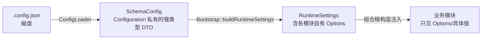

# 卷 04 · 配置系统：加载、校验、快照、写回、首次引导、Web 面板

> 源码基准：`src/Configuration/`、`src/Bootstrap/`、`src/utils/Live.h`、`src/WebUI/ConfigPanelServer.cpp`。

## 0. 三段式架构

配置系统被刻意切成三段，**业务模块永远只接触第三段**：



配套规则（`tests/architecture_dependency_test.py` 强制）：核心模块 include `Configuration/` 会被测试拒绝；`Configuration` 反向 include 网络/业务模块同样拒绝。`RuntimeSettings` 只活在组合根与 Bootstrap，不许继续向内传。

2026-11-15 起（ADR-023，配置实时生效 L0）`Bootstrap/` 另有规则表 `ConfigRules`、组合根持有的活值集合 `LiveSettings`（每组配置一个 `Live<T>`，模板在 `src/utils/Live.h`）与唯一的重载入口 `ConfigReloader`（[§5](#5-配置快照规则表与重载入口configsnapshotstore--configrules--configreloader)）。`Bootstrap/` 只允许 `src/main.cpp`、`Bootstrap/` 自身与面板 `WebUI/` 包含，同样由依赖测试机检。持活值（`const Live<T> &`，每次操作开头取一份快照）的有：L1.a 起 `UserSessionService`、`ChatService`（chat 组），组合根的网页摘录模型与长度粗检也从活值现取；L1.b 起三个专用模型端点来源；L1.c 起 `Voice` 与语音总开关的读写方；L1.d 起 `MemoryService`；L1.e 起 `Dock` 的两个适配器、`TavilySearchProvider`、`WebSearchAction`、`WebFetchAction`；L1.f 起 `GlanceService`、`EngagementService`、`Message`；L2.c 起 `DecisionRecorder`、策略外壳 `SwitchingPolicy` 与 judge 的调用目标解析；L2.d 起 `GroupContextService` 与 `UserSessionService`、`EngagementService` 里的机器人名字。只能重启的键按启动时的 `RuntimeSettings` 生效（[§5](#5-配置快照规则表与重载入口configsnapshotstore--configrules--configreloader)）。

## 1. SchemaConfig：全部字段参考（SchemaConfig.h）

### 1.1 顶层

| 字段 | 类型 | 默认 | 必填 | 校验规则（ConfigLoader.cpp） |
| --- | --- | --- | --- | --- |
| `schema_version` | int | 1 | 是 | 只允许 `1`（integer 范围 [1,1]，required） |
| `bot` | object | — | 是 | 见下 |
| `chat` | object | — | 是 | |
| `models` | object | — | 是 | |
| `voice` | object | — | 否 | |
| `memory` | object | — | 否 | |
| `affect` | object | — | 否 | 见 §1.14 |
| `glance` | object | — | 否 | 见 §1.15（R1.1） |
| `web_search` | object | — | 否 | |
| `web_fetch` | object | — | 否 | |
| `storage` | object | — | 否 | |
| `network` | object | — | 否 | |
| `communication` | object | — | 是 | |
| `webui` | object | — | 否 | |
| `push` | object | — | 否 | |
| 其他 | — | — | — | Warning"未知字段已忽略"（含已废弃的 `resources` 段） |

（`perception` 节曾短暂存在并已迁出配置体系——项目规则 2026-09-15：观察通道总开关与监控群集是运行时状态，由数据库独占管理，面板「群聊设置」页直接改库并即时生效。旧配置残留该键时加载器只发一条 Info 提示后忽略。）

### 1.2 bot（BotSchema）

| 字段 | 类型 | 默认 | 必填 | 规则 |
| --- | --- | --- | --- | --- |
| `id` | uint64 | 0 | 是 | 必须正整数（unsignedInteger, required）；这是"群里必须 @ 这个 QQ"的判定依据 |
| `manager_id` | uint64 | 0 | 否 | 0=无管理员（相关功能关闭） |
| `name` | string | `"Klein"` | 否 | 内置默认人格也会用它；群聊"提名字"点名判定的主名。L2.d 起重载即生效：下一条群消息起按新名字判点名，她之后的发言以新名字记入群缓冲，之前的发言保留当时的昵称 |
| `aliases` | string | `""` | 否 | 她也会答应的另一个名字（如 `"克莱茵"`），空串表示没有。键名沿用 `aliases`，2026-11-08 项目规则由字符串数组改为单个字符串。群消息正文含 `name` 或该别名（ASCII 不区分大小写、非 ASCII 精确子串，`BotIdentity.h::mentionsBotName`）即 `mentions_bot`，触发提名字激活（直入入场轮）/点名轮。解码 `decodeAliasName`：旧的数组形态取第一个非空字符串元素，并发 Warning（Type）「已改为单个名称（字符串），旧的数组形态取第一项」；null 与其他非字符串类型 Warning（Type）视为空。L2.d 起重载即生效（与 `name` 同一个应用函数 `applyBotNames`）。面板写回时上述 Type 诊断一律拒绝落盘（422，[§6](#6-配置写回configwriter)）；面板不展示（字段级 `PASSTHROUGH_PATHS`，2026-11-08 项目规则），只在 `.config.json` 手改，面板保存时原样带回 |
| `group_chat_enabled` | bool | true | 否 | false 时群消息全拒；L1.f 起重载即生效 |

`id`、`manager_id` 只能重启生效；重载时 `applyBotNames` 只换名字与别名，两者保持运行值（决定 9）。

### 1.3 chat（ChatSchema）

| 字段 | 类型 | 默认 | 范围 | 说明 |
| --- | --- | --- | --- | --- |
| `default_model` | string | — | 非空必填 | 全局默认模型名（应能在 ModelsName.json 找到，否则聊天报"当前模型未注册"；加载与重载都不校验这一点）。**重载即生效**（L1.a）：没用 `#切换模型` 手动选过模型的用户跟随新默认模型，手动选过的保持自己的选择 |
| `temperature` | double | 1.0 | [0,2] | 重载即生效（L1.a） |
| `frequency_penalty` | double | 0.0 | [-2,2] | 重载即生效（L1.a） |
| `presence_penalty` | double | 0.0 | [-2,2] | 重载即生效（L1.a） |
| `max_message_tokens` | size_t | 4096 | [1,1000000] | 长度粗检上限（×3 字节）；重载即生效，下一批入站消息起按新值（L1.a） |
| `worker_threads` | size_t? | 无 | [1,256] | 缺省=动态：初始=CPU 逻辑核数，最大=4 倍；配置了则固定该数且关闭动态伸缩。只能重启生效 |
| `message_survival_seconds` | long | 3600 | [1,INT_MAX] | 上下文存活时间；重载即生效（L1.a） |

> 历史版本曾提供 `max_pending_messages`（背压上限，内部定值 1024）与 `worker_idle_seconds`（动态 worker 空闲回收，内部定值 30 秒）；两者已改为程序内部定值，残留配置按未知字段忽略。
>
> `top_p` 于 2026-11-15（配置实时生效 L2.e）按用户决定删除：它一直被加载进 Schema，却从未送进模型请求，只有 `temperature` 起作用。Schema、加载器白名单、模板与示例配置、`ChatOptions`、规则表、面板都已去掉；旧配置里还写着它时按未知字段发一条 Warning“未知字段已忽略”，启动、`#刷新配置文件`、面板保存照常（`ConfigReloaderFixture.LegacyTopPOnlyWarnsAtStartupAndReload`、`PanelServerFixture.PostConfigWithLegacyTopPSavesAndWarns`）。面板把它登记在 `HIDDEN_KEYS.chat`，不显示，保存后随收集从文件里消失。

### 1.4 models（ModelSchema）

> 历史版本曾提供 `registry_path`（模型注册表 JSON 路径）与 `stable_diffusion` 独立生图路径（Stable Diffusion 适配器已于 2026-08 移除，生图统一走 `drawing`）；旧配置残留这些字段按已知字段静默忽略（不弹未知字段警告）。

| 字段 | 说明 |
| --- | --- |
| `drawing` / `vision` / `worker` | 各是一个 ModelEndpointSchema（下表）。**部分填写**（三字段只填了一部分）→ FeatureDisabled"模型配置不完整，对应功能不可用"；全部为空 → 保留空配置，功能不可用但不告警。`worker` 是上下文压缩/情绪基调等后台苦力任务的专用模型（2026-10-31 起不再做话题介入判定），2026-09-19 起支持**注册表形态**：只填 `model`（端点与密钥由注册表条目提供，运行时按名字解析，注册表热重载即时生效；名字未注册时回退 `chat.default_model`），显式全配端点的旧形态仍直连；面板已不再为它单独成卡。2026-10-31 起 `vision` / `drawing` 同样允许注册表形态（只填 `model`；调用时经 `ModelApiCaller/ModelEndpointResolver` 按名字解析，名字未注册时端点为空，按未配置处理并由就绪检查说明原因；瞥视的启动就绪判定同样跑在解析结果上）。半截全配（如只填 model + api_standard）仍报"模型配置不完整"；面板未改动 |

ModelEndpointSchema 字段：`model`（名）、`endpoint`（URL）、`api_key`（Secret 形态）、`api_standard`（"OpenAI"/"Anthropic"）。`configured() = 三者全非空`。

**实时生效（L1.b）**：三个端点的 12 个字段重载即生效。`LiveSettings` 里三个端点各是一个 `Live<ModelEndpointOptions>`（`drawingModel`、`visionModel`、`workerModel`；`ModelRuntimeSettings` 在 `Bootstrap/`，业务侧看不到，所以拆成三个），组合根用 `registryEndpoint(liveSettings.visionModel, models)` 这类活值重载构造 `EndpointProvider`：每次调用先取一份配置快照、再按注册表解析，生图/看图工具、`#生成图片`、Message 的当前图视觉、瞥视视觉 seam、话题会话与私聊摘要的杂务下一次调用就用新端点。L1.b 当时的两处例外都已解除：瞥视的视觉 seam 自 L2.b 起无条件设置，视觉就绪在每张图入队时现判（启动时未就绪、之后才补配的从下一张图起开始瞥视）；judge 的调用目标与决策记录里的模型标签自 L2.c 起每次决策按当前 `affect.judge_model`、`models.worker` 一起解析（`resolveLabeledEndpoint`）。

### 1.5 voice（VoiceSchema）

| 字段 | 默认 | 说明 |
| --- | --- | --- |
| `enabled` | false | `enabled=true` 但 host/port 为空 → **自动改为 false** + FeatureDisabled"语音配置不完整" |
| `host` / `port` | 空 | GPT-SoVITS 地址与端口（port 是字符串） |
| `reference_audio` / `reference_text` | 空 | 参考音频路径与文本 |

**实时生效（L1.c）**：5 个键重载即生效。`voice.enabled` 变化时应用函数 `applyVoiceSwitch` 把语音总开关 `LiveSettings::globalVoice`（`Live<bool>`，启动时取 `voice.enabled`）置为新值；管理员的 `#激活语音`/`#冻结语音`（`AdminControlAction`）也改它，后写者生效。只改其他 voice 键时调的是 `applyVoice`，只换合成参数，总开关不动。`Voice` 持 `const Live<VoiceOptions> &`，每次合成开头取快照；`VoiceOptions` 里的 `enabled` 没有读者，语音开不开只看总开关。

### 1.6 features（已废弃）

> `features` 段已废弃：`accessibility_chat` 开关已移除，上下文模式仅管理员，旧配置残留键仅告警忽略。

### 1.7 memory（MemorySchema）

| 字段 | 默认 | 范围 | 说明 |
| --- | --- | --- | --- |
| `enabled` | true | | false → 不收新的对话轮次、召回不查长期记忆；库打不开 → 记忆系统整体停用（后台线程不起） |
| `model` | =default_model | | 提取用模型名 |
| `batch_turns` | 10 | [1,1000] | 每用户攒几轮触发提取（2026-09-19 由 3 上调，配合全用户上下文降低提取频率） |
| `idle_minutes` | 30 | [1,1440] | 未攒够轮数但空闲超时也提取；历史上为秒单位键 `idle_seconds`（默认 20），已更名换单位，旧键按未知字段忽略 |
| `recall_limit` | 8 | [1,1000] | 单次召回上限（也是 recall 工具的默认上限） |

**实时生效（L1.d）**：`model`、`batch_turns`、`idle_minutes`、`recall_limit` 重载即生效：后台线程每一轮开头取快照（最迟约 500 毫秒后的下一轮按新条件挑批次、用新模型），召回每次取快照。L2.b 起 `enabled` 也重载即生效：记忆库可用就起后台线程（与开关无关），开关在入队（队列锁外取快照）与召回处读，关掉后已入队的批次照常提取完；应用函数 `applyMemory` 整份替换。没写 `memory.model` 时加载阶段取 `chat.default_model` 的值，Schema 里的 `memory.model` 随之变化，所以改默认模型时差异里同时出现 `chat.default_model` 与 `memory.model`，记忆提取下一批就用新默认模型；显式写了 `memory.model` 的不跟随（`ConfigReloaderFixture.MemoryModelFollowsDefaultModelWhenNotConfigured`）。

### 1.8 web_search（WebSearchSchema）

| 字段 | 默认 | 范围 | 说明 |
| --- | --- | --- | --- |
| `enabled` | false | | |
| `provider` | "tavily" | | **非 tavily → enabled 强制 false** + FeatureDisabled |
| `endpoint` | `https://api.tavily.com/search` | | |
| `api_key` | — | Secret | enabled 且空 → enabled=false + FeatureDisabled"API Key 缺失" |
| `search_depth` | "basic" | basic/advanced | 其他值 → 警告并回退 basic |
| `max_results` | 5 | [1,10] | 模型传更大的 max_results 会被 min 到这里 |
| `max_content_chars` | 2000 | [100,20000] | 每条结果正文截断 |
| `max_response_bytes` | 2097152 | [1024,16MB] | HTTP 响应体上限 |
| `connect_timeout_ms` / `request_timeout_ms` | 5000/15000 | [100,300000] | |

### 1.9 web_fetch（WebFetchSchema）

| 字段 | 默认 | 范围 |
| --- | --- | --- |
| `enabled` | false | |
| `max_content_chars` | 12000 | [500,60000]，超出走模型蒸馏或截断 |
| `max_response_bytes` | 2097152 | [1024,16MB] |
| `connect_timeout_ms` / `request_timeout_ms` | 5000 / 20000 | [100,300000] |
| `cache_ttl_seconds` | 900 | [0,86400]，0=禁缓存 |
| `cache_max_entries` | 32 | [1,1024] |

**实时生效（L1.e、L2.a）**：web_search 除 `provider` 外的 9 个键、web_fetch 的 7 个键重载即生效。`TavilySearchProvider`、`WebSearchAction`、`WebFetchAction` 各持自己的活值，每次搜索或执行开头取快照；抓取缓存里已有的条目按存入时的有效期过期，条目上限在下一次存入时按新值淘汰。L2.a 起两个工具始终构造、始终注册，`enabled` 决定它是否对模型开放（`available()`）：关掉后下一次对话的工具列表里就没有它，打开后下一次就有；加载器在 `provider` 不是 tavily 或缺密钥时已把 `enabled` 置假，所以打开搜索但没配密钥时工具仍不开放。`web_search.provider` 决定构造哪一种搜索实现，只能重启生效（L2.e 起为 `restart()`），`applyWebSearch` 保持它的运行值、其余整份替换；`applyWebFetch` 整份替换。

### 1.10 storage / network

- `storage.conversation_database` 默认 `source/.conversations.db`（点前缀隐藏，旧路径无自动迁移）；`storage.image_assets` 默认 `source/image_assets`。
- `network.proxy`：空串默认；非空时用于模型 HTTP、搜索、抓网页（curl `CURLOPT_PROXY`）。L1.e 起重载即生效：一个键作用于三处，应用函数 `applyProxy` 同时换 `dock`、`webSearch`、`webFetch` 三个活值里的 `proxy`（其余字段不动）；`Dock` 的两个适配器每次请求开头取一次代理（OpenAI 的 400 降级重发用同一份）。

### 1.11 communication（CommunicationSchema + TransportProfileSchema）

结构（三种 Profile 类型字段互斥，按 `type` 决定读哪些）：

```json
"communication": {
  "protocol":  {"type": "onebot"},        // 必填；非 onebot → Fatal
  "active_transport": "onebot-reverse",   // 必填；transports 里必须有同名键（否则 Fatal）
  "transports": { "<名字>": { Profile } },
  "defaults": { "connect_timeout_ms":5000, "request_timeout_ms":15000, "max_event_body_bytes":1048576 }
}
```

Profile 公共：`type`（必填，`forward_websocket`/`reverse_websocket`/`http`，其他 → Fatal"未知传输类型"）。

| type | 专属字段 | 必填性 |
| --- | --- | --- |
| `forward_websocket` | `host`(必填)、`port`(1–65535 必填)、`path`(默认 `/`，必须以 `/` 开头否则 Error+回退 `/`)、`access_token`(Secret) | Klein 主动连出 |
| `reverse_websocket` | `bind`(默认 127.0.0.1)、`port`(必填)、`path`(同上)、`access_token`(Secret) | Klein 监听 |
| `http` | `api.base_url`(必填)、`api.access_token`(Secret)；`events.bind`(默认127.0.0.1)、`events.port`(必填)、`events.path`(默认 `/onebot/events`)、`events.access_token`(Secret，旧)、`events.secret`(Secret，HMAC) | 双向两条认证 |

**展示名与配置值**（2026-10-19）：面板与日志把 `forward_websocket` 显示为**服务器模式**（协议端作服务器、Klein 主动连出），把 `reverse_websocket` 显示为**客户端模式**（协议端作客户端、主动连入 Klein）。模式名按协议端角色命名，配置值、`transport` API 字段和代码类型名保持不变。

defaults 范围：connect [1,300000]ms、request [1,300000]ms、body [1024, INT_MAX] 字节。

**跨档案端点检查**（2026-10-19）：加载时扫描全部 transports（不只活动档案）。若某 `forward_websocket` 的 `host:port` 与某 `reverse_websocket` 的 `bind:port` 重合（`127.0.0.1`/`localhost`/`::1` 视为同一回环；`0.0.0.0`/`::`/`*` 通配与回环视为重叠），在客户端模式档案的 `communication.transports.<key>.port` 上发 **Warning/Dependency**：提示协议端通常已占用该地址，客户端模式会以 `bind: Address already in use` 启动失败。只告警不阻断——非活动档案不参与监听；检查只读端点字段，不会为非活动档案引入缺失/类型等字段校验诊断。

### 1.12 webui（WebUiSchema）

| 字段 | 默认 | 规则 |
| --- | --- | --- |
| `enabled` | false | true 但 access_token 空 → **强制 false** + FeatureDisabled"访问令牌缺失" |
| `bind` | 127.0.0.1 | 非 `127.0.0.1/localhost/::1` → Security Warning"面板暴露外部网络，请确认有反代 TLS" |
| `port` | 55346 | [1,65535] |
| `access_token` | — | Secret |

### 1.13 push（PushSchema，2026-10-05 起）

推送门（外部投递入口，`src/Push/` 模块）的部署参数。语义与 webui 镜像：降级关闭不阻断启动，且 **fail-closed**。

> **2026-10-25 起运行时搁置**：本配置节仍正常解析、校验并在面板展示，但 `main.cpp` 的推送门接线已 `#if 0` 停用，当前 `enabled=true` 不会启动 HTTP 门；恢复后按下表语义运行。

| 字段 | 默认 | 规则 |
| --- | --- | --- |
| `enabled` | false | true 但 access_token 空 → **强制 false** + FeatureDisabled"推送令牌缺失"；true 但两白名单皆空 → **强制 false** + FeatureDisabled"目标白名单为空" |
| `bind` | 127.0.0.1 | 非 `127.0.0.1/localhost/::1` → Security Warning（同 webui） |
| `port` | 55347 | [1,65535]（55346 的下一号） |
| `access_token` | — | Secret（enabled 时才解析，FeatureDisabled 语义） |
| `allowed_groups` | [] | 正整数数组（群号）；元素级宽容——非法元素告警跳过不作废整表（`decodeIdArray`） |
| `allowed_users` | [] | 正整数数组（QQ 号），同上 |
| `max_per_hour` | 60 | [1,10000]，按目标计的频率帽 |

### 1.14 affect（AffectSchema，2026-10-25 起）

M1 决策记录的开关。默认关闭；关闭时两条群回应路径完全保持 v2.4.1 行为，不写决策表。开启后记录决策/执行/反馈，记录本身不改变实际回应（影子观察）；2026-11-16（经历层 E0，ADR-026）起，开启时群聊两条回应路径与 judge 还带事实卡（当前日期时刻与可选的 `source/facts.md`），关闭时请求逐字不变。**面板不展示，只在 `.config.json` 手改**（2026-11-08 项目规则：策略类配置节不进前端；面板经 `PASSTHROUGH_SECTIONS` 原样带回，见 [§8](#8-web-配置面板后端configpanelservercpp)）。

| 字段 | 默认 | 规则 |
| --- | --- | --- |
| `enabled` | false | 开启后写决策记录，@ 回复与主动接话共用同一决策合同；也是事实卡的开关（ADR-026，每次群回应取当次快照）。L2.c 起重载即生效：`DecisionStore`/`DecisionRecorder` 始终构造，决策库在第一次需要记录且开关为真时才打开、建表（从没打开过的库里没有决策表；打开失败只试一次，之后到重启都降级为不记录）；关掉后不再写新记录，已落库的执行行照常回填回执 |
| `policy` | `"baseline"` | R1（2026-11-01）：只认 `baseline` / `judge`，其他值给 Warning 诊断（Range）并回默认。`judge` 且决策记录已启用时用 `affect::JudgePolicy`，否则 `affect::BaselinePolicy`。L2.c 起重载即生效：两个策略都始终构造，策略外壳 `affect::SwitchingPolicy` 每次决策按当前快照选一个（`DecisionPolicy::resolve`），judge 每群每小时的预算跨切换保留 |
| `enforce` | false | R1：false = 影子，judge 只记录计划、不改变实际回应；R1.c 起 true 让计划生效。L1.f 起重载即生效（Dynamic）：`EngagementService` 每个会话轮、`Message` 每条消息各取一次 |
| `judge_model` | `""` | R1：judge 所用模型名，按注册表在每次调用时解析（与 `models.worker` 同一 `makeWorkerSeam`）；空 = 用 `models.worker`；名字不在注册表时改用 `models.worker` 端点（judge 要便宜，不回退主模型；每次调用时查注册表，热重载补注册即时生效），启动时打一次 WARNING。L2.c 起重载即生效：调用目标与记录里的 `judge_model` 每次决策一起解析，二者一致 |

映射：模块自有的 `AffectOptions{enabled, policy, enforce, judgeModel}`（`src/Affect/AffectOptions.h`；L1.f 起，此前是 `Bootstrap/RuntimeSettings.h` 里的 `AffectSettings`）。应用函数 `applyAffect` 整份替换（L2.c 起；L1.f 时只换 `enforce`）。

### 1.15 glance（GlanceSchema，2026-10-29 起，R1.1 / ADR-020）

群聊瞥视：观察群里每张入站图片由视觉模型（复用 `models.vision`）瞥一眼，写成一行派生描述存入群缓冲的图片占位符。只丰富 `group_messages.text`，不触发任何回应。**面板不展示，只在 `.config.json` 手改**（与 affect 同属 `PASSTHROUGH_SECTIONS`）。映射为模块自有 `GlanceOptions`（`src/Perception/GlanceOptions.h`）。

| 字段 | 默认 | 规则 |
| --- | --- | --- |
| `enabled` | false | 开启后观察到的群图片入队瞥视。L2.b 起重载即生效：有群缓冲（观察通道启动时开着）时瞥视线程始终启动、视觉 seam 无条件设置，`enabled` 与视觉就绪都在每张图入队时判断，关着或未就绪的图不入队、已入队的照常看完；未就绪告警只在状态变化时打一次。观察通道启动时关着的，群缓冲与瞥视要重启才有（群内容库只在启动时构造，看的是数据库里的观察总开关，不是配置键） |
| `per_group_per_minute` | 6 | 整数 [1,60]：每群滚动 60 秒窗口内的视觉调用上限，越界 Warning（Range）并回默认 6；超预算的图标记"未看（刷屏）"，同字节去重命中不计预算。L1.f 起重载即生效：`GlanceService` 每张图开头取一次预算，已用的次数照常计入一分钟窗口；应用函数 `applyGlance` 整份替换 |

## 2. Secret 双形态（Decoder::secret）

三种合法写法：

```json
"api_key": "sk-明文"                       // 纯字符串
"api_key": {"literal": "sk-明文"}
"api_key": {"from_env": "KLEIN_XXX_KEY"}   // 推荐
```

规则：对象里 `from_env` 优先（同时有 literal 则产生 Security Warning）；`from_env` 指向的环境变量不存在 → 产生诊断（severity 由调用方决定：web_search/webui 使用 FeatureDisabled——同时关闭对应功能；模型端点使用 FeatureDisabled；通信 profile 使用默认 Error——**阻止启动**）；null 视为缺失返回空；对象里出现其他键 → 未知字段警告。诊断信息**永不含 Secret 原文**。

## 3. ConfigLoader 的 Decoder 原语（ConfigLoader.cpp:14–210）

所有字段读取都走这几个统一原语，理解它们就理解了全部校验行为：

| 原语 | 行为 |
| --- | --- |
| `object(parent,key,path,required)` | 缺失：required→Fatal"缺少必需对象"否则 nullptr；非对象：required→Fatal 否则 Warning |
| `string(...,default,required)` | 缺失：required→Fatal；有默认值时 Info"使用默认值"；非字符串→Fatal/Warning；required 且空串→Fatal"不能为空" |
| `secret(...)` | [§2](#2-secret-双形态decodersecret) |
| `boolean(...,default)` | 非 bool → Warning + 默认值 |
| `integer(...,default,min,max,required)` | 非整数→Fatal/Warning；越界→Range 警告/致命 + 默认值 |
| `unsignedInteger(...)` | 非（无符号）整数或 ≤0 → required?Fatal:Warning，返回 0 |
| `number(...,default,min,max)` | double 版 integer；**永不 Fatal** |
| `unknownFields(obj, allowed, path)` | 对象里每个不在白名单的键 → Warning"未知字段已忽略" |
| `normalizedPath` | 必须以 `/` 开头，否则 Error + 返回 `"/"` |

严重级别 → 后果：**Error/Fatal 任一存在 → `canStart()=false` → 拒绝启动**；Warning/FeatureDisabled/Info 只记录。**写回路径例外**（2026-11-08）：面板保存经 `ConfigWriter::write` 时，任何 `Type` 类诊断（无论 severity——即加载器会丢弃或替换成默认值的值）同样拒绝写盘，面板得 422（[§6](#6-配置写回configwriter)）。原则是写回严格、读取宽容：启动与 `#刷新配置文件` 读手改文件时 Type 诊断仍只记录为 Warning。

## 4. Bootstrap 映射（RuntimeSettings.cpp）

`buildRuntimeSettings(schema)` 纯函数式地把 Schema 拷成 RuntimeSettings；要点：

- `mapTransport`：Profile→TransportConfig。**HTTP 模式的 `eventSignatureSecret = eventSecret 为空 ? eventAccessToken : eventSecret`**（旧配置的 access_token 自动兼作签名密钥，平滑迁移）。端口转字符串存 ForwardWebSocketConfig.port。
- `mapMessageExecution`（这是唯一有逻辑的映射）：

```
配置了 worker_threads=N → initial=N, max=N, dynamicScaling=false
未配置 → initial = hardware_concurrency() (0 时取 4)
         max     = initial*4（防溢出检查）
         dynamicScaling = true
```

- `message` Options = `{bot 身份, group_chat_enabled}`；`network.proxy` 同时复制进 `dock.proxy`、`webSearch.proxy`、`webFetch.proxy`（重载时由 `applyProxy` 一起换）；`affect` 映射为模块自有的 `AffectOptions`（`src/Affect/AffectOptions.h`，L1.f 由本文件的 `AffectSettings` 迁出并改名）。

## 5. 配置快照、规则表与重载入口（ConfigSnapshotStore / ConfigRules / ConfigReloader）

```cpp
struct ConfigSnapshot { shared_ptr<const SchemaConfig> schema; RuntimeSettings runtime; };
class ConfigSnapshotStore {
    std::mutex reloadMutex;                 // 串行化多次 reload
    mutable std::mutex mutex;               // 保护 activeSnapshot 指针
    shared_ptr<const ConfigSnapshot> activeSnapshot;
};
```

2026-11-15 起（ADR-023，配置实时生效 L0）`#刷新配置文件` 与 Web 面板保存都调唯一的入口 `ConfigReloader::reload()`。它是组合根的栈对象，与活值集合 `LiveSettings` 一起声明在所有服务之前；面板只拿 `ConfigSnapshotStore` 的 const 引用（`/api/botinfo` 取快照），调不了 `reload()`。一次重载：

1. 拿 `ConfigReloader::reloadMutex`（并发重载排队，发布与应用不会交错），取旧快照；
2. 调 `ConfigSnapshotStore::reload()`：拿 `reloadMutex`，锁外读文件 + 完整校验（重用 ConfigLoader）；候选不能启动（文件打不开、JSON 解析失败，或诊断里有任何 Error/Fatal）→ **不发布**，返回 success=false 与加载器的全部诊断，旧快照继续生效、差异为空；否则构建候选快照，短暂拿 `mutex`：`compareConfig(旧,新)` 生成 diff + 原子替换 `activeSnapshot`。这一步在 2026-11-15 之前并没有做到：代码先把诊断移进结果再判 `canStart()`，“能解析但带 Error/Fatal 诊断”的候选（如缺 `bot.id`、档案 `path` 不以 `/` 开头）也会被发布并返回 success=true。L0.d 改为先判断、再移动诊断，现在名副其实；
3. 发布成功后按规则表逐行比较新旧 Schema，把变化的键归为两类：`applies` 行（已应用）、`restart()` 行（只能重启）。带应用函数的行在新快照发布之后执行应用，同一个应用函数一次重载至多调用一次；应用只替换活值快照，不会失败；
4. 反馈：`#刷新配置文件` 返回 `summarizeReload` 文案（下表），日志照旧逐条记 `配置变化：<路径> [档位]` 与加载诊断；面板返回的 JSON 字段与档位不变（[§8](#8-web-配置面板后端configpanelservercpp)）。

反馈文案（`ConfigReloader.cpp::summarizeReload`）：

| 情况 | 文案 |
| --- | --- |
| 校验不过 | `配置刷新失败，继续使用当前内存快照。` |
| 没有变化 | `配置校验通过，内存快照无变化。` |
| 有变化 | 第一行 `配置已刷新：N 项变化，已生效 A 项。`；有 `restart()` 行时另起一行 `需重启才能生效 R 项：路径、路径。`（过渡期的“尚未接通实时生效”一行随 `notYet` 于 L2.e 删除） |

**现状（L2.e）**：产品规则表由 `applies` 行（分属 14 个应用函数）与 `restart()` 行组成，行数见[规则表与影响等级](#规则表与影响等级configrulescpp-全表)。应用函数（都在 `ConfigRules.cpp` 的匿名命名空间里，紧挨着表）。持活值的模块从下一次操作起用新值，正在进行的操作继续用它开头取的那份快照。改造前的文案“当前运行模块尚未重新应用这些参数”已不再使用。

| 应用函数 | 规则行 | 换进的活值 | 保持运行值的字段 |
| --- | --- | --- | --- |
| `applyBotNames` | `bot.name`、`bot.aliases`（L2.d） | `bot` 的名字与别名，同时换 `message` 里那份 `bot` 的名字 | `id`、`manager_id`（只能重启，决定 9） |
| `applyChat` | chat 组 6 行（L1.a） | `chat` 整份 | 无 |
| `applyDrawingModel` / `applyVisionModel` / `applyWorkerModel` | models 三个端点各 4 行（L1.b） | `drawingModel` / `visionModel` / `workerModel` 整份 | 无 |
| `applyVoiceSwitch` | `voice.enabled`（L1.c） | `globalVoice`（语音总开关） | 无；命令随后还能再改，后写者生效 |
| `applyVoice` | voice 其余 4 行（L1.c） | `voice` 整份 | 总开关不动 |
| `applyMemory` | memory 5 行（L1.d、L2.b） | `memory` 整份 | 无 |
| `applyWebSearch` | web_search 除 `provider` 外 9 行（L1.e、L2.a） | `webSearch` | `provider`（只能重启） |
| `applyWebFetch` | web_fetch 7 行（L1.e、L2.a） | `webFetch` 整份 | 无 |
| `applyProxy` | `network.proxy`（L1.e） | `dock`、`webSearch`、`webFetch` 三处的 `proxy` | 三个活值的其余字段 |
| `applyGroupChat` | `bot.group_chat_enabled`（L1.f） | `message` 的群聊开关 | `bot` 身份（决定 9） |
| `applyAffect` | affect 4 行（L1.f、L2.c） | `affect` 整份 | 无 |
| `applyGlance` | glance 2 行（L1.f、L2.b） | `glance` 整份 | 无 |

“保持运行值”是决定 9 的同一做法：结构里有模块在读、但只能重启的字段，应用函数沿用活值里的当前值，活值里始终是模块实际在用的值（L1 期间还没接通的开关也这样保持，L2 接通后都改为整份替换或按新值替换）。voice 拆成两个应用函数，是为了只改合成参数时不冲掉管理员命令设的总开关。

例子：把 `.config.json` 里的 `chat.temperature` 从 1.0 改成 0.3、`chat.worker_threads` 改成 3，执行 `#刷新配置文件`，反馈是

```text
配置已刷新：2 项变化，已生效 1 项。
需重启才能生效 1 项：chat.worker_threads。
```

此后的下一次对话请求（私聊、@ 回复与群会话轮都经 `UserSessionService::buildChatRequest` 装配）温度就是 0.3，线程数仍按启动时的值直到重启（`ConfigReloaderFixture.ReloadedChatKeyReachesUserSessionOnNextRequest` 端到端验证）。

### 规则表与影响等级（ConfigRules.cpp 全表）

`compareConfig`（声明在 `ConfigDiff.h`，对外形态不变）逐行遍历规则表，表的顺序就是差异条目的顺序。每行是 `{路径, 生效方式, field<成员指针链>}`，例如：

```cpp
{"chat.temperature",    applies(applyChat), field<&SchemaConfig::chat, &ChatSchema::temperature>},
{"chat.worker_threads", restart(),          field<&SchemaConfig::chat, &ChatSchema::workerThreads>},
{"models.vision.model", applies(applyVisionModel),
 field<&SchemaConfig::models, &ModelSchema::vision, &ModelEndpointSchema::model>},
```

`field<...>` 的模板实参是从 `SchemaConfig` 出发的成员指针链，链上任何一段写错都编译不过。生效方式只能由两个工厂产生（`ConfigEffect` 的构造函数私有）：`restart()` → Restart、没有应用函数；`applies(应用函数)` → Dynamic、应用函数非空（参数是函数引用，传不了空指针）。L0–L2.d 的过渡工厂 `notYet(原档位)`（保留改造前档位、没有应用函数）于 L2.e 清零后删除，`ConfigEffect::Kind` 只剩 `Restart` 与 `Applies`。档位 `Rebuild` 不再产生，枚举值与 JSON 名 `rebuild` 保留（`ConfigDiff` 与面板 `counts` 的对外形态不变）。`ConfigRulesTests` 把两份清单逐键钉住：`AppliesRowsAreExactlyTheWiredKeys`（带应用函数、档位 Dynamic）与 `EveryOtherRowIsRestartOnly`（档位 Restart、没有应用函数）。产品规则表共 89 行，各档位键数见下表；这三个数由 `ConfigRulesTests` 断言，改规则表时要同步改测试。

| 档位 | 键数 | 规则表里的生效方式（L2.e） | 字段 |
| --- | --- | --- | --- |
| Dynamic | 54 | 均为 `applies(应用函数)`：**重载即生效** | `bot.name/aliases/group_chat_enabled`、chat 6 项（除 `worker_threads`）、models.drawing/vision/worker 各 4 项、voice 5 项、memory 5 项、affect 4 项、glance 2 项、web_search 9 项（除 `provider`）、web_fetch 7 项、`network.proxy` |
| Restart | 35 | 均为 `restart()`：**只能重启生效** | `schema_version`、`bot.id/manager_id`、`chat.worker_threads`、`web_search.provider`、storage 2 项、communication 17 项（protocol.type、active_transport、active_profile 的 12 个字段、defaults 3 项）、webui 4 项、push 7 项 |
| Rebuild | 0 | 不再产生 | — |

L0 改造时各键的档位、路径字符串与差异顺序和改造前逐个相同：`tests/ConfigReloadTests.cpp` 一字未改全部通过；另用一次性对拍程序（不进项目）把改造前的手写比较与规则表逐键对比，90 个单键变化与 90 键同时变化的路径、档位、顺序全同。L1.a 把 chat 组 6 个键从 `notYet(Rebuild)` 换成 `applies(applyChat)`；L1.b–L1.f 依次接通模型端点、voice、memory、搜索/抓取/代理、群聊开关/`affect.enforce`/瞥视预算，共 39 个键（其中 `bot.group_chat_enabled`、`voice.enabled` 原是 `notYet(Dynamic)`，`affect.enforce`、`glance.per_group_per_minute` 原是 `notYet(Restart)`，其余 35 个原是 `notYet(Rebuild)`），这些键的档位都变为 Dynamic，路径与顺序不变。L2.a–L2.d 接通开关与对象类 9 个键（`web_search.enabled`、`web_fetch.enabled`、`memory.enabled`、`glance.enabled`、`affect.enabled/policy/judge_model`、`bot.name/aliases`）。L2.e 收尾：删除 `chat.top_p`；communication 17 项与 `web_search.provider` 由 `notYet(Rebuild)` 改为 `restart()`（档位 Rebuild→Restart，只改标签，行为本来就是要重启）；`notYet` 清零后删除。各键归属见配置实时生效策划（内部笔记） §5。

diff 只记 `path + 等级`，不记值（密钥安全）。模型端点与传输档案的字段在表里逐行列出（改造前的 `compareModelEndpoint` / `compareTransportProfile` 辅助函数已删除）。路径字符串沿用改造前的写法，有两处与配置文件里的键路径不同：`voice.reference_audio_path`（文件里是 `voice.reference_audio`）、`communication.active_profile.*`（指 `active_transport` 选中的那一份档案，文件里是 `communication.transports.<名字>.*`）。

## 6. 配置写回（ConfigWriter）

`ConfigWriter::write(path, candidate)`，`writeMutex` 串行化：

1. 读当前磁盘 JSON（打不开/坏 JSON → Fatal 诊断返回失败）；**读句柄在替换前关闭**——Windows 上打开中的文件会挡住 rename 替换（目标句柄不含 FILE_SHARE_DELETE，报 Permission denied）；
2. `restoreMaskedSecrets(candidate, current)`：把仍是哨兵 `__KLEIN_MASKED__` 的位置恢复为磁盘原值。**数组元素按"身份"匹配恢复**（`sharesIdentity`）：元素有数组字段（如模型注册表的 `ModelName`）时只认数组字段相等——`APIStandard`、`enabled` 这类弱字段在多元素间普遍相同不能当身份；没有数组字段时退回"任意非密钥标量字段相等"。匹配不上保持候选原值，残留哨兵由调用方（面板）`sanitizeSentinels` 置空并警告。模型注册表有个特殊通道：勾选模型的常规编辑恰恰会改动 `ModelName`，身份匹配必然失配，因此面板 `POST /api/models` 在恢复掩码前先按前端带回的 `originIndexes`（每张卡片加载时的注册表原始下标）**按位恢复密钥**，身份匹配只作为不带该字段的旧页面兜底；`originIndexes` 用完即删，不落盘。
3. `ConfigLoader().loadDocument(merged)` 全量校验——存在 Error/Fatal（`!canStart()`），**或存在任何 `ConfigErrorCategory::Type` 诊断（无论 severity）**，都直接拒绝写盘，`result.diagnostics` 为加载器的全部诊断（面板得 422 + 逐字段诊断，`markFields` 按 `path` 标红）。Type 规则是写回专属的严格层：加载器对类型不符的值只告警并丢弃/回默认值，若照样落盘，面板显示「保存成功」而运行时悄悄失效（2026-11-08 缺陷：`bot.aliases` 被面板写成 `null`，别名点名失效）。首跑骨架（`ConfigTemplate::createIfMissing`）直接调 `writeJsonAtomically`，不经此校验，骨架本身也不含任何 Type 诊断；
4. `writeJsonAtomically`：
   - `dump(4)` + 换行 → 写同目录 `path.tmp-<pid>`；
   - 权限收紧 `0600`（失败不阻断——Windows 文件系统不支持 POSIX 位）；
   - `rename` 替换；失败（Windows 上目标被占用等）→ 先删旧文件再重命名的回退——MinGW libstdc++ 的 `copy_file(overwrite_existing)` 对已存在目标实测同样失败（报 File exists），不可作回退；回退也失败 → Fatal 诊断 + **保留临时文件**（`path.tmp-<pid>`，内容即合并后的新文档，供人工恢复），不删。

**关键性质**：写回的是"合并后的原始文档"，不是 SchemaConfig 反序列化——`from_env` 引用、`literal` 形态、注释性未知字段全部逐字保留。

掩码机制（`maskSecrets`）：递归把键名为 `api_key`/`access_token`/`secret` 的值（明文或对象）替换为哨兵串。浏览器永远拿不到明文。

## 7. 首次引导（ConfigTemplate）

- `generateWebUiToken()`：`mt19937_64(random_device{})` + 静态 mutex，两次 64 位 → 32 位十六进制。
- `defaultDocument(token)`：内嵌 JSON，**结构与 `config.example.json` 对齐的全部配置节**（bot/chat 采样四项/models 三端点/voice/memory/affect/glance/web_search/web_fetch/storage/network/communication 双传输档案+defaults/webui/push）——2026-09-19 项目规则"不给用户不完整的内容"：面板首跑即可见并补全所有模块，而不是只看到最小集合（旧骨架只含 6 个节，缺失节的模块不渲染）。值为安全占位：`bot.id=123456789`、`default_model="your-chat-model"`、**密钥一律空串**（不用 from_env 引用不存在的环境变量，避免首跑日志成片告警）、`manager_id=0`（不预置假管理员）、客户端模式 WS `127.0.0.1:8600` 空令牌、webui 启用+随机令牌、push 关闭（无外部脚本依赖时不应意外启用 HTTP 端点）。**观察通道不进骨架**（项目规则 2026-09-15：总开关与监控群集是运行时状态，由数据库独占管理，见 `src/Perception/GroupListService`）。全部占位值都能通过校验（所以"骨架可启动"）。
- `createIfMissing`：`exists()` 为真直接 false（损坏文件也不覆盖）；生成→原子写→成功返回 true + token。

## 8. Web 配置面板后端（ConfigPanelServer.cpp）

HTTP 层：vendored cpp-httplib（`Library/httplib/httplib.h` v0.53.1）。`buildServer()` 是纯构建函数（测试可 bind 临时端口），`run()` 是线程入口：`listen` 失败每 10 秒重试；**看门狗线程**每 200ms 检查 `running`，为假调 `server->stop()` 让阻塞中的 listen 返回。payload 上限 1MB。

| 路由 | 鉴权 | 行为 |
| --- | --- | --- |
| `GET /` | 匿名（页面无数据） | 现读工作目录 `panel.html`，`Cache-Control: no-store`；缺失→500+错误说明（**无内嵌兜底**：页面是部署的一部分，缺失应显式暴露） |
| `GET /api/config/effects` | Bearer | 2026-11-15（L2.e）：按产品规则表逐键返回生效方式 `{"effects": {"chat.temperature": "applies", "bot.id": "restart", …}}`（89 个键，路径与差异里的相同）；面板的字段说明据此推出 |
| `GET /api/botinfo` | Bearer | 基础信息页数据：Klein 版本/构建类型/git 短哈希、进程运行时长、通信模式（快照）+ 协议端登录查询——`get_login_info`（QQ 号/昵称）+ `get_stranger_info` 自查（签名为实现端扩展字段，缺失省略），两次调用各 3 秒超时；通道未注入或协议端离线 → `connected:false` 降级，版本信息恒可用 |
| `GET /api/config` | Bearer | 读盘 → `maskSecrets` 后下发 |
| `POST /api/config` | Bearer | 候选 → `ConfigWriter::write`（Error/Fatal 或任何 Type 诊断 → 422 + `diagnostics[]`）→ 成功后经注入的 `ConfigReloader::reload()`（与 `#刷新配置文件` 同一入口，2026-11-15 起；此前面板自己调 `store.reload()`）并返回 `{diff[], counts{dynamic,rebuild,restart}, reloadSuccess, diagnostics[], warnings[]}`（字段与档位不变）；`warnings[]` 是写回校验剩下的 Warning/Info，前端按项目规则（2026-09-19）成功时不展示 |
| `GET /api/models` | Bearer | 读注册表（路径钉死 `kModelRegistryPath`）；文件损坏→500；不存在→`{exists:false, Models:[]}`；正常→`maskSecrets` 下发 |
| `POST /api/models` | Bearer | 恢复掩码（`originIndexes` 按位优先，身份匹配兜底）→`sanitizeSentinels`→`validateModelRegistry`（见下）→失败 422；成功原子写回后立即 `ModelRegistry::reload()` 热重载进程内副本，返回 `{hotReloaded:bool, warnings[]}`（true=即时生效；false=写盘成功但重载失败，旧表继续服务，需重启恢复） |
| `POST /api/models/available` | Bearer | 面板代理调用供应商的标准模型列表接口（浏览器直连会被 CORS 挡住）。请求 `{api_endpoint, APIStandard, index?, api_key?}`：密钥明文优先，掩码/缺省时按 `index` 从注册表已存条目回退，两者皆无→422；`ModelCatalog::deriveModelsUrl` 从对话端点去掉结尾 `/chat/completions`、`/messages` 拼 `/models`（推导不出→422）；curl 外呼（4s 连接/10s 总超时、2MB 响应上限、仅 http/https），上游错误→502 带原因；成功返回去重排序后的 `{models[]}` |
| `POST /api/models/check-vision` | Bearer | 视觉能力探测：向指定模型发一条 1x1 图片 + 极短文字的多模态请求，按响应分类三态——2xx→`vision`；4xx 且报错指向图片/多模态不支持→`no-vision`；其余（鉴权/限流/模型不存在/5xx/超时）→`unknown`（**失败不算“不支持”**，带 detail 说明原因）。恒返回 200 + `{result, detail?}`；密钥解析与 available 相同 |

`validateModelRegistry`（面板专有的严格校验，比 ModelRegistry 的宽容加载严）：顶层必须有 `Models` 数组；每个供应商必须是对象；`ModelName` 必须非空字符串数组且**跨供应商不得重名**（Error）；`api_endpoint` 必填；`APIStandard` 只能 OpenAI/Anthropic；`api_key` 为空串只是 Warning。`Capabilities.vision` 接受布尔（旧版组级）或字符串数组（按模型名单）：数组含非字符串→Error；名单出现 `ModelName` 之外的名称（疑似拼写错误）→Warning 放行。

鉴权用 `BearerAuth::isAuthorized`（常数时间比较，[卷05 §6](05-网络与OneBot传输层.md#6-鉴权与签名bearerauth--webhooksignature)）；页面本身可匿名（不含任何数据）。

前端 `src/WebUI/panel.html`（内联 CSS/JS 单文件，无外部依赖）：侧边导航控制台布局，含独立"模型供应商"页；密钥字段掩码显示、留空=保持原值；悬停显示字段说明与生效方式；保存走上面的 API。**生效方式由规则表推出**（2026-11-15 L2.e）：`loadConfig` 渲染前先取 `GET /api/config/effects`，`hintFor` 在字段说明末尾追加“保存后立即生效。”或“需重启生效。”（规则表路径与面板路径不同的两处：`voice.reference_audio` 经 `EFFECT_PATH_ALIASES` 对到 `voice.reference_audio_path`；通信视图的字段按 `data-target` 对到 `communication.active_profile.*` / `communication.defaults.*`），分区里的键生效方式一致时 `sectionHint` 在分区说明后补“本组改动保存后立即生效 / 需重启生效”（`features` 分区按 `bot.group_chat_enabled` 算）；取不到时不写，不猜。`SECTION_HINTS`、`KEY_HINTS`、`FIELD_HINTS`、通信视图的说明里不再手写生效方式，`PanelServerFixture.PanelHintsLeaveEffectsToRuleTable` 机检这几段里不出现“重启”“生效”、`FIELD_HINTS` 的每个路径都对得上规则表。保存后的右下角通知按 `counts` 写“N 项已生效，M 项需重启后生效”（`rebuild` 不再计入），重载失败写“已写盘，重载失败：本次变更尚未生效”；页脚说明同步改为“字段说明里写‘保存后立即生效’的项马上生效，写‘需重启生效’的项在重启后生效”。"模型供应商"页是专用视图：顶部"添加供应商"主按钮（点击新增卡片并聚焦名称框）；卡片头部为 `describe` 标题（随输入实时更新，空值显示"未命名供应商"）+ 模型数统计 + 图标化删除按钮；字段行依次为供应商名称（`describe`）、API 端点、API Key、API 标准（自绘下拉：原生 select 的展开列表无法适配暗色终端主题，自绘组件带键盘导航与外部点击关闭）、模型。模型行以 chips 呈现已选模型（可逐个移除），"获取模型列表"经 `/api/models/available` 拉取后弹出带搜索过滤的勾选浮层（预勾选当前已选，点击即增删）；个别端点不提供列表接口时行内报错并展开"手动输入"兜底（datalist 提示已知名）。**视觉能力按模型标注**（组级"支持视觉输入"复选框已退役）：每个 chip 前带 ◉/○ 切换（手动覆盖入口），"检测视觉"按钮对已选模型逐个调用 `/api/models/check-vision` 自动标注，结论三态且"无法判定"带原因单独提示；探测结论只存会话内存，落盘的是"已标注支持"名单。保存时 `collectModels` 把视觉标注物化为 `Capabilities.vision` 字符串数组（全组无标注则删键，旧布尔形态由此自动迁移），并回传 `{Models, originIndexes}`。页面是运行时资源，改动刷新浏览器即生效。

模块与字段的展示顺序由面板固定（`SECTION_ORDER` / `SECTION_KEY_ORDER`），不跟随配置文件里的键序；未列出的键按文件原序排在对应范围最后兜底（新增键不丢失、历史遗留键不打乱布局）。

**策略类配置节不进前端**（2026-11-08 项目规则：后台不做精细化，行为策略只在 `.config.json` 手改）：`PASSTHROUGH_SECTIONS`（当前 `affect`、`glance`）登记的顶层节不渲染、不出导航项，也没有分区标签、字段提示或下拉元数据。`loadConfig` 每次加载先清空 `passthroughSections`，遍历时把这些节的原值暂存进去；`collectConfig` 写完 `schema_version` 后原样带回。必须带回的原因：`POST /api/config` 提交整份文档，`restoreValue` 只保留候选里出现的键，缺失就等于删除（`perception` 节「保存时自然消失」正是靠这一点）。带回的值与 GET 下发的完全相同，两节都不含密钥、没有哨兵，所以 `ConfigDiff` 对它们报无变化。

同一思路推广到**字段级**：`PASSTHROUGH_PATHS`（当前只有 `bot.aliases`，2026-11-08 项目规则：别名不进前端）登记的「分区.键」路径不渲染，也没有标签和字段提示。`loadConfig` 把 `passthroughFields` 与 `passthroughSections` 一起清空；渲染顶层分区的直接子键时，路径命中登记表的值按路径暂存，然后跳过渲染（不递归，只处理顶层分区的直接子键）。`collectConfig` 在所有 pane（含「功能开关」经 `mergeInto` 写回 `bot`）收集完之后，按 `"section.key"` 拆开写回 `result[section][key]`；分区对象不存在时先创建。点名功能与配置键本身不变。

`bot` 分区只展示身份字段（id / manager_id / name；`aliases` 不进前端，见下文 `PASSTHROUGH_PATHS`）；数组文本框（`dataset.kind="json"`）渲染时把原值记在 `dataset.original`，`valueFromInput` 解析失败时标 `.invalid`（title「JSON 解析失败」）并回传原值，**绝不产出 `null`**；`saveConfig` 在 `collectConfig()` 之后检查 `.invalid`，非空则在横幅逐行列出 `data-path - 原因` 并中止，不发请求。登记在 `ARRAY_PATHS`（`push.allowed_groups`、`push.allowed_users`）的数组键，值为 `null`/缺失时仍渲染成数组文本框（内容 `[]`），可直接在面板修复；不登记的键会落入普通文本框分支，此后只能写回字符串——新增数组型配置键必须登记（关联点，见[卷20 §6](20-扩展开发指南.md#6-改配置项--加配置节)）；`group_chat_enabled` 挪进紧随其后的"功能开关"独立模块展示，保存时经 `dataset.mergeInto` 合并回 `bot` 分组（配置文件结构不变，仍是 `bot.group_chat_enabled`）。键缺失时开关按开启渲染（与 ConfigLoader 默认一致），保存后显式落盘。
`models` 分组渲染为"模型设置"模块：`chat` 分组的模型相关参数（`default_model` 与温度/频率惩罚/存在惩罚，小节标题"对话模型"；Top P 随 `chat.top_p` 于 2026-11-15 删除）与 `drawing`/`vision`/`worker` 端点合并展示。字段的 `data-path` 仍指向原分组（如 `chat.temperature`），保存时 `collectConfig` 按分组分别写回——`chat` 分组由"消息处理"与"模型设置"两个模块的行合并而成；配置文件结构与后端诊断路径均不变。`chat` 分组展示层面只剩消息处理字段（`max_message_tokens` / `worker_threads` / `message_survival_seconds`），模块名相应为"消息处理"；原"聊天参数""模型端点"模块名不再使用。

**模型名字段一律注册表下拉**（2026-09-19 项目规则，2026-09-19 第二次修正范围）：`chat.default_model`、`memory.model` 与 `models.vision/worker` 的 `model` 不再自定义输入——渲染前经 `refreshRegistryNames()` 拉取 `GET /api/models` 的模型名扁平列表（去重、兼容旧版 `name` 键），用与 API 标准一致的自绘下拉呈现；`loadConfig` 与注册表保存成功后各刷新一次缓存。当前值不在注册表（或留空跟随默认模型）时保留为独立选项，保存不会被静默改写；注册表为空时只剩当前值可选，需先到「模型供应商」页添加。**画图例外**：`models.drawing.model` 独立于对话注册表（绘图端点通常不在 ModelsName 中），保留自由输入。**轻量模型不再单独成卡**：选择框挪进"对话模型"区（`models.worker.model`），收集时从 chat 分组归位写回 `models.worker = {model}`（旧直连字段不再收集），加载器允许该"只填 model"的注册表形态。

`schema_version` 不生成编辑分区：侧边导航底部（模型供应商项下方）以只读状态芯片（`CONFIG SCHEMA vN`，非按钮、不可点击）展示加载时的原值，保存时由 `collectConfig` 原样写回，避免不渲染的键在保存时丢失；面板内不可改，修改版本号需直接编辑 `.config.json`。

`perception` 顶层节不渲染（2026-09-19）：观察通道开关与监控群集由数据库独占管理、走侧边栏「群聊设置」页（原"观察通道"，2026-09-19 更名并固定编为导航 M05），配置文件里的残留节不再生成模块——否则会出现第二个"观察通道"死入口（改了也不生效）；与 `HIDDEN_KEYS` 先例一致，保存时随收集自然消失（`HIDDEN_KEYS` 现有 `models` 的 `registry_path`/`stable_diffusion`/`worker` 与 2026-11-15 起 `chat` 的 `top_p`）。字段行的 `data-path` 提示（label 下的等宽小字）在 250px 标签列内**截头留尾**显示（末段才是区分字段的键名），完整路径悬停可见；不截断会溢出盖到右侧输入框上（2026-09-19 真机反馈）。

`communication` 分区是类型驱动的专用视图（顶层渲染特例之一）。顶部"连接方式"下拉直接选传输类型（服务器模式/客户端模式、HTTP），下方只渲染当前活动 Profile 属于该类型的字段（HTTP 形态再分"API 调用""事件上报"两组）；`protocol`（固定 onebot）不再平铺显示，`defaults` 三个超时收进折叠的"高级参数"。切换类型时启用同类型的既有档案（取第一个匹配项），不存在则以 canonical 键名（如 `reverse_websocket`）按默认值新建；编辑始终叠加在原 communication 对象的深拷贝草稿上，未显示的档案、`protocol` 与未知字段逐字保留，本次会话自动新建、最终又未被选中的原型档案不落盘。字段定位用相对 communication 根的键数组（`data-target`）而非路径字符串拆分，避免档案名含 `.` 时写错位置；`data-path` 仍与后端诊断路径一致以支持 422 标红。活动档案悬空或类型未知时退回通用 JSON 渲染兜底。其余分区仍走通用递归渲染，输入取值统一经 `valueFromInput` 转换。字段级有一处枚举特例：`models.drawing/vision/worker` 的 `api_standard` 合法值只有 OpenAI/Anthropic（大小写敏感，与 `Dock` 注册的适配器一一对应），值为二者之一时渲染为与模型供应商页相同的自绘下拉；留空或非法值仍走文本框保留原样，不做静默改写。`collectFrom` 因此同时识别 input/textarea/select 与 `.combo` 根节点（后者暴露同名 `.value`，`data-path`/`data-kind` 挂法与输入框一致）。

## 9. 已知边界与历史残留

| 项 | 现状 | 影响 |
| --- | --- | --- |
| 只能重启的键（2026-11-15 L2.e） | `schema_version`、`bot.id/manager_id`、`chat.worker_threads`、`web_search.provider`、storage 2 项、communication 17 项、webui 4 项、push 7 项；重载反馈列为“需重启才能生效”，面板字段说明写“需重启生效” | 按规划不做热切换（配置实时生效策划（内部笔记）§5 的非目标） |
| 旧配置里的 `chat.top_p` | 键已删除（L2.e）；旧文件里残留时加载器发一条 Warning“未知字段已忽略” | 启动、重载、面板保存照常；面板保存后它从文件里消失 |
| 观察通道启动时关着 | 群内容库只在启动时、数据库里的观察总开关开着时构造；之后在面板打开观察通道，群缓冲与瞥视要重启才有 | 不是配置键，不在配置实时生效范围（L2 日志顺带发现） |
| 决策库打开失败只试一次 | `affect.enabled` 为真后第一次需要记录时打开；失败打 LOG_ERROR，之后到重启都降级为不记录 | 用户定：保持现状（2026-11-15） |
| 默认模型不校验注册表 | 加载与重载都不检查 `chat.default_model` 是否在 ModelsName.json 里。重载换成未注册的名字后反馈照常算“已生效”；跟随默认的用户装配请求失败（回复“当前模型未注册”，`LOG_ERROR 模型未注册`），杂务回退与网页摘录取不到模型返回空；手动 `#切换模型` 过的用户不受影响 | 面板的默认模型是注册表下拉，通常只有手改文件才会出现 |
| 面板保存提示与字段说明 | 保存通知按 `counts` 写“N 项已生效，M 项需重启后生效”，Dynamic 档都带应用函数；字段说明的生效方式由 `GET /api/config/effects` 推出（L2.e），此前 `chat.default_model` 写着“需重启生效”而实际立即生效、L1.b–L1.f 接通的键说明不一的问题随之消失 | 无 |

（`config.example.json` 曾残留 `chat.max_pending_messages` / `worker_idle_seconds` / `private_action` / `group_action` 与 `memory.idle_seconds` 五个已删除键，2026-09-15 已清理并改为 `memory.idle_minutes`；现示例配置经 `--check-config` 零"未知字段"警告。）

## 10. 本章文件清单

| 文件 | 内容 |
| --- | --- |
| `src/Configuration/SchemaConfig.h` | 全部 Schema DTO 定义（[§1](#1-schemaconfig全部字段参考schemaconfigh) 的源头） |
| `src/Configuration/ConfigDiagnostic.h` | 5 级严重度 + 9 类错误分类 |
| `src/Configuration/ConfigLoader.h/.cpp` | Decoder 原语 + 逐段反序列化 |
| `src/Configuration/ConfigTemplate.h/.cpp` | 首次引导骨架 + 令牌生成 |
| `src/Configuration/ConfigWriter.h/.cpp` | 掩码往返 + 身份匹配恢复 + 写回严格校验（Type 诊断拒写）+ 原子写回 |
| `src/Bootstrap/RuntimeSettings.h/.cpp` | 三段映射 + mapTransport/mapMessageExecution |
| `src/Bootstrap/ConfigDiff.h/.cpp` | `ConfigDiff` 类型与 `compareConfig`（遍历规则表） |
| `src/Bootstrap/ConfigRules.h/.cpp` | 规则表：每个配置键一行，档位的唯一来源；两个生效方式工厂（`restart()`、`applies()`）与 `field<成员指针链>` |
| `src/Bootstrap/ConfigSnapshotStore.h/.cpp` | 快照发布与 reload |
| `src/Bootstrap/LiveSettings.h/.cpp` | 组合根持有的活值集合（每组一个 `Live<T>`；models 的三个端点各一个，另有语音总开关 `globalVoice`） |
| `src/Bootstrap/ConfigReloader.h/.cpp` | 唯一的“重载并应用”入口与反馈文案 `summarizeReload` |
| `src/utils/Live.h` | 活值模板（互斥量保护的不可变快照） |
| `src/WebUI/ConfigPanelServer.h/.cpp` + `panel.html` | 面板后端路由与前端 |
| `src/Push/PushSettings.h` | 推送门模块自有配置（Bootstrap 映射目标） |
| `src/Affect/AffectOptions.h` | 决策层模块自有配置（L1.f 由 `RuntimeSettings.h` 的 `AffectSettings` 迁出并改名） |
| `config.example.json` | 无密钥完整模板 |
