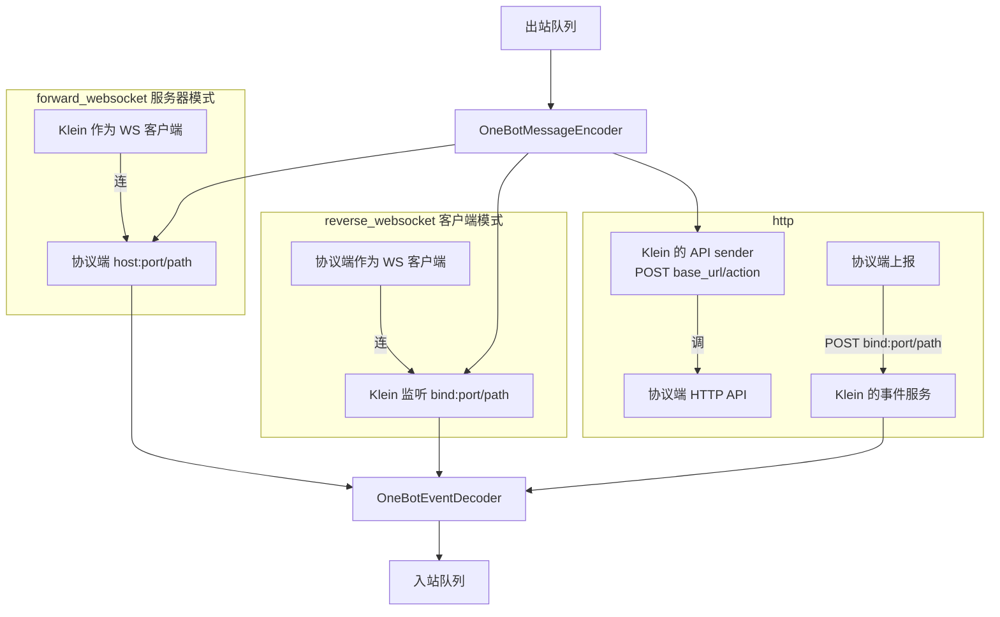

# 卷 05 · 网络与 OneBot 传输层

> 源码基准：`src/Network/`（18 文件 1230 行）+ `src/Protocol/OneBot/`（5 文件 221 行）。本层位于系统边缘：将 QQ 侧的 OneBot JSON 转换为内部 `InboundMessage`，将内部 `OutboundDelivery` 转换回 OneBot action。

## 1. 全景：三种传输模式

`communication.active_transport` 三选一，一次运行只启动一个传输线程：



配置数据结构（`TransportConfig.h`）：`TransportMode` 枚举 + 三个模式各自的 Config 结构 + 公共 `connectTimeoutMs=5000 / requestTimeoutMs=15000 / maxBodyBytes=1MB`（来自 communication.defaults）。

## 2. 共享 WS 会话（OneBotWebSocketSession.cpp，服务器/客户端模式复用）

`runOneBotWebSocketSession(ws, ioContext, inbound, outbound, apiChannel, decoder, encoder, running)` 是两种 WS 模式的会话核心——**单线程同时驱动一个异步读 + 至多一个异步写**：

```cpp
// 伪代码还原（真实实现为 lambda 状态机）
startRead();                                  // 挂起 async_read，完成置 readCompleted
while (running) {
    if (!writePending)                        // ① 没有在途写 → 先弹 API action（有调用方在等），
        if (apiChannel.tryPopAction(a))       //    再弹业务投递；同一写槽串行发出
            writePayload = a.toJson().dump();
        else if (auto d = outbound.tryPop()) {
            voiceCleanup.hold(voiceAttachmentPath(d->message));   // 语音附件登记
            writePayload = encoder.encode(*d).toJson().dump();
        }
        if (writePayload) {
            webSocket.text(true);
            async_write(writePayload);        // 挂起，完成置 writeCompleted
        }
    ioContext.run_for(50ms); ioContext.restart();   // ② 泵 50ms 异步事件
    if (writeCompleted) {                     // ③ 写落定：清 payload、删语音附件；错误→抛异常断线
        ...
        if (writeError) throw beast::system_error(writeError);
    }
    if (readCompleted) {                      // ④ 读落定：先试 API 响应帧（resolve 兑现），
        payload = buffers_to_string(readBuffer);   //   再试事件帧→入队；解析异常只记日志不断线
        try {
            if (auto r = decoder.decodeResponse(payload)) apiChannel.resolve(*r);
            else if (auto e = decoder.decode(payload)) inbound.push(*e);
        }
        catch (...) { LOG_ERROR("OneBot WebSocket数据解析失败"); }
        startRead();                          // 继续挂下一个读
    }
}
// 退出路径：failAll 兑现全部未决 API 调用 → cancel socket → ioContext.run() 排空 → close
```

关键行为：

- **出队即编码**：业务投递的 OneBot action JSON 在这里才生成（队列里是协议无关的 OutboundDelivery）。
- **写是串行的**（`writePending` 门闩）：同一时刻最多一条在途写，天然避免 Beast 不允许并发写的问题；代价是吞吐受限——每 50ms 最多处理一条写+一条读。
- **API 调用优先**：`WebSocketApiChannel` 的 action 队列先于业务投递出队——`call()` 的调用方在同步等响应，不能排在 may-lose 的业务消息后面。异常断线与正常退出都会 `failAll()` 把未决调用按 `networkError` 兑现，调用方不会悬挂到超时。
- **读到的 API 响应**（协议端对 action 的 echo 回包）：`decoder.decodeResponse` 识别"无 `post_type` 且带 `echo`"的帧，先交 `DeliveryReceiptRegistry` 兑现业务投递回执（echo ≥ 2^40 的高段），未命中再按 echo 兑现 `WebSocketApiChannel` 的 promise；超时已放弃的 echo 迟到到达时静默丢弃。带 `correlation_id` 的业务投递因此能拿到 `sent`/`failed`/`unknown` 与协议端真实 `message_id`（R0.2，见本章附录）；无 `correlation_id` 的投递仍不带 echo，保持历史的 fire-and-forget。
- **语音附件清理**（`VoiceAttachmentCleanup`，RAII）：`hold()` 登记本条投递的音频路径，写完成回调后 `cleanup()` 删除文件——无论成功失败（队列无重试，离队即终态）。前提注释说明：同机部署下 NapCat/Lagrange 等在动作处理时同步读取 record 文件，发送返回后删除是安全的。进程崩溃残留交给系统临时目录清理。
- **退出不阻塞**：`running=false` 后 cancel socket 使挂着的 async_read 立即完成（错误），循环退出，`run()` 排干 io_context 后 close。

## 3. 服务器模式 WebSocket（MyWebSocket.cpp，forward_websocket）

```
while (running) {
    try {
        io_context ioc;
        websocket::stream<tcp::socket> ws(ioc);
        if (token 非空) ws.set_option(decorator{Authorization: Bearer <token>});  // 升级请求头
        resolver.resolve(host, port) → connect → ws.handshake(host:port, path);
        LOG_INFO("WebSocket（服务器模式）连接成功！");
        runOneBotWebSocketSession(...);
    } catch (boost::system::system_error &se) {
        if (running) LOG_ERROR("WebSocket（服务器模式）异常（目标 host:port/path）：" + localToUtf8(se.what()));
    } catch (e) { if (running) LOG_ERROR("WebSocket（服务器模式）异常（目标 host:port/path）：" + e.what()); }
    if (running) { LOG_FATAL("WebSocket（服务器模式）已失联（目标 host:port/path），5秒后将重新连接..."); waitForReconnect(5s); }
}
```

`waitForReconnect`：100ms 粒度睡到 deadline，保证停止信号能立刻打断等待。重连是**全新 io_context + 全新连接**，无状态残留。

**错误日志三条纪律**：① `boost::system::system_error` 单独 catch（`beast::system_error` 是其子类，一并接住），消息经 `utils::localToUtf8` 转码——Windows 系统错误消息是本地 ANSI 代码页（中文系统为 GBK），直接进 UTF-8 日志即乱码；自家 UTF-8 异常绝不能过该转换（会把 UTF-8 当 GBK 二次转坏），所以两条 catch 分立（2026-09-19 真机回归）。② 错误消息内嵌的编译期源位置（构建机路径）已在 `kleinbot_boost` INTERFACE 层禁用（见卷02），服务器/客户端模式 WS 与 HTTP 事件服务三处接入。③ **日志必须自带本程序配置的端点**：`Connection refused`、`bind: Address already in use` 等系统原文不含地址，服务器模式记 `host:port/path`，客户端模式 / HTTP 事件服务记监听的 `bind:port`；客户端模式对 `address_in_use` 额外提示“协议端服务器模式是否也用了该地址”（2026-10-19）。

## 4. 客户端模式 WebSocket（MyReverseWebSocket.cpp，reverse_websocket）

Klein 当服务端，接受**一个**连接（单 socket 模型，无多客户端/广播）：

```
while (running) {
    acceptor: open(v4) + reuse_address + bind(bindHost,bindPort) + listen()
    async_accept（100ms 泵等待，退出时 cancel+close）
    async_read HTTP 升级请求（同样可取消）
    ① Bearer 校验：isAuthorization 不匹配 → 写 401 (WWW-Authenticate: Bearer) → 关连接 → continue 重新监听
    ② 路径校验：request.target() != path → 404 → continue
    websocket::stream ws{move(socket)}; ws.accept(request);     // 完成 WS 升级
    runOneBotWebSocketSession(...);
}
// 会话/监听异常 → 系统错误 catch 转码并带 bind:port 记日志 → "WebSocket（客户端模式）已失联（监听 bind:port），10秒后将重新连接" → waitForReconnect(10s)
```

细节：鉴权先于路径（401 优先于 404）；`Server: KleinBot` 响应头；keep_alive(false)。`bind()` 抛 `address_in_use` 时单独走一条日志，明确写出被占用的 `bind:port` 并提示协议端服务器模式与 Klein 监听不能共用同一地址；该分支仍保持 10 秒重试，不退出进程。

## 5. HTTP 传输（OneBotHttpTransport.cpp）

`run()` 里启动**两个角色**：API sender 子线程（出站）+ 事件服务（入站，本线程）。

### 5.1 API sender（Klein → 协议端）

```
while (transportRunning && running) {
    delivery = outbound.tryPop();  没有就睡 50ms
    VoiceAttachmentCleanup cleanup{voiceAttachmentPath(delivery)};   // 离队即登记，迭代结束删除
    action = encoder.encode(delivery);
    url = base_url + "/" + action.action      // base_url 尾带 / 则直接拼
    POST url, body=action.params.dump(), Content-Type: application/json
    可选 Authorization: Bearer <api.access_token>
    超时/取消：connectTimeoutMs/requestTimeoutMs + 双开关 progress callback
    （HttpCancellationState 观察 transportRunning 与 running 两个原子量）
    失败：CURLE 错误→LOG_ERROR；HTTP 非 2xx→LOG_ERROR 状态码；body 有内容则解析并检查
    status!="ok" || retcode!=0 → LOG_ERROR。响应体无重试语义。
}
```

SSL：`VERIFYPEER=1, VERIFYHOST=2`（默认证书校验）。

### 5.2 事件服务（协议端 → Klein）

Beast 实现的极简 HTTP 服务器，每连接串行处理（accept → 读请求 → 响应 → 关闭 keep_alive=false）：

| 检查（顺序固定） | 失败响应 |
| --- | --- |
| 读取请求（超时=requestTimeoutMs，体上限=maxBodyBytes） | body_limit → `413 Payload Too Large`；其他读错误 → `400` |
| 方法必须 POST | `405` |
| 路径必须 == eventPath | `404` |
| Content-Type 前缀必须 `application/json` | `400` |
| 认证（二选一通过即可，仅当配置了任一凭据） | `401` + Warning 日志 |
| body 必须是含 `post_type` 的 JSON 对象 | `400` |
| 全过 → decode → 入队 → **`204 No Content`** | |

认证规则：`bearerAuthorized = eventAuthToken 非空 且 Bearer 匹配`；`signatureAuthorized = eventSignatureSecret 非空 且 X-Signature 匹配 HMAC-SHA1(secret, raw_body)`。`authenticationConfigured = 任一凭据非空`。两者都没配则放行（内网部署场景）。事件服务的系统异常日志统一携带监听的 `events.bind:events.port`，`address_in_use` 单独提示端口已被占用。

## 6. 鉴权与签名（BearerAuth / WebhookSignature）

### BearerAuth（BearerAuth.cpp）

- `buildAuthorizationValue(token)` → `"Bearer " + token`。
- `isAuthorization(header, expected)`：
  - `expected` 为空 → **true**（没配就放行）；
  - 按第一个空格切 scheme，大小写不敏感比较 "Bearer"；跳过多余空格；
  - token 比较用**常数时间** `constantTimeEqual`：`difference = len1^len2`，逐位 OR 进 `difference`，最后判 0——耗时与内容无关，防时序侧信道。

### WebhookSignature（WebhookSignature.cpp）

纯 C++ 实现的 SHA-1 + HMAC-SHA1（无 OpenSSL 依赖）：

- `sha1(input)`：标准实现（填充 0x80 → 补到 56 mod 64 → 8 字节大端位长 → 80 轮压缩 → 20 字节摘要）。
- `hmacSha1(body, secret)`：密钥 >64 字节先 SHA-1 归一；`inner = (key⊕0x36)||body`、`outer = (key⊕0x5c)||sha1(inner)`。
- `signSha1` → `"sha1=" + 40 位小写十六进制`。
- `isAuthorized(signatureValue, body, secret)`：secret 空 → true；否则常数时间比较"来的签名"与"本地重算的签名"。

日志约定：不输出 Secret 或签名原文。

## 7. curl 请求控制（CurlRequestControl）

所有模型/搜索/抓网页的 curl 句柄共用这套配置（`configure`）：

| 设置 | 值 | 目的 |
| --- | --- | --- |
| `CURLOPT_NOSIGNAL` | 1 | 多线程安全（不用 SIGALRM） |
| `CURLOPT_CONNECTTIMEOUT_MS` / `TIMEOUT_MS` | 默认各 300000（模型场景 5 分钟）；调用方可传自定义 | 模型长思考不被掐 |
| `CURLOPT_NOPROGRESS=0` + `XFERINFOFUNCTION=cancelWhenStopped` | running 指针 | **优雅退出的取消机制**：progress 回调每次被 curl 调用时检查 `running`，为 false 返回 1 → curl 以 `CURLE_ABORTED_BY_CALLBACK` 终止 |

辅助函数：`cancellationRequested(running)`、`wasCancelled(code,running)`（= code 是 ABORTED_BY_CALLBACK 或现在 running 已 false——后者覆盖"回调没来得及触发但已经在停"的窗口）、`failureStatusCode`（TIMEOUT→504，其他→503）、`failureMessage`（对应中文提示"模型请求超时，请稍后重试。"/"无法连接模型服务，请稍后重试。"）。

OneBot HTTP API sender 用的是自己的双开关版本（观察 transportRunning+running），不共用这套。

## 8. OneBot 编解码（Protocol/OneBot）

### 8.1 OneBotAction（OneBotAction.h）

```json
{"action": "send_private_msg", "params": {...}}
```

WS 模式整体 toJson().dump() 后作为一帧文本发出；HTTP 模式 action 拼 URL、params 当 POST body。

### 8.2 事件解码（OneBotEventDecoder.cpp）

输入：WS 文本帧或 HTTP 事件 body。流程：

1. `json::parse(payload)`——**非法 JSON 抛异常**（由调用点捕获：WS 会话记日志继续；HTTP 事件服务回 400）。
2. 不是对象或无 `post_type` → nullopt（**这就是 API 响应被丢弃的地方**）。
3. `post_type` 为空或 `"meta_event"`（心跳）→ nullopt（网络层噪声过滤）。
4. 其余事件全部接收（message/notice/request 均进入队列，由业务层按 post_type 分类处理）。

字段提取：`user_id`（默认0）、`sender.nickname/card`、`group_id`、`message_type`、`post_type`、`raw_message`、`time`、`payload_size_bytes = payload.size()`。

`message_id` 双形态（T3）：数字形态存 `message_id`（int64），字符串形态（NapCat 新版）存 `message_id_raw` 供出站 reply 段原样回填；两者皆缺时记一条 WARNING 留痕（引用降级为仅@不引用）。不能先 `value("message_id", 0LL)`——字符串形态会让 `value()` 抛类型异常丢掉整个事件。

`message` 数组遍历（逐段，缺字段跳过该段而非整事件失败）：

| 段类型 | 提取 | 去向 |
| --- | --- | --- |
| `text` | `data.text` | 累加进 `plain_text`，循环结束后统一 `trim` 首尾空白（at 段独立于 text 段，`"@bot #帮助"` 的文本段会残留空格，群聊命令匹配因此需要它） |
| `image` | `data.url`；`data.subType`（LLOneBot 键名，驼峰，无 summary；NapCat 为 `sub_type` + `summary`——两种都认；数字/字符串宽容提取）、`data.summary` | `message_data_url`（**多图只保留最后一张**——已知简化）；`image_summary` = summary 原样；`image_is_sticker` = subType 非零（QQ NT picSubType 原样透传：0 普通图、1 表情包、7 贴图/联想表情、13 热搜图、11 未见文档）或 summary 非空（R1.1：群观察路径据此给占位符加 ` sticker`、瞥视 hint 写"发送者以表情包形式发送"）。url 为空时 LOG_WARNING 列出 data 字段名（2026-10-30） |
| `video` / `record` / `file` / `json` / `forward` / `markdown` / `keyboard` | `file`（文件名）、`data`（json 卡片内层 JSON 的 `prompt`） | 追加 `attachment_labels`：`[视频]` / `[语音]` / `[文件 名]` / `[卡片 prompt]`（内层非 JSON 或无 prompt 为 `[卡片]`）/ `[合并转发]` / `[卡片]`。2026-10-30 起；此前这些段被忽略，整条消息退化成裸 `[图片]`（真机：38MB 的 png 以文件发送） |
| `mface` | `data.summary`（如 `[狗头]`） | 非空时追加进 `face_summaries`（R1.1 零成本表情，不下载） |
| `face` | `data.id`（数字/字符串） | 追加 `"face:<id>"` 进 `face_summaries`（R1.1） |
| `at` | `data.qq`（数字/字符串双形态；`"all"` 是广播不记录） | `mentioned_ids`（T3 起为群聊触发门槛与指向性回复的结构化判据） |
| `reply` | `data.id`（双形态同 message_id） | `reply_to_message_id` / `reply_to_message_id_raw`（T7b：观察通道凭它还原回复链、同线程消息互相加权） |
| 其他 | — | 忽略 |

`notice` / `request` 事件在通用字段之上补齐事件专属字段后直接返回（T4）：notice 填 `notice_type` / `sub_type` / `target_id` / `operator_id`，request 填 `request_type` / `comment` / `flag`。

### 8.3 动作编码（OneBotMessageEncoder.cpp）

`encode(delivery)` → action + params：

- 目标 variant：`DirectMessageTarget` → `action="send_private_msg", params.user_id=parseNumericId(...)`；`GroupMessageTarget` → `send_group_msg/group_id`。`parseNumericId`：`stoll` 必须消费完整字符串且结果非负，否则抛出 `invalid_argument`（**编码器采取严格校验**——上游保证 ID 为数字）。
- 回应元数据（v2.4.1 T3）：`delivery.reply` 存在时在内容段之前输出 `{"type":"reply","data":{"id":...}}`（`message_id_raw` 非空时字符串原样回填，否则数值 `message_id`）与 `{"type":"at","data":{"qq":parseNumericId(at_user_id)}}`；段顺序固定 `reply → at → 内容`，空字段跳过对应段。
- 消息段 `toSegments`（variant 分派）：

| 语义消息 | OneBot 段 |
| --- | --- |
| `TextMessage` | `{"type":"text","data":{"text":content}}` |
| `ImageMessage{Base64}` | `file: "base64://" + data` |
| `ImageMessage{Url}` | `file: data`（原样 URL） |
| `ImageMessage{LocalPath}` | `file: localFileUrl(path)`：反斜杠归一 `/`；POSIX 绝对路径前缀 `file://`，Windows 盘符/相对路径前缀 `file:///` |
| `MusicMessage` | `{"type":"music","data":{"type":"163","id":song_id}}` |
| `VoiceMessage` | `{"type":"record","data":{"file": localFileUrl(path)}}` |

新增 `OutboundMessage` 变体或 `OutboundTarget` 变体时，两个 `static_assert(!sizeof(T*))` 会让编译期直接报错强制补分支。

## 9. API 调用通道（OneBotApiChannel / WebSocketApiChannel / HttpApiChannel）

v2.4.1 T1 落地的"问了要拿答案"地基。`OneBotApiChannel` 是纯虚接口：`call(action, params, timeout=10s) → OneBotApiResult{echo, status, retcode, data, networkError}`。与 fire-and-forget 的业务投递相对，调用方在同步等答案（首个消费者是 v2.4.1 T2 的能力探测）。

**WebSocketApiChannel**（WS 服务器/客户端模式共用，main 持有、跨重连存活）：

- `call()`：加锁 → 未决表 ≥ `maxPending`（默认 64）立即按 `networkError` 拒绝 → 自增 echo（跨重连不复位）→ promise 入未决表、action 入内部队列 → 解锁后 `wait_for(timeout)`。超时则从未决表摘除并返回 `networkError`；迟到的响应帧在 `resolve` 因查无此 echo 被静默丢弃。
- `tryPopAction/resolve` 由 WS 会话线程调用（见 §2 写优先级与读分流）；会话异常断线与正常退出都会 `failAll`，把未决调用按 `networkError` 兑现。
- 已入队未写出的 action 在断线后仍会在下一条连接上补发（实现端未曾收到过，不算重复）；此时调用方可能已按失败处理——窗口极小，T1 接受该语义。

**HttpApiChannel**（HTTP 组合模式）：curl POST `${api_base_url}/${action}` 同步等响应体，无关联表（echo 仍随 body 发出便于对照）；总超时取调用方与 `requestTimeoutMs` 的较小者；curl 错误/非 2xx/响应解析失败均按 `networkError` 兑现。v2.4.1 T1 已实现并测试，main 侧装配随 T2 消费者一起接线。

## 10. 行为边界

| 边界 | 说明 |
| --- | --- |
| 业务出站无重试无对账 | 投递离队后失败即丢（HTTP sender 记日志；WS 写失败断线重连但那条消息已消费）；API 通道（§9）有对账，但业务投递不走它 |
| 客户端模式单连接 | acceptor 与会话同处一个 try 块：会话期间监听 socket 仍开着但无人 accept，第二个协议端连上来只会滞留内核 backlog；会话结束、acceptor 析构时排队连接被丢弃，随后重新 bind（reuse_address）监听。即"一次只服务一个客户端" |
| 入站多图简化 | 一条消息多张图只留最后一张的 URL |
| 事件服务明文 HTTP | 无 TLS；公网部署须由反向代理终止 TLS |
| 心跳/notice/request 进队列 | decode 只滤 meta_event；notice/request 进入队列后在 `workingThread` 交给 `EventRouter` 路由（v2.4.1 起，无订阅者静默丢弃） |

## 附：出站回执（R0.2，2026-10-28）

- `OutboundDelivery.correlation_id` 非空时，WS 会话写循环给编码后的 action 分配 echo（`DeliveryReceiptRegistry::track`，echo ≥ 2^40，与 `WebSocketApiChannel` 的低段 echo 不重叠），读循环对响应帧先 `receipts.resolve`、未命中再 `apiChannel.resolve`；断连时两者都 `failAll`。循环每秒 `sweep()` 一次，60s 未兑现按 `unknown` 回报。
- HTTP 模式：`runApiSender` 持 `DeliveryReceiptSink*`，按响应体 `status/retcode/data.message_id` 直接回报 `sent`/`failed`；curl 失败、非 2xx、异常路径由 `ReceiptOnce` 兜底 `unknown`/`failed`，一次投递只发一份回执。
- `message_id` 双形态（数字/字符串）统一由 `Protocol/OneBot/OneBotMessageId.h` 的 `oneBotMessageIdRaw` 读取。
- 无 `correlation_id` 的投递逐字保持历史行为（不带 echo）。

## 11. 本章文件清单

| 文件 | 内容 |
| --- | --- |
| `src/Network/TransportConfig.h/.cpp` | 模式枚举 + 三配置结构 + 名称函数 |
| `src/Network/WebSocketHead.h` | Boost.Beast/Asio 统一 include 与命名空间别名 |
| `src/Network/OneBotWebSocketSession.h/.cpp` | 共享 WS 会话循环 |
| `src/Network/MyWebSocket.h/.cpp` | 服务器模式（Klein 作为客户端连出）+ 5s 重连 |
| `src/Network/MyReverseWebSocket.h/.cpp` | 客户端模式（Klein 作为服务端监听）+ 401/404 + 10s 重监听 |
| `src/Network/OneBotHttpTransport.h/.cpp` | API sender + 事件服务 |
| `src/Network/DeliveryReceiptRegistry.h/.cpp` | 业务投递回执：echo 高段分配、超时/断连按 unknown 兑现、sink 扇出 |
| `src/Network/BearerAuth.h/.cpp` | Bearer 构造/常数时间校验 |
| `src/Network/WebhookSignature.h/.cpp` | SHA-1/HMAC-SHA1 + X-Signature 校验 |
| `src/Network/CurlRequestControl.h/.cpp` | curl 超时/取消/错误映射 |
| `src/Network/VoiceAttachmentCleanup.h` | 语音附件 RAII 清理 |
| `src/Network/OneBotApiChannel.h` | API 调用通道接口（echo 关联语义） |
| `src/Network/WebSocketApiChannel.h/.cpp` | WS 模式 API 通道：echo 未决表 + action 队列 |
| `src/Network/HttpApiChannel.h/.cpp` | HTTP 模式 API 通道：curl 同步请求-响应 |
| `src/Protocol/OneBot/OneBotAction.h` | action 信封（含 echo 序列化） |
| `src/Protocol/OneBot/OneBotApiResult.h` | API 调用统一回报结构 |
| `src/Protocol/OneBot/OneBotEventDecoder.h/.cpp` | 事件 → InboundMessage；响应帧 → OneBotApiResult |
| `src/Protocol/OneBot/OneBotMessageEncoder.h/.cpp` | OutboundDelivery → action |
| `src/Protocol/OneBot/OneBotMessageId.h` | `data.message_id` 数字/字符串双形态读取（WS 与 HTTP 回执共用） |
