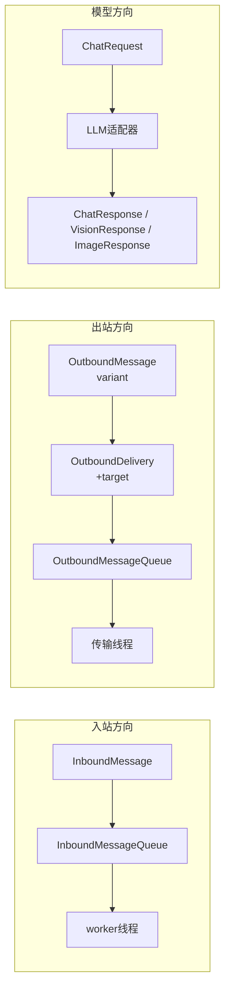

# 卷 06 · 消息模型与队列：全部 Port 数据结构

> 源码基准：`src/Port/`（9 头文件）、`src/MessageQueue/`、`src/MessageSender/`、`src/JsonParse/`。本卷为数据结构参考——全项目跨层流动的数据结构均在此定义。

## 1. Port（端口）命名由来

`src/Port/` 中的类型是**各层之间的契约**：业务层只依赖这些结构，不感知 OneBot、不感知 OpenAI。由此，新协议或新供应商只需编写新适配器，契约保持不变。



## 2. InboundMessage（InboundMessage.h）——入站消息的规范化形态

| 字段 | 类型 | 来源 | 用途 |
| --- | --- | --- | --- |
| `user_id` | uint64 | OneBot `user_id` | 一切按用户隔离的 key、调度分片 key |
| `nickname` / `card` | string | `sender.nickname` / `sender.card` | 观察通道的昵称快照（群内容库摘要可读性，T7b）；其余主链路未使用 |
| `group_id` | uint64 | `group_id` | 群聊时非 0，决定 send_private 还是 send_group |
| `message_type` | string | `"private"` / `"group"` | 过滤与路由 |
| `post_type` | string | `"message"` / `"notice"` / `"request"` / `"meta_event"` | notice/request 走事件路由（v2.4.1 起）；meta_event 在解码层丢弃 |
| `raw_message` | string | 原始文本（含 CQ 码） | 仅诊断/日志用途，不再参与任何匹配 |
| `plain_text` | string | message 数组 text 段拼接（无 CQ 码），解码器统一去首尾空白 | **聊天文本与命令匹配/参数提取都用这个** |
| `message_data_url` | string | image 段 `data.url` | 图片下载入口 |
| `image_is_sticker` | bool | image 段 `data.subType`（LLOneBot 驼峰；NapCat 形态 `sub_type` 也认）非零 或 `data.summary` 非空（与 `message_data_url` 同取最后一个 image 段） | 群观察路径：占位符写 `[image asset_id=… source=inbound sticker]`，瞥视 hint 填"发送者以表情包形式发送"（R1.1，卷23）；私聊路径不读 |
| `image_summary` | string | image 段 `data.summary` 原样（如 `[动画表情]`） | 贴纸判定依据（R1.1） |
| `face_summaries` | vector\<string\> | `mface` 段 `data.summary`；`face` 段写 `"face:" + id`（按出现顺序） | 群观察路径拼成 `[表情 …]` 进群缓冲文本（mface 的外层方括号去掉，R1.1，卷23）；私聊路径不读 |
| `attachment_labels` | vector\<string\> | 无正文也无图片 url 的段的文字标签：video/record/file/json/forward/markdown/keyboard（卷05 §段表） | 群观察路径原样拼进缓冲文本；`Message` 的聊天路径拼在用户文本后，纯 @ 无文字时占位改为"（对方@了你，没有文字，附带了：…）"（2026-10-30，此前整条退化成裸 `[图片]`） |
| `mentioned_ids` | vector\<uint64\> | at 段 `data.qq`（数字/字符串两种形态；`"all"` 广播不记录） | 群聊触发门槛与指向性回复的判断依据（v2.4.1 起替代 raw_message 的 CQ:at 字符串匹配）；观察通道的信箱标记判据（T7b） |
| `message_id` | int64 | `message_id`（数字形态） | 出站引用回复段回填（T3）；观察通道记录原始 id 供回复链解析（T7b） |
| `message_id_raw` | string | `message_id`（字符串形态，如 NapCat 新版） | 同上：编码 reply 段时优先原样回填，否则用 int64 |
| `reply_to_message_id` / `reply_to_message_id_raw` | int64 / string | `message` 数组 `reply` 段的 `data.id`（双形态同 message_id） | 入站引用关系（T7b）：群内容库凭它在消息流中还原回复链，同线程消息互相加权 |
| `message_timestamp` | int64 | `time` | |
| `payload_size_bytes` | size_t | 原始 payload 长度 | 长度粗检（×3 字节规则） |
| `notice_type` / `sub_type` | string | notice 事件的 `notice_type` / `sub_type` | 事件路由 key（notify 家族细分到 sub_type，如 `notice.notify.poke`） |
| `target_id` / `operator_id` | uint64 | poke 被戳者 / 操作者 | 事件 handler 判断响应对象 |
| `request_type` / `comment` / `flag` | string | request 事件的类型 / 验证语 / 处理令牌 | 好友申请通知与后续处理 |

**标量字段宽容提取**（2026-09-19 真机回归）：JS 系实现端（LLOneBot/NapCat）会把数字字段字符串化（JS number 精度/序列化差异），`user_id`/`group_id`/`target_id`/`operator_id`/`time`/`echo`/`retcode` 统一经 `uint64Field`/`int64Field` 提取——数字直接取、数字字符串解析（严格全数字校验，越界回退默认值）、浮点截断、其它形态回退默认值，**类型差异绝不抛异常丢整条事件**（曾因 `user_id` 为字符串抛 `type_error.302` 丢消息）；字符串字段（`post_type`/`nickname` 等）同理仅接受字符串形态。`message_id` 保持双形态特例：数字进 `message_id`、字符串进 `message_id_raw` 原样回填。API 响应的字符串 `echo` 解析回数字后可正常兑现调用方。

**raw_message 与 plain_text 的差异曾是命令系统的主要易错点**：群聊里 @ 机器人后，raw 是 `[CQ:at,qq=xxx] 你好`，plain 是 `你好`。命令匹配与参数提取已统一到 plain_text（解码器在拼接 text 段后 trim 首尾空白，"@bot #帮助" 的残留空格由这一步吸收），raw_message 退化为诊断/日志用途。详见[卷08](08-命令体系.md)。

## 3. OutboundMessage（OutboundMessage.h）——语义出站消息

```cpp
using OutboundMessage = std::variant<TextMessage, ImageMessage, MusicMessage, VoiceMessage>;
```

| 变体 | 字段 | 语义 |
| --- | --- | --- |
| `TextMessage` | `content` | 纯文本（命令回复 + 90% 场景） |
| `ImageMessage` | `source` 枚举 `Base64/Url/LocalPath` + `data` | 三种来源**用枚举显式区分**，由协议边缘决定编码（避免业务层写 `"base64://"` 这类协议细节） |
| `MusicMessage` | `song_id` (long long) | 网易云卡片（platform 字段 YAGNI 省略，编码器固定 "163"） |
| `VoiceMessage` | `audio_path` | 本地 WAV 路径 |

辅助函数 `voiceAttachmentPath(msg)`：是 VoiceMessage 则返回路径，否则 nullopt——传输层据此清理临时文件。

### OutboundDelivery（OutboundDelivery.h）

```cpp
using OutboundTarget = std::variant<DirectMessageTarget{user_id:string}, GroupMessageTarget{group_id:string}>;
// 回应上下文（v2.4.1 T3）：描述"这条消息回应谁"，与内容无关
struct ReplyContext {
    std::int64_t message_id = 0;   // >0 才编码引用段
    std::string message_id_raw;    // 字符串消息 ID（个别实现端）优先回填
    std::string at_user_id;        // 非空才编码 @ 段
};
struct OutboundDelivery { OutboundTarget target; OutboundMessage message;
                          std::optional<ReplyContext> reply;
                          std::string correlation_id; };  // 非空 = 要回执（R0.2）
```

ID 用字符串存（协议无关），编码器再转数字。**出站队列里只有这种协议无关结构**；`reply` 是投递级元数据——引用语义在 Milky/Satori 同样存在，不属于消息内容，因此不做成 `OutboundMessage` 变体。`correlation_id` 也是投递级元数据：非空时传输层索要协议端回执（取值约定为 affect 执行记录的 `execution_id`），空时逐字保持历史的 fire-and-forget。

## 4. MessageSenderPort（MessageSenderPort.h）——出站端口

```cpp
class MessageSenderPort {
    virtual void deliver(OutboundDelivery delivery) = 0;   // v2.4.1 T3 收敛为单一入口
};
```

早期版本是 `send_private/send_group` 两方法族；引入回应元数据后收敛为单一 `deliver`：私聊/群聊由 target 变体携带、引用+@ 由 `delivery.reply` 携带，都是"这条消息怎么发"的一部分，方法族会随元数据增长持续膨胀。实现 `QueuedMessageSender`（MessageSender/）只是把投递塞进出站队列，**不做协议编码、不管 socket**。群聊路径的 `reply` 由 `buildReplyContext` 纯函数决定（被 @ 才指向，且仅本轮第一条出站；同一轮后续分条/多消息不重复引用；固定行为无配置；bot 自身消息回声不 @ 自己）。

## 5. 两个队列（MessageQueue/）

**入站连发合并（R2.2，2026-11-08，私聊范围）**：`InboundMessageQueue` 本身不变；主线程 `tryPop` 之后、提交执行器之前多一层 `Application/InboundCoalescer`（纯逻辑、只在主线程用）。可合并的私聊纯文本先进该用户的连发桶，放行时整桶成为一个 `Burst{user_id, messages}`，原消息逐条保留、不拼接。规则见[卷07 §4](07-消息调度与路由.md#4-与主循环的配合回顾卷03-8)。**项目规则（2026-11-08，铁律）**：合并只改时机，不改回复条数。N 条入站 → N 次回复，顺序与对应关系由代码保证；绝不拼接成一条让模型一次回完；给模型的只是事实性注记（后面还有哪几条、原文、会各自单独回复），不写"必须怎么答"的规则。

`InboundMessageQueue` / `OutboundMessageQueue` 结构完全相同：

```cpp
std::queue<T> queue; std::mutex mutex;
push(T)          // 加锁入队
tryPop() -> optional<T>   // 同一把锁内完成"判空→move队首→弹出"
```

- 无容量上限（背压在上游 KeyedTaskScheduler 的 maxPendingMessages 兜）、无确认/持久化（进程重启即丢）。
- `tryPop` 把判断和弹出放同一临界区，避免 TOCTOU。

## 6. LLM 请求/响应合同（ChatRequest/ChatResponse/VisionResponse/ImageResponse + LLMPort）

### 6.1 ChatMessage（ChatRequest.h）

```cpp
struct ToolCallRequest { string id; string name; string arguments; /*JSON 字符串*/ };
struct ChatImageContent { string asset_id; string mime_type="image/jpeg"; string base64_data; };
struct ChatMessage {
    string role;                    // system/user/assistant/tool
    string content;
    string tool_call_id;            // role==tool 时：配对 assistant 的工具调用
    vector<ToolCallRequest> tool_calls;  // role==assistant 且要调工具时
    vector<ChatImageContent> images;     // ★ 仅存在于当前请求，不进历史/不落库
};
```

`ChatRequest`：`system_prompt` + `history` + `tools`（**每项是完整 OpenAI tool 定义的 JSON 字符串**；空=本请求不带工具）+ 采样参数（temperature/frequency_penalty/presence_penalty/max_tokens）。

### 6.2 ChatResponse

| 字段 | 含义 |
| --- | --- |
| `cancelled` | 程序停止导致的取消（上游见到直接放弃，不解析内容） |
| `multimodal_unsupported` | 供应商以明确 4xx 拒绝图片（触发 ChatService 的降级重试，见[卷10](10-ChatService与Agent循环.md)） |
| `code` | HTTP 状态码（200 成功；传输失败被映射为 503/504；Dock 找不到标准时 -1） |
| `content` / `finish_reason` | 文本 / stop/length/tool_calls/content_filter… |
| `tool_calls` | `ResponseToolCall{id,name,arguments-JSON字符串}` |
| `input/output/total_tokens` | 用量统计 |
| `error_message` | 失败描述（成功为空） |

`VisionResponse` 多一个 `refusal`（内容审核拒绝理由）；`ImageResponse` 是 `image_base64`。

### 6.3 LLMPort（LLMPort.h）

```cpp
class LLMPort {
    virtual ChatResponse request_chat(const ChatModel&, model_name, const ChatRequest&) = 0;
    virtual VisionResponse request_vision(const ChatModel&, model_name, prompt, base64) = 0;
    virtual ImageResponse request_image(const ChatModel&, model_name, prompt) = 0;
};
```

三个方法对应聊天/看图/画图。适配器无状态（proxy + running 指针除外）。

## 7. ChatModel（ModelRegistry/ChatModel.h）——供应商配置的运行时形态

```cpp
struct ChatModel {
    std::unordered_set<std::string> modelList;  // 该供应商条目下的全部模型名
    std::string api_key, endpoint, api_standard;
    ChatModelCapabilities capabilities;         // {vision:bool=false}
};
```

注意它同时被用作"模型查找结果"（modelList 是多条名字共享一份 key/endpoint）。dock 按其中的 `api_standard` 路由适配器，按 `hasVision(modelName)` 决定多模态路由——能力按模型名标注（同一组内各模型可以不同，[卷10](10-ChatService与Agent循环.md)）。

## 8. JsonParse 单例（JsonParse/）——遗留工具

历史遗留的 JSON 工具（**新代码不应使用**，架构测试标记为已知穿刺点）：

| 方法 | 行为 |
| --- | --- |
| `getJsonKeyValue(json, key)` | 深度优先递归找第一个匹配键；字符串返回值，其他 dump；找不到空串 |
| `findKeyAndValue(text, key, out)` | parse 后递归找（只认字符串值） |
| `toJson(message)` | `json(message).dump()` 去外层引号 → JSON 字符串转义 |
| `getAttributeFromChoices` | **有 bug 的遗留函数**：类型检查写反（对数组调 is_object），返回值恒为空——当前无调用方，视为死代码 |

现存使用方主要是 Message/Command 层的历史 include。写新代码请直接用 nlohmann::json。

## 附：OutboundDelivery.correlation_id 与 DeliveryReceipt（R0.2，2026-10-28）

- `Port/OutboundDelivery.h` 新增 `std::string correlation_id`（空 = fire-and-forget）。约定取值 = affect 执行记录的 `execution_id`；无记录器时为 `utils::uniqueId("dlv")`。
- `Port/DeliveryReceipt.h`：`DeliveryReceipt{correlation_id, status(sent|failed|unknown), message_id_raw, retcode, detail}` 与消费端口 `DeliveryReceiptSink`。
- `Application/DeliveryReceiptFanout.h`：组合根把回执扇出给 `affect::DecisionRecorder`（执行记录回填）与 `SelfMessageReceiptSink`（群自消息回填）。
- 一轮回复的文本每段都带关联键（2026-10-28 修订）：首段用裸 `execution_id`（驱动执行记录状态），后续段用 `execution_id#序号`（只把该段 `message_id` 聚合到同一条执行记录）；无文本时给第一条出站消息；命令回复与系统提示不带。

## 9. 本章文件清单

| 文件 | 定义 |
| --- | --- |
| `src/Port/InboundMessage.h` | 入站规范化消息 |
| `src/Port/OutboundMessage.h` / `OutboundDelivery.h` | 出站语义消息 / +目标 |
| `src/Port/DeliveryReceipt.h` | 投递回执结构（sent/failed/unknown + 真实 message_id）与 `DeliveryReceiptSink` 端口 |
| `src/Port/MessageSenderPort.h` | 出站端口接口 |
| `src/Port/ChatRequest.h` / `ChatResponse.h` / `VisionResponse.h` / `ImageResponse.h` | LLM 合同 |
| `src/Port/LLMPort.h` | 模型端口接口 |
| `src/MessageQueue/InboundMessageQueue.h/.cpp` / `OutboundMessageQueue.h/.cpp` | 双队列 |
| `src/MessageSender/QueuedMessageSender.h/.cpp` | 端口的队列实现 |
| `src/ModelRegistry/ChatModel.h` | 供应商配置形态 |
| `src/JsonParse/JsonParse.h/.cpp` | 遗留 JSON 工具 |
