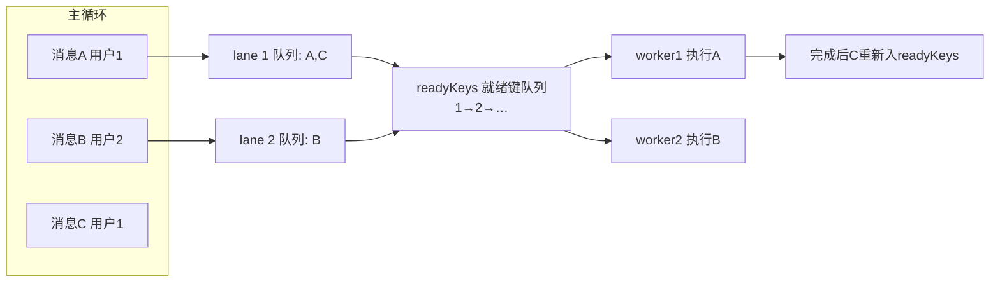
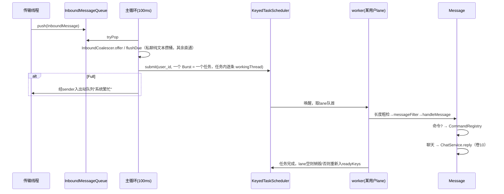

# 卷 07 · 消息调度与路由：KeyedTaskScheduler 与 Message 路由器

> 源码基准：`src/utils/KeyedTaskScheduler.h/.cpp`、`src/Message/Message.h/.cpp`。这一卷回答两个问题：**消息怎么被调度到线程**（[§1–4](#1-keyedtaskscheduler-的设计目标)），**一条消息进来后走哪条路**（[§5–9](#5-message-路由器messagehcpp)）。线程池的尺寸规则（最小/最大/扩缩容条件）与全项目同步原语清单集中于[卷22](22-并发与线程模型.md)。

## 1. KeyedTaskScheduler 的设计目标

朴素实现（每条消息创建一个线程）存在两个严重问题：同一用户的两条消息并发执行会产生会话写竞争；线程数量不可控。Klein 的方案（ADR-012）：

> **按 key（user_id）分 lane：同一 lane 的任务严格串行，不同 lane 并行；worker 池动态伸缩；未执行任务总量有上限（背压）。**



## 2. 数据结构（KeyedTaskScheduler.h）

```cpp
struct Lane { std::deque<std::function<void()>> tasks; bool scheduled=false; };
// scheduled：该 lane 是否已在 readyKeys 里排队（防止重复入队）

std::unordered_map<uint64_t, Lane> lanes;   // key → 待执行任务队列
std::queue<uint64_t> readyKeys;             // 有活干的 lane 的 FIFO（公平调度）
std::vector<WorkerRecord> workers;          // {thread, shared_ptr<atomic<bool>> finished}
std::size_t liveWorkers, idleWorkers, outstandingTasks;
bool stopping;
std::condition_variable taskAvailable;
```

`outstandingTasks` = 已提交未完成的任务总数（**背压计数器**，含正在执行和排队的）。

## 3. 逐函数走读

### 3.1 构造（纠正参数 → 起初始 worker）

所有参数做下限钳制：`initial≥1`、`max≥initial`、`maxPending≥1`、`idleSeconds≥1`；`workers.reserve(max)`；起 `initial` 个 worker。**注意 options 是拷贝进对象的**（组合根传入的 MessageExecutionOptions 不被共享修改）。

### 3.2 submit(key, task) —— 主循环调用点

```
reapFinishedWorkers()                        // 顺带回收已退出线程（见3.6）
加锁：
  stopping → 返回 Stopping
  outstandingTasks >= maxPendingMessages → 返回 Full        // 背压拒绝
  lanes[key].tasks.push_back(task)；++outstandingTasks
  if (!lane.scheduled) { lane.scheduled=true; readyKeys.push(key); }
  scaleUpLocked()                            // 动态扩容（见3.5）
解锁后 taskAvailable.notify_all()
返回 Accepted
```

### 3.3 workerLoop —— 每个 worker 的主循环

```
while (true) {
  加锁：
    ++idleWorkers
    if (dynamicScaling && liveWorkers > initial)          // 弹性 worker：限时等待
        ready = cv.wait_for(lock, idleSeconds, []{stopping || !readyKeys.empty()})
    else                                                    // 基础 worker：无限等待
        cv.wait(lock, 同上)
    --idleWorkers

    if (stopping && readyKeys.empty()) { --liveWorkers; finished=true; return }   // 退出①
    if (!ready && readyKeys.empty() && liveWorkers > initial)
        { --liveWorkers; finished=true; return }                                  // 退出②：弹性worker空闲超时自杀
    if (readyKeys.empty()) continue                     // 虚假唤醒
    key = readyKeys.front(); readyKeys.pop();
    task = move(lanes[key].tasks.front()); pop_front();
  解锁

  try { task(); } catch(...) { errorHandler(current_exception()); }   // 异常绝不杀worker

  加锁：
    --outstandingTasks
    if (lanes[key].tasks.empty()) lanes.erase(key)       // lane 清空即销毁
    else { readyKeys.push(key); notify_one(); }          // ★ 同 key 后续任务此刻才重新可见
}
```

**串行性保证的关键机制**：lane 从 readyKeys 取走后 `scheduled` 仍为 true，worker 执行期间后续 submit 到同 key 的任务只会进入 lane 队列、不会重复进入 readyKeys；直到任务完成，lane 若非空才重新 push 回 readyKeys。因此同一用户的前一条消息未处理完成前，后一条绝不会被其他 worker 取得。

**errorHandler**：组合根传入的 lambda 把 `std::exception_ptr` 重抛并打 LOG_ERROR（"消息处理任务异常：…"）——单条消息的业务异常不会传染其他消息。

### 3.4 shutdown

```
加锁：workers 为空直接返回（幂等）
stopping=true；清空 lanes 与 readyKeys（未开始的任务被丢弃，outstandingTasks 相应扣减）
把 workers 换出到局部；notify_all
锁外逐个 join
```

活动任务会执行完毕（worker 满足 stopping && readyKeys empty 条件才退出），**排队中未开始的任务被静默丢弃**——即退出过程可能丢弃部分消息，这是已知并接受的设计行为。

### 3.5 scaleUpLocked（动态扩容）

条件：`dynamicScaling && liveWorkers < max`。计算 `shortage = readyKeys.size() - idleWorkers`（排队的 lane 数超过空闲 worker 数），补充 `min(shortage, max-live)` 个。**扩容仅在 submit 时触发**——负载升高时自动增加 worker。

### 3.6 reapFinishedWorkers

弹性 worker 自杀时线程对象还挂在 `workers` 里（finished=true）。下次 submit 顺带把已 finish 的线程移出并 join——避免析构时 join 卡住已退出的线程，也避免频繁销毁调度器内部结构。

## 4. 与主循环的配合（回顾卷03 §8）

### 入站连发合并（R2.2，2026-11-08，私聊范围）

**项目规则（2026-11-08，铁律）**：合并只改时机，不改回复条数。N 条入站 → N 次回复，顺序与对应关系由代码保证；绝不拼接成一条让模型一次回完；给模型的只是事实性注记（后面还有哪几条、原文、会各自单独回复），不写"必须怎么答"的规则。

- **合并对象**（`InboundCoalescer::coalescable`）：`post_type==message`、`message_type==private`、`plain_text` 非空、无图片（`message_data_url`）、无附件标签、无表情段、不以 `#`/`＃` 开头。
- **直通**：其余一律立即放行——命令、图片/附件、空正文、notice/request、**群聊**（群 @ 路径每条有自己的决策记录与回执，合并留到 enforce 之后）。直通前先把同一用户桶里已攒的消息按序 flush，再放行它自己，保证该用户 lane 上的处理顺序与到达顺序一致。
- **放行条件**（主循环每 tick 调 `flushDue`）：自最后一条起静默 ≥ `kSilenceMs=1500`，或条数 ≥ `kMaxBurst=5`，或自首条起 ≥ `kMaxWaitMs=10000`（兜底：正常节奏下最长约 6s 就会因前两条放行）。常量在头文件，按用户决定暂不做配置项。
- **N 进 N 出**：一个 Burst 提交为该用户 lane 上的**一个**任务，任务内逐条调 `workingThread → Message::handleMessage(msg, burstNote)`。每条照常写穿历史、照常回复（分段、语音路径不变），第 i+1 条处理时历史里已有前面的问答。`burstNote = burstFollowUpNote(messages, i)`：后面还有几条、原文逐条列出（标明不可信数据）、会各自单独回复；最后一条与单条 Burst 为空，请求与合并前逐字相同。注记经 `ChatService::reply` 的 `tailNote` → `appendContextNote` 以「[系统注]」尾插到请求副本，不落库。
- **代价**：可合并的私聊文本至少延迟 1.5s 才开始处理。
- **队列满**：整桶拒绝，桶内每条（过 `messageFilter` 的）各回一次「系统繁忙」，与此前逐条拒绝一致。
- **退出**：主循环退出后 `flushAll()` 取出剩余桶，只记 `LOG_INFO` 丢弃条数，不再提交。


主循环 `submit` 返回 `Full` 时的处理：给"本会处理的消息"（过滤通过的）回一条"系统繁忙"——注意这里直接调 `messageClass.sendError`，**不经过调度器**（否则排队语义又会被背压挡住）。

## 5. Message 路由器（Message.h/.cpp）

`Message` 持有 10 个依赖引用（构造注入），自身**无用户持久状态**。配置都经组合根的活值引用读取（ADR-023）：`MessageOptions{bot, groupChatEnabled}`（`const Live<MessageOptions> &`，L1.f）、语音总开关 `global_Voice`（`const Live<bool> &`，L1.c；管理员命令与配置重载改的是同一份）、`affect`（`const Live<AffectOptions> &`，L1.f 起读 `enforce`；L2.c 起每条消息在决策点取一次快照，经 `DecisionPolicy::resolve` 选出这条消息实际用的策略——构造注入的是始终存在的策略外壳 `SwitchingPolicy`，记录开关问 `DecisionRecorder::enabled()`）。`MessageOptions` 里的 `bot` 名字与别名自 L2.d 起随 `bot.name`/`bot.aliases` 重载同步换（`id`、`manager_id` 保持运行值）。另外持有 `visionModel`（`EndpointProvider`，每次调用时解析，L1.b 起配置这一半也取活值）。

### 5.1 classify——两行分类器

```cpp
post_type != "message" → SystemEvent   // 防御性兜底；正常情况下到不了这里（见下）
否则 → Chat                            // 命令与否在下一层判断
```

`Intent::Vision` 枚举值存在但**当前没有分支产生它**（历史遗留，图片走 Chat 内的多模态路由）。

**notice/request 的分流点在 classify 之前**（v2.4.1 T4）：`workingThread` 入口先判 `post_type != "message"`，是则交给 `EventRouter::dispatch`（`src/Application/EventRouter.{h,cpp}`，与 CurrentImageRouting 等路由助手同层）——按 `routeKey`（`notice.notify.poke` / `notice.group_increase` / `request.friend` …）分发给注册的 handler，无订阅者的事件静默丢弃（与 v2.4.0 行为一致）。事件仍按 `user_id` 占用调度 lane：同一人的事件与对话天然串行。classify 的 SystemEvent 分支因此退化为防御性兜底。

**当前注册的订阅者**（v2.4.1 T6，`src/Event/` 子系统，组合根在 main.cpp 构造并订阅）：

| 路由键 | handler | 行为要点 |
| --- | --- | --- |
| `request.friend` | `FriendRequestNotifier` | flag 去重（内存 1h TTL）→ `get_stranger_info` 尽力附昵称（失败省略）→ 私聊通报管理员；绝不调 `set_friend_add_request`（v2.4.4 范围） |

进群欢迎与戳一戳回应 handler 曾随 T6 落地，因部署模型对事件场景持续输出应答式退化文本（"我在/收到/未收到事件内容/嗯我听着"，四轮 prompt 迭代无效）于 2026-09-10 撤下——`notice.notify.poke`/`group_increase`/`group_decrease` 现无订阅者，回归静默丢弃（与 v2.4.0 一致）；重做前需先解决模型侧问题（见迭代计划修订四/五，内部笔记），`GroupPoke` 能力位与 git 历史均保留。

`FriendRequestNotifier` 为纯文本通报，不涉模型生成。事件回应的教训已沉淀：对事件场景的模型生成 prompt 应使用**纯自然叙事**（通知/事件/任务等元词汇和方括号标记会被模型当成需要应答的对话），人格装配宜用管理员会话（部署者调好的口吻，且不为事件当事人建幽灵会话）。冷却/概率/延迟类常量遵循零旋钮定规，不进配置。

### 5.2 handleMessage——总入口逐段（Message.cpp:35–121）

```
① SystemEvent → return
② Chat：CommandContext{user_id, group_id, message_type, data}
   registry.execute(plain_text, ctx) 命中 → dispatch(结果) → return     ★ 命令优先
   // 匹配用去空白 plain_text：raw_message 带 [CQ:at,…] 前缀，群里永远全等不上
③ 聊天路径（try/catch 包裹，异常只 stderr 打印不回复）：
   a. 打印控制台轨迹 [type]user:plain_text
   b. 图片处理：message_data_url 非空 →
      asset = imageAssetStore.importFromUrl(user_id, url, 0)   // 下载+登记（卷16）
      成功 → conversationText 追加 "\n[image asset_id=… source=inbound]"
              currentImage = ChatImageContent{asset_id, mime, base64}   // 本次请求的临时图片
   b2. 纯@无文字无图片（conversationText 仍为空）→
       置为"（对方只是@了你，没有附带任何文字）"占位：
       空 user 消息会让模型答非所问（"没有收到你的消息内容"之类），
       占位让人格自然接住这次点名
   b3. 观察通道话题注入（T7/T7b 消费端）：群聊 →
       ① onAtActivated(group, plain_text)：@ 硬激活话题会话（意志层 v2，
       开会话不回答；回答走本流程）
       ② groupContext.assemble(group, plain_text) 非空 → 写入 requestContext
       （相关性选择原文块/摘要；只进请求副本，不拼进 conversationText）
       ③ 空选退回 perception.topicNoteFor(group)（"群里最近常聊：…"，
       count≥2 才给；数据注记走请求副本的 user 尾部保住管理员 system
       前缀缓存——technical-design §10.8）
   c. 上下文对所有用户开放（2026-09-19 缺陷修正，原仅管理员）
   c2. 新朋友第一句话（私聊 + takeFirstContact 进程内首次 + 无历史会话）→
       组装 situationNote 经 reply 参数注入该轮 system prompt（服务契约之后）：
       先回应对方、再顺带一两句话自我介绍。行为约束归 system 而非用户文本前插；
       hasChatHistory 排除重启后的老朋友；缓存代价为该用户一次性 prefix miss
   c3. 事实卡（经历层 E0，ADR-026）：群聊、当条消息的 affect.enabled 快照为真且接了
       DeployerFacts → 部署者事实段追加在群聊收敛契约之后（situationNote，进 system）；
       现场事实（日期、星期、时刻）并入 tailNote（已有 burstNote 时换行接在后面），
       经 appendContextNote 以 "[系统注]" 尾插；judge 的材料不带它。私聊不加
   d. chatReply = chatService.reply(user_id, conversationText, currentImage,
                                    situationNote, requestContext, …, tailNote)  → 卷10
      // M0 边界（2026-10-25）：conversationText 只含用户原文（及图片占位符），
      // 用于会话落库、自动召回和长期记忆提取；requestContext 仅附在请求副本的
      // 最后一条 user 消息尾部，模型可见但不落库、不参与召回/提取
   e. attachToConversation(user, inboundAssetId, chatReply.user_message_id)
      // 把入站图片回填关联到这轮 user 消息的 SQLite id（先 reply 后 attach，因为 id 在落库时才产生）
   f. 逐条 dispatch(chatReply.outbound_messages, replyContextPending)
      // 工具产生的图片等；本轮第一条出站带引用+@，之后 replyContextPending=false
   g. 文本回复为空（语音已发/纯图片轮）→ return
   h. dispatchText(llm_text, replyContextPending)
      // 2026-11-16 起 Message 没有语音分支（每人语音模式删除，ADR-025）：她要用语音时调用
      // send_voice 工具，语音（或合成失败时的原话文字）已在步骤 f 随 outbound_messages 发出，
      // 工具声明 suppress_text_reply，这一轮文本为空，在步骤 g 返回
      // 私聊整条单发；群聊一句一条，仅首段引用+@、后续裸发
```

### 5.3 dispatch——出站方向选择

构造 `OutboundDelivery` 后 `sender.deliver(...)`（单一出站入口，v2.4.1 T3）。群聊路径的指向性由 `buildReplyContext(data, bot)`（`src/Application/ReplyContextRouting.h` 纯函数，固定行为无配置）决定：**消息 @ 了 bot（点名应答）时，本轮第一条出站引用+@ 回发起人；同一轮的后续分条/多消息是裸消息**，不再重复指向同一条 @。没 @ bot 的回复（v2.4.2 接话/观察路径）是裸消息——被点名才看着对方回答，自己凑过来的话不正式其事地引用。bot 自身消息回声不指向自己；私聊不引用。

### 5.4 dispatchText——私聊单发、群聊一句一条（Message.cpp）

上限：群 5000 字符、私聊 4096。按场景分流：

- **私聊 `splitTextWhole`**（utils/TextSplit）：整条原样单发，换行保留在消息内；仅超 4096 字符时按 UTF-8 字符硬切兜底——逐字符按首字节判断 UTF-8 长度（F0→4、E0→3、C0→2、否则 1），数够 n 个**字符**（不是字节）后切，绝不把汉字切半。
- **群聊 `splitTextSegments`**（utils/TextSplit）：按"一句一条"分条（真人打字习惯）——单个换行即分条边界、空行丢弃、``` 代码块整体一条（内部换行不拆，未闭合按已积累内容发）、最多 10 段（溢出以换行并入末段防刷屏）、超长段按 UTF-8 字符硬切。

分段之间 `sleep 500ms`（模拟真人连发节奏，也规避 QQ 风控连发）。群聊分条只有第一段带引用+@，后续段以普通群消息直接发出，不重复引用同一条 @ 消息。

### 5.5 messageFilter——业务过滤（v2.4.1 起结构化）

签名 `messageFilter(const InboundMessage&)`：非 message 事件拒（防御，notice/request 已在 workingThread 分流）；群聊：先取一份 `MessageOptions` 快照（L1.f 起群聊开关重载即生效，`bot` 身份保持运行值），总开关关拒 / `mentioned_ids` 不含机器人 QQ 号拒（解码器解析 at 段的结构化字段，替代旧版 raw_message 的 `CQ:at` 字符串匹配——顺带消除"正文含机器人 QQ 号数字即误触发"的缺陷；@全体成员是广播不触发）；私聊放行。

过滤结果同时驱动观察通道（v2.4.1 T7）：失败路径（非 @ 群消息）先 `perception.observeMessage` 再返回，通过路径在 handleMessage 前调 `observeInteraction`——监控群内"只看不说"地累计话题热度与亲密度计数（总开关/该群是否监控/群聊三重门控，均为数据库运行时状态、逐步实时查询，关闭即 no-op；超长消息分支不经观察）。数据链路与隐私红线见 technical-design §10.8。

### 5.6 其余遗留函数

- `dataToBase64` / `encodeToURL`：就地实现（与 Voice 里的实现是两份拷贝，历史遗留；原 Realesrgan 中的第三份已随其 2026-08 移除）。
- `provideImageRecognition`：**独立视觉路径的遗留实现**（自己 curl 下载图→vision 模型），当前主链路不再调用（被 ChatService+inspect_image 取代），保留作参考。

## 6. Person 结构（Person.hpp，卷12 详述）

```cpp
struct TimestampedMessage { string role, content; time_t timestamp; int64_t id; double relevance; };
struct Person {
    vector<TimestampedMessage> user_chatHistory;   // 内存全量镜像（未裁切）
    size_t history_anchor = 0;                      // 上下文裁切锚点（卷12算法核心）
    string context_digest;                          // 滚动摘要（只在内存）
    string system_prompt;
    optional<string> current_model;                 // 手动选的模型；空 = 跟随默认模型（L1.a，经 resolveModelName 解析）
};
```

## 7. 调度链全景（本卷与前后各卷的衔接）



## 8. 行为边界

| 边界 | 说明 |
| --- | --- |
| 同用户串行的粒度为"消息任务" | 任务内部若再 submit 同 key 不会死锁（调度器不支持递归依赖），但 Klein 未使用该模式 |
| 顺序保证 | 同 key FIFO；跨 key 无全局顺序 |
| worker 异常 | errorHandler 捕获，lane 继续被消费 |
| 退出丢任务 | shutdown 丢弃排队任务；正在执行的等待完成 |
| 队列满提示 | 只回给过滤通过的消息；群聊非 @ 消息被拒时静默 |

## 附：命令消息不进群内容与话题会话（2026-10-28 修复）

- `workingThread` 在 `groupContext.observe` 之前先判断 `messageClass.messageFilter(data) && messageClass.isCommand(data)`（`CommandRegistry::matches` 只匹配不执行；L1.f 起过滤结果只算一次、入库判断与回应判断共用，群聊开关是活值，避免同一条消息两次过滤之间正好重载）；会被当作 `#命令` 处理的消息不入 `group_messages`、不喂 `EngagementService`。起因：群里 "@她 #坏" 被会话当成点名而多回一句。
- `Message::dispatch` 新增 `observeOutbound` 参数：命令确认与 `sendError` 的系统提示不记为她的群聊发言（不调 `recordOutbound`）。
- 2026-11-16（ADR-024）：群 @ 回复这一轮确有出站（文字或工具出站）时，`deliver` 开头调用一次 `GroupContextService::onAtAnswered(group_id)`，在场账本记一句应答（分条发送只记一句）；`recordOutbound` 只管入库，不再顺带改话题会话的状态。群 @ 时 `ChatService::reply` 按 `ToolVenue::Group` 取工具表（多一个只在群聊开放的 `leave_topic`），情境卡的 `availableTools` 用 `chatService.toolNamesIn(ToolVenue::Group)`，与实际工具表同一口径。

## 附：R1 决策点（@ 路径影子，2026-11-01，分支 `feat/v2.4.2-r1-judge`）

- `Message` 构造新增可选 `decisionPolicy` / `enforcePlan`（默认空/false，现有调用不变）。L1.f 起 `enforcePlan` 这个 `bool` 删除，改为必填的 `const Live<AffectOptions> &`，每条消息在决策点取一次 `enforce`（`MessageLiveConfigTest.EnforceIsReadAtEachMessage`）。
- 群聊 @、记录器启用、策略非基线、`enforce=false` 时：投递前**不**写基线决策；执行记录引用预分配的 `decision_id` 在投递前落库（`deviation_reason=shadow`），投递完成后装配 card（`Application/AtReplySituation.h`）→ `decide` → 以同一 id 写决策（`Application/ShadowDecision.h`）。不给 @ 回复加 judge 延迟，回执规则不变；执行行比决策行早几秒落库是有意的（取舍见 R1 任务书 §4.2，内部笔记）。
- 投递逻辑包进 `deliver` lambda（原有 `return` 改为 lambda 返回），基线/私聊路径直接调用它，行为逐字不变。
- 测试：`ShadowDecisionTests`（执行先于投递、同一 decision_id、decide 在投递之后、judge 失败回退、投递异常仍补写）、`AtReplySituationTests`。

## 附：R1.c @ 路径生效（affect.enforce=true，默认关闭，2026-11-01）

- 群聊 @、记录器启用、策略非基线、`enforce=true`：judge 前置，决策在回复前记（与基线顺序一致）；`ReplyConstraints c = fromPlan(plan)` 经 `ChatService::reply(..., &c)` 约束分寸与工具。
- 执行记录：她实际开口（文本或出站消息）为 `reply`，否则 `no_reply`；与计划不符记 `model_override:<实际>`。
- `enforce=false` 时 `reply` 末参为 `nullptr`，与 R1.b 逐字相同；影子分支与 R1.b 相同（card 装配与 judge 材料抽成局部 lambda/字符串，两条分支共用）。

## 9. 本章文件清单

| 文件 | 内容 |
| --- | --- |
| `src/utils/KeyedTaskScheduler.h/.cpp` | 分片调度器全部实现 |
| `src/Message/Message.h/.cpp` | 路由器：classify/handleMessage/dispatch/dispatchText/messageFilter + 遗留函数 |
| `src/Message/Person.hpp` | 会话内存结构 |
| `src/Message/MessageOptions.h` | `{BotIdentity, groupChatEnabled}`（组合根以 `Live<MessageOptions>` 持有，L1.f 起群聊开关重载即生效） |
| `src/Application/MessageExecutionOptions.h` | 调度器参数结构 |
| `src/Application/DeliveryReceiptFanout.h` | 投递回执扇出：组合根装配 affect 执行记录与群自消息回填两个 sink |
| `src/Application/EventRouter.h/.cpp` | notice/request 路由：subscribe/dispatch/routeKey |
| `src/Event/FriendRequestNotifier.h/.cpp` | 好友申请 flag 去重 + 管理员通报 |
