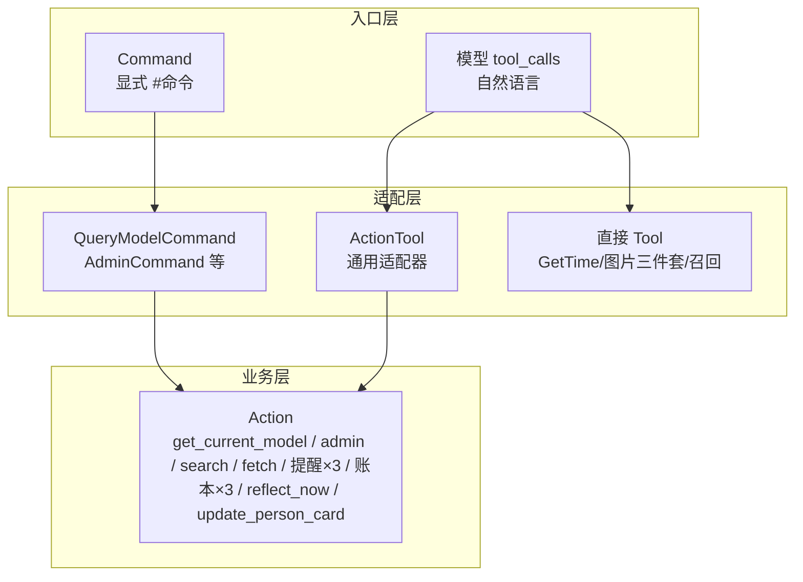

# 卷 09 · Action 与 Tool 体系：业务能力的三层复用

> 源码基准：`src/Action/`、`src/Tool/`。这是项目最重要的架构模式（ADR-014）：**业务逻辑只写一遍（Action），按入口形态挂两种适配器（Command 适配 / Tool 适配）**。

## 1. 三层关系总图



- **Action**：纯业务单元。输入 JSON 参数 + ActionContext，输出 ActionResult。不知道 QQ 命令语法、不知道模型 tool_call 协议、不知道 OneBot 格式（依赖红线的原文）。
- **ActionTool**：把任何 Action 包装成模型工具——名称/描述/schema/管理员要求全部取自 `ActionDescriptor`，执行时解析参数后委托。
- **直接 Tool**：不走 Action 的小工具（时间、召回、图片三件套）——它们要么无业务状态要么直连 Dock/Store。

## 2. Action 接口（Action.h）

```cpp
struct ActionDescriptor {
    std::string name, description;      // 工具名与给模型看的说明
    nlohmann::json parameters_schema;   // OpenAI parameters 对象
    bool expose_as_tool = false;        // 元数据保留；实际注册与否由组合根决定
    bool requires_admin = false;
};
struct ActionContext { uint64_t user_id; int64_t user_message_id; std::string user_text; };
struct ActionResult {
    std::string content;                        // 回灌模型/命令的文本
    std::vector<OutboundMessage> outbound_messages;  // 直接出站的媒体（如图片）
    std::string context_content;                // 追加进持久上下文的注记
    bool terminal = true;                       // Action 默认终态
};
```

`Action` 另有虚函数 `usageGuidance(GuidanceScene, const GuidanceContext&) const`（默认空串）：暴露为工具时的使用规则，经 `ActionTool::usageGuidance` 原样转出（语义见 §3）。

注意 `ActionResult::terminal` 默认 true（业务动作通常一步完成），而 **ToolResult::terminal 默认 false**（工具结果一般还要回灌模型）——适配时 ActionTool 显式传递。

## 3. Tool 接口与 ToolRegistry（Tool.h / ToolRegistry.h）

```cpp
struct ToolResult {
    std::string model_content;               // 回灌模型
    std::vector<OutboundMessage> outbound_messages;   // 交给消息适配器直接发送
    std::string context_content;             // 追加到持久 assistant 上下文的注记
    bool terminal = false;                   // 终止本轮工具循环
    bool cancelled = false;                  // 进程停止，ChatService 立即放弃
    bool suppress_text_reply = false;        // 终态时不把 model_content 发给用户
};
inline bool terminatesToolRound(r) { return r.terminal || !r.outbound_messages.empty(); }
```

**兜底规则**：只要产生了出站消息就视为终止（`terminatesToolRound`），即使工具忘了声明 terminal——防止图片重复发送（[卷10 §4](10-ChatService与Agent循环.md#4-图片路由与降级currentimagerouting--40134-行)）。

`ToolRegistry`：`vector<unique_ptr<Tool>>`；`allSchemas()` 把每个工具拼成完整 OpenAI tool 定义 JSON 字符串（`{"type":"function","function":{name,description,parameters}}`）；`find(name)` 线性查找；`names()`。注册后不再变更（ChatService 持只读引用）。

**工具可用性（ADR-023 L2.a，2026-11-15）**：`Tool` 与 `Action` 各有虚函数 `available()`（默认真，写法同 `requiresAdmin()`；`ActionTool` 转给 Action）。`WebSearchAction`、`WebFetchAction` 读各自活值里的 `enabled`：联网两工具始终构造、始终注册，开关只决定此刻是否对模型开放。`ToolRegistry` 对外的 `names()`、`allSchemas()`、`schemaFor()` 只给当前可用的；`find()` 不看可用性，由执行端自己判断；`registeredNames()` 给全部注册名（只用于启动日志）。工具循环（`Application/ToolLoop`）对注册了但当前不可用的工具按“未开放”拒绝（回灌“错误：未知工具 X”），开放名单里有它也一样；使用规则组装（`composeToolGuidance`）跳过不可用的工具。对话路径（`ChatService`）每次把可用工具名取一次，工具表与使用规则用同一份；话题会话每轮开头再按可用性筛出本轮开放的名单（[卷23](23-观察通道与话题会话.md)）。改了 `web_search.enabled` / `web_fetch.enabled` 后，下一次对话的工具列表即随之变化。

`ToolContext{user_id, user_message_id, user_text}`：调用期数据走参数而非构造注入——工具实例是全用户共享的。

**适用场合（ADR-024，2026-11-16）**：`ToolContext.h` 定义 `enum class ToolVenue` 与 `venueOf`（`shared_scope_id` 非 0 即群聊，与 ADR-019 同一判据）；`Tool` 新增虚函数 `offeredIn(ToolVenue)`（默认真，与 `available()` 正交：`available` 看配置开关，场合看这次对话发生在哪），`ToolRegistry::namesIn(venue)` 给出当前可用且适用于该场合的名字。`ChatService::reply` 按 `venueOf(sharedScopeId, user_id, managerId)` 取工具表，`ChatService::toolNames()` 改为 `toolNamesIn(ToolVenue)`。`leave_topic` 覆写为只在群聊开放。经历层 E2（ADR-028）起场合有三种：`ToolVenue { Private, Group, ManagerPrivate }`，群聊之外、对方是 `bot.manager_id` 时 `venueOf` 给 `ManagerPrivate`；`Action` 新增虚函数 `managerPrivateOnly()`（默认假），`ActionTool::offeredIn` 对它为真的 Action 只在 `ManagerPrivate` 开放（认识账本三工具与 `reflect_now`，§6.15、§6.16）。

**工具自带使用规则（ADR-022，2026-10-31）**：`Tool::usageGuidance(GuidanceScene, const GuidanceContext&) const` 默认返回空串；`GuidanceScene{Conversation, GroupTurn}` 与 `GuidanceContext{localDate}` 定义在 `src/Port/UsageGuidance.h`（Tool 与 Action 两层共用）。每个工具给出自己在两种场景下"何时该用我"的文本：图片三工具共用 `src/Tool/ImageToolGuidance.h` 的同一段（组装时去重）；联网两工具的文本在 `src/Action/WebToolGuidance.h`（对话场景的搜索规则带运行时本地日期锚点）；`set_reminder` 承载提醒三工具的规则；`recall_conversation`、`get_current_model`、`admin_control`、`leave_topic` 各一句（对话场景；`leave_topic` 只在群里被 @ 时开放，§6.14），`send_voice` 两个场景各一句（§6.3）；账本三工具、`reflect_now`、`update_person_card` 没有使用规则，描述只讲机制；`get_time` 无规则。`src/Application/ToolGuidance` 的 `composeToolGuidance(registry, offeredNames, scene, context)` 按固定顺序拼接（只取既开放又已注册的工具；相同文本只出一次；布局外的新工具按开放顺序接在最后），ChatService（Conversation）与EngagementService（GroupTurn）共用，不再按工具名 if。新工具只需实现 `usageGuidance`。

## 4. ActionTool 适配器（ActionTool.h，全文 40 行）

```cpp
ToolResult ActionTool::execute(args, ctx) {
    try {
        auto result = action.execute(parseToolArguments(args), {ctx.user_id, ctx.user_message_id, ctx.user_text});
        return {result.content, result.outbound_messages, result.context_content, result.terminal, false, false};
    } catch (const std::exception &e) {
        return {"错误：操作参数无效：" + e.what(), {}, {}, true};   // 参数错误→terminal文本
    }
}
```

## 5. ToolArgumentParser：畸形参数归一化（本卷核心算法之一）

第三方网关常把多个 JSON 对象**拼接损坏**（如 `{}{"query":"..."}` 或参数串里夹前导文本）。两层防线：

### 5.1 parseToolArguments（执行前解析）

```
先按标准 json::parse
失败 → splitConcatenatedObjects(value)：
  状态机逐字节扫：跳过空白；期待 '{'（否则抛"非对象内容"）；
  depth 计数 + inString/escaped 处理字符串内的花括号；
  每个平衡的 {...} 作为一个对象收集；depth<0 或结尾不闭合 → 抛异常
  收集 ≥2 个对象才走合并路径（<2 说明不是拼接问题，重抛原始解析异常）
  merged = {}，逐个 json::parse 后 update() 合并（后出现覆盖先出现）
任何一步失败 → 异常由 ActionTool 转为工具错误文本
```

### 5.2 normalizeToolArguments（回灌前归一化）

`parseToolArguments(args).dump()`；**解析失败时原样返回**——保证回灌给网关的内容"不会比收到的更差"（Anthropic 转换器对无法解析的 tool_use 参数亦有"退回空对象"的兜底，构成双重保险机制，见[卷11 §5](11-模型调用层.md#5-openaistandard-逐函数openaistandardcpp)）。

## 6. 全部 14 个模型工具详解

> 本节标题里的个数是数到 6.14 为止的；6.15–6.17 是经历层加的工具（ADR-028、ADR-030、ADR-032）。

### 6.1 GetTimeTool `get_time`

无参（`{"type":"object","properties":{}}`）；`strftime("%Y-%m-%d %H:%M:%S")` 本地时间。`localtime` 非线程安全（已知边界，时间格式化竞态无害）。

### 6.2 GetCurrentModelAction `get_current_model`

无参；getter 是构造注入的 `function<string(uint64_t)>`（组合根绑 `USS.getModelName`，经 `resolveModelName` 给出手动选的模型或当前默认模型，L1.a）；返回 `"当前模型：" + 名字`。

### 6.3 SendVoiceTool `send_voice`（2026-11-16 起取代 `set_voice_mode`，ADR-025）

`src/Tool/SendVoiceTool.h`（仅头文件，原生 Tool）。参数 `{text}` required——要说出口的话本身。项目规则：没有手动开关，用不用语音由她决定，对方明确要求才用语音、平时以文字为主；schema 与使用规则因此写得严格（“只在对方明确要求你用语音时调用……没有明确要求时一律用文字回复，不要调用”）。

- 开放（`available`）：管理员语音总开关 `liveSettings.globalVoice` 为真（每次列工具时取，L1.c），且组合根给的可达性 seam（`Voice::reachable`，60 秒缓存的一次 TCP 探测）为真；否则工具表与使用规则都没有它。私聊与群聊都开放。
- 执行：合成 seam（`Voice::toAudio`）成功 → 出站 `VoiceMessage{audio_path, transcript=原话}`；失败 → 出站原话 `TextMessage` 并记 WARNING。两种都 `terminal=true`、`suppress_text_reply=true`，`model_content` 就是原话——对话路径写进历史的回复是原话。text 为空回灌错误、不终止。
- 话题会话轮：同名定案动词（[卷23](23-观察通道与话题会话.md)），由 `EngagementService` 定案后调用这个工具的 `execute` 送达，语音入群缓冲存原话。
- 规则文本：Conversation 场景排在布局第 5 位（原 `set_voice_mode` 的位置）；GroupTurn 场景接在最后，带 `[系统注]` 前缀。
- 已删除：`VoiceModeAction`、`VoiceSwitchCommand`、`USS::voiceSwitch/isVoiceMode`、`Person::isOpenVoiceMode`、`Message` 的语音分支与 `textToVoice`、`Application/SpokenForm.h`（失败退回文字的规则移进本工具）。

### 6.4 AdminControlAction `admin_control`（requires_admin）

参数 `{action:enum}` required，6 个枚举值。执行内容是改语音总开关的活值或调回调：

| action | 效果 |
| --- | --- |
| refresh_config | 调 `refresh()` 回调（= `configReloader.reload()` + 日志 + `summarizeReload` 反馈，[卷04 §5](04-配置系统.md#5-配置快照规则表与重载入口configsnapshotstore--configrules--configreloader)） |
| activate/freeze_global_voice | `Live<bool>::set` 语音总开关（L1.c 起是活值；配置里 `voice.enabled` 变化时重载也会置它，后写者生效） |
| get_inet4 / get_inet6 / get_public_ip | ComputerStatus 查询（[卷18](18-支撑模块.md)） |

权限双重校验：ChatService 在调用工具前检查 `tool->requiresAdmin() && user_id != managerId`（[卷10](10-ChatService与Agent循环.md)）；CommandRegistry 同样执行校验。

### 6.5 WebSearchAction `klein_web_search`

名称前缀 `klein_` 是为了**避开部分网关抢占保留名 `web_search`** 并把结果折叠成文本。

参数校验顺序（每步失败都返回 JSON 错误文本、terminal=false）：
1. 必须对象；`query` 非空字符串（trim 后）；
2. `topic` ∈ {general,news}（默认 general）；`time_range` ∈ {day,week,month,year}；`days` ∈ [1,30] 整数；`max_results` ≥1 且被 `min(options.maxResults)` 封顶（options 是活值，每次执行开头取一份快照，L1.e）；
3. `provider.search(request)`（Tavily，[卷17](17-联网能力.md)）异常 → `{"error":...}`。

成功输出 JSON：`{query, requested_at(本地ISO日期), result_count, answer?, results:[{source_id++, title, url, content(截断 max_content_chars), published_at?, score?}]}`。描述里明确要求"用户没指定年份不得自行添加年份""只引用时间上可信的结果"。

### 6.6 WebFetchAction `klein_web_fetch`

参数 `{url 必填, question 可选}`。question 空时取 `context.user_text`（用户当前这句话）再兜底"这个页面的主要内容是什么"。核心流程（细节[卷17](17-联网能力.md)）：URL 公网校验（SSRF 防护）→ 缓存/下载 → HTML 提取 → 超长蒸馏（Distiller 回调，默认模型原文摘录）→ 截断兜底 → 结构化 JSON 输出 `{url,status,content_type,fetched_bytes,extracted_chars,method(direct/distilled/truncated),truncated,cached,content,title?,charset?,download_truncated?}`。

### 6.7 RecallConversationTool `recall_conversation`

参数：`queries[1..5]`（required）、`fact_queries[0..5]{subject,predicate,temporal}`、`limit[1..20]`（默认 8，最终还会被 `recallLimit` 封顶）。解析失败/queries 空 → 错误文本。委托 `MemoryService.recall`（[卷14 §6](14-长期记忆系统.md#6-recall三路统一召回memoryservicecpp99219)）。

### 6.8 GenerateImageTool `generate_image`

`{prompt}` required。流程：prompt 空 → 错误；构造 ChatModel（drawing 端点）→ `dock.RequestDraw` → cancelled 透传；`code>=400 || base64 空` → "错误：图片生成失败。"；`assetStore.saveBase64(user, b64, "generated", prompt, ctx.user_message_id)`（存资产）→ 失败 →"图片已生成，但保存失败。"；成功返回：

```
ToolResult{
  model_content = "图片已生成，可以继续询问它的内容，或要求重新发送。",
  outbound = {ImageMessage{LocalPath, asset->local_path}},   // 直接发图
  context_content = "[image asset_id=… source=generated]",   // 持久化占位符
  terminal=true, cancelled=false, suppress_text_reply=true}  // 不把 model_content 发用户
```

### 6.9 InspectImageTool `inspect_image`

`{question required, asset_id?, source?}`。`resolveImageAsset`（ImageToolHelpers.h，2026-10-30 改为三级兜底）：① 有 asset_id → `find(user, id)`；② 有 source → `findLatest(user, source)`；③ `findLatest(user)` 不分来源最近一张。上一级没命中就落下一级（旧逻辑 id 没命中直接失败、无参数默认找"最近生成图"，群里常常空手而归——真机缺陷 2026-10-29）；给了 id 却兜底到别的图时 `note` 写明"指定的 asset_id 未找到，已改用最近一张（id）"，工具把它作为"注意："前缀回灌给模型。读 base64 → 空 →"图片文件不可读。"；`dock.RequestVision(vision 端点, question, base64)` → 失败"错误：视觉模型调用失败。"；成功 `"图片视觉分析结果：\n" + content`（非 terminal——结果回灌主模型综合）。

### 6.10 SendImageTool `send_image`

`{asset_id?, source?}`，resolve 同上；成功：`{"图片已发送。", {ImageMessage{LocalPath}}, {}, true, false, true}`——terminal + suppress，只发图不发文本，**不向用户展示内部 asset_id**。

### 6.11–6.13 提醒三 Action

**SetReminderAction `set_reminder`** 校验链（全部返回中文错误文本，terminal=false 便于模型自我纠正后重试）：
1. 参数对象；`content` 非空 trim、≤1500 字节（≈500 汉字）；
2. `time` 经 `parseIsoLocal`（**往返比对**防 mktime 静默归一化 2 月 30 日，[卷15 §2](15-提醒系统.md#2-remindertimeh三个纯函数全-inline可单测)）；必须晚于当前时间；
3. `repeat` ∈ none/daily/weekly；
4. `pendingCount >= 20`（kMaxPendingPerUser）→ 上限错误；
5. `reminders.add(...)` 落库+入队 → 0 → 写入失败；
6. 成功："提醒已设置：YYYY-MM-DD HH:MM[，每天/每周重复]，编号 N。请向用户复述确认这条安排。"

**ListRemindersAction `list_reminders`**：无参；空 →"当前没有待触发的提醒。"；否则逐条 `"编号 N：时间[，重复]：内容"`。

**CancelReminderAction `cancel_reminder`**：`{id:int}` required；`reminders.cancel(user_id, id)` 归属校验失败 →"未找到编号 N 的提醒…"；成功 →"提醒已取消（编号 N）。"

### 6.14 LeaveTopicTool `leave_topic`（2026-11-16，ADR-024）

`src/Tool/LeaveTopicTool.h`（仅头文件，原生 Tool）。与话题会话轮的离场动词同名同义，两条群发言路径共用同一个离场动作：参数 `reason`（只进日志）、`step_back`（布尔，被请走时为 true，之后一段时间不主动接话，被 @ 仍会回答）。只在群聊开放（`offeredIn`）；组合根在 `EngagementService` 构造后 `bind` 到 `EngagementService::leaveTopic`，未接线时不可用（`available`）。非终止：结果回灌后她照常写回复（或按群聊收敛契约不回应）。私聊里被调（模型臆造）只回灌“这里是私聊……”，不动任何群。使用规则只在 Conversation 场景给出（群里被 @ 时），排在布局之外、接在最后。起因：2026-11-16 她在 @ 回复里答应“好，我退开了”，话题会话那边不知道，10 秒后照常接话（卷23 §4.4）。

### 6.15 认识账本三工具 `remember_guidance` / `review_guidance` / `forget_guidance`（经历层 E2，ADR-028）

`src/Action/KnowledgeAction.h/.cpp`：基类 `KnowledgeAction` + 三个子类，账本见[卷13](13-持久化层.md)文末的认识账本附录。原来的五个账本命令已移除，改为这三个工具（[卷08 §2.13.1](08-命令体系.md#2131-knowledgecommand教她--查看认识--撤回认识--回滚认识--清除认识管理员经历层-e2adr-028)）。

- 开放：`managerPrivateOnly()` 为真，只在管理员私聊（`ToolVenue::ManagerPrivate`）出现；`requires_admin` 也为真，工具循环再按调用者核对一道；`affect.enabled` 当前为假时 `available()` 为假，工具表里没有它们、账本不打开。没有使用规则。
- 每次调用先打开账本（幂等），再跑一次 `applyDecay()`（`forget_guidance` 给 `scope` 时不跑：要删的东西不必先记成淡了）。
- `remember_guidance {text, scope?, replaces?}`：用她自己的话记一句（`origin=teaching`，经账本的代码校验）；`scope` 为 `global`（默认）/ `group:<群号>` / `user:<QQ号>`；`replaces` 填编号即改写那一条，同一句再记一次算再确认。记下的算教导：不衰减、回想改不了、只有部署者能让她忘掉。
- `review_guidance {scope?, id?}`：不给参数列出全部范围的条目（至多 30 条，`kMaxListedEntries`），给 `scope` 只看那个范围，给 `id` 看那一条和它最近的变化（至多 10 行，`kMaxHistoryRows`）；每条有编号、范围、原文、强度、来源、最后确认时间。
- `forget_guidance {id | scope}`：给 `id` 撤回那一条，变化记录保留；给 `scope`（`group:<群号>` 或 `user:<QQ号>`）把那个群或那个人的全部条目连同变化记录删掉（`forgetGroup` / `forgetPerson`），不可恢复。两者只给一个。
- 回滚（`rollbackTo` / `rollbackBefore`）不对外。回复是给模型看的短文本（`terminal=false`），由她用自己的话说；日志里没有认识正文。

### 6.16 ReflectAction `reflect_now`（经历层 E3，ADR-030）

`src/Action/ReflectAction.h/.cpp`。参数 `{group?}`：群号；不填或 0 = 所有有待回想经历的群。开放规则与账本三工具相同（`managerPrivateOnly`、`requires_admin`、`affect.enabled` 当前为真）；另要求回想服务已由组合根 `bind`（它构造得比工具表晚），未 bind 时不可用。执行只调 `ReflectionService::requestNow` 把群排进回想队列，回想在后台线程上跑（[卷23 附：回想](23-观察通道与话题会话.md#附回想经历层-e3adr-030)），手动回想不受自动回想的间隔、当日次数与退避限制，但它同样记下 `last_run`，会推迟下一次自动回想；“有没有待回想的经历”与自动调度同一判据（游标同样套 24 小时地板，只有更早的旧决策的群不安排）。同一个群已在队列里或正在回想时（已排队集合在 `runNow` 跑完后才清）不重复入队（还在队列里的那一次升级为手动），`requestNow` 返回的 `ReflectionRequest` 把它们分别计数，回复据此如实区分：

- 指定了群号：排上时“安排了 1 个群的回想，在后台进行。”；正在回想时“这个群正在回想，不用再安排；结果之后用 review_guidance 翻看。”；已在排队时“这个群的回想已经排上了，正在后台等着，不用再安排。”；都不是时“这个群眼下没有待回想的经历（最近 24 小时里在那的开口、沉默、离场都回想过了，或最近一次还不到 20 分钟）。”；
- 没指定：“安排了 N 个群的回想，在后台进行。”，有群已在回想或排队时接一句“另有 M 个群已经在回想或排着队，不用再安排。”（一个也没新排上时开头是“没有新安排的群。”）；什么都没有时“眼下没有待回想的经历。”；
- affect 关着、账本打不开或回想服务已停止：“回想眼下用不了，这次没安排。”。

`terminal=false`，回复由她自己说；结果之后用 `review_guidance` 翻看。没有使用规则。

### 6.17 UpdatePersonCardAction `update_person_card`（ADR-032）

`src/Action/PersonCardAction.h/.cpp`，名字常量 `KleinUpdatePersonCardToolName`。参数 `{slot, value, user?, index?}`，`slot`、`value` 必填：`slot` ∈ `wanted_name` / `my_name` / `name_for_me` / `note`；`value` 一行，留空 = 清掉；`user` 是那个人的 QQ 号，不填就是正在跟她说话的人（私聊对象 / @ 她的人；话题会话轮里没有这个人，必须填）；`index` 只对 note 有意义（1–5，不填就放进空位）。QQ 号、昵称、是不是部署者、建卡日期由程序给出，不在可写范围里——没有人能靠说一句话变成部署者。

- 开放：私聊与群聊都开放、不要求管理员（`requires_admin=false`）；组合根也把它放进话题会话轮的注册表工具名单。`available()` = `PersonCards::enabled()`（记忆库可用且 `memory.enabled` 为真）。
- 执行：`PersonCards::write` 当场写库并清掉这个人的缓存，下一次请求里的卡片就是新的；来源号：写的是说话人自己的卡时取这一轮的 `user_message_id`（删掉这一轮时一起撤回），写别人的卡时为 0（那个人删自己的对话不撤它），见[卷14 附](14-长期记忆系统.md#附人物卡确定性加载的对方卡片adr-032)；成功回“改好了，卡片现在是——<这个人在群聊里的那一行>”，失败回“没改：<原因>。”；`terminal=false`。护栏与上限见[卷14 附](14-长期记忆系统.md#附人物卡确定性加载的对方卡片adr-032)。
- 没有使用规则：记不记、怎么叫由她定，描述只讲机制。

## 7. 工具 Schema 汇总表（发给模型的能力清单）

| 工具名 | 参数要点 | terminal 默认 | 权限 |
| --- | --- | --- | --- |
| get_time | 无 | false | 所有人 |
| get_current_model | 无 | true(Action) | 所有人 |
| send_voice | text | true（ToolResult 显式） | 所有人；总开关开且语音服务可达时开放 |
| admin_control | action:enum | true | 仅管理员 |
| klein_web_search | query + topic/time_range/days/max_results | false | 所有人 |
| klein_web_fetch | url + question | false | 所有人 |
| recall_conversation | queries + fact_queries + limit | false | 所有人 |
| generate_image | prompt | true | 所有人 |
| inspect_image | question + asset_id/source | false | 所有人 |
| send_image | asset_id/source | true | 所有人 |
| set_reminder | content + time + repeat | false→成功文本 | 所有人 |
| list_reminders | 无 | false | 所有人 |
| cancel_reminder | id | false | 所有人 |
| leave_topic | reason + step_back:bool | false | 所有人；只在群聊开放（ADR-024） |
| remember_guidance | text + scope + replaces | false | 仅管理员；只在管理员私聊开放、affect 开着时（ADR-028） |
| review_guidance | scope / id | false | 同上 |
| forget_guidance | id / scope | false | 同上 |
| reflect_now | group | false | 同上（ADR-030）；回想服务已接线 |
| update_person_card | slot + value + user + index | false | 所有人；长期记忆开着时开放，会话轮也开放（ADR-032） |

## 附：ToolContext.shared_scope_id（ADR-019，2026-10-28）

`ToolContext` 新增 `uint64_t shared_scope_id`（群聊=群号，私聊/无=0），由 `ChatService::reply(..., sharedScopeId)` 原样放入，`ChatService` 不解释其含义（仍不碰群/私聊概念）。图片三工具据此选择资产库（卷16 附）；其他工具忽略。

## 8. 本章文件清单

| 文件 | 内容 |
| --- | --- |
| `src/Action/Action.h` | 三结构接口 |
| `src/Action/GetCurrentModelAction.h` / `AdminControlAction.h` | 两个简单 Action（头文件内联实现） |
| `src/Tool/SendVoiceTool.h` | `send_voice`：用语音说一句话（ADR-025） |
| `src/Action/WebSearchAction.h/.cpp` | 搜索参数校验与结果组装 |
| `src/Action/WebFetchAction.h/.cpp` | 抓取全流程（[卷17](17-联网能力.md) 展开） |
| `src/Action/SetReminderAction.*` / `ListRemindersAction.*` / `CancelReminderAction.*` | 提醒三件套 |
| `src/Tool/Tool.h` / `ToolRegistry.h` / `ToolContext.h` | 工具接口（含 usageGuidance、`offeredIn`）与注册表（含 `namesIn`）；`ToolVenue` |
| `src/Tool/LeaveTopicTool.h` | `leave_topic`：@ 回复路径的离场（只在群聊开放，ADR-024） |
| `src/Action/KnowledgeAction.h/.cpp` | 认识账本三工具（ADR-028） |
| `src/Action/ReflectAction.h/.cpp` | `reflect_now`：手动回想（ADR-030） |
| `src/Action/PersonCardAction.h/.cpp` | `update_person_card`：写人物卡（ADR-032） |
| `src/Port/UsageGuidance.h` | GuidanceScene / GuidanceContext |
| `src/Tool/ImageToolGuidance.h` / `src/Action/WebToolGuidance.h` | 图片三工具、联网两工具的共用规则文本 |
| `src/Application/ToolGuidance.h/.cpp` | composeToolGuidance（固定顺序组装） |
| `src/Application/InboundCoalescer.h/.cpp` | 私聊入站连发合并 + `burstFollowUpNote`（非工具；编排小件，见[卷07 §4](07-消息调度与路由.md#4-与主循环的配合回顾卷03-8)） |
| `src/Application/ContextDigest.h/.cpp` | mergeDigest 滚动摘要合并（非工具；Application 层与 ToolLoop 同属编排小件，见[卷12 §4](12-用户会话与上下文.md#4-buildchatrequesttoken-水位裁切与滚动摘要)） |
| `src/Tool/ActionTool.h` | Action→Tool 通用适配 |
| `src/Tool/ToolArgumentParser.h/.cpp` | 拼接对象解析 + 归一化 |
| `src/Tool/GetTimeTool.h` / `RecallConversationTool.h` | 两个直接工具 |
| `src/Tool/GenerateImageTool.h` / `InspectImageTool.h` / `SendImageTool.h` + `ImageToolHelpers.h` | 图片三件套 |
