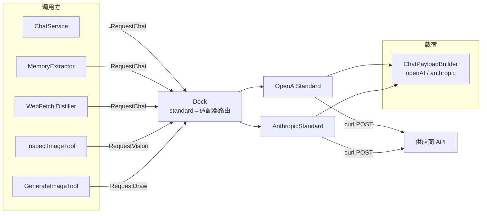

# 卷 11 · 模型调用层：注册表、Dock、载荷构造与两个适配器

> 源码基准：`src/ModelRegistry/`、`src/ModelApiCaller/`（Dock.hpp、ChatPayloadBuilder、OpenAIStandard、AnthropicStandard、Voice、RWKV）。这一层回答："一个统一的 ChatRequest 怎么变成某个供应商的 HTTP 请求，响应又怎么变回统一结构"。

## 1. 调用链与参与者



## 2. ModelRegistry（模型注册表）

数据文件：路径钉死为 `source/Model/ModelsName.json`（编译期常量 `kModelRegistryPath`，相对工作目录；旧配置的 `models.registry_path` 已废弃并被静默忽略）。打不开时日志带解析后的绝对路径，方便定位工作目录漂移：

```json
{"Models": [
  {"ModelName": ["gpt-4o","gpt-4"], "api_key": "sk-…", "api_endpoint": "https://…/v1/chat/completions",
   "APIStandard": "OpenAI", "Capabilities": {"vision": true}}
]}
```

`reload()` 的**宽容加载**（与面板的严格校验对比，[卷04 §8](04-配置系统.md#8-web-配置面板后端configpanelservercpp)）：

- 文件打不开 → 区分两种情况：**文件不存在**（首次部署的正常状态）→ LOG_WARNING 引导走面板「模型供应商」页添加保存；**存在但打不开** → LOG_ERROR（带解析后的绝对路径，方便定位工作目录漂移）。返回 false，旧表原样保留（首次则为空表）；
- 顶层无 `Models` 数组 / JSON 解析失败 → LOG_FATAL/ERROR，返回 false；解析在**锁外的局部 vector** 上进行，任何失败路径都不碰旧表（旧实现"已 clear 的表不会回滚"的缺陷已随热重载改造消除：锁内只做一次整体交换，读者拿到的要么是完整新表要么是完整旧表）；
- 每条：`ModelName` 或 `name` 数组（两者都认）→ modelList 集合；`api_key`/`api_endpoint`/`APIStandard`（注意字段名大小写固定）；`Capabilities` 或 `capabilities` 对象里的 `vision` **双形态**——布尔（旧版）= 整组继承，加载时展开成全部模型名的 `visionModels` 集合；字符串数组（面板保存的新形态）= 按模型正向名单。其它类型宽容忽略（不抛异常、不影响整份注册表加载）；运行时查询走 `ChatModel::hasVision(modelName)`。

`find(name)`：互斥锁内线性遍历 modelList 集合，命中即返回 ChatModel **拷贝**（`std::optional<ChatModel>`）；`all()` 同样加锁按值返回——按值返回消除了热重载悬空内部指针的可能。**支持运行期热重载**：内部 vector 由 `mutable std::mutex` 保护，`reload()` 可被任意线程安全调用；WebUI 面板 `POST /api/models` 写盘成功后即调 `reload()`，聊天/命令/记忆提取线程的下一次 `find()` 立即可见新模型，无需重启。

## 3. Dock（Dock.hpp，全文 80 行）

```cpp
Dock(const Live<DockOptions> &network, const std::atomic<bool> *running) {
    registryLLM.emplace("OpenAI",    make_unique<OpenAIStandard>(network, running));
    registryLLM.emplace("Anthropic", make_unique<AnthropicStandard>(network, running));
}
RequestChat/RequestVision/RequestDraw(model, model_name, …) {
    find(model.api_standard) == end → response.code=-1, "你的服务API规范为：X，当前并未支持"
    否则委托适配器
}
```

**Dock 是路由器不是适配器**：按 ChatModel 的 `api_standard` 字符串选择实现；注册表构造后不变。三个 Request 方法结构相同。`network` 是组合根的活值（L1.e，ADR-023）：两个适配器各持它的引用，每次请求开头取一次代理传给 `http_post`，`network.proxy` 重载后下一次请求即走新代理。

**专用端点（ADR-022，2026-10-31）**：`models.vision` / `models.drawing` / `models.worker` 的解析只在 `src/ModelApiCaller/ModelEndpointResolver.h`：`resolveEndpoint(configured, registry)`——endpoint 为空且 model 在注册表里时，用注册条目补齐 endpoint/apiKey/apiStandard，其余原样返回（全配形态直连）；`toChatModel(options)` 是端点→ChatModel 字段映射的唯一处。组合根用 `registryEndpoint(liveSettings.XModel, models)` 构造 `EndpointProvider`（`std::function<ModelEndpointOptions()>`；L1.b 起配置这一半也在调用时取：每次调用先取一份 `Live<ModelEndpointOptions>` 快照、再按注册表解析，`models.*` 重载与注册表热重载都在下一次调用生效。临时活值不许传（该重载被删除）；按值版 `registryEndpoint(ModelEndpointOptions, registry)` 只剩 judge 在用，L2.c 前保持启动值），注入 InspectImageTool、GenerateImageTool、`#生成图片`、Message（当前图视觉）、瞥视视觉 seam 与话题会话杂务；这些使用方另有固定端点重载（`fixedEndpoint`）供测试。Dock 增加便捷重载 `RequestChat/RequestVision/RequestDraw(const ModelEndpointOptions&, …)`（内部 `toChatModel` + `endpoint.model`）；就绪检查 `modelEndpointReadinessText` 跑在解析后的端点上。 依赖拆分（2026-11-01）：工具 / 命令 / Message 只包含 `ModelEndpointOptions.h`（`EndpointProvider` 在此），Dock 只包含 `EndpointChatModel.h`（`toChatModel`），只有 main 与测试包含 `ModelEndpointResolver.h`，使用方不再间接依赖 `ModelRegistry`。

## 4. ChatPayloadBuilder——两种协议的载荷工厂

### 4.1 openAI(payload)（65–119 行）

```
{model, temperature, frequency_penalty, presence_penalty,
 messages: [system?（仅非空时）] + history 逐条编码,
 tools?（schema 字符串逐个 parse 后成数组）}
```

history 编码规则：

| ChatMessage | 编码 |
| --- | --- |
| assistant 且有 tool_calls | `content`（空→null）+ `tool_calls:[{id,type:"function",function:{name,arguments}}]`（**arguments 原样字符串**） |
| role==tool | `content` + `tool_call_id` |
| 其他（user/assistant 普通/system） | `content = openAIContent(msg)`：无图→纯字符串；有图→数组 `[{type:text},{type:image_url,image_url:{url:"data:mime;base64,…" }}…]` |

### 4.2 anthropic(payload)（121–265 行，四处协议变换）

1. **system 单独字段**：非空时编码为带 cache_control 断点的文本块数组（[§6](#6-anthropicstandard-差异点anthropicstandardcpp)）。
2. **history 变换**：
   - `system` 角色消息跳过（已进 system 字段）；
   - **连续 tool 消息聚合**成一条 user 消息的 `tool_result` 块数组（协议要求结果必须紧跟 tool_use 且同轮合并）；
   - assistant 带 tool_calls → content 块数组：可选 text 块 + 每个调用一个 `{type:"tool_use",id,name,input}`；**arguments 解析失败退回空对象**（`json::object()`）——网关拼接损坏的参数不至于让请求无法序列化；
   - 图片编码 `{type:image, source:{type:base64, media_type, data}}`（图先文后，OpenAI 顺序相反——各协议习惯）；
   - `max_tokens` 必填：`request.max_tokens>0 ? 它 : 4096`。
3. **user 连续合并**：tool_result 聚合出的 user 消息后面若紧跟普通 user 消息（如收尾注记），把后者内容块并入前者——协议要求 user/assistant 严格交替。
4. **tools 格式转换**：OpenAI 的 `{type:function,function:{name,description,parameters}}` → `{name,description,input_schema}`。

### 4.3 explicitlyRejectsMultimodal(status, body)（275–301 行）

判定"供应商明确表示只收文本"（用于 ChatService 降级，[卷10 §4](10-ChatService与Agent循环.md#4-图片路由与降级currentimagerouting--40134-行)）：
- 只认 4xx（5xx/空 body 直接 false）；
- body 转小写后：同时含 `messages.content.type` 和 `['text']`（OpenAI 官方报错样式）→ true；
- 或（含 unsupported/not support/不支持/仅支持文本）**且**（含 image_url/multimodal/图片）→ true。

保守设计取向：宁可漏判也不误判（超时、鉴权失败不会命中）。

## 5. OpenAIStandard 逐函数（OpenAIStandard.cpp）

### 5.1 request_chat（12–68 行）

```
前置：cancellationRequested → 直接 cancelled 响应
payload = ChatPayloadBuilder::openAI(...)；记 DEBUG（消息数/图片数，不记 base64）
http_post → 400 且是多模态请求且 explicitlyRejectsMultimodal
    → 解析响应 + multimodal_unsupported=true 提前返回（供 ChatService 降级）
400（其他原因）→ 删 temperature/frequency_penalty/presence_penalty 重试一次
    （兼容不支持超参字段的服务；第二次结果无论什么都接受）
chat_json_parse + code + multimodal_unsupported(重算)
```

### 5.2 request_vision / request_image

vision：单条 user 消息 `[text, image_url(data:image/jpeg;base64,…)]`（MIME 固定为 jpeg——上传的 PNG 也会被标记为 jpeg，多数服务可容忍）。image：`{model,prompt,n:1,quality:"high",size:"1024x1024"}`。

### 5.3 http_post（134–211 行，两个适配器几乎相同）

```
url/key 空 → 合成 {"error":{"message":"模型服务配置不完整…"}} + 500
filterNonNormalChars(url/key)：剥掉不可打印字符与空白（防粘贴的换行/零宽字符）
curl：POST JSON + Authorization: Bearer；CurlRequestControl::configure（默认 300s/300s + 停止取消；`ChatRequest.timeout_ms`>0 时 chat 请求连接/总超时都用它，2026-11-01 起供 judge 用，2026-11-24 起为 60 秒）；可选 proxy（调用方在请求开头从活值取一次传入，OpenAI 的 400 降级重发用同一份，L1.e）
重试：attempts=5；CURLE_OK 或取消 → break；超时(CURLE_OPERATION_TIMEDOUT) → 不重试 break；
其他错误 → 睡 1s 重试
最终仍失败 → code=504(超时)/503(其他) + 合成 error envelope（不会把空响应交给解析器）
```

### 5.4 chat_json_parse（213–295 行）

- 空 → 默认对象；parse 异常 → 记日志返回空；
- `error` 键存在 → error_message 提取后返回；
- `choices[0].message`：content + **`<think>…</think>` 前缀过滤**（深度思考模型的开头思考段：仅当 content 以 `<think>` 开头才剥）+ **前导换行剥离**；`tool_calls[]` → `{id, function.name, function.arguments}`；
- finish_reason 取最后遍历到的 choice（多 choice 时后者覆盖前者）；usage 三项。

### 5.5 draw/vision 解析

draw：请求体带 `response_format=b64_json`（2026-10-30 起；真机中转站默认只回 `url`，此前生图一直失败）；解析 `data[0].b64_json`（剥可能的 `data:image/png;base64,` 前缀）并把 `data[0].url` 记到 `ImageResponse.image_url`，只有 url 时由 `GenerateImageTool` 经 `ImageAssetStore::importFromUrl(owner, url, "generated", prompt, …)` 下载入库；usage 的 input/output/total。`draw_json_parse` 公开，`OpenAIImageParseTests` 单测。vision：choices[0] 的 content/refusal/finish_reason。

## 6. AnthropicStandard 差异点（AnthropicStandard.cpp）

| 点 | 行为 |
| --- | --- |
| 鉴权头 | `x-api-key: <key>` + `anthropic-version: 2023-06-01`（**不是 Bearer**） |
| chat 解析 | `content` 块数组：text 块拼接为 content；`tool_use` 块 → tool_calls（`input` 对象 dump 成 arguments 字符串）；`stop_reason=="tool_use"` → 映射为 `"tool_calls"`（对齐 ChatService 循环判断）；前导换行同样剥离 |
| usage | 只有 input/output，total 自己加 |
| request_image | 直接 code=-1 + "Anthropic API 不支持图像生成，请改用 OpenAI 标准的图像接口" |
| request_chat 无 400 重试 | Anthropic 协议没有超参兼容问题 |

### 提示缓存断点（attachCacheBreakpoint + 布局）

Anthropic 必须**显式**打 `cache_control:{type:ephemeral}` 断点（上限 4 个）才能缓存，布局固定为：**tools 末项、system、倒数第 3 条消息、最后一条消息**。断点对齐"每请求恰好追加 2 条消息"的增量模式（工具循环每轮 +2：tool_use+tool_result；跨轮 +2：assistant+新 user）——上一请求末条断点写入的缓存恰好被本请求倒数第 3 条断点命中，末条断点写新增后缀。tools 末项独立断点保证 system 变化时工具表仍命中。纯文本消息需先转块数组再挂断点（两种编码对模型输入等价）。

OpenAI 路径不显式标记（依赖供应商自动前缀缓存）——这就是全项目"system 稳定、每轮内容尾插"纪律的来源。

## 7. Voice（GPT-SoVITS 客户端，Voice.cpp）

`toAudio(text)`：

0. 开头取一份 `VoiceOptions` 快照（L1.c 起 `Voice` 持 `const Live<VoiceOptions> &`，host、port、参考音频与文本改了下一次合成即用新值）；
1. 输出目录 `temp_directory_path()/kleinbot/`（自动创建）；文件名 `<毫秒时间戳>_<原子序号>.wav`（防并发覆盖）；
2. 打开 ofstream 失败 → 返回空串（2026-11-16 起**约定：成功返回路径，任何失败都返回空串**；此前失败返回错误文本串，调用方靠“串里没有 .wav”判失败）；
3. POST `host:port/tts`，body `{text, text_lang:"zh", ref_audio_path, prompt_text, prompt_lang:"zh", streaming_mode:false}`；
4. 响应字节直接写文件（ostream 回调）；连接失败、HTTP 状态不是 200（此前不检查，服务报错时会把错误 JSON 当音频发出去）或取消 → 删半成品返回空串，并把服务记为不可用；成功 → 返回绝对路径。

`reachable()`（2026-11-16，`send_voice` 的开放条件之一）：配置的 host:port 没变且距上次探测不到 60 秒时直接返回缓存；否则做一次只连不发的 TCP 探测（`CURLOPT_CONNECT_ONLY`，连接超时 1 秒），状态变化时记一行 INFO。合成失败会立即把缓存置为不可用。

`dataToBase64`：手写 base64 编码（与 Message 的实现两份重复，历史遗留）。仅支持中文是已知限制（注释明示）。

## 8. 未接线/废弃部分（如实记录）

| 类 | 状态 |
| --- | --- |
| `RWKV.hpp` | 整体注释掉的死代码占位 |

> 历史残留：`StableDiffusion`（本地 SD WebUI txt2img）与 `Realesrgan`（图片放大，`fixImageSizeTo4K` 本身即"功能暂未实现"桩）两个适配器从未接线主流程，连同配置段 `models.stable_diffusion` 已于 2026-08 整体移除；生图统一走 `models.drawing`。

## 9. 行为边界速查

| 边界 | 说明 |
| --- | --- |
| 重试语义 | 仅传输层错误重试 5 次（间隔 1s）；超时与 HTTP 4xx/5xx **不重试** |
| `<think>` 过滤只在 OpenAI 解析器 | Anthropic 深度思考模型若把思考放进 text 块不会被剥 |
| 注册表热更新 | 无——改 ModelsName.json 必须重启 |
| api_standard 大小写敏感 | "openai" 小写会走 Dock 的 -1 错误分支 |
| 代理只影响模型/搜索/抓网页 | WS 与 TTS 不走 proxy 配置 |

## 10. 本章文件清单

| 文件 | 内容 |
| --- | --- |
| `src/ModelRegistry/ModelRegistry.h/.cpp` + `ChatModel.h` | 注册表加载/查找/能力位 |
| `src/ModelApiCaller/Dock.hpp` / `DockOptions.h` / `ModelEndpointOptions.h` | 路由器与配置 |
| `src/ModelApiCaller/ModelEndpointResolver.h` | 专用端点注册表解析（`resolveEndpoint` / `registryEndpoint`），只供组合根与测试包含 |
| `src/ModelApiCaller/ModelEndpointOptions.h` | 端点配置 + `EndpointProvider` / `fixedEndpoint` / `currentEndpoint`（使用方只依赖它，不依赖注册表） |
| `src/ModelApiCaller/EndpointChatModel.h` | `toChatModel`：端点配置 → `ChatModel`，Dock 的端点重载用它 |
| `src/ModelApiCaller/ChatPayloadBuilder.h/.cpp` | 双协议载荷工厂 + 多模态拒绝判定 |
| `src/ModelApiCaller/OpenAIStandard/OpenAIStandard.h/.cpp` | Bearer/重试/解析/400 兼容重试 |
| `src/ModelApiCaller/AnthropicStandard/AnthropicStandard.h/.cpp` | x-api-key/块解析/缓存断点 |
| `src/ModelApiCaller/Voice/Voice.h/.cpp` / `VoiceOptions.h` | TTS |
| `src/ModelApiCaller/RWKV.hpp` | 未接线/废弃 |
