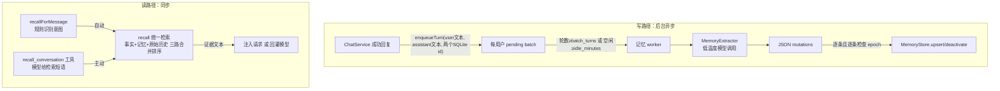

# 卷 14 · 长期记忆系统：提取、召回与结构化事实

> 源码基准：`src/Memory/`。这是项目里算法密度最高的模块：**不用 Embedding**，靠 n-gram 文本相关性 + 规则规划实现"记住用户、按需想起来"。表结构见[卷13 §2](13-持久化层.md#2-全库-20-张表-ddl-汇总)。

> **情感迭代复用边界（2026-09-20，规划；2026-10-25 暂停）**：原计划 v2.4.2 复用本卷自动／工具召回和群话题既有短时召回，不另建 RAG、向量库或检索系统。2026-10-25 起该学习/决策方向暂停，M0/M1 已落地，M2+ 重启待定（暂停与备选方向（内部笔记））。现有群背景已于 2026-10-25 与 `conversationText` 分离：只进入请求副本，不写会话历史、不参与自动召回与记忆提取（technical-design §10.8 M0 边界）。本卷以下仍描述当前实现，未新增学习模型或训练存储。

## 0. 整体模型



## 1. MemoryService：队列、批次与 epoch

### 1.1 状态

```cpp
MemoryStore store;                    // 独立 SQLite 连接
MemoryExtractor extractor;            // dock+registry（模型名每次提取时由调用方给，L1.d）
const Live<MemoryOptions> &config;    // 组合根的活值（ADR-023）：五个键都在使用处取快照
bool storeOpen;                       // 记忆库是否可用（构造时定，决定是否起后台线程；L2.b 起与 enabled 无关）
std::thread worker;                   // storeOpen 才启动
std::mutex queueMutex; std::condition_variable queueChanged;
std::unordered_map<uint64_t, PendingBatch> pending;    // user → {turns, lastUpdated, epoch}
std::unordered_map<uint64_t, uint64_t> userEpoch;      // user → 当前纪元
```

### 1.2 enqueueTurn（写入口，聊天线程调用）

`!storeOpen || 当前 memory.enabled 为假（队列锁外取快照，L2.b） || user/assistant 文本空 → 丢弃`；锁内：`pending[user].turns.push_back({userText, assistantText, startId, endId})`，batch.epoch 取当前 userEpoch，刷新 lastUpdated，notify。

### 1.3 workerLoop（500ms 心跳轮询）

```
每轮开头（队列锁之外）取一份配置快照 options              // L1.d：活值的锁不与 queueMutex 嵌套
cv.wait_for(500ms) → stopping 则退出
扫描 pending（map 序）：batchReady = turns.size() >= options.batchTurns
                     idleReady  = now - lastUpdated >= minutes(options.idleMinutes)
首个满足者 move 出队（锁内）→ 锁外 processBatch(user, batch, options.model)
```

### 1.4 processBatch 与 epoch 失效机制

```
mutations = extractor.extract(user, turns, model)  // 一次模型调用（可能数秒）；model 是本轮快照里的 memory.model
!isEpochCurrent(user, batch.epoch) → return    // ★ 提取期间用户重置/回滚 → 整批丢弃
for mutation in mutations:
    !isEpochCurrent → return                   // ★ 逐条写前再查
    isPersonCardPredicate(predicate 或 memory_key) → 跳过   // 人物卡的保留前缀 card.（ADR-032），只由写卡工具与程序写
    action=="delete" → store.deactivate(key)   // 模型说"用户要求遗忘"
    else            → store.upsert(item)
```

epoch 语义：`clearUser/removeBySourceFrom` 在锁内 `++userEpoch[user]` 并删除 pending batch；两者做完还让人物卡代数 `cardGeneration` 前进（见[文末附](#附人物卡确定性加载的对方卡片adr-032)）。正在进行的外提取带着旧 epoch 回来，发现不一致即放弃——**防止已删除的记忆被异步任务写回**（ADR-010）。epoch 只在进程内，跨重启无效（已知边界）。

`shutdown`：stopping=true + pending.clear()（**未处理批次丢弃**）+ join。

### 1.5 配置实时生效（L1.d、L2.b，ADR-023）

`model`、`batch_turns`、`idle_minutes`、`recall_limit` 重载即生效。快照取在哪里：后台线程把“挑一个批次并提取”算作一次操作，每轮开头、在拿 `queueMutex` 之前取一份，本轮的批次条件与提取模型都出自这一份；`wait_for` 期间换了值，本轮仍按手里的旧快照挑批次，最迟下一轮（约 500 毫秒）起用新值，正在提取的批次不受影响。召回在 `recall` 开头取一次；`recallForMessage` 传 `limit=0`，不再自己另取。L2.b（2026-11-15）起 `enabled` 也重载即生效：记忆库可用就起后台线程（运行时不建不销线程），`enabled` 只在入队与召回处读——关掉后不再收新的对话轮次、召回不查长期记忆（只查原始对话），已入队的批次照常提取完；打开后下一轮对话起照常积累。`recallForMessage` 的开关与 `recall_limit` 出自同一份快照（私有 `recallWith`）；`isEnabled()` 是“库可用且当前开着”。应用函数 `applyMemory` 整份替换。`memory.model` 没写时加载阶段取 `chat.default_model`，所以改默认模型会一并改 `memory.model`，下一批提取即用新模型（[卷04 §1.7](04-配置系统.md#17-memorymemoryschema)）。

## 2. MemoryExtractor：提取协议（模型→JSON）

请求（低温度 0.1、max_tokens 1600）的 system prompt 要点：

- 只提取"原文可确认且未来有价值"的信息；类型限定 8 种；忽略寒暄/一次性问题/推测；
- `memory_key` 稳定简短（`preference.favorite_game` 风格），**同一事实变化复用 key**，事件类 key 带日期防覆盖；
- `search_text` 写规范事实 + 原文可能的同义表达（空格分隔）——**这就是无向量的"语义检索面"**；
- 可结构化时额外输出 `subject_key/subject_type/subject_name/subject_aliases/predicate/value_text`；复杂事件可省略；
- 用户明确要求遗忘 → `action=delete`；只输出 JSON。

解析（宽容策略）：截取首个 `{` 到最后一个 `}` 之间再 parse；缺 `memories` 数组或异常 → 整批不更新。逐条后处理：

- importance/confidence 钳到 [0,1]；
- 结构化字段**不齐全则全部清空**（选择仅保留开放记忆）；齐全但缺 memory_key → 自动补 `subject_key.predicate`；
- 缺 key（且非 delete）或缺 canonical_text → 丢弃该条；
- source 区间 = 本批 turns 的最小 start 与最大 end。

## 3. MemoryQueryPlanner：意图规则（三个纯函数）

| 函数 | 触发词（部分） | 用途 |
| --- | --- | --- |
| `hasExplicitRecallIntent` | 以前/之前/曾经/上次/还记得/说过/历史/上一版/改之前…（21 个） | 决定是否自动召回 |
| `looksLikeFactQuestion` | 是什么/叫什么/是谁/哪里/多少/几岁/什么时候/最喜欢/什么版本/有没有…（28 个） | 决定是否尝试结构化事实规划 |
| `detectFactTemporal` | timeline:时间线/变化过程/都用过…；previous:上一个/上一版/改之前…；earliest:最早/一开始/最初…；默认 current | 事实查询的时间轴选择 |

纯 `contains` 匹配，无分词——中文子串即命中。

## 4. TextRecall：归一化、n-gram 与评分（无 Embedding 检索的核心）

### 4.1 normalizeText

ASCII：字母→小写保留，其余（标点/符号）→折叠成单个空格（`previousSpace` 去重，首尾剪掉）；**非 ASCII（中日文等多字节）原样保留**（按 UTF-8 长度 1–4 切字符，不断多字节）。

### 4.2 buildRecallQueryPlan(queries, maxTerms=24)

每个查询归一化后生成三层检索词（去停用词后进 map，**同词保留更高权重**）：

| 层 | 权重 | 说明 |
| --- | --- | --- |
| 完整短语 | 6.0 | `normalized` 整串 |
| 词段（splitWords 按空格） | 4.0 | 英文单词/被标点切开的段 |
| 中文 3-gram | 2.5 | 词段含非 ASCII 时，滑窗生成所有 3 字组合 |
| 中文 2-gram | 1.5 | 同上，2 字组合 |

停用词表（30 个）：我/你/他/我们/之前/现在/什么/哪个/怎么/为什么/这个…（问题骨架词不参与检索）。
计划按 权重↓ → 长度↓ → 字典序 排序并截断到 maxTerms。

### 4.3 scoreRecallText(plan, text)

```
归一化 text；对每个 phrase：整串相等 +14，包含 +9
对每个 term：命中累计 matchedWeight/matchedTerms
score = matchedWeight + 4×(命中词数/总词数) + 3×(命中权重/总权重)
```

直观理解：完整短语命中是强信号；n-gram 命中率奖励"覆盖了问题的多个侧面"；归一化保证大小写/标点不干扰。**这个评分同时用于记忆与原始历史检索**，是三路召回可比性的基础。

## 5. MemoryStore：开放记忆 + 结构化事实

### 5.1 upsert（开放记忆，154–193 行）

`memories` 表 `ON CONFLICT(user_id,memory_key)`：更新全部字段并把 `active` 拉回 1（重新激活）。成功后若条目带完整结构化字段 → `upsertStructuredFact`。

### 5.2 upsertStructuredFact 状态机（195–340 行，最复杂的一段）

```
① memory_entities upsert：
   canonical_name 只有新值 ≠ entity_key 时才覆盖（防把名字退化成 key）
   aliases 空串不覆盖旧值
② 查当前事实 (subject,predicate) 的 {value_text, active}
③ changed = 不存在 || inactive || 值不同
④ changed 且旧值 active：把旧 active 历史版本关账
   UPDATE fact_history SET valid_to=新source_start, status='superseded' WHERE status='active'
⑤ memory_current_facts upsert（主键 user+subject+predicate）
⑥ !changed → 结束（同值再确认只刷新来源，不建新版本）
⑦ 插入新历史版本 (valid_from=source_start, valid_to=NULL, status='active')
```

**版本时间轴用消息 id 而不是墙钟时间**——与删除边界（也是消息 id）天然可比。

### 5.3 delete / deactivate

- `deactivate(user,key)`（模型遗忘）：memories.active=0；`deactivateStructuredFact(status="retracted")`：当前事实 active=0，全部非 removed 历史打 retracted（`valid_to` 保持 source_end——显式撤回不是"被删除边界截断"）。
- `deactivateBySourceFrom(user,firstId)`（回滚对话）：memories 里 `source_end_id >= firstId` 全部 active=0；然后 `restoreStructuredFactsBefore`：

```
受影响的 (subject,predicate)（当前事实 source_end>=firstId）逐个：
  a) 历史里 source_end>=firstId 的版本 → status='removed', valid_to=firstId
  b) 找 source_end<firstId 且 status NOT IN (removed,retracted) 的最新版本
     找到 → 当前事实整行恢复为该版本 + 该历史版本重新 active（valid_to=NULL）
     没找到 → 当前事实 active=0（该属性彻底没有有效来源）
```

**语义：删除最近的对话后，属性回退至"删除边界之前的最后一个值"**——用户回滚误发内容后，记忆同步回退至该内容写入之前的状态。

### 5.4 search（开放记忆检索，562–631 行）

对 plan.terms 逐个执行：

```sql
SELECT … FROM memories WHERE user_id=? AND active=1
 AND (canonical_text LIKE ? OR search_text LIKE ?) ESCAPE '\'
 ORDER BY updated_at DESC LIMIT max(32, limit*8)
```

每行打分：`relevance = scoreRecallText(plan, canonical+search) + importance*2 + confidence`；id 去重（取高分）；排序 relevance↓, updated_at↓；截断。

### 5.5 searchFacts（结构化查询，633–799 行）

每个 `StructuredFactQuery{subject,predicate,temporal}`：

- temporal 归一（非四值之一→current）；
- **相关性打分器** `relevanceFor`：
  - subjectPlan 对 `subject_key+type+name+aliases` 打分（query.subject 空 → 10 分保底；≤0 直接 0 淘汰）；
  - predicatePlan 对 `predicate+canonical+search` 打分；
  - 精确等值加成：`subject==subject_key 或 canonical_name → +20`；`predicate==predicate → +20`；
  - 总分 = subject 分 + predicate 分 + importance*2 + confidence。
- current：全表 active 当前事实逐行打分（>0 保留）；
- earliest/previous/timeline：读全部非 removed/retracted 历史 → 按 (subject,predicate) 分组、按 valid_from 升序 → **earliest 取首版；previous 取倒数第 2 版；timeline 全部保留**；
- 跨查询去重键 `temporal\nsubject\npredicate\nvalue\nsource_start`；排序 relevance↓（timeline 同分按 valid_from 升序）。

### 5.6 planFactQueries（自动规划，801–887 行）

给 `recallForMessage` 用：把用户当前问题与**该用户全部 active 事实**做双向匹配：

```
subjectScore = scoreRecallText(以 {subjectKey,name,aliases} 构建的计划, 用户问题)
             + (subjectKey=="user:self" 且问题含"我/我的" ? +20)
             + (问题含 subjectName ? +20)；≤0 淘汰
predicateScore = scoreRecallText(以 {predicate,canonical,search} 构建的计划, 问题)
               + (问题含 predicate 原串 ? +20)；≤0 淘汰
候选按 score↓，保留 [最高分-6, 最高分] 区间内且 ≥6 分的前 limit(5) 个（去重）
temporal = detectFactTemporal(问题)
```

**"多个接近最高分的实体全保留"**——由主模型向用户澄清歧义，规划层不武断选一个。

## 6. recall：三路统一召回（MemoryService.cpp:99–219）

```
recallLimit    = config.get()->recallLimit       // 一次召回取一次快照（L1.d）
effectiveLimit = limit==0 ? recallLimit : min(limit, recallLimit)
candidateLimit = effectiveLimit * 3
facts    = enabled ? store.searchFacts(user, factQueries, candidateLimit) : {}
memories = enabled ? store.search(user, queries, candidateLimit) : {}
raw      = conversationStore.searchMany(user, queries, candidateLimit, excludeId)   // 不受 enabled 影响！

统一排名容器 RankedRecall{kind, index, relevance, recency}：
  事实    → relevance = fact.relevance + 40.0        ★ 结构化精确结果天然置顶
  记忆    → 与事实 (source区间+canonical 全等) 重复者剔除；relevance = 自身分
  原始行  → 被"高分事实/记忆的 source 区间覆盖"者剔除（coveredBy*：相关分差 40 以内才判覆盖）
排序：relevance↓ → kind(事实<记忆<原始)↑ → recency↓；截断 effectiveLimit

输出组装（文本）：
  "- [原始对话/role] content"
  "- [结构化事实/temporal] name (key).predicate = value [来源区间 …]"
  "- [长期记忆/type] canonical"
  事实与记忆条目下追加 loadByIdRange(source_start, source_end, padding=1) 的
  "原始对话证据：[role] content"（排除当前消息 id）
无结果 → "没有找到与这些检索词相关的长期记忆或原始对话。"
```

## 7. recallForMessage（自动入口，221–242 行）

```
explicitRecall = hasExplicitRecallIntent(text)
factQuestion   = looksLikeFactQuestion(text)
两者皆非 → {}（绝大多数闲聊零成本跳过）
factQueries = enabled ? store.planFactQueries(user, text, 5) : {}
!explicitRecall && factQueries 空 → {}   （纯事实问句但规划不出实体属性 → 不搜）
result = recall(user, {text}, 0, factQueries, currentMessageId)   // 0 = 按配置的 recall_limit，由 recall 取那一份快照，同一次召回不取两次
命中空串哨兵 → {}（自动入口不注入未命中提示文本）
```

## 8. 设计取舍分析

| 决策 | 得 | 失 |
| --- | --- |---|
| 无 Embedding | 零外部依赖、可解释、离线可测 | 语义泛化靠提取器写 search_text 的质量 |
| 提取异步批处理 | 聊天延迟不受影响 | 最终一致：刚说的话可能还没进记忆 |
| epoch 失效机制 | 删除语义可靠 | 跨重启无效 |
| 版本用消息 id 当时间轴 | 与删除边界精确对齐 | 不表达"真实世界时间先后"（仅记录顺序） |
| 事实 +40 置顶 | 精确问题精确答 | 事实错误时压制原始证据（模型仍可看证据段） |
| 软删除 memories(active=0) | 审计可回溯 | 需 clearUser 才真正清空间 |

## 附：人物卡：确定性加载的对方卡片（ADR-032）

她每次和一个人说话、或这个人在群里在场时，手里都有一张关于这个人的卡片，确定性地加载、不靠召回。起因（ADR-032）：离线回放里只有带疑问词的提问召回得到，寒暄与不带疑问词的话都没触发；批量提取又有批次延迟，“以后叫我小白”不会当场生效；她此前只知道有个部署者，不知道群里哪个人是。卡片是关于这个人的事实、不衰减；她对这个人的看法在认识账本的 person 条目里（会衰减、回想会改），两样分开。

**槽位**（`src/Memory/PersonCard.h/.cpp`，代码里的机制，不是配置）：

| 槽位 | 谁写 | 谓词 | 说明 |
| --- | --- | --- | --- |
| QQ 号、昵称 | 程序 | —（不存） | 昵称是当场的快照：私聊取发送者昵称，群聊取群名片或群缓冲里最近一次的昵称 |
| 是不是部署者 | 程序 | —（不存） | 只由 `bot.manager_id` 算出（`PersonCards::isDeployer`），谁说“我是部署者”都改不了 |
| 建卡日期 | 程序 | `card.first_seen` | 第一次建卡时写一次（`ensure`），只存不显示——它是建卡那天、不是认识那天 |
| 对方希望被怎么叫 | 她 | `card.wanted_name` | 工具里的 `wanted_name` |
| 她怎么叫对方 | 她 | `card.my_name` | 工具里的 `my_name` |
| 对方怎么叫她 | 她 | `card.name_for_me` | 工具里的 `name_for_me` |
| 她记下的几句 | 她 | `card.note1`…`card.note5` | 工具里的 `note`，至多 `kMaxNotes` 条 |

规则常量（`PersonCardRules`）：

| 常量 | 值 | 作用 |
| --- | --- | --- |
| `kMaxValueCodepoints` | 40 | 一个槽位的值的码点上限 |
| `kMaxNotes` | 5 | 她记下的条数 |
| `kMaxPeopleInGroup` | 8 | 群聊里至多带几个人的卡 |
| `kGroupNotes` | 2 | 群聊一行里至多带几条 note |

**存储**：不建表、不加列，复用 §5 的结构化事实表（谓词前缀与读写方法见[卷13 附](13-持久化层.md#附人物卡取用与回想用到的存储adr-029adr-030adr-032)）。`PersonCards` 经组合根给的后端 `PersonCardBackend`（`enabled` / `slots` / `set` / `generation`）读写 `MemoryService::cardSlots / setCardSlot`，自带按人缓存（互斥锁只护缓存，调后端时不持锁）；`MemoryService::cardGeneration()` 在写槽位、`clearUser`、`removeBySourceFrom` 后前进，缓存按代数失效。批量提取（§1.4）跳过 `card.` 前缀；按人清除时卡片一起删掉，按来源回滚时卡片上的改动照事实表的规则回退。卡片事实带规范文本（如“对方希望被叫作：…”），所以事实召回也查得到。

**加载**：

- 私聊：`Message` 调 `PersonCards::privateSection`（先 `ensure` 建卡），渲染成 `[对方的卡片]` 段接在 `situationNote` 里进 system：QQ、QQ 昵称、部署者身份、她记下的称呼与 note，建卡日期不显示。稳定文本，卡片改了才变一次。私聊不取用认识账本。
- 群聊：在场的人各一行（`groupLines`）：只写有内容的人（部署者，或她记过什么的）、部署者排最前、同一人只写一次、至多 `kMaxPeopleInGroup` 人、每行至多 `kGroupNotes` 条 note；`groupSection` 加上标题行。放在本轮 user 侧，会话轮、@ 回复与判定器里的位置见[卷23 附](23-观察通道与话题会话.md#附人物卡在群聊里adr-032)。

**更新**：工具 `update_person_card`（`src/Action/PersonCardAction`，[卷09](09-Action与Tool体系.md#617-updatepersoncardaction-update_person_cardadr-032)）调 `PersonCards::write`：`slot` 只能是四种之一；值去首尾空白后必须是一行、不超过 `kMaxValueCodepoints`，为空表示清掉；note 用 `index`（1–5）指明哪一条，不填就放进第一个空位，放满了要指明；没有对象（没填 `user` 且没有正在说话的人）时拒绝。写成功后清掉这个人的缓存，下一次请求里的卡片就是新的。

**开关**：`enabled()` = 记忆库可用且当前 `memory.enabled` 为真（`MemoryService::isEnabled`）；否则 `privateSection` / `groupLines` 都给空串、请求逐字不变，写卡工具不出现。

测试：`PersonCardTests.cpp`（[卷21](21-测试体系.md)）。

## 9. 本章文件清单

| 文件 | 内容 |
| --- | --- |
| `src/Memory/MemoryService.h/.cpp` | 队列/批次/epoch/worker + recall 三路合并 |
| `src/Memory/MemoryExtractor.h/.cpp` | 提取协议与宽容解析 |
| `src/Memory/MemoryStore.h/.cpp` | 全部记忆 SQL + 事实状态机 + 双检索 + 规划 |
| `src/Memory/TextRecall.h/.cpp` | 归一化/n-gram 计划/评分函数 |
| `src/Memory/MemoryQueryPlanner.h/.cpp` | 三组意图词表 |
| `src/Memory/MemoryItem.h` / `StructuredFact.h` / `MemoryOptions.h` | DTO |
| `src/Memory/PersonCard.h/.cpp` | 人物卡：槽位、缓存、私聊段与群聊行的渲染（ADR-032） |
