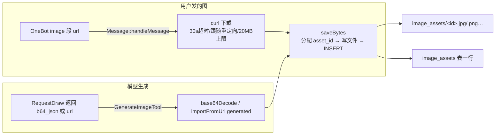

# 卷 16 · 图片资产系统

> 源码基准：`src/Asset/ImageAssetStore.h/.cpp`（头文件含 ImageAsset 结构）、`src/Tool/ImageToolHelpers.h`、图片三工具（[卷09 §6.8–6.10](09-Action与Tool体系.md#68-generateimagetool-generateimage)）、路由侧（Message/ChatService，[卷07](07-消息调度与路由.md)/10）。表 DDL 见[卷13 §2](13-持久化层.md#2-全库-20-张表-ddl-汇总)。

## 0. 设计思想（ADR-013）

图片**不以 Base64 形态进入对话历史**。历史与上下文中仅保存 `[image asset_id=img_xxx source=inbound|generated]` 占位符；需要"查看"时由 `inspect_image` 按需读取并调用视觉模型；需要"重发"时由 `send_image` 产生出站消息。优点：历史轻量、跨轮可引用、同一图片无需重复传输；代价：依赖模型正确选择工具。

占位符的唯一格式化/解析点是 `src/Asset/ImagePlaceholder.h`（ADR-022）：`formatImagePlaceholder(assetId, source, sticker=false)` 产出 `[image asset_id=X source=inbound]` / `… source=inbound sticker]` / `… source=generated]`；`attachImageCaption(text, assetId, caption)` 把瞥视描述插成 `[image asset_id=X source=… | 描述]`（只认完整 id、已有描述不重复追加；`GlanceService::attachCaption` 是它的转发）。Message、GroupContextService、GenerateImageTool 都经它生成，src 里不再手拼。

## 1. 两个来源、一条入库路径



`importFromUrl`：额外用 HEADERFUNCTION 抓 `Content-Type`（空则默认 image/jpeg）；HTTP 状态 ≥400 或空字节 → nullopt。**注意：此处没有 SSRF 校验**（下载的是 QQ 服务器图床 URL，不是模型可控输入；`klein_web_fetch` 的 SSRF 防护不覆盖这条路——已知边界）。

`saveBase64`：解码后固定按 `image/png` 落盘。

## 2. asset_id 的生成与碰撞处理（saveBytes）

```
makeAssetId() = "img_" + 4×(setw(8) hex 的 uniform_int_distribution<uint32_t>(random_device))
             = 128 位随机十六进制
碰撞防护（最多 16 次尝试）：
  同时检查「数据库主键已存在」与「目标文件路径已存在」，双清才算可用
  16 次仍碰撞（碰撞概率可忽略）→ LOG_ERROR "图片资源 ID 连续碰撞" + 拒绝保存
```

ID 不包含用户 ID/时间戳（不透明标识）；扩展名按 MIME 推断：png/webp/gif 命中对应扩展名，其余为 `.jpg`。写入流程：先写文件 → INSERT 失败则删除文件（不遗留无主文件）。

## 3. 查询接口

| 方法 | SQL 语义 | 调用方 |
| --- | --- | --- |
| `find(user, asset_id)` | 精确（user+id，LIMIT 1） | inspect/send 工具 |
| `findLatest(user, source)` | `ORDER BY created_at DESC, rowid DESC LIMIT 1` | 工具未给 id 时按来源取最近（rowid 兜底保证同秒多图稳定取最后插入的） |
| `list(user, source, limit)` | 同排序多条 | 备用 |
| `readBase64(asset)` | 读文件 → 就地 base64 编码（失败空串） | inspect 工具 / 当前消息多模态 |
| `attachToConversation(user, asset_id, message_id)` | UPDATE source_message_id | Message 在 reply 落库拿到 user 行 id 后回填 |

`resolveImageAsset`（ImageToolHelpers.h，工具侧统一入口）：三级兜底 asset_id 精确 → source 最近 → `findLatest(owner)` 不分来源最近一张（2026-10-30 起；旧版默认 `findLatest(generated)` 且 id 未命中即失败）。**全部查询按 user_id 过滤**——用户 A 永远拿不到用户 B 的图（模型伪造 asset_id 也一样）。

## 4. 生命周期：与三种重置联动（卷12 §5）

| 触发 | 行为 |
| --- | --- |
| `#重置上下文` → `clearUser(user)` | SELECT 该用户全部资产 → DELETE 行 → 逐个删文件 |
| `#删除上条对话` → `removeByConversationFrom(user, first_id)` | `source_message_id >= first_id` 的资产行+文件删除（来源在删除区间内的图） |
| `#重置对话`（轻重置） | **不动图片** |
| 无来源关联的资产 | 两种情况产生此类记录：① 非上下文模式（`user_message_id=0`，attachToConversation 直接返回）；② 上下文模式下 `reply()` 抛异常被 Message 层捕获时 attach 未执行。此类记录保留至用户 `#重置上下文`；**无后台回收任务**（已知边界，`#删除上条对话` 无法清理它们——上下文模式下 reply 正常返回则必定完成关联，即使模型报错也携带有效 id） |

## 5. 图片消息的端到端路径（与卷10 呼应）

```
入站带图消息
 → Message: importFromUrl + 文本追加占位符 + currentImage(base64)
 → ChatService:
    routeCurrentImage:
      模型有 vision → 图片附到最后一条 user 消息（原生多模态，一次出答案）
                     [供应商明确拒图 → removeRequestImages + 更正注记 → inspect_image 降级]
      否则/读失败   → 只留占位符（模型须调 inspect_image）
 → reply 返回后: attachToConversation 回填 source_message_id
历史图片被问及: 永远走 inspect_image（不自动重附历史图，避免每轮重传）
生成: GenerateImageTool → saveBase64(source=generated) → 发图 + 上下文占位符 + terminal
重发: SendImageTool → resolve → 发图 + terminal + suppress
```

## 6. 已知边界

| 边界 | 说明 |
| --- | --- |
| 多图消息只留最后一张 | OneBotEventDecoder 的 message_data_url 单值（[卷05 §8.2](05-网络与OneBot传输层.md#82-事件解码oneboteventdecodercpp)） |
| 图片内容安全扫描 | 无（直接交给视觉模型） |
| 磁盘占用 | 图片原样保存（无压缩/缩略图）；20MB 单图上限是唯一约束 |
| 生成图固定 PNG | saveBase64 写死 image/png（多数生图 API 返回 png，合理） |
| importFromUrl 无 SSRF 校验 | 依赖"URL 来自 QQ 官方图床"的信任假设 |

## 附：群资产库与作用域解析（ADR-019，2026-10-28）

- 同一 `ImageAssetStore` 跑两个实例：个人库（`image_assets`，owner=user_id，永久）与群库（`group_image_assets`，owner=group_id，24h/每群 300 张）。群里任何人发的图、她在群里生成的图只进群库，**不进发送者个人库**。
- `ToolContext.shared_scope_id`（群号；私聊 0）：`resolveImageAsset(personal, shared, ctx, args)` 每一级都先查群库再查 `ctx.user_id` 的个人库（级：asset_id 精确 / 按来源最近 / 不分来源最近）；私聊只查个人库。别人引用你的个人资产 id 在群里拿不到你那张（不泄漏），只会兜底到群库最近一张并带 note。
- `GenerateImageTool` 在 `shared_scope_id≠0` 时把结果存群库；`InspectImageTool`/`SendImageTool` 按上述顺序解析。`readBase64` 只读文件，两库通用。
- `Message` 群 @ 路径：当前消息的图片先按 `message_id` 在群库找（观察路径通常已入库），找不到再下载入群库；不再 `attachToConversation`（那是个人库语义）。会话历史里的占位符是 `[image asset_id=gimg_… source=inbound]`，24h 后资产消失、占位符仍在，工具回"没有找到"——这是设计（硬规则 7）。

## 附：瞥视层与群资产（R1.1 / ADR-020，2026-10-29）

- 群资产库是瞥视的原料：`GroupContextService::observe` 把入站图片入群库后，把 `ImageAsset` 连同 `group_messages` 的 seq 交给 `GlanceService`。瞥视 worker 经 `ImageAssetStore::readBase64`（群实例）读字节——既用于 FNV-1a 去重指纹，也由组合根的视觉适配器发给 `Dock::RequestVision`（`models.vision`，与 `inspect_image` 同一端点）。
- 瞥视的产物**不进资产库**：一行描述只写回 `group_messages.text` 的占位符（`[image asset_id=gimg_… source=inbound | 描述]`），与群资产同 24h 生命周期；资产被 prune 后描述仍在缓冲里的那条消息上，直到消息本身淘汰。
- 分层：瞥视是"每张图一眼"的派生文本；细看仍是 `inspect_image` 按需回取原图（群优先/个人兜底）。她自己生成/发出的图不瞥视。

## 7. 本章文件清单

| 文件 | 内容 |
| --- | --- |
| `src/Asset/ImageAssetStore.h/.cpp` | 下载/落盘/查询/清理全实现 |
| `src/Asset/ImagePlaceholder.h` | 占位符格式化与瞥视描述写回（唯一实现） |
| `src/Tool/ImageToolHelpers.h` | resolveImageAsset 统一入口 |
| `src/Perception/GlanceService.h/.cpp` | 群图瞥视（读群资产字节去重 + 视觉 seam + 写回群缓冲，卷23） |
| `src/Tool/GenerateImageTool.h` / `InspectImageTool.h` / `SendImageTool.h` | 三工具（[卷09](09-Action与Tool体系.md)） |
