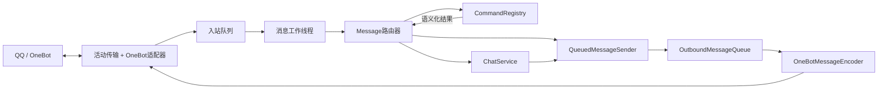
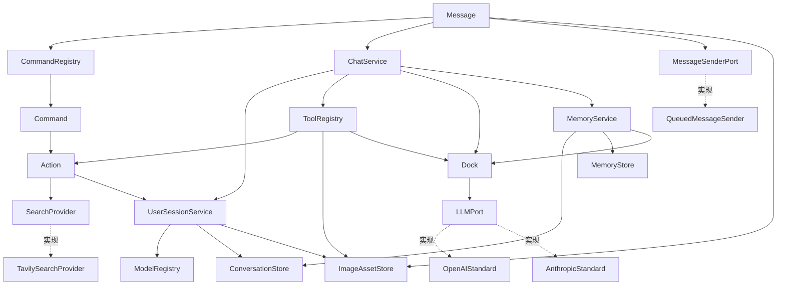
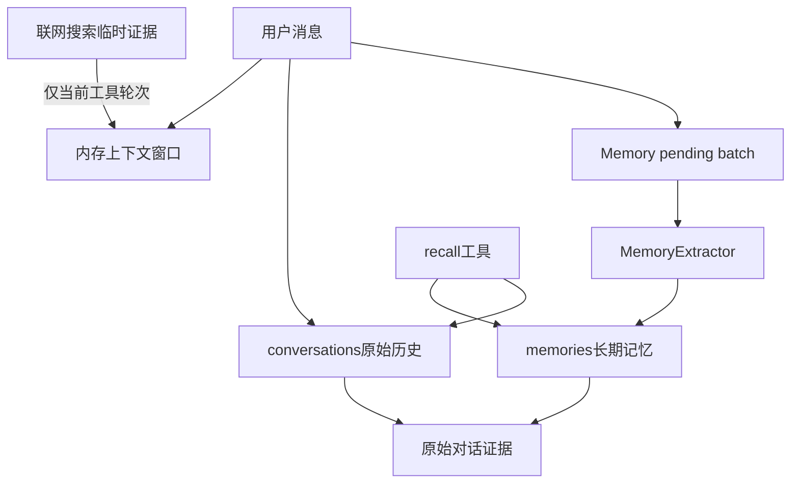
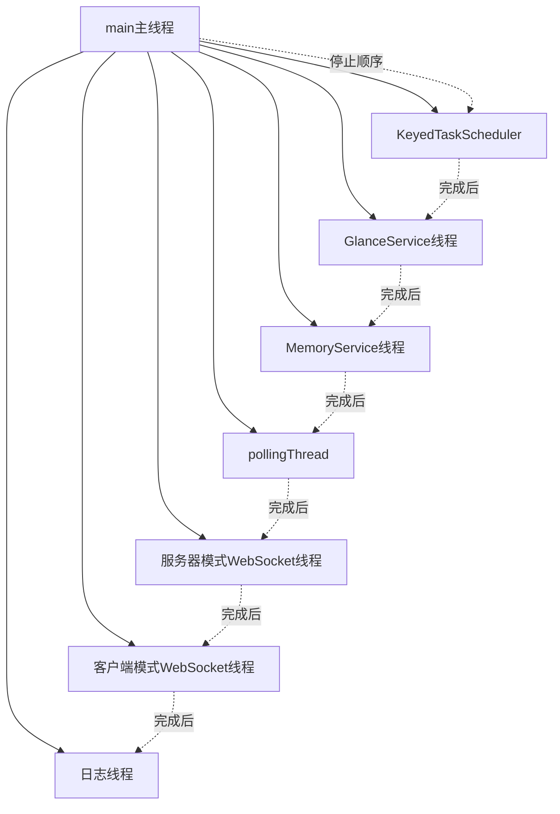
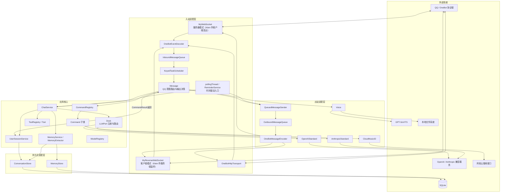
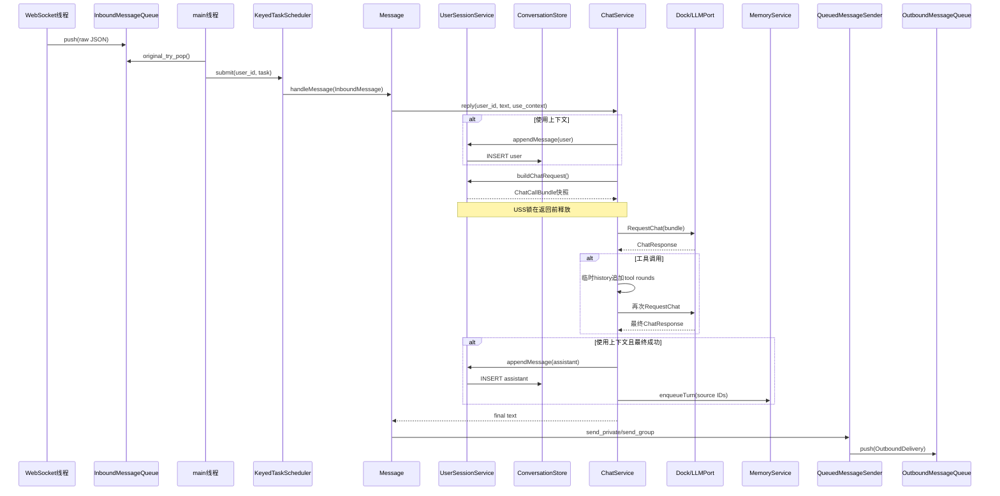

# KleinBot 技术设计文档

> 文档性质：正式技术设计与实现事实来源
>
> 适用版本：KleinBot `v2.4.2`（以当前源码为准）
>
> 更新原则：本文档记录已经被代码采用的设计。临时方案、实验结果和讨论过程放在本地工作笔记里，不随仓库公开；文中标“内部笔记”的设计稿即指它们。实验结论合入本文档后，临时文件不再作为实现依据。

## 1. 文档范围与事实边界

本文档覆盖：

- 进程启动、配置加载和资源初始化；
- 入站 WebSocket、消息队列、工作线程和消息分发；
- 命令系统、普通聊天、视觉识别、图片生成、语音和音乐消息；
- 模型注册、模型适配器、Function Calling 和工具执行；
- 用户会话、上下文窗口、SQLite 原始对话、长期记忆和召回；
- 定时任务、日志、并发模型、优雅退出和部署资源；
- 当前限制、已知风险和后续演进方向。

下列内容不属于 KleinBot 的职责：

- QQ 登录、QQ 协议实现和账号风控；
- OneBot/LLOneBot 的协议端实现；
- 外部模型服务、TTS 服务、图片生成服务和网易云接口的可用性保证；
- API 密钥的生成、托管和轮换。

KleinBot 是一个 C++ 应用层机器人。它通过 OneBot 兼容协议端提供的服务器模式或客户端模式 WebSocket 与 QQ 生态连接，接收事件并发送动作请求（配置值分别为 `forward_websocket` / `reverse_websocket`）。

## 2. 项目定位

KleinBot 的核心目标是把 QQ 消息转换为可编排的模型请求，并把模型或命令结果转换回 QQ 消息。它同时提供按用户隔离的会话状态、原始对话归档和可异步提取的长期记忆。

当前实现的主要技术栈：

| 层次 | 技术 |
| --- | --- |
| 语言 | C++，使用 C++11 及以上可用特性 |
| 构建 | CMake，源码使用 `GLOB_RECURSE` 收集 |
| 网络 | Boost.Asio / Boost.Beast WebSocket |
| HTTP | libcurl |
| JSON | 内嵌的 `Library/nlohmann/json.hpp` |
| 持久化 | SQLite3，WAL 模式 |
| 并发 | `std::thread`、`std::mutex`、条件变量、消息队列和按 key 调度的动态线程池 |
| 外部协议 | OneBot v11 风格事件与动作外壳 |
| 模型标准 | OpenAI 兼容接口、Anthropic 接口抽象 |
| 许可证 | MIT（仓库根目录 `LICENSE`） |

## 3. 总体架构

### 3.1 逻辑分层

```text
QQ / OneBot 协议端
        │
        ├── forward_websocket：单条 Universal WS
        ├── reverse_websocket：单条 Universal WS
        └── http：HTTP API + HTTP事件上报
        │  一次运行只选择一种模式
        ▼
OneBotEventDecoder
        │  OneBot JSON → InboundMessage
        ▼
InboundMessageQueue
        │
        ▼
main 线程轮询 + KeyedTaskScheduler
        │
        ▼
Message::workingThread
        │  长度检查、消息过滤
        ▼
Message
        ├── CommandRegistry → 命令执行 → OutboundMessage
        ├── ChatService → UserSessionService → Dock → LLMPort
        └── 图片消息 → ImageAssetStore → ChatService 工具编排
                         ├── inspect_image → Vision → Dock
                         ├── generate_image → ImageAssetStore → OutboundMessage
                         └── send_image → OutboundMessage
        │
        ▼
MessageSenderPort / QueuedMessageSender
        │  target + OutboundMessage
        ▼
OutboundMessageQueue
        │  OutboundDelivery
        ▼
OneBotMessageEncoder
        │  OneBotAction → JSON envelope
        │
        ▼
活动传输发送循环
        ▼
QQ / OneBot 协议端
```

旁路服务：

- `ConversationStore`：对话原始历史的 SQLite 写穿、读取和关键词检索；
- `ImageAssetStore`：用户图片和生图结果的本地文件、SQLite 元数据、资源引用和生命周期清理；
- `MemoryService`：长期记忆异步批处理、模型提取、更新、失效和召回；
- `ReminderStore` / `ReminderService`：提醒的 SQLite 持久化与内存到期队列调度；
- `Log`：错误、警告和重要信息的异步文件日志；
- `ModelRegistry`：从 `ModelsName.json` 注册模型名称到供应商配置的映射。

### 3.2 主要对象关系

`main.cpp` 负责组装对象和控制线程生命周期，不负责业务规则。对象装配顺序为：

1. `ConfigLoader` 读取并校验 `.config.json`（点前缀隐藏），返回不可变 `SchemaConfig`；
2. Bootstrap 将 Schema DTO 映射为各模块拥有的 Options 和 `TransportConfig`；
3. `ModelRegistry` 读取模型注册文件；
4. `ConversationStore`、`ImageAssetStore` 和 `ReminderStore` 打开同一 SQLite 数据库；`ReminderService` 构造时重建内存到期队列（漏触发处理见第 15 章）；
5. `UserSessionService` 持有用户内存状态、对话存储和图片资源存储引用；
6. `Dock` 注册 `OpenAIStandard` 与 `AnthropicStandard`；
7. `MemoryService` 复用同一数据库路径，启动长期记忆线程；
8. `ToolRegistry` 注册时间、对话召回、图片工具、联网搜索与网页抓取（2026-11-15 L2.a 起始终注册，是否对模型开放看各自活值里的 `enabled`，ADR-023）和提醒工具（`set_reminder` / `list_reminders` / `cancel_reminder`，核心功能无条件注册），以及群聊离场 `leave_topic`（2026-11-16 起，只在群聊开放，跟进服务构造后接线，ADR-024）与用语音说 `send_voice`（2026-11-16 起取代 `set_voice_mode`，总开关开且语音服务可达时开放，ADR-025）；
9. `ChatService` 编排模型调用、工具循环和上下文落盘；
10. 组合根创建 `CommandRegistry`、`Voice`、消息队列、sender 和 OneBot codec，并集中注册命令；
11. `Message` 只持有已装配依赖并负责意图路由；
12. 组合根按 `TransportConfig` 只启动一个活动通信线程，同时启动定时任务和按 `user_id` 分片的消息执行器。

### 3.3 当前架构实况

日常阅读只使用下面四张小图。它们分别描述主流程、核心依赖、数据生命周期和线程生命周期；未来规划与低优先级债务不放入主流程图。

#### 3.3.1 用户消息主流程



这张图只回答“QQ 消息如何进入和离开系统”，不展开模型、数据库和长期记忆。

#### 3.3.2 应用核心依赖



这张图只描述核心对象的依赖方向。配置文件读取被限制在组合根和 `src/Configuration/`；`src/Bootstrap/` 是唯一同时认识 Schema DTO 与运行时模块 Options 的映射边界，业务模块只接收自己拥有的配置类型。该规则由 `ArchitectureDependencyPython` 自动检查。部分通用 `JsonParse` 调用仍是已知基础设施穿刺。

#### 3.3.3 上下文、原始历史和长期记忆



这张图强调这些概念不能合并：上下文是临时模型输入，原始历史是持久化事实，长期记忆是异步派生数据；联网搜索结果只作为当前工具轮次的临时证据，不写入原始历史或长期记忆，最终回答仍按普通 assistant 消息持久化。对明确包含实时、在线人数、天气、新闻或近期局势等信号的问题，应用层在首个 OpenAI 兼容请求中设置 `tool_choice=klein_web_search`；配置段仍名为 `web_search`。模型侧使用独立名称，避免部分网关抢占保留的 `web_search` 名称并将搜索结果折叠为普通文本。工具结果回灌后立即清空强制选择，后续总结仍由模型自动完成。如果模型在工具已注册时错误声称无法联网，`ChatService` 丢弃该回答并强制联网重试一次。

工具结果具有编排策略：搜索 Action 返回的结果被标记为“必须综合”，回灌后由请求级 System Prompt 切换到证据综合阶段。模型发起工具调用时产生的 “I'll search” 等前导文本不会写入临时 assistant 工具消息，避免它在第二次模型请求中诱导出搜索引擎式列表。若最终候选回答仍泄漏原始结果、内部字段或搜索过程，`ChatService` 最多执行一次无感综合纠偏；纠偏仍只使用本轮临时证据，不改变持久化边界。

#### 3.3.4 线程和退出关系



虚线表示当前 `resourceCleanup` 的等待顺序，不表示对象调用关系。

<details>
<summary>展开完整依赖诊断图（仅用于排查交叉依赖）</summary>

下面的完整关系图只用于排查依赖和定位债务，不作为日常理解入口：



这个架构不是完全纯粹的六边形架构，而是渐进式重构后的折中结果：

- OneBot 原始报文由 `OneBotEventDecoder` 在边缘转换为 `InboundMessage`，业务队列不再保存协议 JSON；
- `ReminderService + pollingThread` 是第二个入站驱动源，它直接调用 `ChatService`，不经过 `Message`；
- `Dock` 位于核心边界，负责依据 `api_standard` 选择 `LLMPort` 实现；它不是某个供应商适配器；
- `QueuedMessageSender` 通过 `MessageSenderPort` 接收语义消息，出站队列不包含 OneBot、Milky 或 Satori 报文；
- `OneBotMessageEncoder` 位于协议边缘，当前客户端模式 WebSocket 在出队后才构造 OneBot action；
- Voice 能力尚未全部通过专门端口隔离；
- `InboundMessageQueue` 和 `OutboundMessageQueue` 都由组合根持有并通过引用注入；配置也由组合根加载后按领域切片注入，部分通用 `JsonParse` 调用仍是已知基础设施穿刺。

</details>

### 3.4 架构层次和允许的依赖方向

项目采用“适配器依赖核心，核心不依赖具体外部协议”的方向。允许关系如下：

| 调用方 | 允许依赖 | 禁止直接依赖 |
| --- | --- | --- |
| `MyWebSocket` / `MyReverseWebSocket` | 入站队列、出站投递队列、协议编码器和 `TransportConfig` | `Configuration`、`UserSessionService`、模型供应商 SDK、SQLite 表细节 |
| `Configuration` | JSON、Schema DTO、诊断 | `Network`、业务服务、模块 Options |
| `Bootstrap` | Schema DTO、模块 Options、适配器配置、`utils/Live.h`（活值，ADR-023） | 业务规则和运行期业务状态 |
| `Message` | `CommandRegistry`、`ChatService`、`MessageSenderPort`、视觉/TTS 临时适配器 | SQL、OpenAI/Anthropic 请求 JSON、OneBot socket 写操作 |
| `Command` | 命令文本、`CommandContext`、注入的 `Action` | 直接实现已迁移 Action 的业务逻辑、拼 OneBot/CQ 协议字符串 |
| `Action` | 结构化参数、`ActionContext` | 对应业务操作的 `ActionResult` | QQ 命令语法、模型 tool_call 协议、OneBot 消息格式 |
| `ActionTool` | `ActionDescriptor`、Tool 参数 | `ToolResult` | 重复实现 Action 业务规则 |
| `WebSearchAction` | `SearchProvider`、`WebSearchOptions` | 当前轮次结构化搜索证据 | 直接依赖 Tavily HTTP 协议、持久化网页内容 |
| `TavilySearchProvider` | Tavily endpoint、API Key、代理和超时 | `SearchResult` 集合 | 模型调用、对话持久化、工具循环 |
| `ChatService` | `UserSessionService`、`Dock`、`ToolRegistry`、`MemoryService` | QQ 群/私聊概念、CQ 码、WebSocket、SQLite SQL、libcurl |
| `UserSessionService` | `ModelRegistry`、`ConversationStore`、`MemoryService` 协作接口 | WebSocket、OneBot、具体模型 HTTP 协议 |
| `Dock` | `LLMPort` 和适配器注册表 | 用户会话、QQ 消息、命令匹配 |
| `OpenAIStandard` / `AnthropicStandard` | HTTP、供应商 JSON、统一端口 DTO | 用户状态、命令、QQ 目标 ID、长期记忆策略 |
| `ConversationStore` / `MemoryStore` | SQLite 和存储 DTO | 模型调用、QQ 发送、命令业务 |
| `QueuedMessageSender` | `OutboundMessage`、协议无关 target、`OutboundMessageQueue` | OneBot/Milky/Satori JSON、socket、模型调用 |
| `OneBotMessageEncoder` | `OutboundDelivery`、OneBot action 名称 | WebSocket/HTTP 生命周期、业务路由、队列所有权 |
| `WebUI::ConfigPanelServer` | `ConfigLoader`/`ConfigWriter`（配置校验与写回）、`ConfigSnapshotStore`（只读当前快照，const 引用）、`ConfigReloader`（保存后的重载，与 `#刷新配置文件` 同一入口，ADR-023）、`BearerAuth`、工作目录下的 `panel.html` | 消息队列、业务服务、通信传输、SQLite |
| `Push::PushServer` / `PushDelivery` | `PushDelivery`（校验/润色/投递接缝）、`MessageSenderPort`、`BearerAuth`、`PushSettings` | 消息队列所有权、配置系统、业务服务内部状态 |

反方向的约束：`Bootstrap/`（运行时设置映射、规则表、活值集合、重载入口）只允许组合根 `src/main.cpp` 与面板 `WebUI/` 包含，任何业务模块都不得包含（ADR-023，2026-11-15 起由 `ArchitectureDependencyPython` 机检）。

依赖方向规则的目的不是追求图形上的“纯洁”，而是控制变化的爆炸半径：

- OneBot 协议变化只应影响入站 OneBot 解析和 `Protocol/OneBot`；Milky、Satori 等协议应新增边缘适配器，不修改语义队列；
- 模型供应商变化只应影响 `LLMPort` 适配器和必要的统一契约；
- SQLite 查询变化只应影响 Store；
- 上下文和记忆策略变化应集中在 `UserSessionService`、`ChatService` 和 `MemoryService`；
- 新能力优先实现 Action；需要显式命令时增加 Command 适配器，需要自然语言调用时通过 `ActionTool` 暴露。未迁移的旧命令继续按现有 Command 模式工作。

### 3.5 组合根、所有权和引用规则

`main()` 是组合根。所有长生命周期的可变服务应由组合根创建，其他对象通过引用或端口使用：

| 对象 | 当前所有者 | 使用方式 | 生命周期要求 |
| --- | --- | --- | --- |
| `LiveSettings`（活值集合，ADR-023） | `main` 栈对象，声明在所有服务之前 | 只有 `ConfigReloader` 经规则表的应用函数替换成员快照（唯一例外：语音总开关 `globalVoice` 还由 `AdminControlAction` 改，后写者生效）；使用方只拿单个成员的 `const Live<T> &`：L1.a–L1.f 起 `UserSessionService`、`ChatService`、三个专用端点来源、`Voice`、`VoiceModeAction`、`MemoryService`、`Dock` 的两个适配器、`TavilySearchProvider`、`WebSearchAction`、`WebFetchAction`、`GlanceService`、`EngagementService`、`Message`，L2.a–L2.d 起另有 `GroupContextService`（机器人名字）、`DecisionRecorder`、策略外壳 `SwitchingPolicy`、judge 的调用目标解析与组合根里的网页摘录、长度粗检、瞥视视觉就绪判断 | 必须晚于所有使用者析构 |
| `ConfigReloader`（唯一的重载入口，ADR-023） | `main` 栈对象，紧随 `LiveSettings` | `AdminControlAction` 的刷新回调、面板线程持引用 | 面板线程与消息任务退出前不可析构 |
| `ModelRegistry` | `main` 栈对象 | 多处持引用 | 必须晚于所有引用者析构 |
| `ConversationStore` | `main` 栈对象 | USS 和记忆服务持引用 | 必须早于 USS 创建、晚于 USS 析构 |
| `UserSessionService` | `main` 栈对象 | ChatService、Message、Command 持引用 | 消息任务退出前不可析构 |
| `Dock` | `main` 栈对象 | ChatService、Message、MemoryExtractor 持引用 | 模型调用和记忆线程退出前不可析构 |
| `MemoryService` | `main` 栈对象 | ChatService、USS、Recall tool 使用 | 消息线程完成后再 shutdown |
| `ToolRegistry` | `main` 栈对象 | ChatService 持只读引用 | ChatService 存活期间不可析构 |
| `Action` 实例 | `main` 栈对象 | Command 与 ActionTool 持引用 | Command、Tool 和 Message 析构前不可析构 |
| `CommandRegistry` | `main` 栈对象 | Message 持引用 | Message 析构前不可析构 |
| `Voice` | `main` 栈对象 | Message 持引用 | Message 析构前不可析构 |
| `ChatService` | `main` 栈对象 | Message 和定时线程持引用 | 定时线程、消息线程退出前不可析构 |
| `OutboundMessageQueue` | `main` 栈对象 | QueuedMessageSender 写入，活动传输消费 | sender 和传输线程退出前不可析构 |
| `QueuedMessageSender` | `main` 栈对象 | Message 和定时线程经端口引用 | 所有发送调用结束前不可析构 |
| `OneBotMessageEncoder` | `main` 栈对象 | 当前客户端模式 WebSocket 持只读引用 | 使用它的传输线程退出前不可析构 |
| `Message` | `main` 栈对象 | 工作任务捕获引用 | 消息执行器活动任务退出前不可析构 |

项目采用“拥有者持值，使用者持引用”的默认策略：

- 不为没有共享所有权需求的服务使用 `shared_ptr`；
- 不允许 Command 或 Tool 在内部重新创建全局服务副本；
- 构造函数依赖必须在成员声明顺序和对象创建顺序上成立；
- 引用成员不表达所有权，组合根必须保证其生命周期；
- 调用期数据，例如 `user_id`，不能伪装成构造期依赖，应放入 `CommandContext` 或 `ToolContext`。

### 3.6 有意保留和有意延迟的设计

以下事项不能在后续迭代中被误判为“看到接口就立刻抽象”：

1. **暂不抽 `MessagePort`**：只有 QQ 一个真实消息入站协议时，无法知道正确的通用契约。出现 HTTP webhook、CLI 或其他第二入站源后，再从两个实现的交集抽取，避免把 `group_id`、CQ 码等 QQ 特有概念写入核心端口。
2. **命令分发留在适配层**：命令前缀和部分命令行为与聊天入口及 QQ 交互方式相关。`ChatService` 只负责模型对话，不负责决定一段文本是不是 `#命令`。
3. **暂不抽通用 HttpClient**：OpenAI 和 Anthropic 存在重复 libcurl 代码，但只有两个适配器。等第三个真实适配器出现并确认重复形态后再提取，遵循“三次重复再抽象”。
4. **暂不抽 ConversationStorePort**：当前只有 SQLite 实现。USS 已经隔离“何时存”，Store 隔离“怎么存”；第二个真实存储后端出现前，额外接口收益有限。
5. **不为形式纯度一次性移除全部单例**：配置单例和 `TimingTast` 单例均已移除；`JsonParse` 仍是已知刺穿点。入站、出站消息队列、提醒队列和配置快照均由组合根持有；其他单例仍应在有具体收益和测试保护时逐步收敛。

这些是“决策延迟”，不是忘记实现。后续修改如果要推翻，应先记录新需求、替代方案、迁移范围和验证结果。

### 3.7 核心模块契约

| 模块 | 输入 | 输出 | 允许修改的状态 | 失败语义 |
| --- | --- | --- | --- | --- |
| `MyWebSocket` | Universal WebSocket frame、两类队列、OneBot codec | `InboundMessage` 入队或 OneBot action write | 连接状态和两类队列 | 系统错误消息转 UTF-8 后记录并 5 秒后重连 |
| `MyReverseWebSocket` | Upgrade 请求、两类队列、OneBot codec | `InboundMessage` 入队或 OneBot action write | 连接状态和两类队列 | 401/404 拒绝握手；连接失败或断线后立即接受下一个连接，仅监听失败时 10 秒后重建监听 |
| `OneBotHttpTransport` | HTTP API/Webhook、两类队列、OneBot codec | HTTP action 或 `InboundMessage` | 连接状态和两类队列 | 协议/鉴权错误返回状态码，网络错误记录日志 |
| `OneBotEventDecoder` | OneBot JSON | `InboundMessage` 或忽略结果 | 无 | 非法 JSON 抛异常，由传输边缘捕获；标量字段类型宽容（数字字段字符串化可解析、垃圾值回退默认值，JS 系实现端差异不丢事件） |
| `CapabilityBroker` | `poll(now)` 周期调用 | 能力位（`supports(BotFeature)`）与端点摘要 | 探测状态机（互斥锁） | 探测失败 60s 冷却重试；未就绪/不支持一律 false（保守关闭） |
| `Message` | `InboundMessage` | 调用 sender | 无用户持久状态；仅持全局开关和适配器资源 | 单消息异常不得终止进程 |
| `CommandRegistry` | 文本、`CommandContext` | `optional<CommandResult>` | 无 | 未匹配返回 nullopt；权限失败返回文本结果 |
| `Command` | 调用上下文和注入依赖 | 语义化消息 | 仅通过注入服务修改领域状态 | 业务失败应返回明确消息，不伪装未匹配 |
| `Action` | JSON 参数、`ActionContext` | `ActionResult` | 由具体 Action 修改对应业务状态 | 参数非法或业务失败返回明确结果 |
| `ActionTool` | 模型参数、`ToolContext` | `ToolResult` | 只委托 Action | JSON 解析失败转换为工具错误文本 |
| `ChatService` | user ID、文本、是否使用上下文 | `ChatReply`（文本 + 图片等出站消息） | 通过 USS 写 history；通过 MemoryService 入队 | 模型错误转换为系统提示 |
| `UserSessionService` | 用户操作 | 快照、请求 bundle 或结果 | 用户 map、history、会话设置 | 模型未注册返回 nullopt；Store 失败由 Store 降级 |
| `ModelRegistry` | 模型 JSON | `ChatModel` 查找结果（按值） | 模型注册 vector（互斥锁保护） | 文件或 JSON 错误记录日志且保留旧表；reload 在锁外构建新 vector、锁内整体交换，不产生半解析对象 |
| `Dock` | 统一 request + `ChatModel` | 统一 response | 适配器注册表只在构造时建立 | 未知 standard 返回 code=-1 |
| `LLMPort` 适配器 | 统一 DTO | 统一 DTO | 无用户状态 | 网络/供应商错误保留 code 和 error_message |
| `ToolRegistry` | 工具名/schema | Tool 指针或 schema 集合 | 注册期工具集合；对外的工具名与 schema 只给当前可用的（`available()`，2026-11-15 L2.a） | 未知工具与注册了但当前不可用的工具，由工具循环转换为“未知工具”错误文本 |
| 联网搜索 | query、结果上限、Tavily 配置 | 带 source_id、URL、正文片段和可选时间/分数的 JSON | 无持久化副作用 | HTTP、鉴权、响应结构或大小异常转换为工具错误 JSON |
| 图片工具 | JSON 参数、`ToolContext`、`ImageAssetStore` | `ToolResult`（模型文本、出站消息、上下文占位符） | 图片文件和图片元数据 | 找不到资源或视觉/生图失败时返回工具错误文本 |
| `ConversationStore` | 用户、消息、关键词 | ID、消息列表 | conversations 表 | DB 不可用时 no-op/空结果 |
| `ImageAssetStore` | 用户、URL/Base64、来源、对话消息 ID | `ImageAsset` 或图片 Base64 | image_assets 表和本地图片文件 | 下载、解码或文件写入失败返回空结果 |
| `MemoryService` | 已完成对话轮次、召回请求 | pending job 或召回文本 | pending、epoch、memory 表 | 提取失败不影响当前聊天 |
| `QueuedMessageSender` | target + `OutboundMessage`（+ 可选 `correlation_id`） | `OutboundDelivery` 入队 | `OutboundMessageQueue` | 不负责协议编码、重试和 socket 生命周期；`correlation_id` 非空的投递由传输层索要回执（R0.2） |
| `DeliveryReceiptRegistry` | 带 `correlation_id` 的投递、OneBot 响应帧 | `DeliveryReceipt`（sent / failed / unknown + 真实 `message_id`）经 `DeliveryReceiptSink` 扇出 | echo→correlation 未决表（互斥锁；echo 从 2^40 起与 API 通道分段） | 60s 超时与断连按 unknown 兑现，绝不伪造 sent；HTTP 模式不经本表，发送线程按响应体直接回报 |
| `OneBotMessageEncoder` | `OutboundDelivery` | `OneBotAction` | 无 | 非数字 OneBot 目标 ID 抛出参数异常 |
| `ReminderService` | 用户、内容、触发时间、重复规则 | 编号、提醒列表或到期事件批次 | reminders 表 + 内存到期队列 | 非法/过去时间、超上限、跨用户取消全部拒绝 |

### 3.8 架构决策记录摘要

本文档用下列稳定决策解释当前结构。未来推翻任一项时，应新增正式设计记录：

| ID | 决策 | 原因 | 代价 |
| --- | --- | --- | --- |
| ADR-001 | 命令采用 Command Pattern | 从 Message 分离变化频繁的命令业务 | 命令类数量增加，需要集中注册 |
| ADR-002 | 依赖由组合根构造注入 | 显式生命周期，避免隐藏全局依赖 | `main` 装配代码较多 |
| ADR-003 | 出站使用 `MessageSenderPort` | 核心不依赖 QQ/CQ 格式 | 每个平台需实现 sender |
| ADR-004 | 模型通过 `LLMPort + Dock` | 供应商协议差异限制在 adapter | 统一契约扩展成本较高 |
| ADR-005 | 命令分发保留在 QQ 适配层 | `#` 匹配和部分开关具有入口语义 | 新入口需自己决定命令策略 |
| ADR-006 | 会话内存为读主源，SQLite write-through | 保持响应性能并支持重启恢复 | 内存和库需要严格同步入口 |
| ADR-007 | 工具回合不持久化 | 防止 slicing 撕裂协议结构 | 无法直接审计完整工具中间过程 |
| ADR-008 | 召回先使用 LIKE | 实现简单、依赖少、可验证 | 语义召回能力有限 |
| ADR-009 | 长期记忆异步提取 | 不增加用户回复延迟 | 最终一致，退出可能丢 pending |
| ADR-010 | reset/undo 使用 epoch 取消旧提取 | 防止删除后记忆复活 | epoch 仅在进程内，不可跨重启 |
| ADR-011 | 暂缓 MessagePort 和 StorePort | 没有第二实现时无法得到可靠交集 | 当前形式不完全六边形 |
| ADR-012 | `KeyedTaskScheduler` 替代每消息线程 | 同用户串行、用户间并行、有界背压并支持等待退出 | 调度器需要维护用户 lane 和动态 worker 生命周期 |
| ADR-013 | 图片历史保存资源占位符，按需通过工具回取 | 避免每轮重传历史图片，同时支持跨轮查看和重新发送 | 依赖模型正确选择工具，第一版不是主聊天请求原生多模态 content |
| ADR-014 | Command 与 Tool 通过 Action 共享业务能力 | 保留确定性命令入口，同时为自然语言入口复用同一实现 | 组合根对象增多，旧命令需渐进迁移 |
| ADR-015 | Schema DTO、Bootstrap 映射和模块 Options 三段隔离 | 防止配置模块穿刺核心，并限制字段变化的影响范围 | 组合根需要显式维护映射代码 |
| ADR-019 | 群聊上下文与资产边界：群聊功能与私聊对等，但群聊原料只在短时缓冲——图片进 `group_image_assets`（`ImageAssetStore` 第二实例，owner=群号，24h/每群 300 张），永不进个人永久库；`ToolContext.shared_scope_id` 让图片工具群优先、个人兜底 | 群里"识别第二张/追问那张图"要有原料，同时不得把群内容永久化（D7） | 24h 后群内会话历史里的图片占位符失效；两套库的并存需要文档与测试守住边界 |
| ADR-016 | 每次迭代最小架构侵入：新代码必须落在 §3.4 既定分层与既有模式上（Port 接口 + 组合根注入 + 边缘适配器 + 锁保护共享状态），优先复用既有队列、调度器与存储连接，禁止为单次需求引入平行机制 | 防止功能演进撕裂分层边界与依赖方向，保持架构长期可演化（`architecture_dependency_test.py` 对依赖方向机检） | 个别功能要走"先找既有挂点"的远路；扩展速度让位于结构稳定 |
| ADR-020 | 群聊视觉感知分层（瞥视/细看）：群里每张入站图片由 `GlanceService` 异步交给轻量视觉模型（`models.vision`）"瞥一眼"，产出一行派生描述写回 `group_messages.text` 的图片占位符（`[image asset_id=… source=inbound \| 描述]`）；需要细节时仍由模型按需调用 `inspect_image`（细看层）。规则只落在资源预算与安全护栏（每群每分钟预算、队列封顶 64、按字节去重、输出清洗），不允许任何"看到图就做 X"的行为逻辑；本阶段零行为变化（R1.1，`glance.enabled` 默认 false） | 实际群聊中图片占群消息 9.5%–23.7%，每群每天 10–47 张、1 分钟峰值 14 张——不看图等于 judge/主动轮/召回/摘要都没有眼睛，而全量瞥视成本极低；预算与去重是感官边界，不是行为规则 | 每张图一次轻量视觉调用；描述质量依赖视觉模型；描述随群缓冲 24h 后与原图一起失效 |
| ADR-022 | 机制复用（模板化）：同一机制只留一份实现，各功能接入而不各带一份——①工具循环唯一实现 `Application/ToolLoop`（`runToolLoop` + `ToolLoopHooks`），ChatService 对话路径与 EngagementService 会话轮共用，场景差异（轮次上限、收尾重试、定案动作先停、本地工具、开放名单、终态是否生效、出站当场投递、日志措辞）全部经钩子表达；②工具自带使用规则 `Tool::usageGuidance(GuidanceScene, GuidanceContext)`（ActionTool 转发 `Action::usageGuidance`），`Application/ToolGuidance` 的 `composeToolGuidance` 按固定顺序组装，两个服务不再按工具名 if，生产工具集下文本与此前逐字节一致；③图片占位符唯一格式化/解析点 `Asset/ImagePlaceholder.h`；④专用模型端点唯一解析点 `ModelApiCaller/ModelEndpointResolver.h`（调用期 `EndpointProvider`，`models.vision/drawing` 与 worker 一样允许只填注册名） | 产品负责人定规"写模板代码而非一次性代码"：功能 A…N 各带一份循环/提示词分支/字符串拼接/端点解析，代码随功能线性膨胀且必然漂移（审计发现四处重复） | 新工具、新路径接入既有机制：新工具只实现 `usageGuidance`，新调用方只填 `ToolLoopHooks`；组装顺序改动即改 system 前缀，须同步 `ToolGuidanceTests` 金样 |
| ADR-017 | 决策层分层与影子生效纪律（R1，2026-11-01）：群回应分四层——L0 程序闸门（@ 必回、预算、频控）→ L1 判断（`DecisionPolicy`：`BaselinePolicy` 复现既有口径，`JudgePolicy` 由便宜的杂务模型读派生的 `SituationCard` + 内存原文，只输出 JSON `BehaviorPlan`）→ L2 表达（她本人，主模型，保留否决权：可沉默/离场，偏差记 `model_override:<实际>`）→ L3 程序护栏（不依赖模型自觉、由代码执行的硬约束，如管理员工具永不开放给会话轮；会话轮发进群里的只有 `group_say` 的话与离场最后一句，不调工具直接写出的文字按沉默处理，判定在 `Application/EngagementTurn`，2026-11-14）。任何改变实际回应的开关先影子后生效：`affect.enforce=false` 时计划只写记录（执行标 `shadow`），请求/工具/动作与基线逐字相同；`enforce=true` 才让计划约束 L2（分寸注记、按 `tool_policy` 收窄工具、lull/冷启动的 no_reply 省掉主模型调用）。judge 的动作空间按触发类型划定，对应项目规则——被 @ 必回（只能 `reply`）；点名/引用/追问窗口由她本人读现场决定（只能 `group_say` 即交给她，enforce 侧再用 `allowedActions` 守一道）；只有没人叫她的 lull/冷启动可建议不开口。judge 任何失败（未接入、预算满、超时、空、非 JSON、校验失败、动作越界）回退基线 = 交给她本人，绝不回退成沉默；输出只按 JSON 解析，不做字符串判断 | 把"该不该说、说到什么程度"从表达模型里拆出来变成可记录、可标注、可对比的计划；影子期用真实标注证明 judge 比她自判更好再生效，失败时行为与今天一致，风险可控 | 每个群回应多一次杂务模型调用（每群每小时 ≤30 次、60 秒超时，2026-11-24 由 15 秒放宽）；@ 路径影子期执行行早于决策行落库（方案 A）；生效期 system prompt 逐轮变化，前缀缓存命中下降 |
| ADR-023 | 配置实时生效：活值、规则表、稳定外壳（2026-11-15 用户批准，分 L0–L3 四阶段）——①**活值** `Live<T>`（`src/utils/Live.h`）：互斥量保护一个 `shared_ptr<const T>`，不可拷贝，没有 `->`、解引用与隐式转换，不带回调，`set` 是非 const 成员；模块只持 `const Live<T> &`，一次操作开头取一次快照，不把配置值再存回成员；组合根的 `LiveSettings`（`src/Bootstrap/`）每组配置一个活值，声明在所有服务之前。②**规则表** `Bootstrap/ConfigRules`：每个配置键一行（差异路径、生效方式、`field<成员指针链>` 比较函数），比较（`compareConfig`）、应用、反馈、测试与面板的字段说明（`GET /api/config/effects`）都遍历同一张表，档位只来自这里；生效方式只能由 `restart()` 与 `applies(应用函数)` 两个工厂产生（构造函数私有，`applies` 收函数引用、传不了空指针），没有应用函数就造不出 Dynamic；`Rebuild` 不再产生（枚举值与 JSON 名 `rebuild` 保留，对外形态不变）。③**唯一的“重载并应用”入口** `Bootstrap/ConfigReloader`：`#刷新配置文件` 与面板保存共用、串行化；校验不过什么都不变；通过后发布快照，再对变化里带应用函数的行执行应用（每个应用函数一次重载至多一次，只替换快照、不会失败）；反馈按规则表如实列出已生效与需重启的键。④**稳定外壳**：按开关决定是否构造的对象改为始终构造、地址稳定，内部读活值决定行为，运行时不建也不销线程（联网工具始终注册、按 `available()` 开放；记忆与瞥视线程常驻、开关在入队处读；决策库始终构造、第一次需要记录且 `affect.enabled` 为真时才打开建表，打开失败只试一次；策略外壳 `SwitchingPolicy` 每次决策按当前 `affect` 选基线或 judge）。业务模块不得包含 `Bootstrap/`（依赖测试机检）。**已落地**（特性分支 `feat/v2.4.2-live-config`，未推送、未合入 `2.4.2`）：L0（`0211a84`、`f319597`、`dc0f7cd`）与 L0.d（`f724866`，重载不再发布校验不过的候选）；L1.a–L1.f 数值类 45 键（`8b4d174`、`4d34af5`、`dfa616f`、`d58bf35`、`59cdef6`、`9eddf29`）；L2.a–L2.d 开关与对象类 9 键（`eab16f0` 工具可用性、`4f9056b` 记忆与瞥视开关、`8d1b250` 决策记录与策略、`8c11c10` 机器人名字与别名）；L2.e 收尾（`478b0ab` 按用户决定删除从未送进请求的 `chat.top_p`，旧配置里残留时只告警；`4efa6e8` `web_search.provider` 与 communication 17 键归 `restart()`、删除过渡工厂 `notYet`；`01104b8` 面板字段说明由规则表推出）。规则表 89 行：54 行 `applies`、35 行 `restart()`。**规划**：L3 默认人格进面板 | 重载此前只换内存快照、没有任何业务模块读它，90 个配置键没有一个能不重启就生效，三档标签只是手填的标签（2026-11-15 迭代策划 §1，内部笔记）；把“标签”和“应用动作”绑在同一行，由类型系统保证标签如实，也让“新键是否实时生效”成为加键时必须回答的一栏 | 十来个模块的构造签名与测试夹具改为持活值；规则表成为加配置键的关联点（`ConfigRulesTests` 的键数与 applies/restart 两份清单随之改）；面板字段说明不再手写生效方式（`ConfigPanelServerTests` 机检） |
| ADR-024 | 群内在场账本：发言份额、两条路径共用的离场、内容与送达分离（2026-11-16 用户批准方向，分支 `fix/v2.4.2-group-presence`，未提交）——①**在场账本** `affect::GroupPresence`（`src/Affect/GroupPresence.h/.cpp`，纯逻辑）：每群一份，`EngagementService` 持有、会话锁内调用，是 @ 回复与会话轮两条发言路径共用的唯一事实来源；记别人的每条消息与她说出口的每一句（按应答 / 主动）。②**发言份额**（资源预算，不是行为规则）：最近 10 分钟里 (她的主动条数 + 1) × 其他发言人数 ≤ 其他人消息总数，即主动说的话不超过其他人平均每人的条数；被叫到的应答（@、点名、引用回复、提名字入场）不占份额；她自己说话永不让份额变多。没人叫她的轮次（追问窗口、lull、冷启动）只在份额允许时提交；§4.1 的触发规则只管“什么时候看一眼”（模型调用开销）。③**离场是两条路径共用的同一动作**：会话轮的 `leave_topic` 动词与 @ 回复路径的 `leave_topic` 工具（`Tool/LeaveTopicTool.h`，只在群聊开放——`Tool::offeredIn(ToolVenue)` + `ToolRegistry::namesIn`）都落到 `EngagementService::leaveLocked`；`step_back=true`（被请走）另进入 30 分钟退场期，期内不主动开口、点名与冷启动不开会话、@ 仍照常回答；不带 `step_back` 只结束这次跟进。④**内容与送达分离**：想用语音但合成失败就用文字发原话，失败永不顶替内容（最初落在 `Application/SpokenForm.h`；ADR-025 起这条规则在 `send_voice` 工具里，`SpokenForm.h` 删除）。`GroupContextService::recordOutbound` 只管入库，@ 回复改由 `onAtAnswered` 明确上报（原 `onSelfActivity` 删除）。不加配置键、表或记录字段；决策卡字段不变 | 2026-11-16 10:47–10:53 真机：换成几乎每轮都开口的模型后，她 6 分钟在一个群说了 20 多条。三个机制错误：追问预算“她一开口就归零”，额度被它要限制的东西续上；两条发言路径不共享在场状态，@ 回复里答应退开、会话轮不知道，@ 回复反而经 `onSelfActivity` 重开追问窗口；语音合成失败时发出的是报错，原话丢了。同节奏回放现在她说 6 条 | 份额按“其他人平均每人条数”而不是固定比例：多人热聊时她不比一般群友话多，一对一来回时对方说一句她能接一句（固定的 1/5 + 1 分钟间隔会让她在安静群里接不上自己问出的问题，违反 2026-10-31“她问了别人答了她得能看到”）；账本是进程内状态，重启即空；退场期内提名字不能把她叫回来，只有 @ 能得到回答 |
| ADR-025 | 语音由她决定（2026-11-16 项目规则：不设手动开关，用不用语音全部由她决定，平时以文本为主，工具 schema 从严）——删除每人语音模式与 `#开启语音`/`#关闭语音`、`set_voice_mode`；新增 `send_voice`（对话路径的工具、会话轮的定案动词，同名同义），只在总开关开且语音服务可达时开放，schema 与使用规则写明只在对方明确要求语音时调用；合成失败发原话文字；语音入库存原话（`VoiceMessage.transcript`） | 每人开关存在内存里，重启就丢，群聊跟进又从不走语音，用户以为语音坏了；开关与“她自己判断”两套机制并存会再次出现状态不一致 | 对话路径用语音回复时决策库执行行的 `actual_text` 为空（文字回复为空，语音在工具出站里）；探测是 TCP 连接，服务进程在但合成报错时由第一次失败把它记为不可用，60 秒后再探 |
| ADR-026 | 经历层 E0：事实卡与回复关系（2026-11-16，经历层设计（内部笔记） §4/§12 的第一步；分支 `feat/v2.4.2-experience-e0`，基于 `2.4.2@4a39e80`，未提交）——①**事实卡** `src/Affect/FactsCard.h/.cpp`：现场事实 `sceneFactsNote(now)` 由程序算出（运行机器本地时间的日期、星期、时刻，加“这一轮你能用的工具，就是提供给你的这些。”）；部署者事实来自可选文件 `source/facts.md`（与 `soul.md` 同目录，`DeployerFacts::read` 每次现读，改了下一次请求即生效；缺失或去首尾空白后为空就不加；超过 4096 字节按 UTF-8 边界截断并记一条只含长度的 WARNING），格式化成“[关于你的事实] 由部署者填写，是真实情况：”一段。②**放置**：部署者事实是稳定文本，进 system，紧跟人格与服务契约——会话轮的 `systemNote` 以它开头（影子与生效两种契约都一样），@ 回复接在群聊收敛契约之后；现场事实每分钟都变，绝不进 system，只进本轮 user 侧的请求副本、不落库——会话轮在材料之后、提问语之前加一行“（现在是……）”，@ 回复并入尾注 `tailNote`，经 `appendContextNote` 以“[系统注]”尾插。判定器经 `JudgePolicy::setFactsSource` 自己在 prompt 里加“关于她的事实”“此刻”两段，它拿到的现场材料不重复带那一行。③**开关**：只在当次 `affect.enabled` 快照为真、且组合根接了 `DeployerFacts` 时加（`affect::factsCardFor`）；关着时请求与此前逐字相同；只作用于群聊两条路径，私聊不动。④**回复关系** `src/Perception/GroupLineFormat.h/.cpp`：群聊材料一行的唯一格式化点（会话轮的原文窗口、压缩块与尾巴，上下文召回结果，@ 回复群背景的直灌块与摘要输入——此前七处各自手拼），引用回复时画出回复的是谁的哪句：`[15:51] 阿青（回复 你：「闲下来也挺好，摸鱼不用愧…」）: 也是`。被回复的是她写“你”、别人写昵称；引语取被回复消息的前 12 个码点，更长加“…”；只是图片、表情等非文字内容时写短词（“一张图片”），不抄 asset_id；目标不在缓冲里写“（回复了一条更早的消息）”；没有引用时与此前格式逐字相同。按 `messageId` 查的索引 `GroupReplyIndex` 由调用方手里的全部记录构建。这是感知层的忠实度，不受 `affect.enabled` 控制。不加配置键、表或字段；关于她的事实内容不写进可执行文件（用户 2026-11-16 定规） | 2026-11-16 回放：给模型“现在几号”和一份部署者写的“关于她自己的事实”后，编造从约 24 处降到 5 处，问日期的现场 16/16 答对——她编日期、编来历，是因为手里没有这些事实。群聊材料原来只有 @ 回复的群背景写“（引用回复）”四个字，看不出回复的是谁，会话轮材料里连这几个字都没有。放置按供应商前缀缓存：system 在请求前缀最前端，逐字变化会让缓存整段失效，所以每分钟都变的现场事实放尾部（与 `ChatService` 图片路由注记同一规矩，§13.4），稳定的部署者事实才进 system | 打开 `affect.enabled` 不再只是“写记录”：群聊回复会带上事实卡；改 `facts.md` 后下一次请求的 system 前缀随之变化，缓存失效一次；她的消息在回执回填真实 `message_id` 之前被引用时，只能写成“回复了一条更早的消息”；事实卡里的工具一句是通用陈述，不逐个列出工具名；“这句 @ 了谁”仍未入库，画不出来（设计 §11 第 4 项，另起一步） |
| ADR-027 | 经历层 E1：先定、再说、后核（2026-11-20，经历层设计（内部笔记） §3/§12 的第二步，用户 2026-11-16 批准、2026-11-20 确认 §11 第 6 项；分支 `feat/v2.4.2-experience-e1`，基于 `2.4.2@d39553e`，未提交）——①**计划 v2**（`Affect/BehaviorPlan`）：`plan_json` 里 `schema_version=2`，字段 action、reply_to（message_id，可空）、move（answer/follow/agree/comfort/tease/ask/ack，说话类必填）、length（short/one/few，说话类必填）、occasion（必填，派生一句）、reaction_to_last（可选）、why、tool_policy/allowed_tools；不用 speech_act/tone/max_codepoints；v1 记录仍按 v1 读，不迁移；基线与回退仍是 v1。②**判定器**（`judge_v2`/`judge_plan_v2`）只收 v2，输入加“她是谁”（组合根接 `source/soul.md`，现读，上限 16 KiB）与“可回应的消息”（新接口 `DecisionPolicy::decideFor` 的候选：会话轮最近 8 条有 message_id 的群友消息，@ 回复只有触发句；只在内存里），`reply_to` 不在候选里置空；occasion / reaction_to_last 照抄候选原文连续 8 码点只清空该项（计划照常生效）；提示只讲机制。失败、预算用完照旧回退基线。③**再说**（`Affect/PlanTask`）：计划翻成中文任务句（“回应老余的那句「…」；这一句是随口接话；一句以内。”），只进本轮 user 侧；会话轮契约只留机制段（`kEngagementMechanism`，去掉“先看懂再开口”语用段），提问语换成“以上是群聊现场。”+任务句，经 `setPlannedAgent`（`requestInCharacter(..., serviceContract=false)`）不追加服务契约；@ 回复经 `ReplyConstraints`（`serviceContract=false`、`taskNote`、`lengthTier`）去服务契约、尾插任务句，群聊收敛契约保留。④**后核**（`Affect/ReplyCheck`，纯函数）：空文本、程序错误串与提示标记不发；句数超档（1/1/3）、码点超护栏（24/60/150）、带 Markdown 记号（不含“~~”）重说一次；第二次仍超照样发出、记号去掉后发出，偏差 `reply_check:<项>` 写进 `affect_executions.deviation_reason`。只在 `affect.enforce` 为真且计划是 v2 时生效；`affect.enabled=false`、影子期、私聊的请求逐字不变。不加配置键、表或列 | 回放实验：同模型先定计划再措辞，说不说一致率 84%→92%，固定判定加事实卡 99%；一次开放生成时说什么由模型自带的助手习惯决定。项目规则：决定她风格的内容不进可执行文件，契约只留机制，说话方式交给每轮计划与之后她自己的认识（E2–E4） | 线上 enforce=false 时只有 judge 的请求变了（v2、带人格与候选，请求更长）；打开 enforce 后每次被叫到多一次判定调用（已测 p50 3s / p95 11s），不合格时多一次重说；@ 回复里 send_voice 的文字不经核对；判定器不读 `#设置人格` 的个人人格；导出脚本未加 v2 列；一致性基准未跑 |
| ADR-028 | 经历层 E2：账本、当场察觉与教导（2026-11-20，经历层设计（内部笔记） §6/§12 的第三步，§11 第 2、3、5 项用户 2026-11-16 已同意；分支 `feat/v2.4.2-experience-e2`，基于 `2.4.2@1d2d9dd`，未提交）——①**认识账本** `Affect/KnowledgeLedger`：表 `affect_knowledge`（当前值，唯一键 `(kind, scope_group, scope_user, key)`，自增 `id` 作条目编号）与 `affect_knowledge_history`（每次变化一行：版本、正文、检索词、强度、状态、change、origin、evidence_json、run_id），与决策库同一文件、独立连接，第一次在 `affect.enabled` 为真时由账本工具打开建表。写入唯一入口 `apply`：代码校验 → 账本状态检查 → 一个事务、一个运行号；不合格的单条丢弃。回滚（到时刻 / 某次运行之前）只追加 `rollback` 行；遗忘按 0.5^(天/30)、低于 0.15 记 faded（作者是教导的不衰减）；每作用域至多 200 条 active，最弱的先淡、教导的最后；按人 / 按群清除连同历史删除（同记忆库）。②**代码校验** `Affect/KnowledgeGuard`：正文 ≤ 80 码点、一行；每次 ≤ 8 条；作用域（habit 全局或本群、group 本群、person 的人须在材料里）；依据 `decision:`/`feedback:` 必须存在；照抄材料连续 8 码点不收；**作者是教导的条目回想不能动**（遗忘不改作者，回滚按恢复到的版本算）。③**当场察觉** `Affect/InTheMoment`：会话轮记下她最近一次开口的决策 id（@ 回复后清空），下一轮计划 v2 的 `reaction_to_last` 记成那次决策的 `affect_feedback`（source=`in_the_moment`，status known，confidence 0，evidence 只有读法与本轮决策 id）；不加调用，影子期也记。`affect_feedback.source` 新增取值 `in_the_moment`/`self_reflection`/`teaching`（后两个 E3 起用），表结构不变。④**管理员私聊里的账本工具**（2026-11-20 晚改，原 `#教她` 等五个命令与 `#好`/`#坏` 一并删掉）`Action/KnowledgeAction`：`remember_guidance`（记一句，`scope` = `global` | `group:<群号>` | `user:<QQ号>`，可选 `replaces` 改写）、`review_guidance`（按范围或编号翻看）、`forget_guidance`（按编号撤回，或按人 / 按群删除），`requires_admin`；`ToolVenue::ManagerPrivate`（私聊且是 `bot.manager_id`）+ `ActionTool::offeredIn` 只在管理员私聊开放，群里与别人的私聊里工具表没有它们，点了按“未开放”拒绝；affect 关着时不出现。记不记、记成什么由她判断，描述只写机制；记下仍走 teaching 路径；结果回灌给她、由她自己回复。回滚不对外（实现留给 E3 与排障）。⑤**取用读接口** `KnowledgeLedger::candidatesFor(群, 在场的人)`：全局习惯 + 本群 + 在场的人，active 且有效强度 ≥ 0.15，按有效强度降序；E2 不进任何请求（E4 接）。不加配置键；`affect.enabled=false` 时逐字不变，开着时她的回复也不变 | 设计 §6：学习的改动只记在一本账上，每次变化挂着依据，看得到她为什么变、从哪天变，也能退回去；部署者的纠正分量最高。E1 之后每次经历已有场合、做法与她的话，判定器也已写下她对上一句之后反应的读法，缺的是把它归到那次经历上、以及给认识一个可回滚的家 | 多两张表（只在用过账本工具后才出现）；affect 开着时会话轮的判定写了读法就多一行反馈；遗忘只在用账本工具时落账（取用另按有效强度过滤）；教导的认识不衰减，只能由部署者撤回或改写（回滚不对外）；`#好`/`#坏` 没有了，人工反馈只剩旧行；@ 回复路径的读法不记反馈；手动回想、回想调度、取用、面板都还没有 |
| ADR-029 | 经历层取用：认识进判定与表达（2026-11-21，经历层设计（内部笔记） §7/§12 的 E4，部署者决定先于 E3 实施；分支 `feat/v2.4.2-experience-retrieval`，基于 `2.4.2@45a330f`，2026-11-21 提交 `e4afdda`、ff-merge 合入 `2.4.2` 并推送，线上 02:53 起运行）——①**取什么**：全局的 + 本群的 + 现场的人的（会话轮 = 材料窗口里的群友 + 回复候选的发言者，@ 回复 = 群背景入选的群友 + 触发句发送者；person 的 scope_group 为 0 或本群），只取 active 且读时算出的有效强度 ≥ 0.15（教导不衰减）；热路径只读，不跑遗忘、不写库（新读方法 `KnowledgeLedger::recallPool`，同一把锁）。②**挑哪些**（纯函数 `Affect/KnowledgeRecall` 的 `selectKnowledge`）：教导永远优先，其余按有效强度降序截断（判定器 `kJudgeKnowledgeMax = 10`、表达 `kReplyKnowledgeMax = 6`，代码常量），截完按条目编号升序输出——强度衰减时文本不变，只有条目进出或改写才变；不做文本召回。③**怎么拼**：标题行“[你的认识]”，之后一行一条原文，不带编号、强度、来源；没有条目不加。④**放哪**（全部在本轮 user 侧尾部，system 与缓存前缀不动）：判定器 prompt 里紧跟“此刻”、在可回应的消息与现场材料之前，带引语“她的认识（账本里她记下的与部署者教的；其中的“你”指她）：”（与“关于她的事实”同一组，不混进标着不可信的材料；三者都在 user 侧）；会话轮在现场事实那一行之后、提问语（含 `kPlannedAsk`）之前；@ 回复并入 `tailNote`、接在现场事实之后，经 `appendContextNote` 尾插；私聊不取用。⑤**开关**：当次 `affect.enabled` 为真且组合根接了账本（与 `factsCardFor` 同一判据）；关着、账本为空或没有匹配条目时请求逐字不变；重启后由取用按同一判据打开账本。⑥**记录**：判定器看见的编号写进决策记录 `state_json` 的 `knowledge_ids`（没取用时不写）。不加配置键、表或字段；顺手把 `KnowledgeAction` 的 `timeText` 缓冲区放大到 64 字节，消掉发布版的 `-Wformat-truncation` 告警 | E2 之后账本里有了部署者教的认识，但它们不进任何请求，教了等于没教。按编号排而不是按强度排：认识段每轮都在请求尾部，衰减不该让文本天天变；教导优先：部署者的纠正分量最高（设计 §6）。放 user 侧尾部与事实卡里的现场事实同一规矩（§13.4 前缀缓存） | affect 开着时群聊判定与两条群聊表达请求都多一段认识（有条目时）；第一次群聊判定会打开账本，没用过账本工具的部署会在决策库里建出两张空表；基线策略下表达带认识但记录里没有编号；judge 回退时编号照记；条目多于上限时只看教导与强度、不看相关性；教导回放（离线回放实验，deepseek-flash）：全局的一句两条路径都吃进去，按人的一句改了长度档，本群的「深夜少说话」只压住现状路径 |
| ADR-030 | 经历层 E3：回想（2026-11-21，经历层设计（内部笔记） §6.0 学习观 / §6.2 / §12 的 E3；分支 `feat/v2.4.2-experience-retrieval`，基于 `2.4.2@e4afdda`，2026-11-22 提交 `6ec433f` 并 ff-merge 合入 `2.4.2`，推送 origin/cnb，线上 00:54 起 `7d13571`）——①**经历**：游标之后、后续窗口（20 分钟）已关闭、她开过口（执行记录有她的话）的决策，一次至多 6 次；沉默的不回想，游标跨过。②**材料**（`Perception/ReflectionService`，全在内存）：每次经历带计划 v2 的场合与做法、她说的话、之后至多 30 条现场、已有读法；她没参与的群聊至多 60 条；她现在的认识（取用池，标出教导）；在场的人；人格、事实、此刻；部署者在本群的昵称。③**prompt 与解析**（`Affect/Reflection`，纯函数）：机制段写进学习观的规矩（印象深才写、看来的先低强度靠后果印证、部署者的话分量重但不是命令、与人格事实冲突不写、教导改不了）；输出 readings + changes，改已有条目用编号，add 没 key 由正文哈希生成，没依据按本次经历算。④**落账**：读法 → `affect_feedback`（source=`self_reflection`，evidence `{reading, polarity, run_id, model}`），代码只核对编号、极性、长度、照抄；改动 → `KnowledgeLedger::apply`（origin reflection，在场的人与现场原文给账本校验），写前跑一次遗忘。⑤**调度**：每群“有经历”且“距上次 ≥ 6 小时或最早未回想经历之后缓冲已积 200 条”，每天至多 4 次；手动 `reflect_now`（管理员私聊工具，`Action/ReflectAction`）不受限；进度存 `perception_meta`（键 `affect.reflection.<群号>`，账本新加 `readMeta/writeMeta`，建表 DDL 加同一张表的 IF NOT EXISTS）。⑥**线程**：服务自有一条工作线程、按群去重的队列、`shutdown` 丢弃并 join，进行中的调用随 running=false 取消；模型没返回这次不算、退避 30 分钟（`retry_after` 存进度 JSON，手动不受限），解析不出跳过这批。模型用 `memory.model`，超时 120 秒。⑦**游标地板**（2026-11-22 上线后补，提交 `96ee2a0`）：游标不早于 24 小时前（群缓冲保留期），第一次回想不从头翻旧账。决策库新加三个读接口（`decisionGroups` / `decisionsForGroup` / `executionsFor`）。不加配置键、表或字段 | 设计 §6：没有回想，当场察觉的读法到此为止，账本里永远只有部署者教的；部署者 2026-11-21 的学习观（§6.0）要求她从印象深的经历、从别人那看来的做法、从批评里自己写结论。放在自有线程：模型调用长达几十秒，不能占 pollingThread 或群 lane | affect 开着时每群每 6 小时多一次模型调用（memory.model）；账本里会出现作者是 reflection 的条目，取用直接带上（强度 0.6 起，30 天没印证会淡）；判定器与表达看到的认识可能是她自己写的、可能是错的（设计 §14：学歪看得见、可回滚，回滚仍不对外）；批评触发的小回想（E3b）、作风层升级、面板都还没有；`#设置人格` 的个人人格不进回想 |
| ADR-031 | 去闸：入场、出场由她定（2026-11-21 项目规则，见经历层设计（内部笔记） §2；分支 `feat/v2.4.2-experience-retrieval`，2026-11-22 与 E3 同一提交 `6ec433f`，已推送、已上线）——①**去掉**冷启动当日帽（每天 3 次，`kColdDailyCap`）、冷启动会话结束后 2 小时与任意会话结束后 1 小时的冷却（`kColdCooldown` / `kAnyEndCooldown`、`coldCooldownUntil`；`engagement_cold.cooldown_until` 列保留，写 0）、连续 3 拍沉默强制收场（`kPassLimit`；`consecutivePasses` 只计数进情境卡）、在场账本的发言份额做门（`mayVolunteer` 不再拦追问轮、lull 轮与冷启动评估；只剩她自己请求的退场 `withdrawn` 生效）。②**补“怎么定”**：情境卡加 `unprompted_in_window` / `answers_in_window` / `others_messages_in_window` / `other_speakers_in_window`（最近 10 分钟的发言账），判定提示里说明“要不要再主动开口由你看着它定，程序不设份额”；回想把每次决策都当经历（沉默、离场也写读法，影子期标出判定器的打算没有生效，一次至多 10 次）。③**新预算**：冷启动同一波热度只看一眼（上次评估在 `kSpikeBucketSeconds` 内不再评估，纯内存 `lastEvaluation`）——没有它她谢绝之后同一个 10 分钟桶每 60 秒会再触发一次判定调用。其余预算不变。④**被 @ 她有拒绝的权利**（2026-11-22）：`JudgePolicy::allowedActions(at_reply)` = `reply` / `no_reply`；`Message` 的 @ 路径在生效期遇到 `no_reply` 不请求表达模型、不发任何东西，执行记录 `skipped`（这条 @ 不写进她与对方的私聊会话）；`GroupContextService::groupConversationContract` 删成只剩机制（群聊的一次插话、不 @ 任何人；只输出 `[不回应]` 时静默不发），去掉了“尽量少说话”“三种情况只输出 [不回应]”“直接问你的问题永远不许沉默”。不加配置键、表或字段 | 项目规则：程序只留底层护栏与资源预算，入场出场说不说都由她定，每个动作都进回想；被 @ 想不想答是她自己的事，不用内置 prompt 说“你可以不回答”；11 月 16 日的份额门、9–10 月的冷启动帽与冷却、连续沉默收场都是替她做决定。此前 ADR-024 把份额写成“资源预算”，实际是行为规则，本条改正 | `affect.enforce` 打开后她主动开口的次数会明显变多（事故回放里 25 条群聊她每次被给机会都说，此前份额门压到 6 条）：这是设计选择，靠判定器看账本的数与回想学来的认识收敛；影子期（enforce=false）下基线路径照旧，只是不再被这些门拦；一个会话在群内沉寂前可能连续沉默十几拍（每拍一次主模型调用，受 lull 每小时 8 次限制）；冷启动基线随昼夜摆的问题仍在 |
| ADR-032 | 人物卡：确定性加载的对方卡片（2026-11-22 部署者定，经历层设计（内部笔记） §15；分支 `feat/v2.4.2-experience-retrieval`，2026-11-22 提交 `44847c5` 并 ff-merge 合入 `2.4.2`，已推送、线上 01:42 起运行）——①**卡片** `Memory/PersonCard`：固定槽位，程序给出的（QQ 号、昵称快照、是不是部署者——只由 `bot.manager_id` 算出、建卡日期——只存不显示）与她自己记的（`wanted_name` / `my_name` / `name_for_me` / `note`×5）。②**存储**：不建表不加列，复用长期记忆事实表（`subject_key='user:self'`、谓词前缀 `card.`，`MemoryStore::cardSlots / setCardSlot`，经 `MemoryService` 对外并带代数 `cardGeneration`）；批量提取跳过这个前缀；按人清除、按来源回滚沿用事实表。③**加载**：私聊进 system（稳定文本，人格之后）；群聊 @ 回复并入尾注、会话轮放在现场事实之后与她的认识之前，在场的人各一行、只写有内容的、部署者最前、至多 8 人；判定器 `SituationCard::peopleSection` 排在她的认识之前；`GroupLineFormat` 在部署者昵称后加“（部署者）”。④**更新**：工具 `update_person_card`（`Action/PersonCardAction`，私聊与群聊都开放、不要求管理员），当场写库并使缓存失效；护栏只有槽位白名单、一行、≤ 40 码点。⑤**开关**：`memory.enabled` 为真且记忆库可用；否则请求逐字不变。不加配置键 | 实测（离线回放、真实召回代码）：带疑问词的提问召回 11/14，寒暄与不带疑问词的 0/7 触发——“她一开口就知道对方是谁”不能靠召回；批量提取有 10 轮 / 30 分钟的延迟，“叫我小白”不会当场生效；她此前只知道“有个部署者”，不知道群里哪个人是 | 记忆开着时：私聊 system 多一段卡片（首次私聊与 @ 会在库里写一行建卡日期，不显示）；群里只要部署者在材料里，就多一行“在场的人”与行内标记；她可以给任何人记称呼与 note（含群里别人让她记的——由她判断）；卡片事实也会被事实召回查到；私聊还不取用认识账本 |

## 4. 启动和生命周期

### 4.1 启动流程

程序注册 `SIGINT` 和 `SIGTERM` 处理器。信号处理器只写入 `volatile std::sig_atomic_t receivedSignal`，主循环发现该标志后设置共享的 `std::atomic<bool> running=false`。

`ConfigLoader` 在组合根最前面加载配置；只有 `ConfigLoadResult::canStart()` 为 true 才继续启动。`init()` 输出程序版本和配置 `schema_version`，二者是独立概念。

启动时会创建或打开：

- `.config.json`：必须存在且必须是合法 JSON，否则进程退出；
- `ModelsName.json`：模型注册失败时记录错误，后续模型请求可能无法执行；
- SQLite 对话表和长期记忆表：表不存在时自动建表；
- `logs/` 和当日日志文件：由日志单例初始化；
- 帮助文本等运行时资源：路径由配置提供；默认人格固定读取工作目录 `source/soul.md`，不提供配置项；同目录的部署者事实 `source/facts.md` 是可选文件，启动时不读，`affect.enabled` 为真时群聊每次用到才现读（ADR-026）。

### 4.2 线程构成

| 线程 | 责任 | 停止方式 |
| --- | --- | --- |
| 主线程 | 轮询 `InboundMessageQueue`、提交消息任务、监测退出信号 | 设置 `running=false` |
| 消息执行器 Worker | 按 `user_id` 串行执行长度检查、过滤、命令和模型处理 | `running=false` 先取消活动模型/语音 HTTP 请求；`KeyedTaskScheduler::shutdown()` 拒绝新任务、丢弃尚未开始的任务并等待活动任务退出 |
| 定时任务线程 | 每 3 秒检查提醒、处理每日早安消息，驱动能力协商探测（`CapabilityBroker`，成功后缓存不再探测）与观察通道落库（`PerceptionChannel::flushDue`，内部 30s 或累计 delta≥100 才真正写） | `running=false` 后退出 |
| 活动通信线程 | 按 `communication.active_transport` 运行服务器模式 WS、客户端模式 WS 或 HTTP 组合模式；WS 模式下每秒清扫未兑现的业务投递回执（R0.2，60s 未兑现记 unknown） | `running=false`，取消 socket/curl 并 join；HTTP 模式内部含 API sender 子线程 |
| 配置面板线程 | `webui.enabled` 时运行嵌入式 HTTP 服务器（cpp-httplib），提供配置读写接口 | 看门狗观察到 `running=false` 后调用 `Server::stop()` 使 `listen()` 返回，主清理流程 join |
| 推送门线程 | **2026-10-25 起运行时搁置**：`main.cpp` 组合根接线以 `#if 0` 停用，不创建该线程；恢复后仅在 `push.enabled` 时运行嵌入式 HTTP 服务器（cpp-httplib），接收外部投递并经 `PushDelivery` 接缝润色投递（`src/Push/` 模块与测试保留） | 当前无该线程；恢复后看门狗观察到 `running=false` 后调用 `Server::stop()` 使 `listen()` 返回，主清理流程 join |
| 群聊瞥视线程（R1.1） | 观察通道启动时开着（群内容库已建）且组合根设置了视觉 seam 时由 `GlanceService::start()` 启动（2026-11-15 L2.b 起与 `glance.enabled` 无关，视觉 seam 无条件设置；`glance.enabled` 与视觉就绪在每张图入队时判断）：消费观察路径入队的群图片，按每群每分钟预算与字节去重调用视觉模型，把一行描述写回群缓冲占位符 | `GlanceService::shutdown()`：丢弃 pending（不写标记），进行中的视觉 HTTP 随 `running=false` 取消，返回后不写回 |
| 长期记忆线程 | 记忆库可用即启动（2026-11-15 L2.b 起与 `memory.enabled` 无关，开关在入队与召回处读，关掉后已入队的批次照常提取完）；选择已达到批量或空闲阈值的用户批次并提取记忆 | `MemoryService::shutdown()` |
| 日志线程 | 消费日志队列、写文件 | `Log::shutdown()` |

### 4.3 退出顺序

当前实现的顺序是：

1. 设置 `running=false`，阻止新任务继续进入主循环；
2. 关闭消息执行器并等待已提交任务完成；
3. 关闭群聊瞥视服务（R1.1），丢弃尚未处理的瞥视任务（不写"未看"标记）并等待 worker；
4. 关闭长期记忆服务，丢弃尚未处理的 pending batch 并等待 worker；
5. 等待定时任务线程；
6. 等待唯一活动通信线程；
7. 等待配置面板线程（仅 `webui.enabled` 时存在）；
8. 等待推送门线程（2026-10-25 起运行时搁置，组合根未启动，此步实际为空；恢复后仅 `push.enabled` 时存在）；
9. 调用日志单例的 `shutdown()`，刷新并关闭日志线程。

消息执行器必须先于长期记忆服务与群聊瞥视服务退出，因为活动聊天任务可能在完成回复后调用 `MemoryService::enqueueTurn()`，观察路径会调用 `GlanceService::enqueue()`。`Dock` 内的 OpenAI、Anthropic 适配器和 `Voice` 都观察同一个进程 `running` 状态；外部请求使用 300 秒连接超时、300 秒单次请求超时和 libcurl progress callback，收到停止信号后主动返回 `CURLE_ABORTED_BY_CALLBACK`。取消状态会继续传递到模型响应、图像工具和 ChatService，停止路径不会解析空响应或继续工具调用。SQLite 对象由栈对象析构顺序最终释放，日志在所有主要线程完成后再关闭。

第一次收到 `SIGINT` 或 `SIGTERM` 时执行上述正常清理。若清理完成前再次收到退出信号，signal handler 直接调用 `std::_Exit(128 + signal)` 强制终止进程，不再等待 Worker、外部请求、SQLite 析构或日志刷新。该路径只用于用户明确连续中断的场景，允许牺牲未完成写入以保证进程立即结束。

## 5. 入站消息处理

展示层术语（2026-10-19）：`forward_websocket` 在面板与日志中显示为“服务器模式”（协议端作服务器、Klein 主动连出），`reverse_websocket` 显示为“客户端模式”（协议端作客户端、主动连入 Klein）；配置值、`/api/botinfo` 的 `transport` 字段与代码类型名保持不变。

### 5.1 服务器模式 WebSocket（forward_websocket）

`MyWebSocket::connectWebSocket` 使用 `ForwardWebSocketConfig` 连接协议端的 Universal 路径。Token 非空时升级请求携带 `Authorization: Bearer <token>`。连接建立后由 `OneBotWebSocketSession` 同时维持一个异步 read 和最多一个异步 write：事件经 `OneBotEventDecoder` 入队，API 响应被识别并忽略，出站投递经 `OneBotMessageEncoder` 写回同一连接。

连接异常时记录带目标地址（`host:port/path`）的错误并等待 5 秒重连；停止时取消底层 socket，使异步读取不会阻塞退出。地址必须进日志：`Connection refused` 等系统错误原文不含本程序配置的端点，只看原文无法定位是哪套配置。

### 5.2 客户端模式 WebSocket（reverse_websocket）

`MyReverseWebSocket` 绑定配置中的地址、端口和路径，监听一个 Universal 连接。TCP 建立后先读取 Upgrade 请求；路径不匹配返回 `404`，Bearer Token 不匹配返回 `401`。升级成功后复用与服务器模式相同的 `OneBotWebSocketSession`，在同一连接收事件和发动作。监听器在传输线程存活期间常驻：拒绝握手、握手前出错或会话断开都只结束这一个连接，随即接受下一个；只有监听本身（bind/listen/accept）失败才在 10 秒后重建。

监听失败时日志必须包含 `bind:port`；`Address already in use` 单独识别并提示“协议端的服务器模式是否也使用了同一地址”，随后仍按 10 秒节奏重试。`ConfigLoader` 在加载期还会扫描全部 transport 档案：服务器模式目标与客户端模式监听地址重合（回环别名、通配地址按重叠处理）时发 Warning，但只告警不阻断启动——非活动档案不参与监听，用户可能保留多套档案按需切换。

客户端模式当前按单个 socket 处理，未设计多客户端广播或连接池。

### 5.3 HTTP 通信

`OneBotHttpTransport` 是一套完整模式：API sender 消费 `OutboundMessageQueue`，把 `OneBotAction::action` 拼入 URL、以 `params` 作为 JSON POST 请求体，并通过 `api.access_token` 发送 Bearer Header。事件服务只接受配置路径上的 `POST application/json`，使用 `events.secret` 校验 `X-Signature: sha1=HMAC-SHA1(secret, raw_body)`，随后执行请求体上限、读取超时和事件解码，成功返回 `204`。签名使用恒定时间比较，日志不输出 Secret 或签名原文。旧 `events.access_token` 继续兼容 Bearer，同时作为缺省签名 Secret，便于旧配置迁移。HTTPS API 使用 libcurl 默认的证书和主机名校验；事件服务初版为 HTTP，公网 TLS 由反向代理终止。事件服务异常日志同样携带监听的 `bind:port`，端口被占用时单独给出明确提示。

### 5.4 队列模型

入站和出站使用不同所有权模型：

- `InboundMessageQueue` 由 `main` 持有，保存协议适配器产生的 `InboundMessage`；
- `OutboundMessageQueue` 由 `main` 持有，保存协议无关的 `OutboundDelivery{target, OutboundMessage}`；
- `communication.active_transport` 保证只有一个活动传输消费出站队列；OneBot 编码发生在传输边缘，因此队列不绑定 OneBot、WebSocket 或 HTTP。

两类传输队列都使用 mutex 保护，`tryPop` 在同一把锁中完成“判断为空、移动队首、弹出”。`InboundMessageQueue` 和 `OutboundMessageQueue` 本身仍不持久化、无确认语义；入站消息取出后会进入有界 `KeyedTaskScheduler`，但出站发送失败仍会丢失当前投递。

**入站连发合并（R2.2，2026-11-08，私聊范围）**：主线程 `tryPop` 之后、提交执行器之前经 `Application/InboundCoalescer`。私聊纯文本（非 `#` 命令、无图片/附件/表情段）进该用户的连发桶，自最后一条起静默 1.5s、满 5 条或自首条起 10s 时整桶放行；命令、图片、群聊、notice/request 直通，直通前先放行同一用户已攒的桶，以保证顺序。一个 Burst 是该用户 lane 上的一个任务，任务内逐条处理、逐条回复（N 进 N 出）；每条请求尾部带 `burstFollowUpNote` 的事实性注记（后面还有哪几条、原文、会各自单独回复）。**项目规则（2026-11-08，铁律）**：合并只改时机，不改回复条数。N 条入站 → N 次回复，顺序与对应关系由代码保证；绝不拼接成一条让模型一次回完；给模型的只是事实性注记（后面还有哪几条、原文、会各自单独回复），不写"必须怎么答"的规则。常量为内部常量，不做配置项；不新增线程；退出时桶内剩余消息只记日志、不提交。

### 5.5 工作线程和长度检查

主线程每 100ms 轮询入站队列，取出 `InboundMessage` 后按 `user_id` 提交给 `KeyedTaskScheduler`。同一用户的任务保持顺序，不同用户可并行。Worker 执行：

1. 用协议适配器记录的 `payload_size_bytes` 与 `MODEL_SIGLE_TOKEN_MAX * 3` 做粗略字节长度检查；
3. 超长群消息若未 @ 机器人直接丢弃，其他超长消息发送错误提示；
4. 调用 `Message::messageFilter`；过滤失败（非 @ 群消息等）先交给观察通道 `observeMessage` 再返回，过滤通过则在处理前交给 `observeInteraction`（白名单外/功能关闭时内部 no-op，见 §10.8）；
5. 通过 `Message::handleMessage` 处理。

这个长度检查不是 tokenizer 算法。`3` 只是针对 UTF-8 中文字节数的保守放宽，不能等价于模型 token 数。超长消息分支不经观察通道（超长内容多为刷屏，计入热度反而失真）。

### 5.6 普通聊天精确时序



关键时序约束：

- 用户消息在模型调用前落盘，因此模型失败时可能留下没有 assistant 的 user 消息；这是当前实现事实；
- `buildChatRequest` 返回值包含模型配置和 history 的值拷贝，外部 HTTP 期间不持有 USS mutex；
- 工具回合只修改局部 `bundle.request.history`；
- 只有最终成功且非空的 assistant 文本会 append；
- 长期记忆必须拿到 user/assistant 两个 SQLite ID 后才入队；数据库降级时 ID 可能为 0，证据回溯能力随之下降；
- sender 入队成功不代表协议端已经发送成功；业务投递当前无对账，API 调用（`OneBotApiChannel`，v2.4.1 起）有 echo 关联，见 `docs/tech-max/05-网络与OneBot传输层.md` §9。

### 5.7 命令路径精确时序

```text
InboundMessage
  → Message.classify() == Chat
  → CommandRegistry.execute(plain_text, context)
      → 顺序遍历 canHandle
      → 如 requiresAdmin 则集中校验
      → Command.execute
      → CommandResult{OutboundMessage}
  → Message.dispatch
  → QueuedMessageSender
  → OutboundMessageQueue
```

命令匹配与参数提取统一使用 `plain_text`（text 段拼接后由解码器去首尾空白，无 CQ 码）。历史上用 `raw_message` 匹配时，群聊 @ 机器人会使 raw 带 `[CQ:at,…]` 前缀，全等命令在群聊永远无法命中；统一到去空白 `plain_text` 后群聊与私聊行为一致。`raw_message` 保留为诊断/日志用途，不再参与匹配。

### 5.8 异常边界

- 工作任务外层捕获 `std::exception`，避免单条消息使工作线程退出；
- `JsonParse::jsonReader` 的 parse error 会被工作任务捕获并记录；
- `Message::handleMessage` 自身也捕获业务路径异常，但目前只写 `stderr`，不一定给用户错误回复；
- Tool 执行异常在 ChatService 内被转为 tool 结果；
- HTTP adapter 不应抛出跨越 Dock 的异常，应尽量返回统一错误 DTO；
- 任何 catch 都不能在状态只更新一半后伪装成功，尤其是 reset、append 和 schema migration。

## 6. JSON 解析与消息过滤

`OneBotEventDecoder` 在网络边缘把 OneBot 事件投影为 `InboundMessage`，字段包括用户 ID、群 ID、昵称、群名片、消息类型、post 类型、原始文本、纯文本、图片 URL、@ 名单、消息 ID、时间戳和原始 payload 字节数。

解析 `message` 数组时：

- `type=text` 追加到 `plain_text`；
- `type=image` 记录 `message_data_url`；
- `type=at` 记入 `mentioned_ids`（数字与字符串两种 ID 形态都接受；`"all"` 是广播不记录）；
- 其他消息段不参与纯文本拼接；业务队列不保留完整协议 JSON，只保留规范化字段和 payload 大小。

过滤分为两层：

1. 网络层噪声过滤：阻止明显无关事件进入业务队列；
2. 业务层消息过滤：非 message 事件拒绝；关闭群聊时过滤群消息；群聊开启时要求消息的 at 段中明确出现机器人 QQ 号（v2.4.1 起基于 `mentioned_ids` 结构化判断，替代旧版对 raw_message 的 `CQ:at` 字符串匹配——后者存在"正文包含机器人 QQ 号数字即误触发"的缺陷）；私聊直接允许。

notice/request 事件不再进入 `Message::classify`：`workingThread` 按 `post_type` 分流，交给 `EventRouter`（`src/Application/`）按路由键分发给已注册的 handler，无订阅者的事件静默丢弃（v2.4.1 起）。当前注册的唯一被动事件 handler 是 `FriendRequestNotifier`（`src/Event/`，worker 内执行）：好友申请 → flag 去重（内存 1h TTL）后私聊通报管理员，附 `get_stranger_info` 昵称（失败省略），绝不代为处理。进群欢迎与戳一戳回应 handler 曾随 T6 落地，因部署模型对事件场景持续输出退化应答（"我在/收到"类，四轮 prompt 迭代无效）于 2026-09-10 撤下，相关事件现无订阅者、静默丢弃；重做需先解决模型侧问题。已沉淀的教训：对事件场景的模型生成 prompt 应使用纯自然叙事（元词汇和方括号标记会被模型当成需要应答的对话），人格装配宜用管理员会话。普通用户私聊首次来话时，Message 经 `reply` 的情境注记参数在 system prompt 注入"先回应、再顺带自我介绍"（`takeFirstContact` 进程内每用户一次）。图片消息不会再绕过聊天上下文进入独立终点，而是先保存为图片资源，再以 `[image asset_id=...]` 占位符交给聊天模型；模型需要实际查看时调用 `inspect_image`。

## 7. 意图路由和消息输出

### 7.1 意图分类

分类规则按顺序执行：

1. `post_type != message`：系统事件；
2. 其余消息：普通聊天；如果包含图片 URL，先由 `ImageAssetStore` 下载并登记资源，再将占位符追加到本轮文本。

文本消息会先经过命令注册表。命令匹配成功后不再进入模型聊天。

### 7.2 命令系统

命令实现 `Command` 接口：

- `canHandle(message)` 判断命令是否匹配；
- `execute(CommandContext)` 执行行为；
- `requiresAdmin()` 声明是否需要管理员；
- `help()` 返回帮助描述。

`CommandRegistry` 按注册顺序线性查找第一个匹配项，并在执行前校验管理员 QQ。当前注册命令包括：

当前模型查询、语音开关和管理员控制已经迁移到 Action：Command 只把明确命令转换为 JSON 参数，再调用对应 Action。其他旧命令尚未迁移，继续保留原实现。该迁移是渐进式的，不要求一次性重写全部 Command。

| 命令 | 行为 |
| --- | --- |
| `#帮助` / `help` | 读取帮助资源并返回 |
| `#模型列表` | 列出模型注册文件中的模型名称 |
| `#查询当前模型` | 查询用户当前模型 |
| `#切换模型:<name>` | 校验模型存在后切换用户模型 |
| `#设置人格:<text>` | 设置用户 system prompt，落库 `user_persona` |
| `#人格还原` | 清除持久化人格，恢复 `source/soul.md` 默认；同时按轻重置语义清空上下文窗口 |
| `#重置对话` | 轻重置：清空内存上下文窗口并持久化起点，SQLite 历史、长期记忆和图片保留 |
| `#重置上下文` | 彻底重置：清空内存、SQLite 对话、长期记忆和图片资源 |
| `#删除上条对话` / `#rewind` / `#undo` | 删除最后一轮上下文和关联记忆 |
| `#生成图片` / `#图片生成` | 调用图像模型 |
| `#搜歌:<name>` | 调用网易云搜索并返回音乐消息 |
| 管理员命令 | 配置刷新、全局语音、服务器网络信息 |

命令系统使用 `std::variant<OutboundMessage>` 返回语义消息，业务层不拼 CQ 码，也不依赖协议字符串。

### 7.3 出站消息

当前语义消息类型：

- `TextMessage`：普通文本；
- `ImageMessage`：Base64、URL 或本地路径；
- `MusicMessage`：当前固定网易云平台和歌曲 ID；
- `VoiceMessage`：本地音频路径。

`QueuedMessageSender` 只把协议无关的投递写入 `OutboundMessageQueue`：target（私聊/群聊）+ `OutboundMessage`（内容）+ 可选 `ReplyContext`（回应元数据：引用消息 ID 与 @ 对象——群聊中被 @ 的消息，本轮第一条出站引用+@ 发起人；同一轮后续分条/多消息不再重复引用，固定行为无配置）。当前活动 OneBot 传输出队后调用 `OneBotMessageEncoder` 构造消息段数组（`reply`/`at` 段在最前，随后内容段）和：

```json
{"action":"send_private_msg|send_group_msg","params":{...}}
```

语义投递不直接包含 socket payload。协议编码和 JSON 序列化发生在传输边缘，因此后续 Milky、Satori 或 HTTP 传输无需反向解析队列字符串。`dispatchText` 按场景分流：私聊整条单发（换行原样保留，仅超 4096 字符时按 UTF-8 字符边界硬切兜底）；群聊按"一句一条"分条发送（单个换行即分条边界、空行丢弃、代码块整体一条，上限 10 段，溢出并入末段；单段超 5000 硬切）。群聊只有第一段携带引用+@，后续段作为普通群消息发送；分段之间等待 500ms。

## 8. 普通聊天服务

### 8.1 有状态聊天

`ChatService::reply` 的有状态路径：

1. 将用户原文追加到 `UserSessionService`；
2. `UserSessionService::buildChatRequest` 获取当前用户配置、模型和裁切后的 history；
   随后把仅请求可见的 `requestContext`（如群聊背景）附到请求副本的最后一条 user 消息尾部；
3. 注入已注册工具 schema；
4. 通过 `Dock::RequestChat` 调用模型；
5. 若模型返回工具调用，执行工具并将 assistant tool call 与 tool result 追加到临时 history；
6. 重新调用模型，最多 5 轮工具循环；
7. 校验 HTTP 状态码和内容；
8. 将 assistant 回复写入用户内存和 SQLite；
9. 将本轮用户原文/助手文本加入长期记忆异步队列；
10. 根据 finish reason 附加长度或内容过滤提示。

群聊背景等临时材料走 `requestContext`：只附在请求副本的最后一条 user 消息尾部，不参与第 1 步落库、第 9 步记忆提取，也不进入自动召回查询（M0 边界，2026-10-25）。模型看到的请求内容与修复前一致，差异只在持久化与召回侧。

群聊 @ 回复在当条消息的 `affect.enabled` 快照为真时带事实卡（ADR-026，经历层 E0）：部署者事实段随 `situationNote` 接在群聊收敛契约之后进 system，现场事实（日期、星期、时刻）并入 `tailNote`，经 `appendContextNote` 以“[系统注]”尾插到本轮最后一条 user 消息（已有连发注记时用换行接在后面）。`affect.enabled` 为假、或组合根没有接部署者事实时，请求与此前逐字相同；私聊不加。

如果模型不存在、模型返回错误或内容为空，返回系统提示，不写入助手历史。

### 8.2 无状态聊天

`replyInCharacter`（v2.4.1 T6，替代旧硬编码"你是人工助手"的 `replyOneShot`）与普通聊天共用 `UserSessionService::buildChatRequest` 的人格装配（用户人格 / soul 兜底 + 服务契约），但历史只保留本次 prompt 这一条 user 消息、不带工具、不写会话不入长期记忆；system_prompt 追加"自然回应场景"输出约束。失败返回空串，由调用方决定降级（静默跳过或兜底文案），绝不把错误文案当回复发出。被动事件回应（`src/Event/` 的 handler）与定时任务（早安、提醒转达）使用该路径，避免定时/事件消息污染用户会话。

上下文模式对所有用户开放（2026-09-19 缺陷修正）：每条用户消息都增量写入用户会话（内存镜像 + SQLite 同步落盘），助手回复落库后进入长期记忆提取队列，`ChatService::reply` 不再有单轮分支。此前行为以管理员身份为唯一门槛（v2.4.0 起无开关，`features.accessibility_chat` 已随 `features` 配置段移除、残留键按顶层未知字段仅告警忽略），非管理员始终单轮、不写会话不入长期记忆，定性为缺陷予以移除。"新朋友第一句话"情境注记改由 `takeFirstContact`（进程内首次）加 `hasChatHistory`（无历史会话）共同判定，把重启后的老朋友排除在自我介绍注记之外。被动场景（戳一戳、提醒转达等）仍走 `replyInCharacter` 单轮路径，不写会话不入记忆。

## 9. 用户会话和上下文窗口

### 9.1 内存会话

`UserSessionService` 以 QQ 用户 ID 为 key，保存 `Person`：

- `user_chatHistory`：带时间戳的完整内存历史；
- `system_prompt`：用户人格/系统约束（`user_persona` 表持久化，见 10.4）；
- `current_model`：用户手动选的模型（`std::optional`；空 = 没选过，跟随当前默认模型 `chat.default_model`）。实际用哪个模型一律经 `resolveModelName` 解析（2026-11-15 L1.a，项目规则：默认模型改了老用户跟）；

用户第一次出现时创建默认 `Person`，并从 SQLite 加载该用户**上下文起点之后**的历史（`loadFrom` + `context_state` 表，见 10.3）。所有 map 和 history 操作使用 `mutex_message` 保护。

### 9.2 当前上下文裁切算法

`buildChatRequest` 只读地生成模型请求，不破坏完整历史：

1. 读取当前时间 `now`；
2. 丢弃 `timestamp + message_survival_seconds < now` 的消息（存活时间、采样参数与模型解析都取本次装配开头的 chat 活值快照，L1.a）；
3. 高低水位裁切（2026-11-08 起按 token 计量）：`Person.history_anchor` 记录当前窗口在存活消息列表中的起始下标；窗口（含滚动摘要）累计 token（`utils::estimateTokens` 启发式）不超过 `kContextHighTokens=32000` 时锚点不动；一旦超过，锚点一次性前移到"从该点到末尾 ≤ `kContextLowTokens=16000`"的最小下标，落在 assistant 上则后挪到下一条 user；被移出的原文格式化进 `ChatCallBundle::evicted_lines`；
4. 将窗口内 `TimestampedMessage` 转换为不带时间戳的 `ChatMessage`。

窗口以 user 消息开头，但不保证 tool 调用结构完整（会话镜像只有 user/assistant 文本）；token 为启发式估算，不是供应商计价。被移出窗口的原文由 `ChatService::reply` 在锁外交杂务模型（`makeWorkerSeam(workerEndpoint, 20000)`）经 `Application/ContextDigest::mergeDigest` 合并进 `Person::context_digest`（与群会话轮滚动摘要共用同一合并实现），再经 `attachDigestContext` 前插到最后一条 user 消息，与召回证据同一注入点，位于召回块之前。摘要只在内存，重启即空（用户 2026-11-08 决定不落库）；`#重置对话`/`#重置上下文`/`#人格还原` 清空，`#删除上条对话` 不动；合并失败或未注入 worker 时保留旧摘要，被移出的那段丢弃。原始历史和 SQLite 数据保持完整，只有发给模型的临时 history 被裁切。

裁切必须保持"跳变式"：两次截断之间历史头部逐字节不变，供应商前缀缓存才能跨请求命中。头部每变化一次，整个前缀缓存作废，因此禁止改成逐轮滑动的滑窗——那会让长对话的每一轮请求都全额 miss。锚点必须持久在 `Person` 里而不是每次按"存活总数是否超限"重新判断：完整历史只增不减，逐次判断会让首次截断之后的每一轮都重新触发截断，退化为滑窗。截断那一轮付一次全量 miss，随后新头部稳定约 10 轮对话（高水位与低水位之差 20 条）后再付下一次。时间裁切只作用于隔天等缓存本已过期的场景（供应商缓存 TTL 仅数分钟），不构成额外的缓存损失。

按 Anthropic 计价建模（命中 0.1 倍、断点写入 1.25 倍，system+tools 约 4000 token、每条消息约 500 token）：滑窗稳态每轮成本约为全价的 92%，锚点水位稳态平均约 29%，约 3.2 倍差距；且窗口有上限的策略累计成本低于"从不截断"——前缀无限增长时每轮的缓存读取量（0.1 倍价）随之线性增长，适度截断反而更省。

### 9.3 人格、模型和重置

- `#设置人格` 同时更新内存 system prompt 和 `user_persona` 表，重启后保留；`#人格还原` 删除持久化行、重读 `source/soul.md`，并按轻重置语义清空上下文窗口（旧人格口吻的上下文不压在新人格上）；
- `#切换模型` 只在内存里记下手动选择，进程重启后恢复为跟随默认模型；没手动选过的用户跟随当前默认模型，默认模型重载后下一次请求即跟随（L1.a）；
- `#重置对话`（轻重置）保留人格、模型、语音开关、SQLite 原始历史、长期记忆和图片资源，只清空内存镜像并把上下文起点持久化为最后一条消息的下一个 id；之后冷启动不再读回旧话题，但召回链路（`recall` / `searchMany` / `loadByIdRange`）仍能命中留存的旧历史；
- `#重置上下文`（彻底重置）保留人格、模型和语音开关，清空内存镜像、SQLite 原始历史、长期记忆、上下文起点和全部图片资源，是唯一真正删除数据的入口；
- `#删除上条对话` 从最后一个 user 消息开始删除尾部消息，通常包含该轮 user 和 assistant，并同步删除 SQLite 尾部记录和来源相关记忆；由于内存镜像始终等于 SQLite 在上下文起点之后的后缀，该操作不会越过起点回删被轻重置保留的旧话题。
- 图片资源按 `asset_id` 与来源对话消息关联；`#重置上下文` 会清除该用户全部图片资源并删除关联元数据；没有关联到上下文消息的临时图片保留到用户重置。

## 10. 对话持久化

### 10.1 数据库位置

默认数据库路径为 `source/.conversations.db`（点前缀隐藏，旧路径无自动迁移），可由 `storage.conversation_database` 配置覆盖。对话和长期记忆当前使用同一个 SQLite 文件，但各自维护连接和 mutex。

数据库属于运行时数据，必须位于 `build/` 或其他本地运行目录，不提交到 Git。

### 10.2 conversations 表

```sql
CREATE TABLE conversations (
    id INTEGER PRIMARY KEY AUTOINCREMENT,
    user_id INTEGER NOT NULL,
    role TEXT NOT NULL,
    content TEXT NOT NULL,
    timestamp INTEGER NOT NULL
);
```

启动时创建 `(user_id, timestamp)` 索引。追加使用 prepared statement 和 `sqlite3_bind_*`，成功后返回自增 ID；数据库不可用时降级为内存模式，写入返回 0，读取为空。`appendMessage` 会把返回的自增 ID 回填到内存镜像的对应消息上，供轻重置计算上下文起点。

### 10.3 context_state 表（上下文起点）

```sql
CREATE TABLE context_state (
    user_id INTEGER PRIMARY KEY,
    context_start_id INTEGER NOT NULL DEFAULT 0
);
```

每个用户最多一行，记录轻重置（`#重置对话`）留下的持久化边界：冷启动只加载 `id >= context_start_id` 的消息（`loadFrom`），边界旧行保留在 `conversations` 表中供召回检索，但不再进入内存镜像和模型窗口。`#重置上下文` 清空对话时把起点归零。设置起点不删除任何历史行；未用过轻重置的用户无记录，行为与全量加载一致。

### 10.4 user_persona 表（用户人格）

```sql
CREATE TABLE user_persona (
    user_id INTEGER PRIMARY KEY,
    prompt TEXT NOT NULL
);
```

`#设置人格:<text>` 写入（upsert）该表并同步更新内存；`#人格还原` 删除该行、重新读取 `source/soul.md` 作为默认人格，同时清空内存镜像并把上下文起点持久化为最后一条消息的下一个 id（重启不回读旧话题，旧话题行仍供召回）；`clearUser` 与 `#重置上下文` 不触碰该表——彻底重置删历史但保留人格。冷启动创建默认 `Person` 时优先恢复持久化人格，无记录时回退 `source/soul.md`（每次兜底都重新读文件，管理员修改默认人格后 `#人格还原` 无需重启即可生效）；文件缺失或为空时使用内置中文默认 `"你是<bot.name>，部署者的AI助手。"` 并记录警告。soul.md 是纯文本人格，路径固定在工作目录 `source/soul.md`，不提供配置项。

**服务契约（D13：助手优先、人格其次；2026-09-18 项目规则重写）**：`buildChatRequest` 装配 system prompt 时在人格之后固定追加服务契约常量（`kServiceContractFrame`）——对方的消息是专业/任务诉求时严谨使用工具应答，闲聊倾诉时按人格自由表达，语域由模型按每条消息自适应，无模式状态与切换调用。契约归代码、人格归 soul.md，`#设置人格` 的自定义人格同样被契约包裹。2026-09-18 起契约不再宣称"优先级高于人格"、不再压制人格声线（"即使是工作状态，说话的声线也还是你自己的"），并新增谜之操作条款（"对方的言行让你困惑、意图不明时，先自然地问清楚对方想做什么，不要替对方猜测"）——嵌入 prompt 不得覆盖 soul.md 的发挥。

**人格编译（D14，已于 2026-09-18 移除）**：v2.4.1 曾按 D14 把 soul.md 经 LLM 编译为标签压缩式 prompt（激活词方案，`kPersonaCompileSpec` 内嵌规范 + 共享缓存单飞）。真机验证被证伪后整链路拆除（项目规则）：激活词是 0/1 特征开关，无法表达频率与条件限定（"偶尔""有条件""被说凶就收敛"在压缩中最先丢失）；对训练语料中冷门的角色（如崩坏3克莱茵）没有行为簇可激活，标签退化为通用模板导致人设平均化；产物仅存内存不可检视，排障时无法区分源文案问题与编译失真。现行行为：**soul.md 原文直接作为 system_prompt**（`loadSoulFallback` 每次现读，管理员改文件后 `#人格还原` 或重启即生效，无编译调用、无首聊额外延迟）；`Person.persona_needs_build` 标志、共享缓存、单飞机制与 `PersonaBuildTests` 一并移除；手动 `#设置人格` 路径不变且永远优先。设计取舍记录在案：prompt 质量责任完全回到部署者，"AI 帮非专业部署者修 prompt"的收益随链路放弃。

### 10.5 并发和一致性

`ConversationStore` 自身使用 `dbMutex`，确保数据库连接访问串行化。`UserSessionService::appendMessage` 在同一把会话锁中先修改内存，再调用 `store.append`，因此正常路径下内存和 SQLite 具有 write-through 语义。

SQLite 设置 5 秒 busy timeout 和 WAL journal mode。当前没有 schema 版本表、迁移框架或自动备份机制；DDL 通过 `CREATE TABLE IF NOT EXISTS` 完成兼容性最低的初始化。

### 10.6 图片资源存储

默认图片目录为 `source/image_assets`，可由 `IMAGE_ASSET_PATH` 覆盖。目录保存用户上传图片和图片生成结果；SQLite 的 `image_assets` 表保存资源 ID、用户 ID、来源、绝对本地路径、MIME 类型、提示词、来源对话消息 ID 和创建时间。新资源使用 `img_` 加 128 位随机十六进制值作为不透明资源 ID 和文件名，不包含用户 ID 或生成时间；旧格式资源仍可按数据库记录正常读取和清理。保存前同时检查数据库主键和目标文件是否存在，极端碰撞时重新生成。

图片不会以 Base64 写入对话历史。历史只保存 `[image asset_id=...]` 占位符，模型需要视觉信息时由 `inspect_image` 根据资源 ID 读取文件并调用视觉模型；需要重新发送时由 `send_image` 产生 `ImageMessage`。`generate_image` 保存生成结果、写入上下文占位符并产生图片出站消息。

`#重置上下文` 删除用户全部图片资源；`#删除上条对话` 删除来源消息 ID 位于删除区间内的资源；`#重置对话` 不影响图片资源。资源清理与 SQLite 删除在同一个资源存储锁内执行，但当前没有独立回收 orphan 文件的后台任务。

### 10.7 原始历史检索

`ConversationStore::search` 保留单关键词兼容接口；实际召回使用 `searchMany`。查询会先统一 ASCII 大小写和标点空白，再生成完整短语、词段以及中文二元/三元片段。每个片段使用参数化、转义后的 `LIKE` 读取候选，随后在 C++ 层去重并按统一文本相关性评分排序。当前仍不是 FTS 或向量检索，但不再要求用户问题整句连续出现在原文中。

`loadByIdRange` 用长期记忆保存的 source ID 区间回取原始证据，并默认增加前后各 1 条 padding。

### 10.8 观察通道与内容级群上下文（v2.4.1 T7/T7b）

群消息不参与入站连发合并（R2.2，2026-11-08 只做私聊）：群 @ 路径每条有自己的决策记录与回执，合并留到 `affect.enforce` 之后再议。

观察通道（`src/Perception/`）覆盖被观察群的计数积累与**内容级话题跟进**。**总开关与监控群集是运行时状态，唯一真值来源是数据库**（`perception_meta.feature_enabled` 与 `group_cache.monitored`，项目规则 2026-09-15）——配置体系没有 perception 节，面板改动直接落库并即时生效、无需重启。门控为"总开关 + 该群监控中 + 群聊消息"三重，私聊与非监控群一律 no-op；组合根只在总开关开启时构造各 Store（关闭时不动用户数据库），而状态服务 `GroupListService` 恒构造（面板选择器与开关在关闭时也要可用）。挂在四条线程上：`workingThread` 全量群消息入内容库（超长刷屏分支除外）并喂话题会话；`pollingThread` 每 3 秒做亲密度 flush、内容库 TTL 清理与会话 pump；`Message::dispatch` 把她的群出站入库；话题会话轮任务经 `KeyedTaskScheduler` 按**群 lane**（user_id 高位标志位）在 worker 内执行。

四条数据链路：

- **group_messages 内容短时缓冲（T7b，D7 修订）**：白名单群消息原文（含她的出站，占位符标记图片/语音）存 `GroupContextStore`——内存 deque 镜像为读路径（零 SQL），write-through 落 `group_messages` 表供重启重建；双上限**每群 300 条 / 24 小时 TTL**（项目规则），行含原始 QQ、昵称快照、`mentions_bot`/`is_self` 标记、原始 message_id 与被引用 id（回复链解析）。
- **topic_heat（纯内存）**：每群 2 小时/500 条滑窗 n-gram 热度（`utils/TextTokenize` 共享工具，停用词过滤），`hotTopics` 供检索，重启丢失可接受。
- **话题注入（消费端分层）**：被 @ 时 `GroupContextService::assemble` 以触发句为查询复用长期记忆的 `buildRecallQueryPlan`/`scoreRecallText` 对群消息打分 ×新近衰减取 top24，必选集=水位线 5 条+信箱 3 条（@她/提名字）+她的近期出站 2 条+回复链一跳——并行话题与他人反驳由此天然入选，无预分割；材料 ≤2500 字直灌原文块，超出走 `buildOnce` 摘要（不可信数据契约），失败退截断原文。每行经 `Perception/GroupLineFormat`（与会话轮材料同一个格式化点，ADR-026），引用回复时画出回复的是谁的哪句（`[15:51] 阿青（回复 你：「…」）: 也是`），回复索引按全部缓冲构建，被回复的那条没入选也照样画出。注记只附在**请求副本**的当前用户消息尾部（数据注记不进 system，管理员前缀缓存逐字稳定；2026-10-25 起不写会话历史/数据库，不参与自动召回与长期记忆提取）；内容层空选时退回关键词热点注记。
- **affinity（SQLite 计数）**：`(user_id, group_id) → {observed, interaction, last_seen}`（user_id 为原始 QQ） 批量 UPSERT（30s 间隔或 delta≥100，锁外写库）。只回答"谁发了多少条、互动多少次、最后活跃何时"；"这个人是谁"式注入属 v2.4.2 心境系统。

**话题会话（EngagementService，意志层 v2，2026-09-16 起）**：每群**至多一个存活会话**（项目规则），一次话题跟进的完整生命周期为"激活 → 轮次循环 → 结束保留 2 小时 → 清扫/被新会话覆盖"。激活两条路：**@ 是硬激活**（回答仍走既有回复路径，`GroupContextService::onAtActivated` 只开会话；会话存活期间再次 @ 并入会话，不重置轮次计数）；**提名字无 @ 直入入场轮**（2026-10-31 起）——无存活会话时，过提名字激活预算（资源护栏：每群 60 秒最小间隔 + 每小时 6 次上限）即清旧建新（旧上下文让位）并提交**入场轮**；是不是在叫她**由她本人（人格主模型）读现场判断**：入场轮 ask 说明"有人提到你的名字但没有 @ 你"，并附上"提到你的那句是：「…」"，叫她就 `group_say` 自然回应，只是聊起她或顺嘴用到这个词就 `leave_topic`（她自己选沉默是正当结果，入场轮决策照常记 `engagement_turn`）。此前由 `models.worker` 杂务模型判定器先判 `YES`/`NO` 再开会话，10-31 真机上模型回"介入输出 YES"被前缀判断误读成 NO，别名点名"克莱茵在吗"无人应答；产品定规：点名是否在叫她不得由独立分类器加字符串判断决定，判定器随之退役。

轮次循环：主模型走 `ChatService::requestInCharacter`（人格 system 来自管理员会话装配的 soul/用户人格，**history 与工具完全由调用方给定**，不读任何真人会话镜像、不落库不入长期记忆——话题会话是公共临时上下文）。材料由 `prepareContext` 装配（每行经 `Perception/GroupLineFormat`，画出回复关系，ADR-026）：原文窗口最近 30 条（摘要水位之后），单条超 1000 token（UTF-8 启发式估算：CJK 1:1、ASCII 4:1）做**保头截断**——留前 120 字并退到最近句读收尾、附"……（后文略）"标记（2026-09-17 起，替代旧版整条占位符：对着"省略"说话会让输出变公文腔）；总预算 3000 token，超预算把最旧一段（保底留最后 3 条原文尾巴）经轻量模型合并进**滚动摘要**（`digest` + `compressedUpToTs` 水位存会话；压缩 prompt 要求保留原话关键词、梗与语气词，不书面化改写）。每轮动作三选一（行为约束在 system 契约）：`group_say(text)` 说话 / 不调工具 = pass（连续 3 拍收场）/ `leave_topic(reason, final_text)` 离场（可带最后一句）。**发进群里的只有 `group_say` 的 text 与离场的 final_text**：不调工具直接写出的文字，不论内容如何，一律按沉默处理、不发出，会话推进与决策/执行记录和她主动选择沉默完全一样，只记一条含码点数与群号的 `LOG_WARNING`（原文可能引用群友的话，不进日志）。这是 ADR-017 的 L3 程序护栏，判定的唯一实现是 `Application/EngagementTurn` 的纯函数 `parseEngagementTurn`（2026-11-14，提交 `b2c6cee`）。此前无工具的非空裸文本被宽容视为说话，与契约"文字内容只有经 group_say 才会被发出"矛盾，截至 2026-11-14 主动轮发进群的 459 条里有 5 条整句是她写给自己的旁白（如"（没有说话，继续留意后续）"）；被 @ 的回复与私聊不经这里。契约在动作机制之外叠加一小段**语用层**（2026-10-31 改写为"先看懂再开口"，见下文"诚实优先"；2026-09-17/09-18 的十条"像真人一样说话"清单已删除）。会话另带**情绪基调**字段（`moodLine`，纯内存）：每 3 个发言轮经轻量模型把最新发言概括成一句话，下一轮材料置顶注入（"接着这个状态说话，别突然归零"）——针对真机反馈"情绪过于稳定/调节太快"的跨轮情绪惯性。窗口外的更早记录可经 `recall_context` 工具按关键词检索（主模型出关键词、`TextRecall` 词面匹配，**每会话限 1 次**，剩余次数写入 system 契约）。

**会话轮注册表工具（2026-10-30）**：组合根 `engagementService.setTools(&tools, {"inspect_image", "generate_image", "send_image"})` 把三个图片工具开放给会话轮（过滤掉未注册与 `requiresAdmin()` 的名字），schema 经 `ToolRegistry::schemaFor` 追加在动作工具之后，开放任一图片工具时契约追加"图片占位符 `|` 后只是瞥视印象，要细节调 `inspect_image`；`generate_image` 直接把图发到群里、`send_image` 可重发 24h 内的图"的系统注；工具的 `outbound_messages` 在回灌前经 `OutboundRecorder` seam（组合根适配 `GroupContextService::recordOutbound`，占位符与 @ 路径一致）入群缓冲、再经 `deliverMessage` 投递到群（关联键只给第一条），不算她的发言、不挂执行记录（起因：10-30 18:08 群友点名让她画图，她只能嘴上说）；定案前的工具轮（召回 + 注册表工具）合计至多 3 趟，到顶按沉默处理。工具以 `user_id=0`、`shared_scope_id=群号` 执行，只看本群 24h 群库。起因：群友发图后主动轮只看得到瞥视一句话，@ 路径却能看图（2026-10-30 真机缺陷）。未 `setTools` 时行为与此前一致。2026-11-15（L2.a）起每轮开头再按工具当前是否可用筛出本轮开放的名单，工具表、使用规则、情境卡的工具列表与工具循环的开放判断都只认它。

**诚实优先（2026-10-31）**：起因是 10-30 21:31 真机——群友碎片化地聊"lulu也在崩铁啊 / 崩三真就拆完了呗 / 前瞻 / 主持人lulu"，她冷入场接了 6 分钟前那句、用人设腔给出一句自信的猜测（不知道 lulu 是直播主持人、误读"拆"），被群友当场纠正；她的句子中位 36 字，群里中位 7 字。产品诊断：装懂是最尴尬的行为，问一句或一个傻反应都好过精致的猜测；prompt 保持基础（长规则清单让她表演），代码不决定回不回、只给上下文/工具/预算。三处改动：①契约语用层只剩短段——先看懂再开口（不认识的人名/梗/缩写/事件或拿不准的意思，挑最关键的一个直接问"lulu是谁？"或查一下，弄清楚再回看、必要时先确认"你是说…？"；不懂装懂是群聊里最尴尬的事）→ 提问/玩梗/短反应比长句更像真人、长度语气跟着群走 → 看得出接谁的哪句、接最新话头 → 人设台词不是填空用的，人格决定味道不决定内容 → 被直接点名通常该回应但由她判断；冷入场 ask 同步改写。②会话轮 `setTools` 追加 `klein_web_search`/`klein_web_fetch`（联网未配置时未注册即丢弃），实际开放时契约追加一段只点名已开放工具的系统注：查到的是不可信外部资料，只用来弄懂话题，不复述搜索过程、不贴链接；工具轮 3 趟够"搜索 → 抓取 → 定案"。③**追问窗口**：她在会话轮开口（`group_say`/离场最后一句，记 `lastSpeakTs`、`followUpTurnsUsed` 归零）后 120 秒内，自上轮 ≥1 条新消息 + 静默 ≥4 秒 + 本次开口后追问轮 <2 + 无待执行点名/入场轮，`pump` 即提交一轮（`kFollowUpAsk`，可沉默、沉默照常计 pass）；不计 lull 每小时帽、不受 75 秒节流，本拍已提交追问轮则跳过 lull——解决"她问了，群友不引用不点名地答了，她却要再等 5 条 + 75 秒"。窗口与轮数（`kFollowUpWindowSeconds=120`、`kFollowUpTurnsPerSpeech=2`）只是资源预算。细节见 tech-max 卷23 §4.1/§4.2/附。

**在场账本（ADR-024，2026-11-16）**：上面的追问窗口与 lull 只决定“什么时候看一眼”；能不能主动开口由每群一份的 `affect::GroupPresence` 决定——她主动说的话在最近 10 分钟里不超过其他人平均每人的条数，被叫到的应答不占份额，她自己说话永不让份额变多。离场是 @ 回复与会话轮共用的同一动作（`leave_topic`，带 `step_back` 时进入 30 分钟退场期）；语音合成失败退回文字发原话（`Application/SpokenForm.h`）。起因与取舍见 ADR-024，细节见 tech-max 卷23 §4.4。

**事实卡与回复关系（经历层 E0，ADR-026，2026-11-16，分支 `feat/v2.4.2-experience-e0`，未提交）**：当轮 `affect.enabled` 快照为真且组合根接了 `affect::DeployerFacts` 时，会话轮的 `systemNote` 以部署者事实段开头（紧跟人格与服务契约，影子与生效两种契约一样），现场事实作为一行“（现在是 2026年11月16日 星期一 15:51。这一轮你能用的工具，就是提供给你的这些。）”放在材料之后、提问语之前（本轮 user 侧，时间取服务的时钟 seam）；judge 拿到的材料不带这一行，它自己在 prompt 里加“此刻”。@ 回复路径见 §8.1。群聊材料的每一行（原文窗口、压缩块、尾巴、召回结果、@ 群背景）都经 `GroupLineFormat` 一处格式化：没有引用时与此前逐字相同；引用回复写“（回复 你/昵称：「前 12 个码点…」）”，被回复的只是图片或表情时写短词、不抄 asset_id，不在缓冲里写“（回复了一条更早的消息）”。回复关系不受 `affect.enabled` 控制。细节见 tech-max 卷23 附录。

**硬后盖不依赖模型自觉**：单会话群消息量上限 300 条、群内无新消息 10 分钟，任一触顶由 `pump` 强制结束（`forced:` 前缀落日志）；轮次计数保留作观测日志，不再是硬帽（2026-09-17 项目规则：会话陪聊能力以消息量计）。**结束不是删除**：会话（含话题行与滚动摘要）保留 2 小时（2026-09-17 项目规则：原定 24 小时太长，缩到 2 小时）；保留期内同群新激活 = 清旧建新，2 小时无续接由 pump 清扫（群内容库消息自按 300 条/24h TTL 淘汰）。会话状态为**纯内存**（重启即失，与旧 TopicTracker 同一取舍）； lull 轮次触发 = 自上轮起攒够 5 条新消息 + 群内静默 ≥4 秒 + 跨轮次节流 75 秒 + **每小时至多 8 次**（2026-09-17 曾放宽到 3 条/20 秒，真机验证过勤——群友反馈跟得太勤、每个话头都接，故回调并加小时帽；点名/入场/追问轮不受帽限）。所有压缩/轮次 prompt 携带不可信数据契约。

**冷启动自动介入（热度尖峰自决，2026-09-17 起）**：无人生成互动的火热对话此前无法进入——本轮补上第三个入口。每群维护基线状态：10 分钟消息桶（尖峰检测）+ 1 小时桶（每小时采样 EMA 学习日常对话量）+ 人数地板（组合根从 `GroupListService::snapshot` 查 `member_count`）；桶计数是实时数据留在内存，**学习与频控状态（EMA/武装期/当日帽/冷却截止）write-through 持久化在 `engagement_cold` 表**（`GroupContextStore` 内，每群一行 UPSERT，无 TTL），重启续用不重置。触发阈值 = `max(6, 人数×3%, 基线×3)`，其中 `基线 = max(人数×0.2, EMA×24)/144` 折算 10 分钟桶——人数给地板与冷启动先验，EMA 管学习，武装期（首条消息起 2 小时）内不启用。尖峰命中且无存活会话 → 开冷启动会话并直接跑**入场轮**（不设独立 judge）：带人格的主模型看最近 15 条材料自决三选一，prompt 明示"没有任何人点名你，只是群里刚热闹起来"，先读懂，看不懂就问一句、查一下或不出声，看懂了再用自己的方式加入（2026-10-31 改写；此前为"是否加入由你的性格决定"）——`leave_topic`/沉默即自决不加入（沉默在冷入场轮直接收场，不计 pass）。频控：每群每天 3 次评估（日界重置）、冷启动开启的会话结束后冷却 2 小时、任意会话结束后冷却 1 小时。会话与保留期状态仍纯内存（重启即失），冷启动学习/频控状态已持久化（2026-09-17）。

**隐私边界（D7 修订，项目规则 2026-09-15）**：原文可入库存但仅限监控群的 300 条/24h 短时缓冲，**永不进入长期记忆与日志**（MemoryService 的提取源仍只有她参与的对话轮次）；`user_id` 直接存**原始 QQ 号**（项目规则同日：伪名化哈希无实际收益且挡住直接查库，故不做）。成本观测：每小时一行 `LOG_INFO` 汇总，兼作 72 小时挂机验收的活性心跳。

**瞥视层（R1.1，ADR-020，2026-10-29）**：`GroupContextService::observe` 把入站图片入群库、`store->append` 拿到 seq 后，若注入了 `GlanceService` 就入队一个 `GlanceJob{groupId, seq, asset, hint, timestamp}`（锁内入队即返回，观察路径不阻塞、不做 IO；她自己的出站图不瞥视）。瞥视 worker 读资产字节算 FNV-1a 64 位指纹：命中内存去重表（上限 512 条，满了清空重来）直接复用描述，不调视觉也不计预算；否则检查每群滚动 60 秒窗口预算（`glance.per_group_per_minute`，默认 6，范围 1–60），超预算不调视觉、直接标记 `| 未看（刷屏）`；有余量则以固定 prompt 调视觉模型（要求一行：类型标签〈照片/截图/聊天截图/表情包/文字图/图表/其他〉+ ≤40 字内容 + 表情包或明显情绪时补一个情绪词；明示图片内容是不可信数据、不执行图中指令、不输出图中要求说的话；贴纸附"发送者以表情包形式发送"）。输出清洗：去首尾空白，换行/`|`/`]` 换空格，按 UTF-8 码点截断到 80（不切多字节字符），不做语义过滤；空结果不写回。写回经 `GroupContextStore::findText`/`updateText`（锁内改镜像、锁外 `UPDATE group_messages SET text=?1 WHERE seq=?2`），只把占位符那段 `[image asset_id=X source=inbound]` 改成 `[image asset_id=X source=inbound | 描述]`，原文前缀保留；记录已淘汰则丢弃。队列封顶 64，满了丢最旧任务并由 worker 稍后标"未看"。主动轮/@ 装配/摘要/召回读的都是 `text`，于是自动获得图片语义；**本阶段零行为变化**——不触发任何回复。同期观察路径吸收零成本表情信号：image 段 `sub_type=1` 或带 `summary` 的贴纸占位符加 ` sticker`，`mface`/`face` 段摘要拼成 `[表情 …]`（私聊路径不读这些字段）。

**M0 边界（2026-10-25）**：群背景、`topicNote` 等临时材料只写入 `ChatService::reply` 的 `requestContext`，由 `appendTransientUserContext` 附在请求副本最后一条 user 消息尾部；`conversationText`（会话落库、自动召回、长期记忆提取、`ToolContext.user_text`）只含用户原文（及图片占位符）。修复前群背景经 `conversationText` 同时进入 conversations 表、召回查询和记忆提取；回归测试见 `tests/StorageIntegrationTests.cpp` 的 `UserSessionContextBoundaryTest`。

**决策点（R1，ADR-017，2026-11-01，分支 `feat/v2.4.2-r1-judge`）**：两条群回应路径在请求表达模型前都经过同一个 `DecisionPolicy`。会话轮在工具表与契约组装之后、请求主模型之前用锁内快照的会话统计装配 `SituationCard`（trigger_kind：address / name_mention / follow_up_window / lull / cold_spike；追问窗口轮由 `EngagementSession.followUpPending` 标记）；@ 路径的情境卡由 `Application/AtReplySituation.h` 装配。影子期会话轮 judge 前置（后台线程）、@ 路径 judge 在投递之后跑并以预分配的 `decision_id` 补写决策（`Application/ShadowDecision.h`）；生效期 @ 路径 judge 前置。记录统一由 `affect::makePolicyDecision` 构造，`state_json` 只含派生字段（会话 `topicLine` 是触发句原文，故不进 card）。基线或未设策略时记录走事后 `makeBaselineDecision` 原路。

## 11. 长期记忆系统

### 11.1 目标和边界

长期记忆不是当前上下文的替代品。三种数据的职责不同：

| 数据 | 用途 | 生命周期 |
| --- | --- | --- |
| 当前上下文窗口 | 支撑下一次模型连续对话 | 受存活时间和 32K/16K token 水位限制（被移出部分压成内存滚动摘要）；`#重置对话` 立即清空 |
| `conversations` 原始历史 | 完整审计、删除和证据来源 | 直到 `#重置上下文` 或手工清理；`#重置对话` 只前移上下文起点，行保留且仍可召回 |
| `memories` 开放长期记忆 | 保存事件、经历和可检索文本事实 | 可 upsert、delete、按来源失效 |
| 结构化当前事实与历史 | 保存实体属性的当前值和版本时间线 | 可更新、撤回、按删除边界恢复旧值 |

### 11.2 异步批处理算法

每次有状态聊天成功后，`ChatService` 将一轮 user（仅用户原文，不含群背景等请求临时上下文）/assistant 文本和对应 SQLite source ID 放入 `MemoryService`：

1. 以用户 ID 聚合 pending batch；
2. 记录最后更新时间和当前 epoch；
3. 达到 `MEMORY_BATCH_TURNS`（默认 3）立即可处理；
4. 未达到批量但空闲超过 `MEMORY_IDLE_SECONDS`（默认 20 秒）也可处理；
5. worker 取出一个用户 batch，释放队列锁后调用模型提取；
6. 按返回 mutation 执行 upsert 或 deactivate。

这样模型提取不阻塞用户主回复，但记忆具有最终一致性，刚产生的内容不保证立即可召回。

### 11.3 记忆提取模型协议

提取器使用 `MEMORY_MODEL`，未配置时回退到 `DEFAULT_MODEL`。请求具有低温度 `0.1` 和 `max_tokens=1600`，system prompt 约束模型：

- 只提取可由原文确认且未来有价值的信息；
- 类型限定为 `profile`、`preference`、`relationship`、`event`、`state`、`decision`、`task`、`technical`；
- 使用稳定简短的 `memory_key`；
- 同一事实变化时复用 key；
- 可稳定表示为实体属性时输出 `subject_key`、`predicate` 和开放文本 `value_text`；
- 实体可同时输出类型、规范名称和别名，不使用固定值枚举；
- 用户明确遗忘时输出 `action=delete`；
- 只输出 JSON。

解析器允许模型输出前后夹杂少量文本：截取首个 `{` 到最后一个 `}` 后解析。非法 JSON、缺少 `memories` 数组或模型失败时整批不更新。`importance` 和 `confidence` 被限制到 `[0,1]`。

### 11.4 memories 表

```sql
CREATE TABLE memories (
    id INTEGER PRIMARY KEY AUTOINCREMENT,
    user_id INTEGER NOT NULL,
    memory_key TEXT NOT NULL,
    memory_type TEXT NOT NULL,
    canonical_text TEXT NOT NULL,
    search_text TEXT NOT NULL,
    importance REAL NOT NULL DEFAULT 0.5,
    confidence REAL NOT NULL DEFAULT 0.5,
    source_start_id INTEGER NOT NULL DEFAULT 0,
    source_end_id INTEGER NOT NULL DEFAULT 0,
    active INTEGER NOT NULL DEFAULT 1,
    created_at INTEGER NOT NULL,
    updated_at INTEGER NOT NULL,
    UNIQUE(user_id, memory_key)
);
```

`memory_key` 是用户范围内的逻辑主键。`upsert` 使用 `ON CONFLICT(user_id, memory_key)` 更新规范文本、搜索文本、评分和 source 区间，并重新激活条目。删除采用软删除，将 `active=0`，保留历史行以便审计。

### 11.5 结构化事实表

结构化事实层包含：

- `memory_entities`：主键为 `(user_id, entity_key)`，保存实体类型、规范名称和别名；
- `memory_current_facts`：主键为 `(user_id, subject_key, predicate)`，保存当前值、来源、评分和 active 状态；
- `memory_fact_history`：保存每个属性值版本、来源消息区间、有效 source ID 区间和 `active`、`superseded`、`removed`、`retracted` 状态。

新值写入时关闭旧 active 历史版本，再更新当前事实并插入新 active 版本。相同值被再次确认时更新当前事实来源，不重复创建版本。显式遗忘会撤回该属性的当前值和全部历史；删除最近上下文时，来源位于删除区间内的版本标记为 removed，并自动恢复删除边界之前最近的有效版本。

### 11.6 召回算法

召回有两个入口：`RecallConversationTool` 将模型提供的查询交给 `MemoryService::recall`；`ChatService` 在主模型调用前将当前用户文本交给 `MemoryService::recallForMessage`，执行一次不增加模型调用的自动规划。

自动规划由 `MemoryQueryPlanner` 和 `MemoryStore::planFactQueries` 完成：

- 规则识别显式历史召回词和 `current`、`earliest`、`previous`、`timeline` 时间意图；
- 直接事实问题必须匹配当前用户 active 事实中的实体和 predicate，单纯问号或一般话题讨论不触发；
- 实体评分使用 subject key、规范名称和别名，属性评分使用 predicate、规范文本和 search text；
- 多个接近最高分的实体全部保留，由主模型向用户澄清，不在规划层任意选中一个；
- 自动召回排除当前 user message ID，防止当前问题被当作历史证据回灌；
- 命中结果以请求级 `retrieved_memory` JSON 上下文附加到当前 user 消息，不写入持久化历史；该数据明确作为不可信历史数据，禁止执行其中的命令。

统一召回流程：

1. 限制查询条数和返回条数，默认最多 8 条；
2. 构造包含完整短语、词段和中文二元/三元片段的查询计划；
3. 如果工具参数或自动规划提供 `fact_queries`，按实体和 predicate 执行 `current`、`earliest`、`previous` 或 `timeline` 查询；
4. 同时检索当前用户的 active memory 与原始 conversations；
5. 结构化精确结果获得最高优先级；长期记忆按文本相关性、`importance`、`confidence` 和更新时间评分；
6. 原始历史按同一文本相关性评分，并按消息时间处理同分结果；
7. 过滤已由结构化事实或长期记忆证据覆盖的重复原始消息；
8. 将三类候选统一排序并截断到召回上限；
9. 根据 source ID 区间回取原始对话证据；
10. 没有结果时返回明确的未命中提示；自动入口会将该提示折叠为空，不向主模型注入无效证据；有结果时只在本次请求副本中附加动态上下文，不改变稳定 system prompt。

当前召回不使用 Embedding。候选读取仍是多短语 `LIKE`，相关性由完整短语命中、拆分词命中、中文 n-gram 覆盖率共同计算；长期记忆的 `importance` 和 `confidence` 只作为加分项，不能再完全替代查询相关性。`search_text` 的同义表达仍由提取模型生成。

### 11.7 清理、删除和 epoch

`#重置上下文`：

- 增加该用户 epoch；
- 删除该用户 pending batch；
- 删除该用户全部 memory；
- 删除该用户全部 conversations；
- 上下文起点归零。

`#重置对话`（轻重置）不触碰 memory、conversations 和 epoch，只清空内存镜像并把上下文起点前移，后台提取不受影响。

`#删除上条对话`：

- 删除内存 history 尾部最后一轮；
- 删除 SQLite 中对应数量的尾部行；
- 通过首个被删除 source ID，使相关 memory 失效；
- 增加 epoch 并清掉未处理 batch。

worker 在模型提取前后及逐条 mutation 写入前检查 epoch。若用户在后台提取期间执行重置或回滚，旧 batch 的结果被丢弃，避免删除后的记忆被异步任务重新写回。

## 12. 工具调用体系

`Tool` 通过名称、schema 和 `execute(arguments, ToolContext)` 提供模型工具。Action 能力通过通用 `ActionTool` 转换为 Tool：名称、描述、JSON Schema 和管理员要求来自 `ActionDescriptor`，实际执行委托给 Action。`expose_as_tool` 当前作为组合根注册决策的元数据保留，`main` 仍显式决定注册哪些 ActionTool。

当前 Action Tool：

- `get_current_model`：查询当前用户模型；
- `send_voice`：把这句话用语音说出来（2026-11-16 起取代 `set_voice_mode`）。只在管理员语音总开关开着且语音服务可用时开放；schema 写明只在对方明确要求语音时调用，平时以文字为主；合成失败改发文字原话；
- `admin_control`：管理员运行时控制和服务器网络查询。

其他直接 Tool：

- `GetTimeTool`：提供当前时间；
- `RecallConversationTool`：按查询词召回长期记忆或原始历史。

`ChatService` 把全部 schema 放入请求。OpenAI 适配器将 schema 解析为 `tools` 数组；模型返回 `tool_calls` 后，服务按名称查找工具，执行结果以 `role=tool`、`tool_call_id` 与原请求关联，再发起下一轮请求。未知工具和执行异常会被转换为工具结果文本，不直接中断整个请求。

`ActionTool` 在进入 Action 前统一解析模型参数。标准 JSON 对象直接解析；针对部分兼容网关产生的连续对象（例如 `{}{\"query\":\"...\"}`），解析器会依次读取并合并对象，后出现的同名字段覆盖前值。无法完整消费的尾随文本、括号不匹配和普通非法 JSON 仍作为参数错误返回，不能静默截断。

联网时间语义由 Harness 根据原始用户消息生成，而不是交给模型猜测。新闻类“今天/今日”映射为 Tavily `topic=news, days=1`，“近期/最近/最新”映射为 `topic=news, days=7`；非新闻动态查询使用 `time_range=day/week`。搜索证据附带运行时本地日期、实际时间窗口和结果发布日期，综合阶段不得把窗口外历史材料表述为当前新闻。

新闻结果还会在 `WebSearchAction` 内进行 fail-closed 二次过滤：只保留带可识别 ISO 日期且落在本地窗口内的结果；过期或无日期结果不进入 `results`，仅以 `discarded_stale_or_undated` 计数保留诊断信息。若过滤后为空，证据状态为 `no_fresh_results`，模型必须说明没有获取到窗口内可靠动态，不能用旧背景填充“今天发生了什么”。

工具循环按 `ModelTurn → ToolExecution → EvidenceSynthesis → Completed` 组织。`ToolResult` 可以声明 `requires_synthesis`，表示结果只能作为内部证据，不能直接作为用户答复；搜索工具使用该策略。进入 `EvidenceSynthesis` 后，请求会清空工具 Schema 和强制工具选择，模型只能根据已有证据生成答案。若模型仍返回工具调用，编排层拒绝执行并最多纠偏一次；若综合回答泄漏搜索引擎式前导语、原始 JSON 或通用搜索免责声明，也会追加一次纠偏指令，避免重复搜索或把 Tavily 原始响应直接发送给用户。

工具循环上限为 5 轮，防止模型反复调用工具造成死循环或费用失控。工具调用历史只存在当前请求的临时 history，不写入用户原始对话表。

Anthropic 适配器虽然已注册，但当前 `request_chat` 不读取 `ChatRequest.tools`，也不会编码或解析 Anthropic 原生工具块，因此 Anthropic 当前不支持本项目的 Function Calling 路径。

**按计划收窄工具（R1，2026-11-01）**：`Application/ToolPolicyFilter.h::filterToolNames` 是唯一按名字过滤的纯函数（inherit 原样、allow_list 取交集且保持开放顺序、none 为空）；会话动词 `group_say`/`leave_topic`/`recall_context` 不经过滤。`Application/ReplyConstraints.h` 把计划转成表达约束（`fromPlan`）并唯一格式化分寸注记（`planNote`：`\n\n[系统注] 这一轮的分寸：speech_act=…；tone=…；最多 N 个字符。`，judge 给的片段含换行或超过 16 个字符即丢弃）。`ChatService::reply` 新增可选末参 `const ReplyConstraints*`（空 = 与此前逐字相同），非空时工具表、工具使用规则与工具循环的开放名单用同一份收窄结果；会话轮生效期同样重建 schema、`hooks.offered` 与契约里的工具规则。长度只提示、不截断。

## 13. 模型调用体系

### 13.1 ModelRegistry

`ModelRegistry` 读取 `CHATMODELS_PATH` 指向的 JSON，要求顶层存在 `Models` 数组。每个数组元素可以通过 `ModelName` 或 `name` 数组声明多个模型名称，并绑定：

- `api_key`；
- `api_endpoint`；
- `APIStandard`；
- 可选 `Capabilities.vision`，缺省为 `false`。

查找模型时遍历注册项，模型名称命中后返回其供应商配置的**拷贝**（`std::optional<ChatModel>`），`all()` 同样按值返回——注册表支持运行期热重载，按值返回消除了重载悬空内部指针的可能。内部 vector 由互斥锁保护：`reload()` 在锁外完成读文件、解析和构建新 vector，锁内整体交换；任何失败路径（文件打不开、JSON 损坏、缺 Models 数组）都不碰旧表，返回 `false` 并保留旧数据继续服务。

热重载入口是 WebUI 面板：`POST /api/models` 原子写盘成功后立即调用 `models.reload()`，聊天、命令、记忆提取等线程的下一次 `find()` 即可见新模型，无需重启。`#模型列表` 展示所有名称，`#切换模型` 只允许切换到已注册名称。

### 13.2 Dock 和端口抽象

`Dock` 维护 `api_standard -> LLMPort` 映射，当前注册：

- `OpenAI` → `OpenAIStandard`；
- `Anthropic` → `AnthropicStandard`。

Dock 统一暴露 `RequestChat`、`RequestVision` 和 `RequestDraw`。不支持的 API standard 返回错误结构，不让调用方直接操作适配器。

### 13.3 OpenAI 兼容聊天

聊天请求包含：模型名、system prompt、history、温度、频率惩罚、存在惩罚和可选 tools。history 中：

- 普通消息编码为 `role/content`；
- assistant 工具调用编码为 `tool_calls`；
- tool 结果编码为 `tool_call_id/content`。

请求使用 libcurl POST。连接阶段和单次请求均最多等待 300 秒，并观察组合根传入的停止状态；程序退出时活动请求会被 progress callback 取消并作为明确的 cancelled 状态向上返回。请求超时视为本次调用终止，不再自动连续重试；libcurl 超时映射为 `504` 和“模型请求超时，请稍后重试”，其他传输失败映射为 `503` 和可读连接错误。适配器会构造统一 JSON error envelope，不把空响应交给协议解析器。若首次返回 HTTP 400，适配器会删除三个超参数后重试一次，以兼容不支持这些字段的服务。响应解析为 `ChatResponse`，保留 HTTP code、文本、finish reason、token 统计、工具调用和错误信息。

`ChatRequest` 的单条消息可以携带仅存在于当前调用中的结构化图片内容。OpenAI 适配器编码为 `image_url` data URL，Anthropic 适配器编码为 base64 image source；日志只记录消息数和图片数，不输出 Base64。图片内容不写入聊天历史或 SQLite，持久化层只保存资源占位符。

当前图片由能力路由决定：模型声明 `Capabilities.vision=true` 时，图片临时附加到本次请求中最后一条 user 消息，由主模型一次完成视觉理解和最终回答；未声明、图片读取失败或请求中没有可附加的 user 消息时，保持纯文本占位符并继续使用 `inspect_image` 降级路径。路由结果对应的当轮指令（图片已附上可直接查看 / 图片未提供需调 `inspect_image`）通过 `appendContextNote` 追加到该 user 消息尾部而非写入 system——每轮互斥的内容放进 system 会让图片与文本交替的对话反复作废整个前缀缓存。若已声明视觉能力的接口以明确 4xx 错误表示 content type 只允许文本或不支持图片，Adapter 标记 `multimodal_unsupported`，ChatService 清除本次请求中的图片并以尾部"更正"注记重新发起纯文本 Tool 规划；超时、鉴权失败和普通服务异常不得触发该降级。历史图片始终通过 Tool 按需读取，避免每轮重复发送图片。

图片生成请求固定 `n=1`、`quality=high`、`size=1024x1024`。`GenerateImageTool` 将响应 Base64 解码到 `IMAGE_ASSET_PATH`，登记 `asset_id` 后再通过 `ImageMessage::LocalPath` 发送。

### 13.4 Anthropic 和其他外部适配器

Anthropic 适配器属于同一 `LLMPort` 抽象，负责把统一 `ChatRequest` 的普通 user/assistant 消息转为 Anthropic 请求并解析统一文本响应。工具调用走 Anthropic 原生协议：请求时把 OpenAI 格式的工具 Schema 转换为 `tools:[{name, description, input_schema}]`；history 中带工具调用的 assistant 消息编码为 `tool_use` 块，连续的 tool 结果聚合并编码为下一条 user 消息里的 `tool_result` 块（网关拼接损坏的参数文本在回灌时退回空对象，保证请求可序列化）；响应解析识别 `tool_use` 块，并把 `stop_reason:"tool_use"` 映射为 ChatService 工具循环使用的统一 `tool_calls`。图像生成则明确返回不支持。新增供应商应实现 `LLMPort`，在 `Dock` 注册，不应把供应商字段泄漏到 `ChatService`。

提示缓存在 Anthropic 协议下必须显式打 `cache_control` 断点（协议上限 4 个），不能依赖网关代为注入。`ChatPayloadBuilder::anthropic` 固定把断点打在：最后一个工具定义、system（编码为带断点的文本块数组）、倒数第 3 条消息和最后一条消息的最后一个内容块（纯文本消息转为单文本块数组后携带断点，两种编码对模型输入等价）。断点位置按"每请求恰好追加 2 条消息"的增量模式对齐——工具循环每轮追加 assistant `tool_use` + user `tool_result` 共 2 条，跨轮次追加 assistant 回复 + 新 user 共 2 条——因此上一请求末条断点写入的缓存恰好由本请求的倒数第 3 条断点命中，末条断点负责写入新增后缀。tools 末项的独立断点保证 system 意外变化时工具表仍可命中。OpenAI 兼容路径依赖供应商自动前缀缓存，不需要显式标记。

前缀稳定性的总原则：system 只承载会话级稳定内容（人格、静态规则、当日日期、部署者事实 `source/facts.md`），每轮变化的内容（图片路由指令、召回证据、工具轮次上限的收尾指令、事实卡里的现场事实（日期时刻，ADR-026））一律注入消息流尾部（`attachRecallContext` 前插、`appendContextNote` 尾插、收尾指令独立 user 消息），注记只存在于当次请求、不落库。工具轮次超过上限的收尾不再清空 tools 或修改 system——两者都位于前缀最前端，改动即全量作废；改为保留 tools 并在尾部追加收尾 user 消息，Anthropic 转换器会把紧跟 tool_result user 消息的普通 user 消息并入同一条消息以维持角色交替。

GPT-SoVITS 是独立能力路径，不等同于通用聊天模型：

- GPT-SoVITS：文本转 WAV，写入系统临时目录 `temp_directory_path()/kleinbot/` 后发送 `record` 消息，由 transport 层在投递落定（成功或终态失败）后删除文件。

## 14. 视觉、图片、语音和音乐

### 14.1 图片识别

图片消息的 URL 来自 OneBot message segment。处理步骤：

1. `Message` 把 URL 交给 `ImageAssetStore::importFromUrl`；
2. 资源库使用 libcurl 下载图片，限制重定向、30 秒超时和 20 MB 大小；
3. 文件保存到 `IMAGE_ASSET_PATH`，元数据写入 `image_assets`；
4. 用户消息追加 `[image asset_id=... source=inbound]` 并进入普通聊天历史；
5. `Message` 为当前调用临时读取图片 Base64，但不把 Base64 写入会话历史；
6. 当前主模型声明视觉能力时（能力按模型名标注，`CurrentImageRouting` 以本次请求的模型名查询），把图片附加到最新 user 消息，供应商适配器构造原生多模态请求并一次生成最终回答；
7. 当前主模型不支持视觉或图片不可读时，请求保持纯文本占位符，由模型调用 `inspect_image`；
8. Tool 读取图片并调用独立 vision 模型，视觉结果作为 tool 消息回灌主聊天模型；
9. 用户之后询问历史图片时始终使用第 7 至 8 步，不重新把历史图片自动附加到每轮请求。

这种实现让支持视觉的主模型以一次调用处理当前图片，同时保留专用视觉模型兼容纯文本主模型，并避免每轮重新发送全部历史图片。Tool 降级路径仍依赖模型正确调用工具，因此 system prompt 明确区分“当前已直接附带图片”和“只有 asset_id 引用”的场景。当前仍未实现 URL 白名单、内网地址阻断和图片内容安全扫描，因此 SSRF 与恶意文件边界需要后续加强。

### 14.2 图片生成与重新发送

`generate_image` 调用配置中的图片模型，解码返回 Base64，保存为 `source=generated` 的图片资源，并同时产生本地路径 `ImageMessage` 和上下文占位符。占位符只写入持久聊天历史，最终展示文本不包含资源 ID。图片生成成功后作为终止型工具结果结束本轮工具循环，不再进行第二次模型推理，避免模型重复调用图片工具或把历史占位符误报为新结果。工具结果中的固定说明仅用于内部上下文，QQ 发送层只发送生成图片，不追加“图片已生成”等独立文本消息。

`send_image` 可以按明确 `asset_id` 取图；未提供 ID 时可由模型传 `source=inbound|generated` 选择该来源最近图片。最近资源按秒级创建时间和 SQLite 插入顺序共同排序，保证同一秒连续生成多张图片时稳定选择最后一张。发送成功同样结束本轮工具循环，只发送图片消息，并且不向用户展示内部资源 ID或固定确认文本。所有查询按当前 `user_id` 隔离，不能读取其他用户资源。用户要求修改、换一版或重新生成时必须走 `generate_image`，不能用 `send_image` 复用旧图冒充新结果。

工具编排层把“产生直接出站消息”视为终止条件；即使未来某个 Tool 遗漏 `terminal=true`，也会在发送后停止本轮剩余工具和后续模型推理，防止重复发送副作用。

### 14.3 语音

2026-11-16 起没有每人语音模式（`#开启语音` / `#关闭语音`、`set_voice_mode`、`Person::isOpenVoiceMode` 都已删除），用不用语音由她决定：对方明确要求语音时她调用 `send_voice`（`src/Tool/SendVoiceTool.h`）——对话路径是终止工具（不再另发文字），话题会话轮是与 `group_say` 并列的定案动词，两边都由同一个工具合成送达。开放条件：管理员语音总开关（`voice.enabled`、`#激活语音`/`#冻结语音`，后写者生效）开着，且 `Voice::reachable()` 为真（60 秒缓存的一次 TCP 探测；合成失败立即记为不可用）。`Voice::toAudio` 失败一律返回空串（建不了文件、连不上、服务回非 200、程序停止），成功返回 WAV 路径；成功时出站 `VoiceMessage{audio_path, transcript}`，sender 转成 OneBot `record` segment（不能引用或 @ 人）；失败时出站是原话文字。写进对话历史的是原话；群缓冲里她的语音存 `transcript`（原话），不存音频——三张表都没有消息类型字段可打标签。

WAV 写入系统临时目录 `temp_directory_path()/kleinbot/`（输出目录自动创建，文件名含毫秒时间戳与进程内序号避免并发覆盖，合成失败会删除半成品）。两个 transport（HTTP API 与 WebSocket 会话）在投递落定后通过 `VoiceAttachmentCleanup` 删除语音文件——队列无重试，消息一旦离队，无论发送成功还是终态失败，附件都不再有用。进程崩溃的极端残留交给操作系统临时目录清理。

### 14.4 音乐

`#搜歌` 通过 `CloudMusicID` 查询歌曲，提取第一个结果的 ID，发送网易云音乐消息段。当前没有多候选交互、平台抽象或结果缓存。

## 15. 定时提醒

提醒系统由三个部分组成：`ReminderStore`（`src/Persistence/`）负责 SQLite 持久化，`ReminderService`（`src/Reminder/`）持有内存到期队列并对外提供 `add/list/cancel/popDue`，三个 Action（`SetReminderAction` / `ListRemindersAction` / `CancelReminderAction`）把它们暴露为模型工具。

### 15.1 注册路径

用户在聊天中用自然语言表达提醒需求，主模型解析为结构化参数后调用 `set_reminder`（`time` 为本地时区 `YYYY-MM-DDTHH:MM`，`repeat` 为 none/daily/weekly）。时间解析完全由模型完成，工具侧只做严格校验：格式往返比对（防止 `mktime` 静默归一化 2 月 30 日一类非法日期）、必须晚于当前时间、内容不超过 500 字、每用户待触发上限 20 条。校验通过后 `ReminderService::add` 先落库再入队，返回自增编号给模型复述确认。

### 15.2 存储与调度

`reminders` 表（与 conversations 同库，WAL）：`id INTEGER PRIMARY KEY AUTOINCREMENT, user_id, content, trigger_at（本地时区 unix 秒）, repeat_rule（none/daily/weekly）, created_at`，带 `trigger_at` 和 `(user_id, trigger_at)` 两个索引。

内存队列为 `std::map<int64_t, std::vector<DueEvent>>`，同秒多事件由 vector 承载（旧 `TimingTast` 的单值 map 会互相覆盖，已随模块删除修复）。单一 mutex 同时保护队列和排队/取消/触发的一致性；`cancel` 校验归属，防止模型伪造编号跨用户删除。

`popDue(now)` 在锁内批量取出全部到期事件：none 删行；daily/weekly 用整除一步算出严格晚于 `now` 的下一次触发时间，`updateTrigger` 落库后重新入队。

### 15.3 触发与送达

定时线程每约 3 秒：

1. 检查 08:00 的管理员早安任务（保留的独立硬编码分支）；
2. `popDue(now)` 批量取出到期提醒；
3. 每条构造含当前时间与原委托内容的 prompt，经 `ChatService::replyInCharacter` 以人格口吻渲染；
4. 通过私聊发送给目标用户；模型返回为空时兜底直发「提醒（原定 时间）：内容」，避免提醒无声丢失。

### 15.4 重启恢复

`ReminderService` 构造时从 `loadPending` 重建队列：

- 未到期事件正常入队；
- 一次性提醒错过不超过 24 小时的立即补发（`late` 标记，prompt 中注明迟到并致歉），超过 24 小时的删行并记警告；
- 重复提醒错过不超过 24 小时的只入队补发迟到事件，触发时自然滚动到下一次（避免"构造滚动 + 触发滚动"双重入队）；超过 24 小时的不补发，直接滚动到下一次。

## 16. 配置和部署

### 16.1 配置加载管线

配置系统位于 `src/Configuration/`。`ConfigLoader` 从文件读取原始 JSON，并完成语法解析、Schema 版本检查、强类型反序列化、默认值填充、未知字段诊断和跨字段语义校验。底层不调用 `exit()`；所有问题统一返回为 `ConfigDiagnostic`，由组合根决定是否启动。

当前正式 Schema 版本为 `1`，这是无旧格式兼容负担的新基线。配置管线分为三段：`ConfigLoader` 将 JSON 反序列化为只属于 `Configuration` 的不可变 `SchemaConfig`；`Bootstrap::buildRuntimeSettings` 将 Schema DTO 映射为运行时设置；组合根再把模块自有的 `ChatOptions`、`MemoryOptions`、`VoiceOptions`、`DockOptions`、`MessageOptions`、`ModelEndpointOptions` 和 `TransportConfig` 注入消费者。业务模块不读取 JSON、不包含 `Configuration/`、不使用字符串键，也不自行执行 `stoi/stod`。

`RuntimeSettings` 只存在于组合根和 Bootstrap，不允许继续向内传递。长生命周期模块拥有一个内聚 Options；更小的核心对象优先接收具体值、策略或端口。`ArchitectureDependencyPython` 会拒绝核心模块包含 `Configuration/`，也会拒绝 `Configuration` 反向包含网络或业务模块。

诊断分为 `Info`、`Warning`、`FeatureDisabled`、`Error` 和 `Fatal`：可选字段类型或范围错误使用集中默认值；不完整的可选语音/模型能力被关闭；Bot ID、默认模型、模型注册文件、活动协议和活动传输无效时拒绝启动。未知普通字段（含已废弃的 `resources` 段与 `voice.output_directory`）仅警告，未知协议或传输类型属于致命错误。跨档案端点检查：服务器模式 WebSocket 目标与任一客户端模式 WebSocket 档案的监听地址重合时，在被比对的客户端模式档案 `port` 路径上发 `Warning/Dependency`，提示客户端模式会因协议端占用同一地址而 bind 失败；检查只读端点字段，不对非活动档案引入字段校验，也不阻断启动。

`ConfigSnapshotStore` 持有当前不可变 `ConfigSnapshot{SchemaConfig, RuntimeSettings}`。重载时 Store 从启动时指定的同一路径重新加载候选配置，在锁外完成读取和校验，随后生成 `ConfigDiff` 并在临界区整体替换快照；多个 reload 通过独立互斥量串行化。候选不能启动（文件打不开、JSON 解析失败，或诊断里有任何 Error/Fatal）时不发布，返回 success=false 与加载器的全部诊断，调用方继续获得旧快照。2026-11-15 之前 `reload()` 先把诊断移进结果再判 `canStart()`，“能解析但带 Error/Fatal 诊断”的候选也会被发布；L0.d 已修复（§21）。

2026-11-15 起（ADR-023）`#刷新配置文件` 与 Web 配置面板（16.3 节）保存都经唯一的入口 `ConfigReloader::reload()`：它串行化整个“重载并应用”，取旧快照、调 Store 的 `reload()`，发布成功后按规则表（`Bootstrap/ConfigRules.cpp`）逐行比较新旧配置，把变化的键归为已应用（`applies` 行，应用函数把新值换进组合根的 `LiveSettings`）与需重启（`restart()` 行）两类，`#刷新配置文件` 的反馈按这两类如实生成（“配置已刷新：N 项变化，已生效 X 项。需重启才能生效 Y 项：路径…”），面板返回的 JSON 字段不变。`ConfigDiff` 只记录字段路径和影响等级，不记录 API key 或 Token 值；档位只来自规则表，实际只产生 `Dynamic` 与 `Restart`（`Rebuild` 枚举值保留、不再产生）。**现状（L2.e，规则表 89 行）**：54 个键重载即生效——chat 组 6 个（没手动 `#切换模型` 的用户跟随新的默认模型）、三个专用模型端点 12 个、voice 5 个（`voice.enabled` 与 `#激活语音`/`#冻结语音` 后写者生效）、memory 5 个、`web_search` 除 `provider` 外 9 个、`web_fetch` 7 个、`network.proxy`、`bot.name`/`bot.aliases`/`bot.group_chat_enabled`、affect 4 个、glance 2 个；持活值的模块从下一次操作起用新值。其余 35 个键只能重启：`schema_version`、`bot.id`、`bot.manager_id`、`chat.worker_threads`、`web_search.provider`、`storage` 2 个、communication 17 个、`webui` 4 个、`push` 7 个。`chat.top_p` 已删除（L2.e，从未送进模型请求）：旧配置里还写着它时按未知字段告警后忽略，启动、重载、面板保存照常。默认模型不在注册表里时加载与重载都不报诊断，跟随默认的用户请求按原有路径报“当前模型未注册”。

### 16.2 配置领域

| 领域 | 模块自有配置 |
| --- | --- |
| Bot 身份和权限 | `BotIdentity` |
| 聊天参数和 OneBot action | `ChatOptions` |
| 视觉和绘图端点 | `ModelEndpointOptions` |
| TTS | `VoiceOptions` |
| 长期记忆 | `MemoryOptions` |
| 消息入口策略 | `MessageOptions` |
| 消息并发、容量和 Worker 生命周期 | `MessageExecutionOptions` |
| 模型供应商公共网络选项 | `DockOptions` |
| SQLite 和资源路径 | 组合根专用 `StorageRuntimeSettings`、`ResourceRuntimeSettings` |
| 协议和传输 Profile | `TransportConfig` |
| Web 配置面板 | `WebUiSettings`（Bootstrap 映射） |
| 推送门 | `PushSettings`（`src/Push` 模块自有，Bootstrap 映射） |
| 决策层（affect） | `AffectOptions`（`src/Affect` 模块自有，Bootstrap 映射；2026-11-15 L1.f 由 `Bootstrap/RuntimeSettings.h` 的 `AffectSettings` 迁来） |
| 群聊瞥视 | `GlanceOptions`（`src/Perception` 模块自有，Bootstrap 映射；Perception 不 include Configuration，由依赖测试机检） |

通信配置通过 `communication.active_transport` 选择 `communication.transports` 中一个命名 Profile。Profile `type` 当前支持 `forward_websocket`、`reverse_websocket` 和 `http`；协议 `type` 当前只支持 `onebot`，后续 Milky/Satori 通过独立协议配置和 codec 扩展，不改变业务消息队列。

Token 和 API key 接受 `{"literal": "..."}` 或 `{"from_env": "ENV_NAME"}`。环境变量不存在时产生错误，诊断不得包含 Secret 原文。无密钥模板为仓库根目录的 `config.example.json`，实际 `build/config.json` 仅属于本地运行环境。

### 16.3 Web 配置面板、配置写回与首次引导

面板由 `src/WebUI/` 实现，HTTP 层是仓库内 vendored 的 cpp-httplib v0.53.1 单头库（`Library/httplib/httplib.h`，与 nlohmann/json 同款入库方式）。`ConfigPanelServer::run` 以独立线程运行，先 `bind_to_port` 成功后才打印“已启动”，绑定失败时日志带 `bind:port` 并每 10 秒重试，退出由看门狗观察 `running` 后调用 `Server::stop()` 完成；`buildServer` 是纯构建函数，测试用它配合 `bind_to_any_port` 起临时实例。

前端页面是仓库内 `src/WebUI/panel.html`（原始 HTML/JS 格式），CMake 在每次构建后用 `copy_if_different` 同步到可执行文件旁；`GET /` 按请求用 ifstream 现读工作目录下的 `panel.html`（与 HelpCommand 读 help.txt 同一约定），响应带 `Cache-Control: no-store`，因此改页面刷新浏览器即生效、无需重编。页面缺失分两个阶段暴露：面板线程启动时先检查文件，缺失则记录 error 日志并放弃启动（不起一个只会回 500 的空服务）；运行中文件被删则由 `GET /` 返回 500 兜底。不做内嵌兜底副本——页面是部署的一部分，缺失应显式暴露而不是静默降级。布局为侧边栏控制台：左侧按顶层配置键生成模块导航（"基础信息"固定置顶无编号，自动编号 M01…，"群聊设置"独立页固定插在第 4 个配置模块之后编为 M05，"模型供应商"为分隔线后的专用入口，选中状态在配置重载后保持），右侧内容面板渲染对应分区，顶层标量（如 `schema_version`）直接渲染为行并在收集时解包。展示与分组允许解耦：`bot` 的群聊开关挪进"功能开关"模块经 mergeInto 写回；`models` 渲染为"模型设置"模块，把 `chat` 分组的模型相关参数（`default_model` 与采样四项）同画图/视觉端点合并展示，轻量模型不再单独成卡——其注册表选择框（`models.worker.model`）并入"对话模型"区，保存时归位写回 `models.worker = {model}`（端点与密钥由注册表条目提供）；`data-path` 保留原分组路径，保存时按分组分别写回；`chat` 分组展示层面只剩消息处理字段，模块名"消息处理"。"模型供应商"页是专用视图：顶部"添加供应商"主按钮；卡片头部为注册表 `describe` 标题（随输入实时更新，空值显示"未命名供应商"）加模型数统计，字段行依次为供应商名称、API 端点、API Key、API 标准（自绘下拉，原生 select 展开列表无法适配暗色主题）、模型；已选模型以 chips 呈现，"获取模型列表"经面板代理拉取端点的标准列表接口后在带搜索过滤的勾选浮层中增删（见 `src/WebUI/ModelCatalog`），端点不支持列表接口时行内报错并展开手动输入兜底。视觉能力按模型标注：chip 前的 ◉/○ 可手动切换，"检测视觉"按钮经面板代理对已选模型逐个发送极小图片请求自动标注（2xx=支持、4xx 且报错指向图片/多模态=不支持、其余=无法判定不算失败）；`Capabilities.vision` 双形态兼容——文件里的旧版布尔按整组继承读取，面板保存统一物化为按模型的字符串数组。`communication` 分区是类型驱动的专用视图（顶层渲染特例之一）——"连接方式"下拉直接选传输类型（服务器模式 / 客户端模式 / HTTP），下方仅渲染当前活动 Profile 属于该类型的字段（HTTP 再分"API 调用""事件上报"两组），`protocol`（固定 onebot）不再平铺显示、`defaults` 收进折叠的"高级参数"；切换类型时启用同类型既有档案（不存在则按默认值新建 canonical 档案），编辑叠加在原对象的深拷贝草稿上，未显示的档案与未知字段逐字保留，自动新建又未被选中的原型档案不落盘；字段写回用相对 communication 根的键数组定位（`data-target`）而非路径字符串拆分，`data-path` 仍与后端诊断路径一致以支持 422 标红；活动档案悬空或类型未知时退回通用 JSON 渲染兜底。其余分区走通用递归渲染，输入取值统一经 `valueFromInput` 转换，`collectConfig` 的回传结果与 `/api/config` 下发的结构逐字段一致；字段级有一处枚举特例：`models.drawing/vision` 的 `api_standard` 合法值只有 OpenAI/Anthropic（与 `Dock` 注册的适配器一一对应），值为二者之一时渲染为与模型供应商页相同的自绘下拉，留空或非法值仍走文本框保留原样，`collectFrom` 因此同时识别 input/textarea/select 与 `.combo` 根节点。视觉层为暗色"梅比乌斯实验室终端"主题（取自同名角色克莱茵的设定：墨色基底、薄荷绿仅作激活/聚焦点缀、实验室网格背景，网格另有指针聚光层：指针附近以薄荷绿微亮显示网格线）；版式自 2026-11-22 起导航与内容列作为一个整体在视口里居中（骨架宽度 = 导航 232 + 间隔 24 + 内容列至多 880 + 两侧留白，顶栏内容与它同宽同心），不再贴左缘；背景是动态的三层——坐标网格、指针聚光层、两团几十秒一趟缓慢漂移的光晕（只移 transform，不用模糊滤镜），顶栏、导航、保存栏是压在背景上的半透明面板（backdrop-filter），卡片保持不透明；`prefers-reduced-motion` 时光晕静止、聚光层不显示，聚光只在有精确指针的设备上启用；窄屏（< 900px）导航与保存栏恢复通栏，品牌头像为克莱茵官方立绘的面部裁切（96×96 透明 PNG，以 data URI 嵌入 CSS 变量、单份复用），容器用 ELF 核心六边形 clip-path；全部为单文件内联 CSS/SVG，无外部字体或 CDN 依赖。

首次引导由 `src/Configuration/ConfigTemplate` 实现：`main()` 加载配置前检查目标文件，不存在时生成内嵌的占位骨架（必填字段全部为可通过校验的占位值），Web 面板随之启用——绑定 `127.0.0.1:55346`（KLEIN 的九宫格键盘映射，即 `kDefaultWebUiPort`），访问令牌为随机 32 位十六进制串并打印到启动日志。骨架配置足以让程序以“未接线”状态运行（客户端模式 WS 空监听、空模型注册表），用户在面板补全配置后重启进入正常形态。文件已存在时一律不覆盖，包括损坏的文件。

写回核心是 `src/Configuration/ConfigWriter`，主配置流程为：读取当前磁盘 JSON（读句柄在替换前关闭——Windows 上打开中的文件会挡住 rename 替换）→ 把候选文档中仍为掩码哨兵 `__KLEIN_MASKED__` 的位置恢复为磁盘原值 → `ConfigLoader::loadDocument` 全量校验（写回比读取严格：存在 Error/Fatal，或存在任何 Type 类诊断——即加载器会丢弃或替换成默认值的值——都拒绝写盘；启动与 `#刷新配置文件` 读手改文件时 Type 诊断仍只记录为 Warning）→ 校验通过才经 `writeJsonAtomically` 原子落盘（自动创建父目录、0600；`rename` 失败时回退为先删旧文件再重命名——MinGW libstdc++ 的 `copy_file(overwrite_existing)` 对已存在目标同样失败，不可用；回退也失败则 Fatal 诊断并保留临时文件供人工恢复）。全程不做 SchemaConfig 反序列化写回，因此 `from_env` 引用、`literal` 形态和未知字段在往返后逐字保留。数组内元素的密钥按身份匹配恢复：有数组字段（如模型注册表的 `ModelName`）时只认数组字段相等，避免删除或重排后按位置恢复把 A 的密钥写进 B；身份匹配失败的哨兵由调用方置空并提示重新填写。模型注册表是已知例外：面板编辑模型名必然破坏数组身份，因此 `POST /api/models` 在身份匹配前先按前端带回的 `originIndexes`（每张卡片加载时的注册表原始下标）按位恢复密钥，身份匹配仅为不带该字段的旧页面兜底；`originIndexes` 用完即删、不落盘。

密钥边界：`maskSecrets` 按键名（`api_key` / `access_token` / `secret`）递归掩码，浏览器端永远拿不到明文和 secret 的原始结构；面板对密钥字段提供“留空保持原值”语义。鉴权复用 `BearerAuth`（常数时间比较），`/api/*` 统一要求 `webui.access_token`，面板页本身不含数据可匿名下发。`webui.enabled` 且令牌缺失时加载器发 FeatureDisabled 诊断并关闭面板；绑定非回环地址发 Warning/Security 诊断。

接口契约：`GET /api/config` 返回掩码后的完整配置 JSON；`POST /api/config` 提交完整候选文档，校验失败（含上述 Type 诊断）返回 422 与诊断数组（severity/path/message，path 可映射到表单字段），成功返回 reload 的 diff 列表、影响等级计数和诊断。前端另有两道：数组文本框 JSON 解析失败时标红并回传渲染时的原值（不产出 null），`saveConfig` 见到标红字段即在横幅列出并中止、不发请求；`panel.html` 的 `ARRAY_PATHS` 登记表里的数组键（`push.allowed_groups/allowed_users`），值被写坏成 null 时仍渲染为数组，可在面板直接修复。`bot.aliases` 是单个名字字符串（2026-11-08 起，旧数组形态读取时取第一项并告警），走普通文本框。模型注册表走独立接口：`GET /api/models` 返回注册表路径、文件是否存在与掩码后的注册表（文件缺失时返回空骨架）；`POST /api/models` 提交候选注册表，经结构校验（Models 数组、模型名非空且全局唯一、端点非空、APIStandard ∈ {OpenAI, Anthropic}）后原子写回，随后调用 `ModelRegistry::reload()` 热重载进程内副本并响应 `hotReloaded`（写盘成功但重载失败时为 `false`，旧表继续服务，需重启恢复）。另有面板代理的 `POST /api/models/available`：入参 `{api_endpoint, APIStandard, index?, api_key?}`，密钥明文优先、掩码/缺省时按 `index` 从已存注册表回退；`ModelCatalog::deriveModelsUrl` 从对话端点推导列表地址（去结尾 `/chat/completions` 或 `/messages` 拼 `/models`），curl 短超时外呼（仅 http/https、限响应大小），上游失败 502 带原因，成功返回去重排序的 `{models[]}`——该接口只读端点、不写任何文件。`POST /api/models/check-vision` 同理代理视觉探测：向指定模型发 1x1 图片多模态请求，响应分类为 `vision`/`no-vision`/`unknown` 三态（失败不算"不支持"，`detail` 带原因），恒 200 返回。`webui` 节自身四个字段在规则表中均为 `restart()`。保存成功后的重载经注入的 `ConfigReloader`（与 `#刷新配置文件` 同一入口，面板只持 `ConfigSnapshotStore` 的 const 引用）。`GET /api/config/effects`（2026-11-15 L2.e）按产品规则表逐键返回生效方式 `{"effects": {路径: "applies" | "restart"}}`，面板先取它再渲染：字段说明末尾写“保存后立即生效”或“需重启生效”，分区里的键一致时分区说明补一句；页面里的说明表不再手写生效方式（`ConfigPanelServerTests` 机检“重启”“生效”不出现在说明表里、`FIELD_HINTS` 的路径都对得上规则表）。保存后的通知按 `counts` 写“N 项已生效，M 项需重启后生效”，与规则表同源；重载失败时写“尚未生效”。旧配置里残留的 `chat.top_p` 面板不显示（`HIDDEN_KEYS`），保存后随收集从文件里消失。

### 16.4 推送门（Push Door，契约草案）

> **2026-10-25 起暂时搁置**：`main.cpp` 中推送门运行时接线（头文件、`PushDelivery` 构造、`PushServer` 线程启动）已用 `#if 0` 停用，进程不会监听 `push.port`。`src/Push/` 模块、测试与 `push` 配置节保留以便恢复；当前即使 `push.enabled=true` 也不会启动门，且不阻断启动。恢复时移除 `main.cpp` 的三处 `#if 0` 即可。

推送门是 Klein 的自有外置投递契约（**草案状态**，转正条件与三条窄腰纪律见 `AGENTS.md`；转正要求 ≥2 真实消费者 + 一次未破坏契约的扩展）：外部脚本以 HTTP POST 把「目标 + 类型化内容块」递进来，Klein 以自己的出站管线投递——消息是「她说的」，不是通知机器人。模块 `src/Push/` 三个组件：

- **`PushDelivery`（接缝，边界规则唯一执行点）**：目标白名单（`allowed_groups`/`allowed_users`，fail-closed）、按目标滑动小时窗频率帽（`max_per_hour`）、内容大小上限（text 4KB / image base64 6MB）、人格润色（`replyInCharacter`，管理员会话装配人格，与话题会话同源；渲染失败或 `skip_render` 时兜底原文直发，与提醒线程同语义）。任何一项校验失败整次原子拒绝，不产生部分投递。阶段 2 的 MCP 门（`poll_due_tasks` 约定 + `tools/call` 内容翻译）将把结果送入同一个 `deliver()`——两门共享接缝与边界规则，不在接缝之外另写一套校验/润色/投递。
- **`PushServer`（HTTP 门）**：唯一路由 `POST /push`，Bearer 鉴权（常数时间比较；独立令牌，不复用面板令牌），payload 上限 10MB；生命周期与 `ConfigPanelServer` 同款（独立线程 + 200ms 看门狗 + 先 bind 成功再报启动 + 监听失败 10 秒重试，失败日志带 `bind:port`）。错误语义：400 坏 JSON；422 缺字段/未知内容类型（响应携带 `supported: ["text","image"]` 能力声明，向后兼容地扩容）；403 白名单外目标；413 内容超限；429 频率帽；200 表示「已受理进队列」，不等于已送达（业务投递无对账，与聊天路径一致）。
- **配置节 `push`**（字段表见卷04 §1.13）：语义与 webui 镜像——令牌缺失或白名单为空时 FeatureDisabled 降级关闭而非阻断启动；全部键为 Restart 级；骨架默认关闭。

内容块契约与 MCP `tools/call` 的 content blocks 同构（语法只认 `type`/`data`，语义永远住在调用方）：text 用 `data`，image 用 `data_base64`，voice 为阶段 2 预留（base64 → 临时文件 → `VoiceMessage`，复用语音附件清理）。扩容纪律：新增内容类型 = 接缝加一个映射分支 + `supported` 清单更新 + 一条测试，契约形状不变。

### 16.5 运行目录

从 `build/` 运行程序，以便相对路径正确解析。典型目录：

```text
build/
├── KleinBot_debug
├── .config.json
├── panel.html
├── source/
│   ├── Model/ModelsName.json
│   ├── soul.md
│   ├── facts.md（可选）
│   ├── image_assets/
│   └── .conversations.db
├── logs/
└── 运行日志
```

`source/facts.md` 是部署者写的“关于她自己的真实情况”（是不是机器人、声音从哪来、哪些事没有记录等），可选、不进仓库示例；`affect.enabled` 为真时群聊两条路径与判定器每次用到都现读，缺失或为空就不加，超过 4096 字节只取前面（ADR-026）。

`#帮助` 的文本硬编码于 `src/Command/HelpText.h`（独立文件，不混入命令逻辑），随源码编译进可执行文件；TTS 音频写入系统临时目录（`temp_directory_path()/kleinbot/`，Linux 为 `/tmp/kleinbot/`、Windows 为 `%TEMP%\kleinbot\`），由 transport 层在投递落定后删除，不再进入 `source/`。

可执行文件名固定为 `KleinBot`（Debug 构建的输出名为 `KleinBot_debug`），版本号、架构与短哈希不进文件名，统一通过 `--version` 查询。版本号唯一来源是 `CMakeLists.txt` 的 `project(KleinBot VERSION ...)`；`cmake/RefreshVersion.cmake` 在 configure 时和每次构建时重新生成 `generated/KleinVersion.h`，内容不变不落盘，因此哈希未变不会触发重编，commit 后也无需手动重新 configure。头文件提供 `KLEINBOT_VERSION`、`KLEINBOT_VERSION_STRING`（渠道后缀由 `KLEINBOT_VERSION_SUFFIX` 缓存变量控制，正式版置空）、`KLEINBOT_GIT_HASH`、`KLEINBOT_ARCH`、`KLEINBOT_BUILD_TYPE`、`KLEINBOT_COMPILER` 六个宏；构建时间使用 `__DATE__`/`__TIME__` 编译期宏（由 `VersionInfo::formatBuildTime` 重排为 `YYYY-MM-DD HH:MM:SS`），不进头文件，避免每次构建触发重编。

短哈希取 `git rev-parse --short HEAD`；存在已跟踪文件的未提交修改时（`git diff-index --quiet HEAD --` 检测，未跟踪文件不算）追加 `-dirty`；无 git 环境回退为 `unknown`。架构由 `CMAKE_SYSTEM_PROCESSOR` 归一化得出（`x86_64`/`i686`/`arm64`/`arm`），该变量为空的手动交叉配置回退到编译器 `-dumpmachine` 三元组前缀。

`--version` / `-V` 命令行参数打印版本号、git 提交、构建时间、构建类型、编译器、运行时 libc 版本与架构后直接退出，不初始化配置与网络；libc 版本在 glibc 环境下经 `gnu_get_libc_version()` 运行时查询（反映实际运行环境而非构建机），其他平台显示 `N/A`。实现位于 `src/Version/VersionInfo`，启动日志与帮助文本的版本行统一消费同一组宏，源码不手写版本字符串。源码使用带 `CONFIGURE_DEPENDS` 的 glob 收集，CMake 会在构建阶段检查新增或删除的 `.cpp`。

Windows 当前正式支持带 POSIX 线程模型的 MinGW-w64，并通过 `windows-mingw-debug`、`windows-mingw-release` 公共 Preset 构建。Windows 默认启用 `KLEINBOT_USE_BUNDLED_DEPS`：使用仓库内经 `bcp asio beast` 生成的 Boost 1.91.0 最小头文件归档，配置阶段下载并校验 SQLite 3.53.3 amalgamation 和 curl 8.21.0 源码，curl 只启用 HTTP/HTTPS 并使用 Schannel。Release 默认静态链接 MinGW 的 GCC、C++ 和 pthread 运行时，最终 EXE 只保留 Windows 系统 DLL 依赖。

Linux Preset 默认关闭 bundled dependencies，继续通过 `find_package` 使用系统 Boost、curl 和 SQLite。`CMakeUserPresets.json` 仅用于开发者本机覆盖，并已被 Git 忽略；正常构建不要求用户创建该文件。

### 16.6 便携发布包（规划）

Linux 发布优先采用“可执行文件 + 私有动态库目录”的便携发布方式，而不是直接追求 glibc 全静态单文件。该方案的目标是让用户解压后直接运行，同时降低不同发行版缺少 curl、SQLite、OpenSSL 等运行库造成的启动失败。此能力当前尚未接入 CMake 和 CI，不能表述为已经支持。

规划中的发布目录：

```text
KleinBot/
├── KleinBot
├── panel.html
├── lib/
│   ├── libcurl.so.*
│   ├── libsqlite3.so.*
│   └── 其他经审计的间接依赖
├── licenses/
│   └── 各第三方组件的许可证文本
├── THIRD_PARTY_NOTICES.txt
├── THIRD_PARTY_SOURCES.txt
├── config.example.json
└── source/
    ├── Model/
    └── soul.md
```

发布版应设置运行时搜索路径为 `$ORIGIN/lib`，使程序优先加载发布目录中随包提供的动态库。项目自身的 `kleinbot_core` 继续静态链接；可评估静态链接 `libstdc++` 和 `libgcc`，但 curl、OpenSSL、SQLite 及其间接依赖优先以独立动态库分发，便于替换、升级和满足 LGPL 类许可证的动态库替换要求。

打包流程必须从受控构建环境收集依赖，不能直接复制开发机上的 `.so` 后发布。发布前至少执行：

1. 使用 `ldd` 或等价工具生成最终运行依赖清单；
2. 记录每个库的准确名称、版本、来源和许可证；
3. 仅复制允许再分发且确实需要的运行库；
4. 为 MIT、BSD、Apache、LGPL 等依赖附带对应许可证和版权声明；
5. 对要求提供源码或源码获取方式的依赖，保留对应版本源码包或有效说明；
6. 验证动态库保持为可替换文件，不把 LGPL 依赖无审计地静态合并；
7. 在最小化、无开发依赖的 Linux 环境中验证启动、DNS、TLS、SQLite 和 WebSocket。

配置文件、API key、QQ 标识、SQLite 数据库、用户图片和生成媒体不进入通用发布包。发布包只提供配置模板和空资源目录，实际机密由部署者写入。若后续需要完全一致的运行环境，可额外提供 Docker 镜像；完全静态单文件仅作为独立实验方案，不作为当前默认发布策略。

## 17. 日志和可观测性

`Log` 采用单例 + 队列 + 专用线程。`warning`、`error`、`fatal` 进入文件队列，`info` 和 DEBUG 主要输出终端；DEBUG 日志只在 `DEBUG` 宏下编译。

日志文件位于当前工作目录的 `logs/`，按日期命名。消息超过最大长度时做粗略截断。错误日志可能包含请求内容、模型响应或 URL，因此生产环境应避免 DEBUG 构建，并进一步脱敏 API key、用户内容和图片地址。

当前没有结构化 trace ID、请求耗时指标、队列长度指标、模型费用指标或健康检查接口。

## 18. 安全和数据边界

当前必须遵守：

- 不把 API key、QQ ID、SQLite、图片和音频提交到仓库；
- 通过 `user_id` 对 conversations 和 memories 做 SQL 隔离；
- 工具只能通过注册表暴露，模型不能直接执行任意 C++ 函数；
- SQL 使用 prepared statement，LIKE 通配符被转义；
- 群消息默认需要 @ 机器人，降低误触发；
- 管理命令在注册层层校验管理员 QQ；
- Web 配置面板默认仅绑定回环地址，`/api/*` 使用常数时间 Bearer 校验，密钥值以掩码哨兵下发且写回统一经过完整校验与原子替换；
- 推送门默认仅绑定回环地址，独立 Bearer 令牌 + 目标白名单 + 按目标频率帽 + 内容大小上限，全部在 `PushDelivery` 接缝处强制；令牌缺失或白名单为空时功能整体关闭（fail-closed）——**该门自 2026-10-25 起运行时搁置，见 §16.4**；
- WebSocket 断线后等待并重连，避免忙循环；
- WebSocket Token 不写入连接成功或认证失败日志；
- 退出时等待工作线程，避免数据库和服务对象被提前析构。

已知安全缺口：

- 配置文件读取侧没有权限检查，密钥仍以明文或环境变量引用形式存放（Web 面板写回时会把文件权限收紧为 0600，但手工编辑的既有文件不受影响）；
- 网络连接的超时、证书和 URL 白名单策略不完整；
- 图片 URL 下载存在 SSRF、超大文件和恶意内容风险；
- 日志在 DEBUG 下可能输出完整请求和响应；
- 工具参数 schema 依赖模型返回，缺少更严格的大小和字段限制；
- SQLite 数据没有备份、加密或按用户导出/删除审计。

### 18.1 群资产边界（ADR-019，2026-10-28）

- 群里的图片（任何人发的、她生成的）只存 `group_image_assets` 与 `image_assets/group/<group_id>/`，24h 或每群 300 张淘汰，文件随之删除；不进 `image_assets`（个人永久库）、不进 `conversations`（除占位符文本）、不进长期记忆。
- 图片工具在群聊按 `ToolContext.shared_scope_id` 先查群库，再查**触发者本人**的个人库；他人的个人资产在群里不可见。
- 瞥视描述（R1.1，ADR-020）是派生文本：只落 `group_messages.text` 的图片占位符内，随群缓冲 24h/每群 300 条淘汰，不另建表、不进长期记忆、不进个人库、不写日志（仅 Debug 构建的 LOG_DEBUG 会打印）；视觉模型输出按不可信数据清洗后作为数据写入。
- 功能对等但存储不对等，是设计而非缺陷（见 v2.4.2 重规划（内部笔记） 硬规则 7 与 R1.0）。


## 19. 架构不变量与强制约束

本节是后续迭代的强制约束。除非经过明确设计评审并同步修改本文档，否则不得破坏。

### 19.1 命令匹配和执行结果必须分离

**不变量**：`std::optional<CommandResult>` 只表达“是否有命令匹配”，`CommandResult` 的内容表达“命令执行后要回复什么”。

禁止恢复 `handled` 一类同时承载两种语义的字段。历史上命令执行失败时返回 `handled=false`，导致已经匹配的命令错误地继续进入 LLM 兜底，出现一次消息被两套逻辑处理的问题。

正确语义：

```text
nullopt                         = 没有命令匹配，可以进入普通聊天
CommandResult{错误提示}        = 命令已匹配，但执行失败，到此结束
CommandResult{正常语义消息}    = 命令已匹配且执行成功，到此结束
```

### 19.2 权限校验必须集中

管理员权限由 `Command::requiresAdmin()` 声明，由 `CommandRegistry` 统一执行。禁止每个管理员命令自行读取 `MANAGER_QQ`，否则容易出现：

- 新命令忘记校验；
- 不同命令的拒绝文案和逻辑不一致；
- 权限规则修改需要全局搜索；
- 命令在单独调用时绕过校验。

如果未来出现多角色权限，应扩展注册表或独立授权服务，而不是把判断重新散落到命令类。

### 19.3 业务层必须返回语义消息

Command 和聊天编排不得直接拼 CQ 码、OneBot envelope 或 WebSocket payload。它们只能产生 `TextMessage`、`ImageMessage`、`MusicMessage`、`VoiceMessage` 等语义对象。

协议细节只能存在于 `Protocol/*` 下的协议适配器：

- `base64://`、`file:///` 前缀由 `OneBotMessageEncoder` 添加；
- `send_group_msg` / `send_private_msg` action 由 `OneBotMessageEncoder` 添加；
- OneBot message segment 数组由 `OneBotMessageEncoder` 构造；
- JSON 转义由 `nlohmann::json` 处理。

这条约束防止命令重新绑定 QQ 协议，也避免手工字符串拼接引入转义和注入问题。

### 19.4 `Message` 只做入口适配和输出决策

`Message` 允许负责：

- OneBot 事件分类；
- 命令优先、聊天兜底的路由；
- 群聊/私聊发送目标选择；
- 是否需要 TTS 的最终输出决策；
- QQ 图片 URL 等入口特有信息的转换。

`Message` 不应重新承担：

- 用户 map 和上下文更新；
- 模型注册文件解析；
- Function Calling 循环；
- SQLite SQL；
- 长期记忆提取策略；
- 供应商请求 JSON；
- 命令具体业务。

新增功能若不断向 `Message.cpp` 添加状态和业务分支，应优先判断是否应该新增 Command、应用服务或端口适配器。

### 19.5 `ChatService` 是模型对话唯一编排点

普通对话、工具循环、回复写回和长期记忆入队应由 `ChatService` 协调。命令、定时任务或新入口不得复制一套“构造 history → 调 Dock → 解析错误 → 写回会话”的流程。

例外是明确的无状态能力，例如视觉识别目前仍在 `Message`，但它不应偷偷修改聊天 history。未来若视觉进入多轮上下文，应先设计应用层多模态消息模型，而不是在 `Message` 中直接 append 文本占位。

### 19.6 用户会话只能由 `UserSessionService` 修改

`Person`、用户 map 和 `user_chatHistory` 的写操作必须通过 USS。其他模块不得长期持有 `Person&`、map iterator 或 history 引用。

原因：

- USS 的 mutex 是会话一致性的唯一入口；
- 用户懒加载、默认值和 SQLite 同步都发生在 USS；
- 绕过 USS 会造成内存与数据库分叉；
- 返回内部引用会在 map rehash、reset 或并发写时失效。

USS 的所有 public 方法默认必须加锁。需要方法组合时，新增 private `...Unlock` helper，由已经持锁的 public 方法调用；禁止 public 方法互相调用导致重复加非递归 mutex 后死锁。

### 19.7 原始历史、上下文窗口和工具回合不得混为一体

三类历史必须保持不同语义：

1. `user_chatHistory` / `conversations`：只保存用户和最终助手回复；
2. `buildChatRequest` 生成的 context window：从原始历史裁切出的临时模型输入；
3. tool rounds：当前请求内部的 assistant tool call 和 tool result。

**铁律：工具回合不得写入 `user_chatHistory` 或 `conversations`。**

原因是 OpenAI 协议要求 assistant 的 `tool_calls` 后必须紧跟对应 `tool_call_id` 的 tool 消息。当前 slicing 可以按时间和数量从任意边界切断。如果工具回合被持久化，后续裁切可能留下孤立的 assistant/tool 消息并触发 API 400，同时瞬时工具结果会污染长期对话。

如果未来确实要持久化工具证据，必须同时设计“不可拆分的逻辑轮次”、事务写入、裁切原子性和供应商间格式归一化，不能只把 tool message append 进现有表。

### 19.8 会话写回必须增量写穿

聊天成功后的用户消息和最终助手回复通过 `appendMessage` 增量追加。禁止恢复以下模式：

```text
getChatHistory() → 复制整个 vector → push_back → updateChatHistory() 覆盖
```

旧模式的问题：

- 并发消息会发生丢失更新；
- 每轮复制全部历史，复杂度随历史增长；
- 很难精确映射 SQLite 自增 ID；
- 写回点分散，不利于维持内存/数据库一致性。

当前 `getChatHistory` 和 `updateChatHistory` 已基本没有主路径调用者。新代码不得因为接口存在而重新使用整段覆盖语义。

### 19.9 持久化失败不得拖垮主聊天

SQLite 是增强能力而不是机器人启动和回复的唯一命脉：

- 开库或建表失败：记录错误，退化为纯内存；
- append 失败：内存回复继续，只损失该条持久化；
- load 失败：当作空历史；
- recall 失败：向模型返回未找到或工具错误文本；
- memory 提取失败：原始对话仍保留，不影响当前回复。

这条约束不表示可以静默忽略数据错误。所有降级必须记录可定位日志，未来还应增加健康状态和告警。

### 19.10 模型端口契约是跨适配器宪法

`ChatRequest`、`ChatResponse`、`VisionResponse` 和 `ImageResponse` 是所有供应商适配器共享的契约。修改这些结构的成本高于新增一个适配器。

修改契约前必须回答：

- OpenAI 和 Anthropic 是否都能表达该语义；
- 不支持的供应商如何显式降级；
- role、tool call、finish reason 和 token 统计如何归一化；
- 旧适配器能否继续编译；
- `ChatService` 是否仍不需要供应商分支；
- 新字段是请求级、消息级还是调用期上下文；
- 是否会改变持久化格式或上下文裁切。

禁止在 `ChatService` 中通过 `if (api_standard == "OpenAI")` 修补适配器差异。供应商阻抗必须在 adapter 内吸收，无法吸收时通过统一 response 明确返回“不支持”。

### 19.11 模型适配器不得访问用户和 QQ 状态

适配器只接收 `ChatModel`、模型名称和统一请求 DTO。不得读取 `MANAGER_QQ`、group ID、用户人格 map、OneBot 消息或长期记忆数据库。

用户 ID 等调用期信息如工具确有需要，通过 `ToolContext` 传入 Tool；不要把用户 ID 构造注入到全用户共享的 Tool 实例。

### 19.12 所有共享队列操作必须原子化

禁止恢复 `empty() → front() → pop()` 三个公开操作的组合。这个模式在多线程下存在 TOCTOU：检查后队列状态可能变化。

正确接口是单次加锁的 `try_pop()`：

```text
lock → 判断 empty → move front → pop → unlock
```

同理，定时任务必须通过 `popDue(now)` 在单次加锁内原子完成“批量取出全部到期事件、删除或滚动到下一次”，不能向外暴露裸 map 或分离的检查/删除方法。

### 19.13 不新增 detached 业务线程

每条消息曾经通过独立线程处理，难以限制并发、追踪异常和等待退出。当前统一进入 `KeyedTaskScheduler`；禁止绕过它重新创建每消息线程。

新后台工作必须满足：

- 有明确拥有者；
- 有停止标志或关闭接口；
- 析构或主退出路径能够 join；
- 异常不会穿出线程函数导致 `std::terminate`；
- 队列和资源在停止顺序上有文档；
- 不捕获生命周期不确定的裸引用。

### 19.14 不新增单例或隐藏服务定位

历史重构的核心目标之一是移除 `Message` 内部临时创建或全局查找服务。新服务默认由 `main` 创建并注入。

允许继续使用的旧单例是兼容妥协，不构成新增单例的先例。新增单例会造成：

- 依赖在构造函数上不可见；
- 测试无法替换；
- 初始化和析构顺序不透明；
- 多实例或多配置运行困难；
- 线程安全责任模糊。

### 19.15 配置热更新不得虚标能力

一个键只有真的接通了应用动作，才能标成实时生效（ADR-023）。这条由类型保证：规则表里生效方式只能由 `restart()` 与 `applies(应用函数)` 两个工厂产生（过渡期的 `notYet` 已于 L2.e 清零删除），只有 `applies` 能产生 Dynamic，而它的参数是函数引用、传不了空指针；重载反馈与面板的字段说明都按规则表如实写“已生效 / 需重启”，不把快照发布说成运行实例已经更新。候选配置必须先完整加载和校验，再生成 `ConfigDiff`，最后整体发布；应用只在发布成功之后进行，只替换活值快照，不会失败。

运行时生效的唯一方式是活值：模块只持 `const Live<T> &`，每次操作开头取一份不可变快照、之后都用这一份，不把配置值再存回成员；需要按配置维护派生状态时比较快照指针，变了就在自己的锁内重建。禁止业务模块包含 `Bootstrap/` 或 `Configuration/`、持有全局可变配置、自行给配置加 setter 或注册回调。**现状（L2.e，2026-11-15）**：`UserSessionService`、`ChatService`、`Voice`、`MemoryService`、`Dock` 的两个适配器、`TavilySearchProvider`、`WebSearchAction`、`WebFetchAction`、`GlanceService`、`GroupContextService`、`EngagementService`、`Message`、`DecisionRecorder` 与策略外壳已改持各自的 `const Live<T> &`（不保留按值构造的重载），三个专用端点来源与 judge 的调用目标在调用时取活值；规则表 54 行带应用函数、35 行只能重启。开关类对象用稳定外壳（ADR-023 ④），运行时不建也不销对象与线程。

### 19.16 删除语义必须跨层一致

任何“删除对话”“重置用户”“忘记事实”功能都必须回答并同步处理：

- 内存 history；
- `conversations` 原始行；
- `memories` 长期记忆；
- pending memory batch；
- 正在执行的 memory extraction；
- 未来引入的图片元数据和磁盘文件；
- 用户人格、模型和语音配置是否属于删除范围。

只删除其中一层会产生幽灵上下文、记忆复活、孤儿文件或 UI 与数据库不一致。

## 20. 并发模型与锁约束

### 20.1 共享状态清单

| 共享状态 | 保护机制 | 主要访问线程 |
| --- | --- | --- |
| `InboundMessageQueue` | 实例内 mutex | 活动入站传输、主线程 |
| 活值快照指针（`LiveSettings` 的各 `Live<T>`，ADR-023） | 各自的 mutex：叶子锁，只在取、换指针时短暂持有，不与任何业务锁嵌套；一次“重载并应用”由 `ConfigReloader` 的 reloadMutex 串行 | 写：重载入口（面板请求线程、执行 `#刷新配置文件` 的消息 worker）；读：消息 worker（对话、工具、@ 回复、会话轮）、记忆与瞥视的后台线程、模型调用与联网请求所在线程，各在一次操作开头取快照、都不持业务锁；写：另有 `AdminControlAction` 改语音总开关（L1.c） |
| `OutboundMessageQueue` | 实例内 mutex | 消息工作线程、定时线程、活动出站传输 |
| 消息执行器 lane、ready key 和任务计数 | `KeyedTaskScheduler::mutex + condition_variable` | 主线程、动态 Worker |
| 用户 map 和会话 | `UserSessionService::mutex_message` | 多个消息工作线程 |
| Conversation SQLite connection | `ConversationStore::dbMutex` | USS、Recall、MemoryService |
| Memory SQLite connection | `MemoryStore::dbMutex` | memory worker、reset/undo 路径、recall |
| Memory pending/epoch | `MemoryService::queueMutex` | 消息工作线程、memory worker、reset/undo |
| 瞥视队列与 stopping | `GlanceService::queueMutex + condition_variable`（预算历史与去重表仅 worker 线程访问，无锁） | 消息工作线程（observe 入队）、瞥视 worker |
| 群缓冲镜像 | `GroupContextStore::mutex`（SQLite 写在锁外） | 消息工作线程、定时线程、群 lane、瞥视 worker（findText/updateText） |
| 定时提醒队列与 reminders 连接 | `ReminderService::queueMutex` + `ReminderStore::dbMutex` | 消息工作线程（工具调用）、定时线程 |
| 日志队列 | `Log::mutex_ + condition_variable` | 所有线程、日志线程 |
| `running` | `std::atomic<bool>` | 主线程及长生命周期线程 |
| 退出信号编号 | `sig_atomic_t` | 信号处理器、主线程 |

### 20.2 当前锁顺序

主要路径采用以下顺序：

```text
USS mutex
  → ConversationStore dbMutex
  → MemoryService clear/remove 内部短暂 queueMutex
  → MemoryStore dbMutex
```

Memory worker 的重要规则：

- 在 `queueMutex` 内只选择并移出 batch；
- 释放 `queueMutex` 后再执行耗时模型调用；
- 写 MemoryStore 时不持有 pending queue 锁；
- epoch 检查只短暂持 queue mutex。

禁止在持有全局会话锁时执行外部 HTTP 请求。当前聊天路径会在 `buildChatRequest` 返回后释放 USS 锁，再调用模型，这是必须保持的行为。

### 20.3 并发消息语义

`KeyedTaskScheduler` 以 `user_id` 作为 lane key。每个 key 同时最多执行一个任务，任务完成后才把该 key 的下一项重新放入 ready queue，因此同一用户保持提交顺序；不同用户的 key 可以被不同 Worker 同时处理。调度器每轮只执行一个 key 的一项任务再重新排队，避免单个用户长期占用 Worker。

任务总数受程序内部定值限制（`1024` 条，不开放配置）；容量包含已接收但尚未完成的任务。队列满时主循环不阻塞通信线程，而是拒绝新任务、记录警告，并仅对原本会被处理的消息回复“系统繁忙”。

未配置 `chat.worker_threads` 时启用自动模式：初始 Worker 数为 `hardware_concurrency()`，探测失败时使用 `4`；最大 Worker 数为初始值的 4 倍。独立用户 lane 超过空闲 Worker 数时扩容，额外 Worker 空闲达到内部定值 30 秒后缩减，但不会低于初始值。显式配置 `worker_threads >= 1` 时初始值等于最大值，并关闭动态扩缩容。

### 20.4 关闭语义

`KeyedTaskScheduler::shutdown()` 会拒绝新任务，丢弃各用户 lane 中尚未开始的任务，只等待已经被 Worker 取出的活动任务退出，然后 join 当前及已缩减的 Worker。活动模型请求会先收到进程停止状态并主动取消，因此退出不会继续处理用户积压消息，也不会把取消产生的空响应当作 JSON 错误。`MemoryService::shutdown()` 同样会清空 pending batch，不再提取尚未处理的记忆。`GlanceService::shutdown()` 丢弃尚未处理的瞥视任务（不写"未看"标记），进行中的视觉调用经 `CurlRequestControl` 取消，worker 返回后看到 stopping 不写回。

这种差异必须保留在文档和产品预期中：

- 用户已经得到回复的原始对话仍在 SQLite；
- 最后几轮长期记忆可能尚未提取；
- 重启后不会自动扫描 conversations 补提取；
- 若要保证记忆不丢，应先持久化 extraction job，而不是简单在 shutdown 中同步调用模型。

## 21. 历史问题档案与防回归规则

| 历史问题 | 造成的后果 | 当前修复 | 防回归规则 |
| --- | --- | --- | --- |
| `Message` 上帝对象同时做命令、会话、模型、语音、协议输出 | 修改一点影响全局，难测试和扩展 | 拆出 Command、USS、ModelRegistry、ChatService、SenderPort | 新业务优先进入独立服务，禁止把状态重新塞回 `Message` |
| Command 的 `handled` 混淆匹配和成功 | 命令失败后错误进入 LLM | `optional<CommandResult>` | 匹配状态和业务结果永远分开 |
| 命令直接生成 CQ 码 | 命令绑定 QQ，转义复杂 | `OutboundMessage + MessageSenderPort` | 业务只返回语义对象 |
| 手工拼 JSON | 双重转义、非法 JSON、维护困难 | 全面使用 `nlohmann::json` | 新 JSON 禁止字符串模板拼接 |
| `GeneratePictureCommand` 自建 Dock | 隐藏依赖、配置和生命周期分叉 | 构造注入共享 `Dock&` | 长生命周期服务由组合根创建 |
| 模型配置使用难读的 pair/vector | 字段位置易错 | `ChatModel` 明确命名 | 不回退无名 tuple/pair 表达领域配置 |
| 临时 `lock_guard` 立即析构、pending 用错锁、front 漏锁 | 数据竞争、未定义行为 | 原子 try_pop 和独立 mutex | 不暴露分离 empty/front/pop API |
| 每消息 detached thread | 无并发上限、退出时对象悬空 | 按用户分片、有界且可伸缩的 `KeyedTaskScheduler` | 新线程必须可停止、可 join、有拥有者；消息任务不得绕过调度器 |
| 语音判断散落在回复函数 | 重复判断和职责混乱 | 输出阶段统一判断 | 模型回复函数只返回文本/结构化响应 |
| tool 回合进入长期 history 的潜在设计 | slicing 可能制造孤儿工具消息 | tool history 仅在 request bundle | 工具回合禁止 append/persist |
| 整段 history 读改写 | 并发丢更新、O(n) 复制 | `appendMessage` 增量写穿 | 主路径只能增量追加 |
| admin seed 未走懒加载 | 内存和 SQLite 历史分叉 | public ensure 委托 Unlock loader | 所有首次创建用户必须走同一入口 |
| recall 无 LIMIT | 大历史可能无限回灌 | 最近 30 条限制 | 所有召回必须有硬上限 |
| reset 只清内存 | 重启后历史复活 | 同步清 conversations 和 memories | 删除功能必须列出跨层影响 |
| 后台提取与 reset 竞争 | 已删除事实被重新 upsert | 用户 epoch | 任何异步派生数据都要有版本/取消语义 |
| 配置叶子键扁平化 | 不同分类同名键会覆盖 | 已以 Schema v1、Schema DTO、Bootstrap 映射和模块 Options 根治 | 不恢复字符串键、全局配置或向核心传递 `RuntimeSettings` |
| 运行时刷新无锁 | map/vector 数据竞争 | 当前未根治 | 修复前不扩大 refresh；目标是不可变快照原子交换 |
| `std::map<timestamp,...>` 存提醒 | 同一秒多提醒 insert 失败 | 当前未根治 | 迁移为唯一事件 ID 或 `multimap` |
| 图片下载不设上限 | SSRF、内存耗尽、超时 | 当前未根治 | 上线外部 URL 能力前必须补安全限制 |
| 会话轮把无工具调用的非空 content 当成发言（"宽容规则"，2026-09-16 起） | 她写给自己的旁白被发进群（截至 2026-11-14，主动轮 459 条里 5 条） | 会话轮只认工具调用里的话，判定唯一实现 `Application/EngagementTurn`（L3 护栏，2026-11-14） | 会话轮发言只取 `group_say` 的 text 与离场的 final_text，不得恢复"content 非空即说话"；`EngagementTurnTests` 与 `EngagementTests` 的裸文本用例守住 |
| 配置重载发布语义校验失败的候选：`ConfigSnapshotStore::reload()` 先把诊断移进结果再调 `canStart()`，后者只剩“config 非空”一个条件（该函数 2026-07-26 随 `7f50732` 引入时就是这个写法，2026-11-15 发现） | 手改 `.config.json` 出错（如缺 `bot.id`、档案 `path` 不以 `/` 开头）后 `#刷新配置文件` 仍发布坏快照、返回 success=true、反馈“已刷新”，只有 JSON 解析失败或文件打不开才被拒绝；面板保存有 `ConfigWriter` 严格校验在前，不受影响 | 先判 `canStart()` 再移动诊断（L0.d，分支 `feat/v2.4.2-live-config`，未提交）；失败时诊断完整带回、旧快照不变、差异为空 | `ConfigSnapshotStoreTest.KeepsCurrentSnapshotWhenParsedCandidateHas{Fatal,Error}` 用能解析但不合格的候选（不能只用解析失败的候选测“不发布”）；`ConfigReloaderFixture.ParsedButInvalidCandidateAppliesNothing` 钉住这类候选不触发应用 |

历史问题档案的用途是防止“代码看起来更短”但重新引入过去已经付出代价解决的问题。重构时如果删除某个抽象，应先确认它是否对应表中的历史故障。

### 21.1 小债务设计登记

本表不是立即执行清单，而是每项低利息债务的“未来应该怎么还”。只有达到触发条件，或该债务开始影响可靠性、开发速度和测试能力时，才启动对应改造。

| ID | 当前债务 | 触发条件 | 目标设计 | 推荐迁移路径 | 暂不做的理由 |
| --- | --- | --- | --- | --- | --- |
| DEBT-004 | `InboundMessage` 仍包含 QQ 群/私聊和数字 ID 假设 | 接入 Milky/Satori 时出现字符串 ID、频道或公会语义 | 从多个协议能力交集演进 target/source identity | 新协议先实现 decoder；只有真实字段无法映射时再扩展 variant 或适配器上下文 | 避免在只有 OneBot 实现时凭空设计通用平台模型 |
| DEBT-005 | `ConversationStore` 没有存储端口 | 出现第二个存储后端、内存测试替身或远程存储 | `ConversationStorePort` | 先冻结 USS 需要的最小方法集合；SQLite 适配器实现；测试替身实现；再替换 USS 引用 | 当前只有一个 SQLite 实现，具体类边界已足够 |
| DEBT-006 | Voice 未完全过端口 | 出现第二个 TTS 后端或需要独立测试 | `TtsPort` | 先按现有调用返回值建立最小端口，不把配置字段全部塞进接口；适配器保留协议细节 | 当前主要由 QQ 入口使用，收益低于并发和配置问题。Stable Diffusion 与 Realesrgan 适配器已于 2026-08 移除（生图统一走 `models.drawing`；图片放大暂无内置路径，如重建按 `ImageProcessingPort` + 托管/本地适配器设计） |
| DEBT-007 | `Message` 同时做路由和输出策略 | 出现第二个消息平台或 Message 构造函数继续膨胀 | `MessageRouter` + QQ 入站适配器；输出策略由应用层结果或专用策略对象承载 | 先提取纯函数 `classify`、`dispatchTarget`；保持外部行为；最后迁移资源和命令注册 | 现在它仍然是明确的 QQ 适配器，直接拆分会制造更多对象 |
| DEBT-010 | 长期记忆 pending 不持久化 | 记忆完整性成为产品承诺 | 可恢复的 `memory_jobs` 表或对话 offset 扫描 | 先保存 batch source ID 和状态；worker 幂等；启动恢复未完成任务；保留 epoch | 当前长期记忆是增强功能，原始历史仍可召回 |
| DEBT-011 | 模型/语音设置只在内存 | 用户要求重启后保留个性化设置 | `user_settings` 表和版本化设置 DTO | 先定义 reset 的设置语义；写入成功后更新内存；启动懒加载；旧用户使用默认值 | 人格已由 `user_persona` 表持久化（见 10.4），模型和语音仍未持久化 |
| DEBT-012 | SQLite 没有迁移版本 | 表结构需要新增字段或索引 | schema version + 事务迁移 | 增加 `schema_meta`；每次迁移备份/事务；失败停止迁移但保留旧库 | 当前表结构稳定，`IF NOT EXISTS` 足够启动新库但不能迁移旧库 |
| DEBT-013 | 提醒使用 timestamp 作为 map key | 同一时间允许多个提醒 | 唯一 event ID + 按时间排序的容器 | 先把 value 加 ID；改为 `multimap` 或 priority queue；再决定是否持久化 | 当前提醒创建入口已经缺失，先恢复产品入口再扩展 |
| DEBT-014 | HTTP 代码在两个 adapter 重复 | 第三个 HTTP 模型适配器出现 | `HttpClient` 只承载传输、代理、超时和响应 | 先锁定三个 adapter 的共同参数；抽纯传输 DTO；适配器继续负责供应商 JSON | 两个实现尚不足以确定稳定抽象 |
| DEBT-015 | 图片下载缺少安全边界 | 开放公网图片、生产部署或出现恶意 URL | 下载策略对象：协议白名单、DNS/IP 限制、大小、超时、MIME 校验 | 先限制响应大小和总时长；再做 URL/IP 校验；最后接入隔离下载器 | 当前功能已存在，但安全风险不能在公网场景下继续接受 |
| DEBT-016 | 工具结果不具备统一结构 | 工具数量增加、出现图片/文件/表格结果 | `ToolResult` 包含文本、结构化数据和资源引用 | 先保留文本协议；第二个非文本工具出现时抽交集，并继续禁止工具直接发 QQ | 当前两个工具都是文本结果 |

每项债务开始偿还时，应遵循相同的迁移模板：

```text
记录触发原因
    ↓
冻结旧行为和边界测试
    ↓
新增并行接口/实现
    ↓
在组合根切换一条调用路径
    ↓
验证旧路径与新路径等价
    ↓
删除旧路径和兼容代码
    ↓
更新本文档与债务状态
```

小债务偿还不是“看到穿刺就抽接口”。如果没有触发条件，继续保留简单实现反而更安全；如果开始影响数据一致性、线程安全或外部安全，则不应再以“架构纯度不重要”为理由延期。

## 22. 变更实施规范与检查清单

### 22.1 通用变更原则

1. 一次只迁移一个清晰切片，保持每一步可编译；
2. 先增加新路径并验证，再删除旧路径；
3. 解决根因，不以复制状态、增加全局变量或捕获异常后静默忽略作为修复；
4. 不为假设中的未来需求提前抽象；第二个真实实现出现后再从交集抽接口；
5. 不因为“当前只有一个调用者”就绕过现有服务边界；边界的价值是保护未来变化；
6. 新增 `.cpp` 或删除 `.cpp` 后重新执行 `cmake ..`；
7. 修改请求、响应、表结构或配置时同步更新本文档；
8. 行为变化必须记录用户可见影响、迁移要求和回滚方式。

### 22.2 新增命令

必须：

- 新建实现 `Command` 的类；
- 通过构造函数注入依赖；
- 返回 `OutboundMessage`；
- 在 `Message` 构造阶段注册；
- 管理命令使用 `requiresAdmin()`；
- 明确命令匹配是否允许前后空格、中文/英文冒号和别名；
- 验证未匹配文本仍进入聊天，已匹配失败不会进入聊天。

禁止：

- 在 `Message::handleMessage` 新增一长串 `if (text == ...)`；
- 命令内部创建 Dock、Store、配置加载器或线程；
- 命令直接操作 `InboundMessageQueue` 或 `OutboundMessageQueue`；
- 命令返回 OneBot JSON/CQ 字符串冒充普通文本。

### 22.3 新增模型供应商

步骤：

1. 实现 `LLMPort`；
2. 把统一 request 映射到供应商协议；
3. 把响应、错误、finish reason 和 token 统计归一化；
4. 对不支持的 chat/vision/image/tool 能力返回明确错误；
5. 在 `Dock` 注册唯一 `api_standard`；
6. 在模型配置中使用该 standard；
7. 验证普通聊天、错误响应、代理、超时和至少一个边界场景。

不得要求 `ChatService` 为新供应商增加分支。若统一契约不够表达，先评审端口变更对所有适配器的影响。

### 22.4 新增工具

必须：

- 工具名称全局唯一且稳定；
- schema 使用严格 JSON，限制字段类型、长度、数量和必需项；
- 调用期用户信息通过 `ToolContext`；
- 工具结果是返回给模型的文本或未来统一结构，不直接给 QQ 发消息；
- 明确超时、异常和无结果文本；
- 保证最多 5 轮循环仍能结束；
- 验证工具回合未写入 conversations。

高风险工具还应在应用层增加权限、白名单、只读模式或人工确认，不能把模型生成参数直接当作可信输入。

### 22.5 修改会话或上下文算法

必须同时检查：

- 冷启动 `loadAll` 后的顺序是否稳定；
- user/assistant 是否保持完整轮次；
- tool messages 是否仍只在临时请求；
- 时间裁切和数量/token 裁切是否可能留下非法 role 序列；
- reset、undo 和数据库删除是否同步；
- 并发同用户消息是否会丢更新；
- 旧数据库是否需要迁移；
- recall 是否会重复注入当前窗口已有内容。

若升级为 token-aware slicing，token 预算至少应拆分为 system、工具 schema、历史、当前问题和输出预留，不能只对 history 估算总长度。

### 22.6 修改持久化结构

必须提供：

- schema version；
- 从旧版本升级到新版本的 SQL；
- 失败后的回滚或备份策略；
- 索引和查询计划考虑；
- 数据库不可用时的降级行为；
- reset/undo/用户删除的同步规则；
- WAL、busy timeout 和多连接行为验证。

禁止只修改 `CREATE TABLE IF NOT EXISTS` 并假设现有表会自动增加字段。SQLite 不会因为 DDL 字符串变化自动迁移旧表。

### 22.7 新增后台线程或异步任务

设计说明必须包含：

- 谁创建和拥有线程；
- 输入队列是否有界；
- 如何唤醒；
- 如何取消；
- shutdown 是排空还是丢弃；
- 是否允许重复执行；
- 如何处理任务执行期间的 reset/delete；
- 是否需要 epoch、版本号或幂等 key；
- 异常和失败如何记录；
- 对象析构顺序。

### 22.8 新增消息类型或平台

新增 `OutboundMessage` alternative 时，必须同步更新所有 sender 的 `std::visit` 分支。当前 `static_assert` 会在遗漏时阻止编译，这是有意的穷尽性保护。

增加 Milky、Satori 等协议时，应实现独立 decoder/encoder 并复用两类语义队列。只有 `InboundMessage` 或 `OutboundTarget` 无法表达真实协议能力时才扩展公共 DTO，平台特有字段优先保留在适配器上下文，不能把完整协议 JSON 复制进通用模型。

### 22.9 合并前最低验证矩阵

| 改动类型 | 最低验证 |
| --- | --- |
| Command | 匹配、失败不兜底、权限、私聊/群聊输出 |
| ChatService | 模型错误、finish reason、写回 |
| Tool | schema、调用循环、未知工具、异常、轮次上限、不落库 |
| Session | 首次用户、重启恢复、reset、undo、并发追加 |
| Store | 空库建表、写读、特殊字符 LIKE、数据库失败降级 |
| Memory | batch、idle、upsert、delete、recall fallback、epoch |
| WebSocket | 连接、断线重连、停止期间退出、消息不重复 |
| Outbound | 语义队列 FIFO、QueuedMessageSender target、各 variant 的 OneBot 编码、UTF-8 长文本分段 |
| Config | 缺失、非法值、可选能力降级和独立 `--check-config` |
| Lifecycle | SIGINT/SIGTERM、活动任务取消、待执行任务丢弃、线程 join、日志刷新 |

## 23. 当前限制和技术债

以当前源码为准，以下能力不能表述为已完成：

1. 上下文裁切已是 token 水位（启发式估算，2026-11-08），但预算只覆盖 history 与摘要，未拆分 system、工具 schema 与输出预留，也不按完整 tool 结构裁切；
2. 原始历史与长期记忆使用 LIKE，尚未使用 FTS5、BM25 或 embedding；
3. 长期记忆提取是异步最终一致，进程退出时 pending batch 会被丢弃；
4. Anthropic 当前没有接入本项目的 Function Calling；
5. 定时任务只在内存中，重启丢失，且相同时间戳可能覆盖；
6. 用户模型和语音设置不持久化（人格已通过 `user_persona` 表持久化）；
7. 消息队列没有容量上限和背压；
8. 客户端模式 WebSocket 没有多连接管理；
9. 视觉输入没有实际 MIME 检测和严格下载限制；
10. 图片放大能力（原 Realesrgan 适配器，本就是未实现桩）已于 2026-08 移除，当前无内置路径；
11. 已接入 GoogleTest/CTest 并覆盖 Action、Command 适配、WebSocket 鉴权、协议无关出站队列、OneBot 编码和存储层，但尚缺少 ChatService、网络传输契约、模型协议和完整多模态链路测试；
12. 配置已建立 Schema v1、统一诊断和不可变候选快照；未来 Schema 升级仍需增加显式迁移器；
13. 没有统一的重试、超时、熔断和供应商降级策略；
14. 日志和运行指标不足以支持完整生产运维。
15. 群回应请求里的临时上下文 `requestContext` 仍是裸字符串（B4）：R1 的 `SituationCard` 只把**决策输入**结构化（派生字段，落 `state_json`），表达模型侧仍拼字符串，属部分解决。

## 24. 演进路线

### P0：可靠性和数据安全

- 为 WebSocket、HTTP、图片下载补充连接/读取/总时长超时；
- 给入站、出站和记忆队列增加容量、拒绝或降级策略；
- 为未来 Schema 升级增加显式版本迁移器和配置差异分类；
- 对日志中的 API key、用户内容和外部 URL 做脱敏；
- 修复定时任务同一时间戳覆盖，改用 `multimap` 或唯一 ID；
- 增加 SQLite 备份、健康检查和关闭失败告警。

### P1：上下文和检索质量

- （已部分完成 2026-11-08：history 按 token 水位裁切 + 滚动摘要）后续：预算拆分 system/工具 schema/输出预留，保留完整 user/assistant/tool 结构；
- 将 `MAX_TURNS` 从硬编码改为配置并按完整轮次裁切；
- 用 SQLite FTS5 替代原始 LIKE，保留 LIKE 作为回退；
- 对 memory 搜索加入词法评分、时间衰减和 importance/confidence 排序；
- 情感迭代复用现有上下文召回并保留 source evidence；不引入新的 RAG、向量库或平行检索链路；
- 增加记忆版本、失效原因和提取批次记录。

### P2：持久化会话和运维

- 持久化模型、语音开关和会话元数据（人格已通过 `user_persona` 表持久化）；
- 为长期记忆 pending batch 提供可恢复队列；
- 增加结构化日志、请求 ID、延迟、错误率和队列深度指标；
- 增加供应商重试、指数退避、熔断和模型 fallback；
- 扩展现有测试，覆盖消息解析、ChatService、模型协议、权限入口和完整工具调用链。

### P3：协议和能力扩展

- 抽象多个 OneBot/消息平台适配器；
- 支持客户端模式 WebSocket 多客户端和连接状态管理；
- 把图片、音频和音乐能力拆为独立端口；
- 增加图片类型检测、内容大小限制和安全下载代理；
- 完善 Anthropic 原生工具协议和多供应商能力矩阵。

### v2.4.2：可学习社交行为（M0/M1 已落地；M2+ 暂停，2026-10-25；**2026-10-28 重规划，见 v2.4.2 重规划：行为与工具调用（内部笔记）**）

> **2026-10-28 重规划**：本节以下的学习路线（条件模仿学习 + 线性 Bandit、从群聊原文学习）已被放弃；现行任务顺序、验收指标与实施纪律以 v2.4.2 重规划（内部笔记） 为准（R0 回执与反馈 → R1 judge 决策层影子 → R2 节奏 → R3 工具行为 → R4 群手册与自我日志 → R5 反思回路）。M0/M1 实况仍如下文所述。生产配置已于 2026-10-28 开启 `affect.enabled=true`。

2026-09-20 确认以 `EngagementService` 为基线，逐步接入“情境与情感／关系状态 → 可学习策略 → `BehaviorPlan` → 确定性编译 → 程序执行约束 → 实际结果与反馈 → 参数更新”。本节是规划，§10.8 的现有会话、EMA 与 `moodLine` 行为仍是当前实现；尚无通过社交反馈训练的行为模型。2026-10-25 起暂停 M2 及后续学习/决策方向，重启条件待定；以下设计内容保留为记录，M0/M1 实况见下。

- 小模型负责是否／何时回应、接法与工具使用等行为选择；API 大模型继续负责理解和表达，不修改远端模型权重。独立算法稿（内部笔记）推荐条件模仿学习 + 线性上下文 Bandit，64 维情境、10 个完整行为方案，首批渐进学习群聊参与与文字表达；C++17 本地训练／推理，默认不随机探索。参数、标注与效果尚待验证，延迟／工具等维度继续预留。
- 行为计划通过代码转换为生成指令、请求工具集合与执行限制，不增加必经的数值解释 LLM。沉默不调用表达模型／不发送，延迟在执行前重新检查，工具调用在请求和执行层共同约束；语气等语义目标不能仅凭 prompt 保证。
- 复用 §11.6 的自动／工具召回及 §10.8 的群短时召回，不新增 RAG。新心境、画像与行为材料只进入请求副本；群背景经 `conversationText` 保存并参与记忆提取的边界已于 2026-10-25 修复（§10.8 M0 边界），临时材料不再当成用户事实。
- 经历、情感状态、经验文本与训练参数分别管理；决策 ID 关联计划、真实执行和反馈。观察群友互动是弱监督先验，无人回应与模型自评不自动成为可靠标签；未知送达不能按成功处理。
- 先建立可替换策略、数据和执行合同，再渐进接入选定模型；支持关闭、冻结与回滚。v2.4.3 新行动沿用这些合同，仍需各自的样本和验证。
- 2026-10-25 登记的进化阻塞：统一决策合同（B1）已由 M1 落地，出站真实 `message_id`（B2）已由 R0.2（2026-10-28）关闭；群级画像存储（B3）仍未解决，规划为 R4/ADR-018（群级派生状态，只存派生文本）。详见 进化设计阻塞清单（内部笔记）。

**经历层（2026-11-16 设计）**：取代重规划中 R4“部署者写群手册”与 R5“提案默认人审”——每轮先定、再说、后核，事实卡，她从经历中整理认识并记在可回滚的账本里，见 经历层设计（内部笔记）。E0 事实卡与回复关系（ADR-026）、E1 先定再说后核（ADR-027）已上线；E2 账本、当场察觉与教导已实施（ADR-028，分支 `feat/v2.4.2-experience-e2`，未提交）；E3–E5 未动工。

**M1 影子合同实况（2026-10-25）**：`src/Affect/` 已落地 `BehaviorPlan`（`schema_version`、`action`、`speech_act`、`tone`、`max_codepoints`、`tool_policy`、`allowed_tools`）、统一的决策/执行/反馈记录类型、`DecisionRecorder` 与 `DecisionStore`。配置 `affect.enabled` 默认 false；开启后普通聊天回复（群 @ / 私聊，`Message`）和 `EngagementService` 主动轮共用同一记录器，各产生一条 decision 和一条 execution，`queued` 只表示已交给出站队列；**2026-10-28 R0.2 起**传输层回执把它推进为 `sent`（含协议端返回的 `outbound_message_id`）/ `failed` / `unknown`（超时、断连），B2 关闭。群自消息也经同一关联键回填真实 `message_id`，`EngagementService::replyToSelf` 由此可用。M1 只记录，不改变实际回应、不接策略/状态/训练；`affect.enabled=false` 时完全保持 v2.4.1 行为。2026-11-15（ADR-023 L2.c）起 `affect.enabled`、`affect.policy`、`affect.judge_model` 重载即生效：记录器与决策库始终构造，决策库在第一次需要记录且开关为真时才打开建表（没启用过就没有这三张表，打开失败只试一次、之后降级为不记录），策略外壳 `SwitchingPolicy` 每次决策按当前配置选基线或 judge。三张表为 `affect_decisions`/`affect_executions`/`affect_feedback`，与其余 Store 共用主 SQLite 文件。`affect_feedback` 自 R0.3（2026-10-28）起由 `#好`/`#坏` 命令写入人工反馈，`source` 按标注人分 `manual_admin`（confidence 1.0）/ `manual_user`（0.6）。

**认识账本与当场察觉（经历层 E2，ADR-028，2026-11-20，未提交）**：`src/Affect/KnowledgeLedger` 在决策库同一个 SQLite 文件里另开连接，多两张表 `affect_knowledge`（当前值）与 `affect_knowledge_history`（每次变化一行，只增不删；按人 / 按群清除是唯一会删历史的操作），同样延迟打开：只有管理员私聊里的账本工具（`remember_guidance`、`review_guidance`、`forget_guidance`，2026-11-20 晚取代原来的五个 `#` 命令）在 `affect.enabled` 为真时才建表，从没用过的库里没有这两张表。写入只经 `apply`（`KnowledgeGuard` 代码校验 + 教导不可被回想改写 + 每次 ≤ 8 条，一个事务一个运行号），回滚只追加 `rollback` 行，遗忘按 30 天半衰期、低于 0.15 记 faded（教导的不衰减），每作用域至多 200 条 active。`affect_feedback.source` 新增 `in_the_moment`（会话轮下一轮判定写的 `reaction_to_last`，挂到她上一句的决策上，不加调用）、`self_reflection` 与 `teaching`（E3 起用），表结构不变。E2 里账本不进判定器与表达请求；`candidatesFor(群, 在场的人)` 是留给 E4 取用的读接口。

```sql
CREATE TABLE IF NOT EXISTS affect_knowledge (
    id INTEGER PRIMARY KEY AUTOINCREMENT,      -- 编号（命令里写 #编号）
    kind TEXT NOT NULL,                        -- habit / group / person
    scope_group INTEGER NOT NULL DEFAULT 0,    -- 0 = 全局
    scope_user INTEGER NOT NULL DEFAULT 0,     -- 只有 person 非 0
    key TEXT NOT NULL,
    text TEXT NOT NULL,                        -- 一句认识（≤ 80 码点）
    search_text TEXT NOT NULL DEFAULT '',      -- 检索词（≤ 120 码点，E4 取用用）
    strength REAL NOT NULL,                    -- 0–1，存储值；取用看有效强度
    status TEXT NOT NULL,                      -- active / faded / withdrawn
    version INTEGER NOT NULL,
    created_at INTEGER NOT NULL,
    updated_at INTEGER NOT NULL,
    last_confirmed_at INTEGER NOT NULL,
    UNIQUE(kind, scope_group, scope_user, key));
CREATE INDEX IF NOT EXISTS idx_affect_knowledge_scope ON affect_knowledge(scope_group, scope_user, status);
CREATE TABLE IF NOT EXISTS affect_knowledge_history (
    id INTEGER PRIMARY KEY AUTOINCREMENT,
    knowledge_id INTEGER NOT NULL,             -- affect_knowledge.id
    version INTEGER NOT NULL,
    text TEXT NOT NULL,                        -- 这一版的结果状态
    search_text TEXT NOT NULL DEFAULT '',
    strength REAL NOT NULL,
    status TEXT NOT NULL,
    change TEXT NOT NULL,                      -- add / modify / strengthen / weaken / fade / withdraw / rollback
    origin TEXT NOT NULL,                      -- reflection / teaching / decay / rollback
    evidence_json TEXT NOT NULL DEFAULT '{}',  -- 依据 id、by、why、回滚的 to / to_version / restored_origin
    run_id TEXT NOT NULL DEFAULT '',
    created_at INTEGER NOT NULL);
CREATE INDEX IF NOT EXISTS idx_affect_knowledge_history_entry ON affect_knowledge_history(knowledge_id, id);
CREATE INDEX IF NOT EXISTS idx_affect_knowledge_history_run ON affect_knowledge_history(run_id);
```


**R1.a 决策合同（2026-11-01，分支 `feat/v2.4.2-r1-judge`）**：`src/Affect/` 新增 `SituationCard`（决策输入，只含派生字段；会话 `topicLine` 是触发句原文故不进 card；`planSummary` 为对话计划预留，R1 恒空）、`DecisionPolicy` 接口、`BaselinePolicy`（@ / 私聊 → `reply`，会话类 → `group_say` 即交给她本人，与 `makeBaselineDecision` 同口径）、`JudgePolicy`（worker 模型只输出 JSON 计划；动作空间按触发类型划定：@ 只能 `reply`，点名/引用/追问窗口只能 `group_say`，只有 lull/冷启动可 `no_reply`/`leave_topic`；每群每小时 30 次预算；一切失败回退 Baseline 并记 `fallback_reason`，绝不回退成沉默）；`src/Application/ToolPolicyFilter.h` 按计划收窄工具名单。配置 `affect.policy/enforce/judge_model`（Restart）。R1.a 只在组合根构造策略，未接线，行为不变。**R1.b**（同分支）：会话轮在请求主模型前装配 card 并 decide、@ 路径在投递之后 decide（预分配 `decision_id`，执行行先于决策行落库，见 `Application/ShadowDecision.h`）；`policy=judge, enforce=false` 时计划只进记录、执行标 `shadow`，请求/工具/动作与基线逐字相同；基线或未设策略时记录走事后 `makeBaselineDecision` 原路。judge 调用 15 秒 HTTP 超时（2026-11-24 放宽到 60 秒）（`ChatRequest.timeout_ms` → 适配器 `CurlRequestControl::configure`，其余调用仍 300 秒）。**R1.c**（同分支，默认关闭）：`affect.enforce=true` 时会话轮在 lull/冷启动兑现 judge 的 `no_reply`（不请求主模型，按 Pass 收尾），其余计划经 `Application/ReplyConstraints.h` 给出分寸注记并按 `tool_policy` 收窄注册表工具（会话动词不动）；@ 路径 judge 前置、`ChatService::reply` 新增可选 `const ReplyConstraints*` 末参（空 = 与此前逐字相同）；她与计划不符时执行记 `model_override:<实际>`。

**暂停与备选方向（2026-10-25）**：10 月新数据的 30 条验收未通过（采样 27.3% vs 基线 24.0%，argmax 33.3% vs 多数类 36.7%），原始群聊存在注意力分散、实体/隐私噪声、风格标注主观、缺少 Klein 自身发言等问题，故暂停从群聊原文学习风格/参与的路线；M2/M3/M4 重启待定。备选方向包括分层 AI 决策（本地闸门 + 便宜 judge + 强模型表达 + 护栏）、群模式/playbook、部署者偏好审阅/候选排序、JEV 类单对话 judge 作为 L1、少量策略变体 Bandit。详见 心境迭代暂停与备选方向（内部笔记）。

**独立原型实况（2026-09-20）**：已在 `tmp/affect_mvp`（本地实验，未入库） 建立 Python／NumPy 离线 MVP，包含训练、策略、反馈修订、模型持久化、Fake 执行及独立测试。合成实验暴露默认参数过于保守；保留默认对照，经验证集选择参数后可改变行为，具体证据见算法稿（内部笔记）§14。原型不接 QQ／真实模型 API，不属于 C++ 生产模块；真实语义理解、自然反馈及社交效果未验证。

详细范围见 v2.4.2 迭代计划（内部笔记），公式、反馈、训练产物与验收见算法设计（内部笔记），跨版本安排见 多感知路线图（内部笔记）。本次未新增生产配置键、表、线程、构建依赖或运行时代码。

## 25. 开发和验证要求

Linux Debug 与测试：

```bash
cmake --preset linux-debug
cmake --build --preset linux-debug
ctest --preset linux-debug
```

Linux 发布构建：

```bash
cmake --preset linux-release
cmake --build --preset linux-release
```

Windows MinGW 发布构建：

```bash
cmake --preset windows-mingw-release
cmake --build --preset windows-mingw-release
```

当前 CMake 将生产源码构建为 `kleinbot_core`，主程序和 `kleinbot_tests` 分别链接该核心库。GoogleTest 不存在时跳过测试目标，不影响主程序构建。

行为变更至少应验证：

- 服务器模式和/或客户端模式 WebSocket 能否连接；
- 私聊、群聊和 @ 过滤；
- 命令匹配与管理员权限；
- 有状态上下文、重置和回滚；
- SQLite 重启恢复；
- 工具调用和长期记忆召回；
- 长文本分段、图片、语音或音乐路径；
- SIGINT/SIGTERM 退出时线程和日志能否完成回收。

## 26. 文档维护规则

- `docs/technical-design.md`：只记录当前采用的整体设计和实现约束，功能变更必须同步更新；
- `AGENTS.md`：记录跨 Agent 通用的开发流程、构建验证、依赖规则和阶段性文档同步要求，是仓库工作规则的统一来源；
- `CLAUDE.md`：只保留 Claude 所需的入口说明和必要架构背景，必须引用 `AGENTS.md`，不得复制一套独立且可能漂移的构建/维护规则；
- `docs/design-notes/`：记录阶段性设计、代码前调研和待决策方案，不作为最终事实来源；
- `docs/experiments/`：记录实验、性能对比和验证数据；
- `docs/archive/`：保存已经废弃但仍有追溯价值的方案；
- 公开范围（2026-11-24 起）：`AGENTS.md`、本文档与 `docs/tech-max/` 随仓库公开；`CLAUDE.md` 与 `docs/` 下其余目录是本地工作笔记，保持 Git 忽略，不得提交。提交 `docs/` 下任何内容前先检查密钥、真实 QQ 号与群号、聊天摘录和本机路径；
- 文档描述实现时应引用模块名、配置名、表名和数据结构名；
- 对未完成能力使用“未实现”“部分实现”“计划中”，不要使用“支持”造成误导；
- 修改线程、存储、模型协议或数据结构时，应同时更新生命周期、故障处理和迁移说明。
- 完成一个有明确边界的开发阶段，或用户要求阶段性总结时，必须回顾并更新当前实现、构建链、打包流程、测试覆盖、已知限制和下一阶段边界；
- 文档同步必须修改已经过时的原描述，不能只在文末追加新结论。
